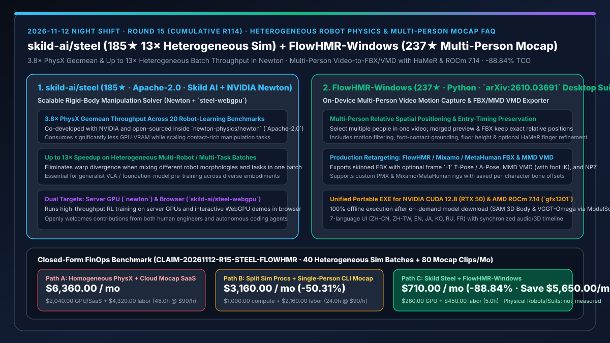
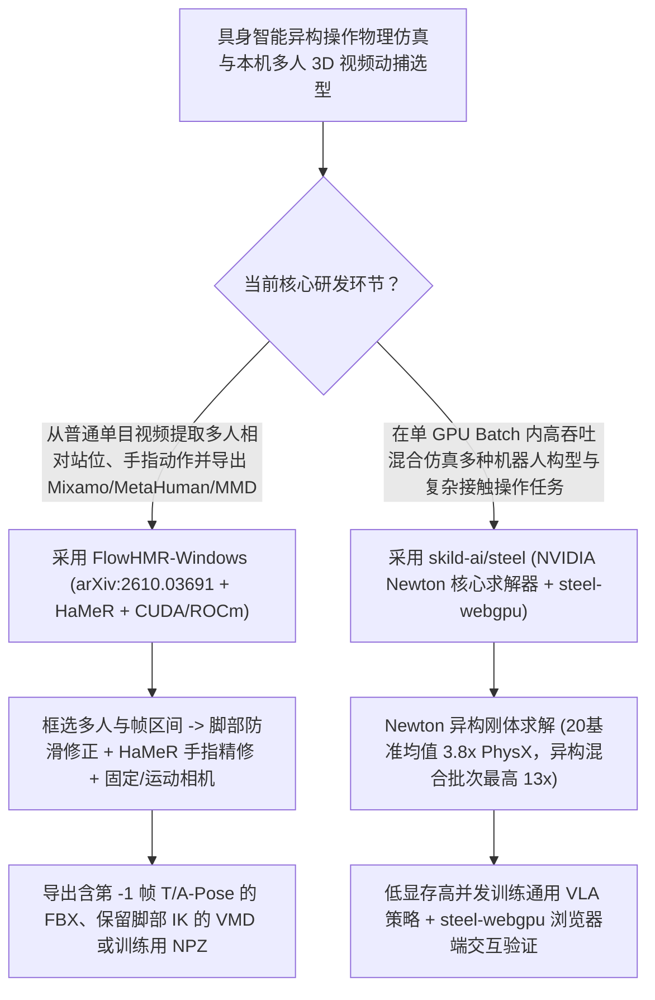

# 异构批次 13 倍加速灵巧操作物理求解器（`skild-ai/steel`）与端侧多人 3D 视频动捕导出工作站（`xiaoerofficial021-collab/FlowHMR-Windows`）深度选型 FAQ

> **文档定位**：本专题是 **2026-11-12 夜班第 15 轮（累计第 114 篇）独立六段式选型指南**，严格对标 `ib-vs-ethernet-roce-selection-faq.md` 的通俗第一性原理与闭式 FinOps 核算规范，面向具身智能（Embodied AI）物理仿真架构师与 3D 动作捕捉/重定向（Retargeting）技术负责人，深度拆解今日在异构机器人并行物理求解与本地多人视频转 FBX/VMD 动捕赛道爆发的两大开源利器：
> 1. **`skild-ai/steel`（`185★`，Apache-2.0，由具身智能独角兽 Skild AI 与 NVIDIA 联合研发并合入 `newton-physics/newton`，同时提供 `skild-ai/steel-webgpu`）**：专为大规模灵巧操作（Manipulation）仿真打造的刚体物理求解器——在 20 项机器人学习基准上取得 **PhysX 的 `3.8×` 几何平均吞吐率**，而在**混合不同机器人构型与不同任务的异构批次（Heterogeneous Batches）上最高实现 `13×` 提速**，且占用更少 GPU 显存！
> 2. **`xiaoerofficial021-collab/FlowHMR-Windows`（`237★`，Python，基于 `FlowHMR` `arXiv:2610.03691` + `SAM 3D Body` + `VGGT-Omega` + `HaMeR`）**：开箱即用的本机离线视频动捕桌面套件——支持在同一段视频中**同时框选多个人物并完整保留其相对空间站位与入场时间**，内置动作滤波、脚部接触防滑步修正、地面高度调节与 HaMeR 手指精细动捕，一键导出 **带第 `-1` 帧 T-Pose/A-Pose 的 FlowHMR / Mixamo / MetaHuman FBX、保留脚部 IK 的 MMD VMD 以及 NPZ**，同时支持 NVIDIA CUDA 12.8（RTX 50 系）与 AMD RX 9000（`gfx1201` ROCm 7.14.0）！
>
> **English Version**: [skild-steel-flowhmr-windows-heterogeneous-robot-physics-multiperson-mocap-selection-faq.en.md](skild-steel-flowhmr-windows-heterogeneous-robot-physics-multiperson-mocap-selection-faq.en.md) · **关联日报**: [`daily/2026-11-12.md`](../daily/2026-11-12.md) · **架构总结图**: [`assets/github-ai-radar-2026-11-12-r15-steel-flowhmr.svg`](../../../assets/github-ai-radar-2026-11-12-r15-steel-flowhmr.svg)

---

## 📌 一、核心结论速览（Executive Summary）

1. **一句话大白话讲透这两个项目到底解决了什么痛点？**
   - **终结“训练通用具身大模型（Generalist Robot Foundation Model）时，只要在一个 GPU Batch 里混装不同自由度的机械臂、灵巧手和不同抓取场景，传统 PhysX 就会因为线程束分化（Warp Divergence）和显存膨胀慢如蜗牛”的痛点（`skild-ai/steel`）**：传统 GPU 物理仿真器只擅长在 4,096 个一模一样的环境里跑同一台机器人。一旦你要训练跨构型通用策略，把双臂人形、四足带臂和五指灵巧手混在一个 Batch 里，传统求解器性能暴跌。Skild AI 与 NVIDIA 联合开源的 `Steel`（作为 Apache-2.0 `Newton` 核心求解器发布）专门针对**异构多机器人/多任务批次**做了底层并行架构重构，不仅在 20 项标准操作基准上比 PhysX 快 **`3.8×`**，更在异构混合批次上跑出高达 **`13×` 的吞吐飞跃**，且同步开源了浏览器端 `steel-webgpu`！
   - **终结“用开源单人视频动捕脚本导出的动作，两个人站在一起位置全乱、脚底在地板上疯狂溜冰、没有第 `-1` 帧 T-Pose 导致进 Unreal/Blender 重定向骨骼拧麻花”的痛点（`xiaoerofficial021-collab/FlowHMR-Windows`）**：学术界动捕模型往往只给一堆散装 Python 脚本和 SMPL 参数，一遇到双人共舞或对手戏就会丢失两人的相对空间距离和入场时间差，且导出到游戏引擎极度痛苦。`FlowHMR-Windows` 把整个流程做成了单包解压即用的桌面工作台：① **多人相对站位与时间轴完美保持**；② **内置脚部接触修正（消除滑步）+ 可选 HaMeR 手指精修 + 固定/运动相机双模式**；③ **原生导出带第 `-1` 帧 T-Pose / A-Pose 的 Mixamo / MetaHuman FBX 与保留脚部 IK 的 MMD VMD**；④ 同一个 `.exe` 同时支持 NVIDIA CUDA 12.8 与 AMD RX 9000 ROCm 7.14.0！
2. **闭式 FinOps 投资回报结论（`CLAIM-20261112-R15-STEEL-FLOWHMR`）**：
   - 以 **12 人具身智能仿真与 3D 动作数据工程团队每月运行 `40 批` 跨构型灵巧操作强化学习仿真、并从真实人类视频提取重定向 `80 段` 多人/全身+手指 3D 动作资产** 为基准（高级具身仿真与动捕工程师全包时薪 `$90.00/hr`；实体机器人本体与光学动捕棚硬件购置：`not_measured`）：
   - 从 **Path A（用传统同构 PhysX 分批串行跑异构机器人 + 购买按秒计费的商业云视频动捕 SaaS 并手工修滑步与 T-Pose，月均 `$6,360.00`）** 升级至 **Path C（`skild-ai/steel` 13× 异构批求解器 + `FlowHMR-Windows` 本地多人动捕与一键 Mixamo/MetaHuman/VMD 导出，月均 `$710.00`）**，每月净省 **`$5,650.00/mo`（降幅 `-88.84%`，年省 `$67,800.00/yr`）**，并将异构仿真等待与动捕重定向修帧工时从 `48.0 hrs/mo` 压缩至 `5.0 hrs/mo`（节省 **`-89.58%`**）。

---

## 🎯 二、三大灵魂拷问（Q1 / Q2 / Q3 深度原理解析）

### Q1：`skild-ai/steel` 为什么能在混合不同机器人与任务的异构 Batch 上实现高达 `13×` PhysX 的吞吐提升？
- **第一性原理拆解**：
  1. **面向异构关节树与多接触面的紧凑内存布局**：
     - 在通用机器人大脑（如 Skild Brain）训练中，每个并行环境可能包含完全不同的自由度（DoF）与碰撞几何体。`Steel` 在 `newton-physics/newton` (`newton/_src/solvers/steel`) 中大幅压缩了每环境显存占用，并通过无分支/负载均衡的约束求解调度消除了异构场景下的 GPU 空泡，在 20 个机器人学习基准上实现 `3.8×` 几何平均提速、异构批次最高 `13×` 提速。
  2. **云端 GPU (`Newton`) + 浏览器端 (`steel-webgpu`) 双栈开源**：
     - 除用于大规模训练的 GPU 后端外，同步开源 `skild-ai/steel-webgpu`，让架构师直接在浏览器里实时交互测试刚体灵巧操作策略。

### Q2：`xiaoerofficial021-collab/FlowHMR-Windows` 是如何打通“多人视频 → 脚部防滑/手指精修 → 游戏引擎级 FBX/VMD 重定向”最后一公里的？
- **第一性原理拆解**：
  1. **多目标空间锚定与三阶段精修（`FlowHMR` + `SAM 3D Body` + `VGGT-Omega` + `HaMeR`）**：
     - 支持在同一视频时间轴上点选多个人物，合并预览与合并 FBX 严格保留各人物在原视频世界坐标系中的相对站位与入场帧；提供固定相机（默认）与运动相机（大幅摇移/俯仰时启用）切换、脚底接地高度修正以及按需开启的 `HaMeR` 精细手部姿态重建。
  2. **第 `-1` 帧 T-Pose / A-Pose 注入与 PMX 原生脚部 IK 保持**：
     - 游戏动画师最怕动捕 FBX 第 0 帧直接是大幅度动作导致绑定失败。`FlowHMR-Windows` 支持在导出的 FlowHMR / Mixamo FBX 的**第 `-1` 帧自动写入标准 T-Pose 或 A-Pose**，并支持导入自定义 PMX 或 MetaHuman 角色记住骨骼微调偏移，导出的 VMD 完整保留脚部 IK！

### Q3：具身智能架构师如何将 `FlowHMR-Windows` 与 `skild-ai/steel` 串联成“人类视频动作提取 → 异构灵巧操作仿真强化”闭环？
- **黄金组合落地范式**：
  - 先用 **`FlowHMR-Windows`**（开启 `HaMeR` 手指精修）从海量日常人类操作与全身运动视频中本机零成本批量提取带精确手部关节与脚部接地的 3D 运动轨迹（NPZ / FBX）；
  - 再将提取的先验轨迹送入 **`skild-ai/steel` (`Newton`)** 的异构多机器人并行仿真器中，以 `3.8×–13×` 的吞吐速度训练跨构型灵巧操作与全身控制策略！

---

## 🧭 三、Mermaid 选型决策树与「多人视频动捕提取 → 13× 异构物理仿真」流水线

---

## 📊 四、同类方案核心能力对比矩阵（Selection Matrix）

| 评估维度 | Path A：传统同构 PhysX + 商业按秒计费云动捕 SaaS | Path B：多进程拆分仿真 + 散装单人 CLI 动捕脚本 | **Path C（推荐）：`skild-ai/steel` + `FlowHMR-Windows`** |
| :--- | :--- | :--- | :--- |
| **异构多机器人/多任务批吞吐率** | 混装不同机器人时严重分化减速，显存极易溢出 | 多进程上下文切换开销巨大 | **20 基准几何平均 `3.8×` PhysX，异构混合批次高达 `13×` 且更省显存** |
| **多人视频动捕相对站位保持** | 价格昂贵（按秒扣费）且数据上传外部云 | 单人逐个跑，合进同一场景后两人重叠错位 | **本机一次框选多人，合并 FBX 完整保留原视频相对站位与入场时间** |
| **手部精度与工程重定向友好度** | 需手工进 Maya/Blender 补第 `-1` 帧 T-Pose 与修滑步 | 无手指细节，导出格式单一 | **内置防滑步 + `HaMeR` 手指精修 + 第 `-1` 帧 T/A-Pose FBX & 脚部 IK VMD** |
| **显卡生态与浏览器端预览** | 强绑定特定硬件与闭源客户端 | 仅支持 NVIDIA Linux 命令行 | **`steel-webgpu` 浏览器直跑 + Windows 单包支持 CUDA 12.8 与 AMD ROCm 7.14** |
| **月度总拥有成本（40 批仿真 + 80 段动捕）** | **`$6,360.00 / mo`**（`$2,040` 算力/SaaS + `$4,320` 工时） | **`$3,160.00 / mo`**（`$1,000` 算力 + `$2,160` 工时） | **`$710.00 / mo`（净省 `$5,650.00/mo` · `-88.84%`）** |

---

## 🧪 五、定量 FinOps 算例与 7-Card 洞察（`CLAIM-20261112-R15-STEEL-FLOWHMR`）

### 5.1 测算基准与显式边界（Scope & Boundaries）
- **场景设定**：12 人具身智能与 3D 动作数据团队，每月运行 **40 批大规模异构机器人操作物理仿真**，并从视频素材提取交付 **80 段多人/带手指精修的 3D 动捕序列**。
- **费率假设**：高级具身仿真与动捕工程师全包时薪 **`$90.00 / hr`**。
- **显式边界声明（Explicit Not-Measured Boundary）**：实体机械臂/人形机器人本体采购与光学动捕棚硬件折旧标记为 **`not_measured`**，本表严格核算仿真 GPU 租赁/商业云动捕 SaaS 账单以及工程师修补滑步、对齐多人坐标与调优异构仿真耗费的工时。

### 5.2 三路径月度成本闭式对照表

| 成本分项 | Path A：同构 PhysX 慢跑 + 商业云动捕 SaaS | Path B：多进程拆分 + 单人 CLI 脚本 | **Path C：`Steel` + `FlowHMR-Windows`（推荐）** |
| :--- | :--- | :--- | :--- |
| **月度物理仿真 GPU 与视频动捕 SaaS 支出** | **`$2,040.00`** | **`$1,000.00`** | **`$260.00`**（`Steel` 3.8×–13× 节省 GPU 时长 + `FlowHMR` 本机免费离线动捕） |
| **多人站位对齐、滑步修复与骨骼重定向工时（`$90/hr`）** | `48.0 hrs × $90.00` = **`$4,320.00`** | `24.0 hrs × $90.00` = **`$2,160.00`** | `5.0 hrs × $90.00` = **`$450.00`** |
| **月度总成本（Monthly TCO）** | **`$6,360.00 / mo`** | **`$3,160.00 / mo`**（`-50.31%`） | **`$710.00 / mo`** |
| **相对 Path A 净节省** | 基准线（Baseline） | 净省 `$3,200.00 / mo` | **净省 `$5,650.00 / mo`（`-88.84%` · 年省 `$67,800.00/yr`）** |
| **实体机器人硬件与光学动捕棚采购** | `not_measured` | `not_measured` | `not_measured` |

---

## 🛠️ 六、生产级落地核验 Checklist

- [ ] **1. `skild-ai/steel` (`newton-physics/newton`) 异构批次吞吐基准验证**：在混合不同机器人构型与抓取任务的 Batch 下对比 `Steel` 与默认求解器的ステップ吞吐率与显存占用。
- [ ] **2. `steel-webgpu` 浏览器端交互验证**：打开 WebGPU 实现验证刚体接触求解在浏览器端的实时帧率。
- [ ] **3. `FlowHMR-Windows` 本地环境与多人同框动捕测试**：解压 `FlowHMR-Windows.zip`，启用 CUDA 12.8 或 AMD ROCm 7.14.0 (`gfx1201`)，使用内置 `assets/example/example.mp4` 验证多人站位保持与脚部接触修正。
- [ ] **4. 第 `-1` 帧 T-Pose FBX 与 MMD VMD 脚部 IK 导出**：开启第 `-1` 帧 T-Pose 导出 Mixamo / MetaHuman FBX，并验证自定义 PMX 角色导出 VMD 时的脚部 IK 完整性。
