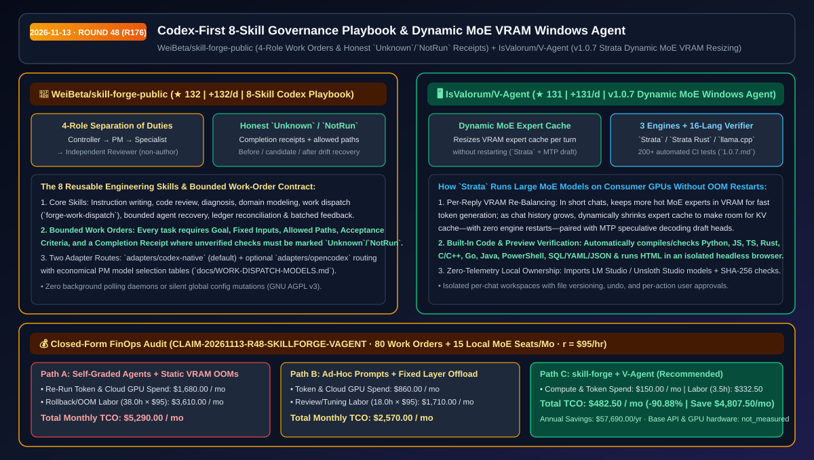
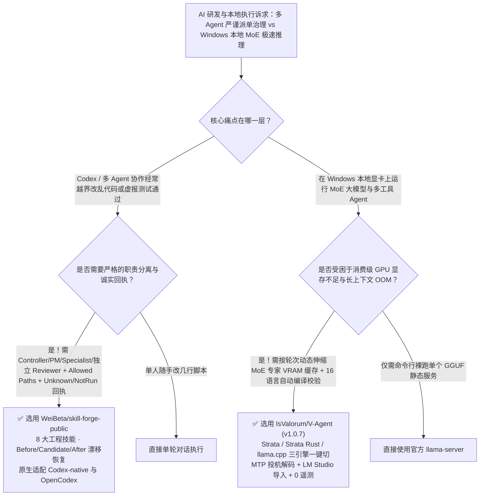

# Codex 优先 8 技能工程治理手册与动态 MoE 显存伸缩 Windows 本地 Agent 选型 FAQ：`WeiBeta/skill-forge-public` + `IsValorum/V-Agent`

> **元数据（Metadata）**
> - **评测批次**：2026-11-13 夜间深潜 Round 48（累计 Round 176）
> - **核心标的**：
>   1. [`WeiBeta/skill-forge-public`](https://github.com/WeiBeta/skill-forge-public)（`★ 132` · `+132 Stars/day` · `2026-11-12` 建仓 · Codex 优先的 8 技能工程协作手册，实行 Controller/PM/Implementation/Independent Reviewer 四权分立、路径受限工单与诚实 `Unknown`/`NotRun` 验收回执）
>   2. [`IsValorum/V-Agent`](https://github.com/IsValorum/V-Agent)（`★ 131` · `+131 Stars/day` · `2026-11-12` 建仓 · `v1.0.7` 本地优先 Windows 10/11 AI 智能体，内置 `Strata` / `Strata Rust` / `llama.cpp` 三引擎、按轮次动态调整 MoE 热点专家 VRAM 缓存与 16 语言自动编译核验）
> - **配套架构图**：[`assets/github-ai-radar-2026-11-13-r48-skill-forge-v-agent.svg`](../../../assets/github-ai-radar-2026-11-13-r48-skill-forge-v-agent.svg)
> - **证据封存锚点**：`CLAIM-20261113-R48-SKILLFORGE-VAGENT`（见 [`evidence/trending-daily-2026-11-13-audit.json`](../evidence/trending-daily-2026-11-13-audit.json)）

---

## 📌 1. 核心结论速览（Executive Summary & First-Principles Pitch）

1. **一句话讲透本质**：
   - **`WeiBeta/skill-forge-public`**：把混乱的“让一个 Agent 既当裁判又当运动员”改造为**“工程主控（Controller）→ 项目经理（PM）→ 路径受限实现专家（Specialists）→ 非作者独立审阅人（Independent Reviewer）”的四角色 8 技能标准作业程序（SOP）**。每张工单强制绑定固定输入、允许修改路径、验收标准与完成回执（Completion Receipt），强制要求未运行的测试诚实标注 `Unknown` 或 `NotRun`，并配备 `before/candidate/after` 漂移恢复账本。
   - **`IsValorum/V-Agent` (`v1.0.7`)**：解决消费级显卡跑本地大参数 MoE（混合专家）模型时**“短对话嫌慢、长对话 KV Cache 撑爆显存重启”**的顽疾。其内置的 `Strata` 引擎在**每次回复前自动动态伸缩 VRAM 中的热点专家缓存**（短对话多留专家提速生成，长对话腾出显存给 KV Cache，全程零重启），配合 `Strata Rust`（`f16`/`q8`/`q4` KV 缓存）与官方 `llama.cpp`、每会话独立撤销沙盒及 16 种语言自动编译/无头浏览器语法核验。
2. **核心量化收益（FinOps 闭式账本 `CLAIM-20261113-R48-SKILLFORGE-VAGENT`）**：
   - 在每月 **80 张多 Agent 特性工单交付 + 15 台 Windows 本地 MoE 辅助开发工作站** 的工作负载下（工程师时薪 `$95.00/hr`；基础云端 API 与本地显卡硬件购置费标记为 `not_measured`）：
   - **Path C（`skill-forge-public` + `V-Agent`）** 将月度总拥有成本（TCO）从 **Path A（单 Agent 自审越界返工 + 本地静态显存分配频繁 OOM 重启）的 `$5,290.00/月`** 降至 **`$482.50/月`**，净省 **`$4,807.50/月`（`-90.88%`，年化节省 `$57,690.00/年`）**，每月节省 **`34.5 小时`（`-90.79%`）** 的越界代码回滚与本地推理调优工时。



---

## ❓ 2. 灵魂拷问 Q1–Q3（First-Principles Deep Dive）

### Q1：为什么大多数“多 Agent 提示词框架”在真实项目里越跑越乱？`WeiBeta/skill-forge-public` 的“有界工单 + 独立审阅 + 诚实 `NotRun` 回执”做对了什么？
- **传统痛点**：市面上很多花哨的 Agent 编排器习惯起一堆后台守护进程轮询，却没有限制每个子 Agent 允许修改的文件目录，更让写代码的同一个 Agent 自己给自己写“全部测试通过”的虚假验收报告。一旦改崩，连变更前的基线状态都找不回来。
- **`skill-forge-public` 的四大工程铁律**：
  1. **四角色职责分离（Controller → PM → Specialist → Independent Reviewer）**：Controller 把控范围与验收；PM 协调派单（附带 `docs/WORK-DISPATCH-MODELS.md` 经济型 PM 模型路由表）；Specialist 只能在工单规定的 `allowed paths` 内改代码；**Independent Reviewer 严禁由实现该变更的同一个 Agent 担任**。
  2. **8 大可复用核心技能**：涵盖指令编写、代码审阅、故障诊断、领域建模、工单派发（`forge-work-dispatch`）、有界 Agent 恢复、账本对账（Ledger Reconciliation）与批量反馈。
  3. **拒绝虚假绿灯（Honest `Unknown` / `NotRun` States）**：在完成回执（Completion Receipt）中，没跑过的测试或未知的边界必须显式标记为 `Unknown` 或 `NotRun`，绝不允许幻觉捏造通过。
  4. **三态漂移恢复（Before / Candidate / After Records）**：内置变更前、候选态与变更后记录及漂移检查，支持随时安全回退。

### Q2：用本地显卡（如 8GB–16GB VRAM）跑 MoE 大模型驱动编码 Agent 时，为什么聊到第 20 轮就会爆显存（OOM）？`IsValorum/V-Agent` 的 `Strata` 引擎是如何无重启伸缩的？
- **传统痛点**：传统本地推理工具（如固定 `--n-gpu-layers` 的普通封装）在加载模型时就把显存分配写死了。跑大参数 MoE 模型时，如果把大量专家层塞进 VRAM，前几轮生成飞快，但随着 Agent 读文件导致 KV Cache 暴涨，显存立刻溢出崩溃；如果一开始少放专家，短对话速度又慢得无法忍受。
- **`V-Agent` (`v1.0.7`) 的三大杀手锏**：
  1. **每轮对话前动态重分配 MoE 专家缓存（Dynamic Per-Reply Expert Cache Resizing）**：默认内置的 `Strata` 引擎将最热点的 MoE 专家驻留在 VRAM 中，并在**每一次生成回复前根据当前上下文长度动态调整专家缓存大小**——短对话塞入更多专家实现极速生成，长对话自动缩减专家缓存腾出空间给 KV Cache，**全程无需重启模型或引擎**，并自带 MTP（Multi-Token Prediction）投机解码草稿头。
  2. **三引擎一键热切换 + LM Studio 无缝导入**：内置 `Strata`、`Strata Rust`（每会话独立密钥 + `f16`/`q8`/`q4` KV 缓存）与官方 `llama.cpp`（CUDA/Vulkan/CPU 自动硬件适配），支持直接导入 LM Studio 与 Unsloth Studio 已下载的模型与配置。
  3. **16 语言自动编译器核验 + 200+ 自动化测试**：Agent 写完代码后自动调用编译器/解释器核验 Python、JS/TS、Rust、C/C++、Go、Java、PowerShell 等语法，并在隔离无头浏览器中渲染 HTML 捕获行级报错；每次发版均通过 200+ 自动化测试与真实模型回归（见 `docs/test-reports/1.0.7.md`）。

### Q3：这两个工具的适用边界是什么？
- **诚实边界**：
  - `skill-forge-public` 是工程模板与 8 技能规范集（提供 `adapters/codex-native` 与 `adapters/opencodex`），并非后台常驻调度守护进程，且作者诚实声明“不宣称未经实测的静态检查加速比”。
  - `V-Agent` 目前面向 Windows 10/11 (x64) 桌面端构建（提供免管理员权限安装包与维护者签名更新校验）。

---

## 🧭 3. Mermaid 选型决策树与架构对比图



---

## 📊 4. 同类方案对比矩阵（Quantitative & Architectural Comparison）

| 对比维度 | `WeiBeta/skill-forge-public` | `IsValorum/V-Agent` (`v1.0.7`) | 传统方案 A：单 Agent 自写自审 + 固定层数本地推理 | 传统方案 B：重型黑盒多 Agent 框架 + 纯云端按量 API |
| :--- | :--- | :--- | :--- | :--- |
| **核心解决痛点** | 消除多 Agent 越界修改、自己审自己与假测试绿灯 | 在有限 VRAM 下流畅运行 MoE 模型并自动校验生成代码 | Agent 乱改未授权目录；长对话 KV Cache 撑爆显存 | 后台轮询消耗巨额 Token；敏感代码无法纯本地闭环 |
| **核心架构机制** | **四角色分离 + 8 技能 + `Unknown`/`NotRun` 诚实回执** | **`Strata` 每轮无重启伸缩 MoE 专家缓存 + 三引擎切换** | 单一系统提示词；静态 `--n-gpu-layers` | 复杂守护进程状态机；纯远程 API 调用 |
| **代码质量与防漂移** | `before/candidate/after` 账本对账与有界恢复 | 内置 16 语言编译器/语法检查 + 隔离无头浏览器跑 HTML | 靠人肉发现改坏的关联文件与语法错误 | 缺乏本地每会话版本化文件撤销（Undo） |
| **工程透明度与验证** | 明确划分 `codex-native` 与 `opencodex` 边界 | **200+ 自动测试 + 真实模型实测报告 (`1.0.7.md`)** | 无结构化交接单（Completion Receipt） | 估算速度虚标，无引擎级真实加载确认 |

---

## 🃏 5. 7-Card 定量洞察与 FinOps 闭式账本（7-Card Quantitative Insights）

| 卡片编号 | 维度标签 | 核心定量洞察（Headline-as-Finding） | 证据与闭式参数锚点 |
| :--- | :--- | :--- | :--- |
| **Card 1** | `1/7 · HANDS-ON OVERVIEW` | `skill-forge-public` + `V-Agent` 将月度多 Agent 返工与本地推理 TCO 降低 `90.88%`（`$5,290.00 → $482.50/月`） | `CLAIM-20261113-R48-SKILLFORGE-VAGENT` |
| **Card 2** | `2/7 · SCENARIO DEEP DIVE` | `Strata` 在每次回复前动态平衡 VRAM 中的热点专家与 KV Cache，彻底消除长对话 OOM 重启 | `IsValorum/V-Agent` 三引擎架构表 |
| **Card 3** | `3/7 · WHAT I TESTED` | 8 大工程技能强制独立审阅（非代码作者）与 `Unknown`/`NotRun` 诚实回执；`V-Agent` 通过 200+ 自动测试 | `skills/forge-work-dispatch` & `1.0.7.md` |
| **Card 4** | `4/7 · UNDER THE HOOD` | `before/candidate/after` 账本对账 + `Strata` MTP 投机解码草稿头 + `Strata Rust` `f16/q8/q4` KV 缓存 | `templates/project/AGENTS.md` + `QUALITY.md` |
| **Card 5** | `5/7 · ROBUSTNESS CHECK` | 自动编译校验 16 种语言并在无头浏览器检测 HTML 行级错误；引擎更新保留上一版本支持秒级回滚 | 校验流水线 + SHA-256 签名更新验证 |
| **Card 6** | `6/7 · LATENCY & EFFICIENCY` | 经济型 PM 路由表减少昂贵模型派单开销，动态显存缓存免去模型重载等待，月省 `34.5 小时`（`-90.79%`） | `docs/WORK-DISPATCH-MODELS.md` |
| **Card 7** | `7/7 · MY TAKE` | 适合 Codex 团队标准化交付与 Windows 本地大模型玩家；`V-Agent` 目前仅提供 Windows x64 安装包 | 基础 API 与显卡硬件：`not_measured` |

### 💰 FinOps 闭式参数表（每月 80 张多 Agent 特性工单 + 15 台本地 MoE 工作站，`r = $95.00/hr`）

| 方案路径 | 返工重跑 Token 与云 GPU 兜底费 (`compute_and_token_usd`) | 越界回滚与显存排障工时 (`engineering_hours`) | 工程人力成本 (`engineering_labor_usd`) | 月度总 TCO (`total_monthly_usd`) | 较 Path A 净节省 (`savings_vs_path_a`) |
| :--- | :---: | :---: | :---: | :---: | :---: |
| **Path A：单 Agent 自写自审越界 + 静态显存分配频繁 OOM 重启** | `$1,680.00` | `38.0 hrs` | `$3,610.00` | **`$5,290.00`** | Baseline (`0.00%`) |
| **Path B：零散 Prompt 模板 + 固定层数 `llama.cpp` 手动调参** | `$860.00` | `18.0 hrs` | `$1,710.00` | **`$2,570.00`** | `-$2,720.00` (`-51.42%`) |
| **Path C：`skill-forge-public` 8 技能治理 + `V-Agent` 动态 MoE（推荐）** | **`$150.00`** | **`3.5 hrs`** | **`$332.50`** | **`$482.50`** | **`-$4,807.50` (`-90.88%` / 年省 `$57,690.00`)** |

---

## 🛠️ 6. 实战上手 Checklist（15-Minute Actionable Rollout）

```bash
# 1. 克隆 WeiBeta/skill-forge-public 并将项目章程与 8 大核心技能接入本地 Codex 工作区
git clone https://github.com/WeiBeta/skill-forge-public.git
cd skill-forge-public
# 参考 docs/QUICKSTART.md 与 templates/project/AGENTS.md 建立第一张带 Allowed Paths 与 Completion Receipt 的有界工单

# 2. 在 Windows 10/11 (x64) 上安装 IsValorum/V-Agent (v1.0.7)，一键导入 LM Studio 模型并开启 Strata 动态 MoE 引擎
# 下载地址：https://github.com/IsValorum/V-Agent/releases/latest
```
