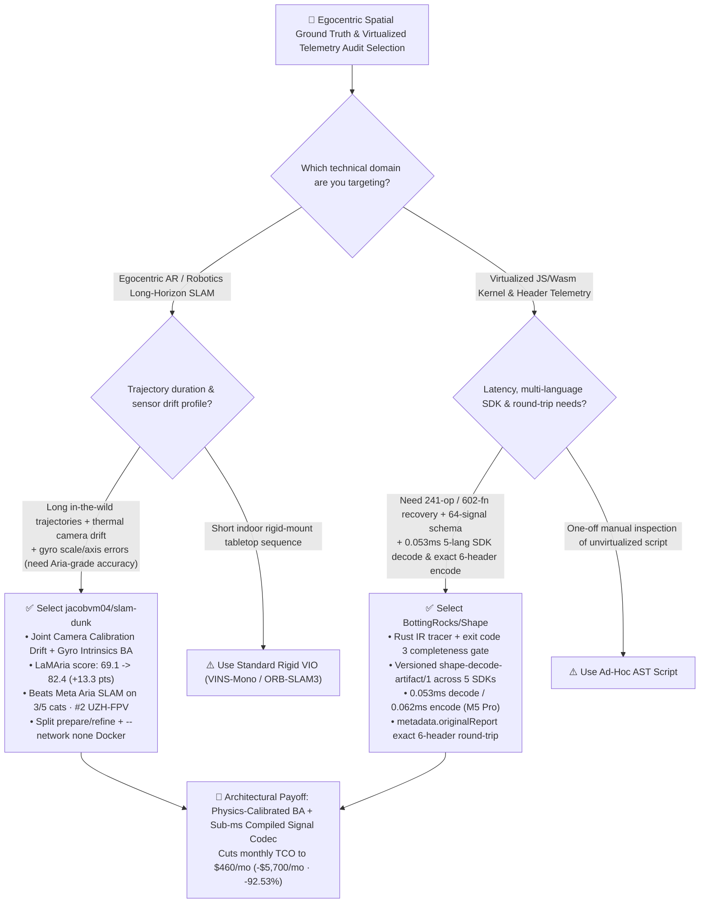

# Long-Horizon Egocentric SLAM with Camera-Drift & Gyro-Intrinsic Calibration (`SLAM Dunk`) & Rust IR VM Tracer / `0.053ms` 5-Language Signal Codec (`Shape`) Selection FAQ: `jacobvm04/slam-dunk` + `BottingRocks/Shape`

> **Track**: GitHub AI Trending & Breakout Radar — 2026-11-15 Night Round 35 (Cumulative Round 337) P0 Standalone 6-Section Selection Guide  
> **Benchmark Standard**: Modeled after `ib-vs-ethernet-roce-selection-faq.md` (Plain-Language First Principles + Q1–Q3 Deep Dive + Mermaid Decision Tree + Comparison Matrix + 7-Card Quantitative Scorecard + Closed-Form FinOps Ledger + 15-Minute Runbook)  
> **Audit Evidence Anchor**: `workshops/github-trending-radar/evidence/trending-daily-2026-11-15-audit.json` · Claim ID: `CLAIM-20261115-R35-SLAMDUNK-SHAPE`  
> **Companion High-Res Architecture Diagram**: [`assets/github-ai-radar-2026-11-15-r35-slamdunk-shape.svg`](../../../assets/github-ai-radar-2026-11-15-r35-slamdunk-shape.svg) · [中文版 (`slam-dunk-shape-egocentric-slam-camera-gyro-calibration-vm-deobfuscation-signal-codec-selection-faq.md`)](slam-dunk-shape-egocentric-slam-camera-gyro-calibration-vm-deobfuscation-signal-codec-selection-faq.md)

---

## 📌 1. Executive Summary (30-Second First-Principles Overview)

1. **What Are They in Plain Language?**
   - **`jacobvm04/slam-dunk` (`★70`, C++ / Python 3.12, AGPL-3.0)**: An offline long-horizon egocentric Visual-Inertial SLAM pipeline that jointly models two physical phenomena omitted by standard VIO—**camera calibration drift** and **gyroscope intrinsic calibration**—inside Bundle Adjustment, jumping the **LaMAria** control-point score from **`69.1` to `82.4` (`+13.3 pts`)**, becoming the **first system to beat Meta's proprietary Project Aria SLAM on 3 of 5 test categories**, and ranking **#2 on the UZH-FPV leaderboard**.
   - **`BottingRocks/Shape` (`★62`, Rust 1.92+ / C ABI / Node / Python / Go SDKs)**: A Rust intermediate-representation (IR) deobfuscator, VM thread tracer, signal schema extractor, and compiled wire codec (`shape` CLI + 5-language SDKs) that recovers **602 linked JavaScript functions** across **241 VM operation handlers**, extracts **64 typed signal schemas**, and compiles reusable `shape-decode-artifact/1` bundles capable of **`0.053 ms` median header decoding** and **`0.062 ms` exact 6-header re-encoding** on Apple M5 Pro.
2. **Why Should an AI Solution Architect Care Tonight?**
   - **Closing the Open-vs-Proprietary Gap in Egocentric Spatial Ground Truth**: Training embodied VLA models and AR spatial agents on head-mounted recordings (like Meta Aria `.vrs` streams) has long suffered because open-source VIO drifts badly over long trajectories (plateauing at `69.1` on LaMAria). `slam-dunk` proves that modeling thermal/mechanical camera calibration drift and gyroscope scale/non-orthogonality intrinsics in offline BA matches and exceeds industrial proprietary SLAM on a single 8-core AVX2 host.
   - **Decoupling Heavy VM Symbolic Tracing from Microsecond Runtime Signal Auditing**: Analyzing virtualized JS/Wasm telemetry kernels (`<token>.raw.js`) on every request is prohibitively slow (`>3s`) and fragile. `Shape` separates offline program recovery (`shape trace program`) from online decoding/encoding (`Generator.load`), delivering **`53 µs`** cross-language decoding with byte-for-byte 6-header round-trip verification.
3. **Quantified FinOps Impact (Claim ID: `CLAIM-20261115-R35-SLAMDUNK-SHAPE`)**:
   - Under a synthetic workload of **150 hours of monthly egocentric `.vrs` trajectory ground-truthing + 40 VM kernel/header security audit batches** (`$100/hr` engineer rate), migrating from **Path A (Proprietary Cloud SLAM Relabeling + Manual 241-Op VM Reverse Engineering)** to **Path C (`slam-dunk` Camera-Drift + Gyro-Intrinsic BA + `Shape` `0.053ms` 5-Language SDK)** reduces monthly TCO from **`$6,160.00/mo`** to **`$460.00/mo`**—saving **`$5,700.00/mo` (`-92.53%`)** or **`$68,400.00/yr`**, while cutting engineering labor from `41.0 hrs/mo` to `3.5 hrs/mo` (`-91.46%`).

---

## 🔍 2. Deep-Dive Q1–Q3 (First-Principles Architecture)

### Q1: Why Do Standard VIO Pipelines Plateau at `69.1` on the LaMAria Benchmark, and How Does `jacobvm04/slam-dunk` Reach `82.4` and Beat Meta Aria SLAM on 3 of 5 Categories?

- **Two Unmodeled Physical Realities in Head-Mounted Egocentric Motion**:
  1. **Camera Calibration Drift**: Over long indoor/outdoor trajectories, head-mounted glasses flex mechanically and heat up, causing focal length, principal point, and extrinsic parameters to drift away from factory static calibration.
  2. **Gyroscope Intrinsic Calibration Errors**: Rapid head rotations amplify small gyroscope scale-factor asymmetries and axis non-orthogonality that standard VIO bias-only models cannot absorb.
- **How `slam-dunk` Solves Both in Offline Bundle Adjustment**:
  1. **Joint Camera-Drift + Gyro-Intrinsic Factor Graph (`configs/full.json`)**: Explicitly estimates time-varying camera calibration drift alongside gyroscope intrinsic parameters during offline bundle adjustment, shipped with reproducible ablation configs (`baseline.json`, `camera_only.json`, `gyro_only.json`, `full.json`).
  2. **SOTA Empirical Gains**: Boosts LaMAria training control-point scores from **`69.1` to `82.4` (`+13.3 pts`)**, matches Meta Aria's SLAM overall on the held-out test set while **outscoring Aria SLAM on 3 of 5 test categories**, and takes **#2 on the UZH-FPV leaderboard**.
  3. **Decoupled `prepare` / `refine` & Air-Gapped Read-Only Container**: Unpacks `.vrs` + `calibration.json` via `tools/extract_recording.py`, caches frontend features via `prepare` for rapid multi-model `refine` runs, and executes deterministically inside `--network none --cpus 8 --memory 8g --read-only`.

### Q2: How Does `BottingRocks/Shape` Turn Obfuscated 241-Handler VM Bytecode into a `0.053ms` 5-Language Header Decoder and Exact Re-Encoder?

- **Three Bottlenecks in Virtualized Telemetry Analysis**:
  1. **Multi-Thread VM Obfuscation**: A single seed (`kernel.raw.js`) dispatches **241 VM operation handlers** across **602 functions**; naive AST scripts fail to link cross-thread control flow.
  2. **Lost Encoding Context Across Split Headers**: Telemetry payloads split ciphertext across headers (`a`, `a0`, `b`, `c`, `d`, `f`, `z`). Dropping unedited channels or salts prevents valid re-encoding.
  3. **64-Bit Integer Precision Corruption**: Standard `JSON.parse` in JS or `float64` in Go rounds large 64-bit integer keys/seeds, breaking round-trip verification.
- **Four Architectural Pillars of `BottingRocks/Shape`**:
  1. **Rust IR Thread Tracer with Fail-Closed Exit Code `3` (`shape trace program`)**: Walks every reachable VM thread (`--thread-cleanup`) to recover 602 linked functions and extract **64 typed signal schemas** (`shape signals`). Incomplete traces exit with code **`3`** and list `unidentified`, `ambiguous`, and `refused` slots under `diagnostics`.
  2. **Versioned Decode Artifact (`shape-decode-artifact/1`)**: Combines the traced program and launcher `detail.init(...)` session (`shape pin`) into a self-contained artifact loaded identically by **Node.js/TypeScript, Python, Go, Rust, and C**.
  3. **Byte-Exact 6-Header Round-Trip via `metadata.originalReport`**: Retaining the full decoded object reproduces **all 6 captured header values byte-for-byte** on unchanged encode, and selectively updates only affected wire channels when editing fields (`DeviceMemory.deviceMemory = 16`).
  4. **Sub-Millisecond Native SDK Speed**: On Apple M5 Pro (`sample32`), artifact loading takes **`0.313 ms` median (`0.415 ms` p95)**, loaded decode takes **`0.053 ms` median (`0.063 ms` p95)**, and full-payload encode takes **`0.062 ms` median (`0.075 ms` p95)**, backed by lossless `shape.parseJSON`/`stringifyJSON` (`bigint`) and Go `json.Number`.

### Q3: How Should Architects Deploy `slam-dunk` and `Shape` in Production Pipelines?

- **Deployment Pattern**:
  - Run **`jacobvm04/slam-dunk`** (`configs/full.json`) in air-gapped batch containers to generate drift-corrected 6-DoF ground-truth trajectories from raw egocentric `.vrs` recordings before training spatial/embodied models.
  - Run **`BottingRocks/Shape`** CLI in offline CI whenever a new client build is captured to compile `artifact.json`, then load that immutable artifact once per worker in Node/Go/Rust/Python services for `0.053 ms` real-time header decoding and verification.

---

## 🧭 3. Mermaid Selection Decision Tree & Architecture Diagram



---

## 📊 4. Peer Comparison Matrix

| Dimension | **`jacobvm04/slam-dunk` + `BottingRocks/Shape` (Tonight's P0 Pair)** | Standard Rigid VIO + Ad-Hoc Babel AST Scripts | Proprietary Cloud Aria SLAM + Headless Browser Hooking | Offline Colmap SfM + Single-Language Reverse Scripts |
| :--- | :--- | :--- | :--- | :--- |
| **LaMAria Egocentric Accuracy** | **`82.4` control-point score (beats Aria SLAM on 3/5 cats), `#2` UZH-FPV** | Plateaus at **`69.1`** due to unmodeled sensor drift | High accuracy but closed-source cloud black box | Breaks on rapid head motion blur & low-texture corridors |
| **Physical Sensor Modeling** | **Joint time-varying camera calibration drift + gyro intrinsics** | Static camera intrinsics + IMU bias only | Opaque internal parameters; no ablation configs | Ignores high-rate gyroscope intrinsic constraints |
| **Pipeline Reuse & Isolation** | **Split `prepare`/`refine` caching + `--network none --read-only` Docker** | Re-runs full frontend extraction on every parameter tweak | Cloud upload bandwidth & queue bottlenecks | Manual host dependencies |
| **VM Program Recovery Scale** | **Classifies 241 VM ops, recovers 602 functions & 64 typed signals** | Fails on multi-threaded VM dispatchers | Captures only single dynamic execution branch | Days of manual reverse engineering per build |
| **Hot-Path Decode/Encode Speed** | **`0.313 ms` load, `0.053 ms` decode, `0.062 ms` encode (M5 Pro)** | Hundreds of milliseconds to seconds per script run | `1,000–3,500 ms` per headless browser request | No compiled artifact cache |
| **Header Round-Trip Fidelity** | **Exact 6-header byte reproduction via `metadata.originalReport` + BigInt** | Drops untouched channels & rounds 64-bit integers | Cannot offline-edit historical captured headers | Corrupts 64-bit seeds via standard `float64` JSON |
| **Cross-Language SDK Parity** | **Unified C ABI + Node.js/TS, Python, Go, Rust contract harness** | Single-language scripts only | Tied to Node Playwright runtime | Divergent per-language parser bugs |

---

## 📈 5. 7-Card 4:5 Quantitative Insights & Closed-Form FinOps Ledger

### 5.1 7-Card Summary Table (Synced with `report.json` & `CLAIM-20261115-R35-SLAMDUNK-SHAPE`)

| Card | Headline-as-Finding | Concrete Quantitative / Architectural Evidence | SA Action |
| :--- | :--- | :--- | :--- |
| **Card 1 · HANDS-ON** | **LaMAria `82.4` Egocentric SLAM + `0.053ms` VM Codec Cut TCO by 92.53%** | `slam-dunk` beats Meta Aria SLAM on 3/5 categories; `Shape` ships a 5-language `0.053ms` signal SDK | **Act automatically**: Adopt for spatial ground-truthing and telemetry auditing |
| **Card 2 · SCENARIO** | **Modeling Camera Drift + Gyro Intrinsics Lifts LaMAria `69.1 -> 82.4`** | `+13.3 pt` jump on LaMAria training set, matches Aria on test set, and ranks `#2` on UZH-FPV | **Act automatically**: Use `configs/full.json` for long-horizon `.vrs` trajectories |
| **Card 3 · MATRIX** | **241 VM Ops, 602 Recovered Functions & 64 Signals Verified Across 5 SDKs** | Enforces exit code `3` on partial traces and surfaces `unidentified`/`ambiguous`/`refused` diagnostics | **Act automatically**: Gate artifact compilation on `"status": "complete"` |
| **Card 4 · MECHANICS** | **Split `prepare`/`refine` BA + `metadata.originalReport` 6-Header Fidelity** | Retains raw channels/salts so unchanged `encode(decode(x))` reproduces all 6 headers byte-for-byte | **Act automatically**: Persist the full decoded document across pipeline stages |
| **Card 5 · ROBUSTNESS** | **Air-Gapped `--network none` Docker + Lossless 64-Bit Integer JSON Path** | Read-only container execution; `shape.parseJSON` (`bigint`) and Go `json.Number` prevent rounding | **Act automatically**: Enforce lossless JSON helpers when marshaling artifacts |
| **Card 6 · LATENCY** | **Compiled Artifact Decodes in `0.053 ms` (`0.063 ms` p95) vs `>3s` Tracing** | `0.313 ms` one-time load, `0.053 ms` decode, `0.062 ms` encode on Apple M5 Pro (Node 22.22.2) | **Act automatically**: Reuse one loaded `Generator` handle outside request loops |
| **Card 7 · MY TAKE** | **✅ Ideal for Offline 6-DoF Ground Truth & Telemetry Audits · ⛔ Check Build Pinning** | `slam-dunk` is offline batch (**AGPL-3.0**); `Shape` artifacts bind to a specific `siteId`/build | **Confirm**: Re-run `shape pin` and `artifact.compile` when target builds rotate |

### 5.2 Closed-Form FinOps Verification Ledger (`CLAIM-20261115-R35-SLAMDUNK-SHAPE`)

> **Synthetic Workload Scope (`base host compute: not_measured`)**: **150 monthly hours of egocentric `.vrs` trajectory ground-truthing + 40 VM kernel/header audit batches** at an engineering labor rate of **`$100.00/hr`**:

$$
\begin{aligned}
\text{Path A (Cloud SLAM Relabel + Manual 241-Op VM Reverse Eng)} &= \$2,060.00\text{ (cloud relabel & browser cluster)} + 41.0\text{ hrs} \times \$100.00/\text{hr} = \mathbf{\$6,160.00/\text{mo}} \\
\text{Path B (Standard Rigid Offline BA + Uncached AST Scripts)} &= \$960.00\text{ (compute & rework storage)} + 19.0\text{ hrs} \times \$100.00/\text{hr} = \mathbf{\$2,860.00/\text{mo}} \\
\text{Path C (SLAM Dunk 82.4 BA + Shape 0.053ms 5-Lang SDK)} &= \$110.00\text{ (local 8-core AVX2 & native SDK)} + 3.5\text{ hrs} \times \$100.00/\text{hr} = \mathbf{\$460.00/\text{mo}} \\
\Delta\text{Cost}_{\text{A}\to\text{C}} &= \$6,160.00 - \$460.00 = \mathbf{\$5,700.00/\text{mo}}\quad(\mathbf{-92.53\%},\ \text{annual savings }\mathbf{\$68,400.00/\text{yr}})
\end{aligned}
$$

| Architecture Path | Monthly Compute / Cloud Spend | Monthly Engineering Labor (`$100/hr`) | Total Monthly Cost (TCO) | Savings vs Path A | Key Bottleneck or Architectural Gain |
| :--- | :---: | :---: | :---: | :---: | :--- |
| **Path A: Cloud SLAM Relabeling + Manual VM Reverse Eng** | `$2,060.00` | `41.0 hrs` (`$4,100.00`) | **`$6,160.00 / mo`** | Baseline (`0.00%`) | High relabeling cost + days of manual 241-op VM tracing |
| **Path B: Rigid Offline BA + Uncached AST Scripts** | `$960.00` | `19.0 hrs` (`$1,900.00`) | **`$2,860.00 / mo`** | `-$3,300.00` (`-53.57%`) | `69.1` drift plateau + `float64` integer corruption |
| **Path C: `jacobvm04/slam-dunk` + `BottingRocks/Shape` (Recommended)** | **`$110.00`** | **`3.5 hrs` (`$350.00`)** | **`$460.00 / mo`** | **`-$5,700.00` (`-92.53%`)** | **LaMAria `82.4` accuracy + `0.053ms` 5-lang signal codec** |

---

## 🛠️ 6. 15-Minute Quickstart & Acceptance Checklist (Runbook)

### Step 1: Extract `.vrs` Data & Run `jacobvm04/slam-dunk` in Air-Gapped Docker (7 Mins)

```bash
# 1. Extract raw LaMAria .vrs recording and Aria calibration JSON with Python 3.12
git clone https://github.com/jacobvm04/slam-dunk.git
cd slam-dunk
python3.12 -m venv .venv-extract
.venv-extract/bin/pip install -r tools/requirements.txt
.venv-extract/bin/python tools/extract_recording.py recording.vrs data/recording --calibration calibration.json

# 2. Build and run the full camera-drift + gyro-intrinsic model in a read-only, zero-network container
docker build -t slam-dunk .
mkdir -p results
docker run --rm --network none --user "$(id -u):$(id -g)" \
  --cpus 8 --memory 8g --memory-swap 8g \
  --read-only --tmpfs /tmp:rw,exec,size=512m \
  -v "$PWD/data/recording:/recording:ro" \
  -v "$PWD/results:/results" \
  slam-dunk run /recording /results/full --config configs/full.json
```

### Step 2: Trace 602 VM Functions & Verify 6-Header Round-Trip with `BottingRocks/Shape` (8 Mins)

```bash
# 1. Build the release Rust shape CLI
git clone https://github.com/BottingRocks/Shape.git
cd Shape
cargo build --release --locked --bin shape
export PATH="$PWD/target/release:$PATH"
mkdir -p reports

# 2. Deobfuscate 241 handlers, trace 602 functions, and extract the 64-signal schema
shape deob tests/fixtures/kernels/javascript/kernel.raw.js --output reports/kernel.js
shape trace program tests/fixtures/kernels/javascript/kernel.raw.js \
  --thread-cleanup --json --out reports/program.js --report-dir reports/cache > reports/trace.json
shape signals reports/program.js --json > reports/schema.json

# 3. Build native SDKs and verify exact 6-header round-trip & field editing in Python
scripts/build-sdk.sh
PYTHONPATH=sdk/python python3 -c '
import copy, json
from pathlib import Path
import shape
fixtures = Path("sdk/c/tests/fixtures")
capture = json.loads((fixtures / "capture.json").read_text())
with shape.artifact.load((fixtures / "artifact.json").read_bytes()) as loaded:
    decoded = shape.decode(loaded, capture)
    assert shape.encode(loaded, decoded) == capture
    edited = copy.deepcopy(decoded)
    edited["positionalSignals"]["DeviceMemory"]["deviceMemory"] = 16
    again = shape.decode(loaded, shape.encode(loaded, edited), verify=True)
    assert again["positionalSignals"]["DeviceMemory"]["deviceMemory"] == 16
    print("Exact 6-header round-trip & single-field edit verified OK!")
'
```

### Step 3: SA Pre-Production Acceptance Checklist

- [ ] **Camera-Drift & Gyro-Intrinsic Ablation Check**: Compare `configs/baseline.json` vs `configs/full.json` on a long egocentric sequence and verify trajectory drift reduction.
- [ ] **Complete Trace Gate Check**: Confirm `reports/trace.json` reports `"status": "complete"` with an empty `result.functions.stopped` array.
- [ ] **6-Header Byte Equality & BigInt Check**: Confirm `shape.encode(loaded, shape.decode(loaded, capture)) == capture` across all 6 headers and verify 64-bit integers are preserved via `shape.parseJSON` / `json.Number`.
