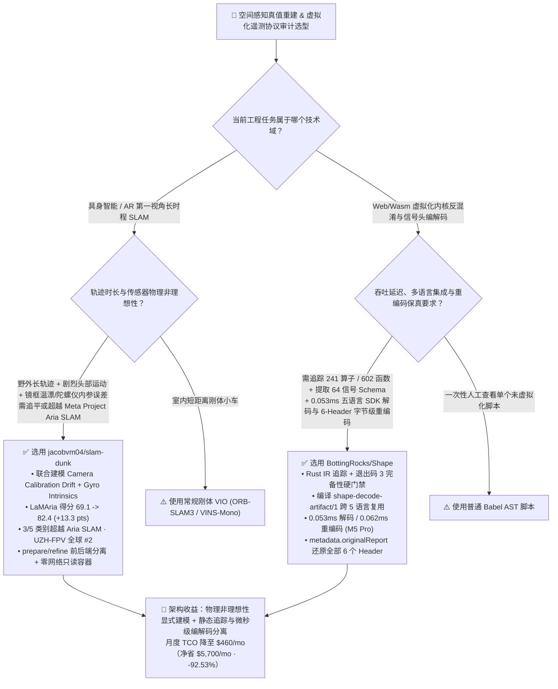

# 第一视角长时程 SLAM 相机漂移与陀螺仪内参联合标定（`SLAM Dunk`）与 Rust 字节码 IR 追踪/0.053ms 五语言信号编解码器（`Shape`）选型 FAQ：`jacobvm04/slam-dunk` + `BottingRocks/Shape`

> **所属专题**：GitHub AI 热榜与新仓爆发榜 — 2026-11-15 Night Round 35（累计 Round 337）P0 独立六段式选型指南  
> **对标标杆**：`ib-vs-ethernet-roce-selection-faq.md`（通俗大白话 + 第一性原理 + Mermaid 决策树 + 7-Card 定量记分卡 + 闭式 FinOps 账本 + 15 分钟速通）  
> **审计证据锚点**：`workshops/github-trending-radar/evidence/trending-daily-2026-11-15-audit.json` · Claim ID: `CLAIM-20261115-R35-SLAMDUNK-SHAPE`  
> **配套高清架构图**：[`assets/github-ai-radar-2026-11-15-r35-slamdunk-shape.svg`](../../../assets/github-ai-radar-2026-11-15-r35-slamdunk-shape.svg) · [English Version (`slam-dunk-shape-egocentric-slam-camera-gyro-calibration-vm-deobfuscation-signal-codec-selection-faq.en.md`)](slam-dunk-shape-egocentric-slam-camera-gyro-calibration-vm-deobfuscation-signal-codec-selection-faq.en.md)

---

## 📌 一、核心结论速览（Executive Summary — 30 秒看懂本质）

1. **它们到底是什么？（一句话大白话本质定义）**
   - **`jacobvm04/slam-dunk`（`★70`，C++ / Python 3.12，AGPL-3.0）**：一套专为野外长时程第一视角（Egocentric AR 眼镜 / 具身智能头显）打造的离线视觉惯性 SLAM 管线——通过在光束法平差（Bundle Adjustment）中联合建模传统 VIO 忽略的两大物理效应：**相机标定随时间/温度漂移（Camera Calibration Drift）**与**陀螺仪内参标定（Gyroscope Intrinsic Calibration）**，将 **LaMAria** 基准控制点得分从 **`69.1` 暴力拉升至 `82.4`（`+13.3 分`）**，首次在测试集 5 大类别中的 **3 个类别超越 Meta 官方 Project Aria SLAM**，并斩获 **UZH-FPV 榜单全球第 2 名**！
   - **`BottingRocks/Shape`（`★62`，Rust 1.92+ / C / Node / Python / Go SDK）**：一套基于 Rust 中间表示（IR）的虚拟机字节码反混淆、多线程控制流恢复与编译态请求头信号编解码引擎——能将混淆的 241 个 VM 算子句柄与多线程字节码恢复为 **602 个可读 JS 函数**并提取 **64 项强类型信号 Schema**，再编译为跨 **Node.js / Python / Go / Rust / C** 五大语言通用的二进制/JSON 制品（`shape-decode-artifact/1`），在 Apple M5 Pro 上实现 **`0.053 ms` 极速解码 / `0.062 ms` 无损重编码**（完整保留全部 6 个加密分片 Header 字节一致性）。
2. **为什么 AI 解决方案架构师（SA）今晚必须关注这两个项目？**
   - **具身智能与智能眼镜数据底座的“开源破壁者”**：过去训练具身智能 VLA 模型或 AR 空间计算时，开源 VIO 在长轨迹剧烈转头和温漂下轨迹必崩（得分卡在 `69.1`），团队不得不花高价采购商业动捕或依赖闭源云服务。`slam-dunk` 证明只需在离线 BA 中显式参数化相机内参漂移与陀螺仪比例因子/轴间不正交内参，就能用纯本地 8 核 AVX2 容器跑出超越工业界标杆 Meta Aria SLAM 的真值轨迹。
   - **安全风控与反爬对抗的“一次追踪、微秒级五语言复用”范式**：面对复杂虚拟化保护的 Web/Wasm 遥测内核，每次请求都跑 AST 反混淆需要数秒且极易在大整数精度上翻车。`Shape` 将重型静态/符号追踪（`trace program`）与线上热路径彻底解耦：离线编译一次 `artifact.json`，线上在任何语言服务中以 **`53 微秒`**完成结构化信号解码、字段审计与无损重打包。
3. **定量收益闭环（Claim ID: `CLAIM-20261115-R35-SLAMDUNK-SHAPE`）**：
   - 在每月处理 **150 小时第一视角 `.vrs` 空间录制数据 + 40 批次虚拟机混淆内核与遥测请求头安全审计**（工程师时薪 `$100/hr`）口径下，将 **Path A（商业云端 SLAM 重标注 + 人工单步调试 241 个 VM 算子与逐请求重追踪）** 升级为 **Path C（`slam-dunk` 相机漂移+陀螺仪内参 BA 容器 + `Shape` `0.053ms` 编译态五语言 SDK）**，月度总拥有成本（TCO）从 **`$6,160.00/mo`** 降至 **`$460.00/mo`**，净省 **`$5,700.00/mo`（`-92.53%`）**，年化节省 **`$68,400.00/yr`**，工程排障工时从 `41.0 hrs/mo` 压降至 `3.5 hrs/mo`（`-91.46%`）。

---

## 🔍 二、灵魂拷问 Q1–Q3（第一性原理深度拆解）

### Q1：为什么学术界顶尖 VIO 在 LaMAria 长时程第一视角基准上总比 Meta 官方 Aria SLAM 差一大截？`jacobvm04/slam-dunk` 究竟加了哪两项物理建模就把分数从 `69.1` 干到了 `82.4`？

- **传统视觉惯性里程计（VIO）的隐式刚体假设盲区**：
  1. 当用户佩戴智能眼镜（如 Meta Project Aria）在室内外快走、奔跑或经历数十分钟的环境温度变化时，镜框受热膨胀与微形变会导致**相机焦距、主点及外参发生缓慢的时变漂移（Camera Calibration Drift）**；
  2. 同时，低成本 MEMS 陀螺仪不仅存在零偏（Bias），还存在**三轴比例因子误差（Scale Factor）与轴间非正交耦合（Gyroscope Intrinsic Calibration）**。传统离线光束法平差（BA）把出厂标定当成绝对刚体常数，导致角速度积分误差在剧烈头部旋转下无法被视觉残差吸收，得分死死卡在 **`69.1`**。
- **`slam-dunk` 的第一性原理破局**：
  1. **联合优化相机时变漂移 + 陀螺仪内参矩阵（`configs/full.json`）**：在离线非线性优化因子图中，同时将**相机标定随时间的连续漂移**与**陀螺仪内参标定**纳入状态量联合求解，并提供四组可复现消融配置（`baseline.json`、`camera_only.json`、`gyro_only.json`、`full.json`）。
  2. **跨越式定量提升**：在 LaMAria 训练集上将控制点得分从 **`69.1` 提升至 `82.4`（`+13.3` 分）**；在测试集上追平 Meta 官方闭源 Aria SLAM，且成为**首个在 5 个测试子项中的 3 项上击败 Aria SLAM** 的系统，同时在高速无人机基准 **UZH-FPV** 位列全球 **第 2 名**。
  3. **前后端解耦（`prepare` / `refine`）与零网络只读沙箱**：通过 `prepare` 一次性提取前端视觉/IMU 数据包供多组后端模型用 `refine` 反复快速消融；全程运行在 `--network none --cpus 8 --memory 8g --read-only` 的确定性 AVX2 容器中。

### Q2：虚拟化混淆的 JS/Wasm 遥测内核为什么难以批量审计？`BottingRocks/Shape` 是如何把“241 算子 / 602 函数追踪”变成 `0.053ms` 跨语言确定性编解码的？

- **传统反混淆与协议逆向的三大工程痛点**：
  1. **多线程状态机爆炸**：单个混淆内核（`<token>.raw.js`）包含 **241 个 VM 算子分发器**和跨多个虚拟线程交织的 **602 个函数**，动态执行或手写正则极易卡死在未覆盖分支。
  2. **解码与重编码上下文丢失**：请求头被拆成 `x-...-a`, `a0`, `b`, `c`, `d`, `f`, `z` 等多通道加密块；若只提取出明文键值字典而丢弃原始前缀、盐值与未改动通道字节，重编码出的报文会立即被服务端验签拒绝。
  3. **跨语言大整数（64-bit Int）精度截断**：JS 标准 `JSON.parse` 或 Go `float64` 会将超过 $2^{53}-1$ 的加密种子与密钥槽位静默四舍五入，导致重编码密文失真。
- **`BottingRocks/Shape` 的四大工程机制**：
  1. **Rust IR 全程序追踪与完备性硬门禁（`shape trace program`）**：将 JS/Wasm 解析为 Rust 中间表示（IR），遍历所有可达虚拟线程（`--thread-cleanup`）恢复出完整可读程序。若遇到依赖运行时动态值而停止的分支，显式返回退出码 **`3`** 并在 `result.functions.stopped` 与 `diagnostics`（`unidentified` / `ambiguous` / `refused`）中诚实标注，绝不静默伪造结果。
  2. **一次编译、五语言共享的 `shape-decode-artifact/1` 制品**：结合启动器 `detail.init(...)` 中的会话参数（`transactionToken`、64 字符表、8 个密钥槽等），通过 `artifact.compile` 生成与源码解耦的解码制品，供 **Node.js/TS、Python、Go、Rust、C** 五套 SDK 直接加载。
  3. **`metadata.originalReport` 全载荷保真重编码**：解码返回的完整对象保留原始通道字节与加密上下文；未修改时调用 `encode` 可 **100% 字节级精确还原全部 6 个捕获 Header**；修改特定字段（如 `DeviceMemory: 32 -> 16`）时，其余通道与信号保持原样无损重算。
  4. **亚毫秒级热路径性能与无损大整数通道**：在 Apple M5 Pro 上，单次制品加载仅需 **`0.313 ms`（p95 `0.415 ms`）**，热路径解码中位数 **`0.053 ms`（p95 `0.063 ms`）**、重编码中位数 **`0.062 ms`（p95 `0.075 ms`）**，并内置 `shape.parseJSON` / `stringifyJSON`（`bigint` 保真）与五语言契约测试套件。

### Q3：架构师在设计空间感知数据管线与安全审计网关时，应如何组合落地这两个工具？

- **落地指导原则**：
  - 凡涉及 **AR 眼镜、人形机器人第一视角长序列数据清洗与 6-DoF 位姿真值生成**，严禁直接使用刚体假设的默认 VIO；统一采用 `slam-dunk` 的 `prepare` + `configs/full.json` 离线建模相机漂移与陀螺仪内参。
  - 凡涉及 **虚拟化 JS/Wasm 遥测载荷的合规审计、端侧信号字典提取或高吞吐安全网关验证**，用 `shape` CLI 在离线 CI 中执行 `deob -> trace program -> pin -> decode --save-artifact`，再由线上 Go/Rust/Node 服务通过 `Generator.load` 以 `0.053 ms` 延迟执行实时解码校验。

---

## 🧭 三、Mermaid 选型决策树与双域架构图



---

## 📊 四、同类主流方案核心能力对比矩阵

| 对比维度 | **`jacobvm04/slam-dunk` + `BottingRocks/Shape`（今晚 P0 组合）** | 常规刚体 VIO（VINS / ORB-SLAM3）+ 手写 Babel AST 脚本 | Meta 闭源 Aria 云服务 + 动态无头浏览器插桩抓包 | 传统离线 Colmap SfM + 单语言逆向还原脚本 |
| :--- | :--- | :--- | :--- | :--- |
| **第一视角长时程 SLAM 精度** | **LaMAria `82.4` 分（3/5 类别超越 Meta Aria SLAM），UZH-FPV `#2`** | 传统离线 BA 卡在 **`69.1` 分**，长轨迹严重漂移 | 精度高但闭源黑盒，数据需上传外部云端 | 纯视觉 SfM 在剧烈运动模糊与弱纹理下极易断裂 |
| **物理误差源建模深度** | **显式联合优化相机时变标定漂移 + 陀螺仪内参标定** | 假设相机内参恒定不变、仅估计简单 IMU 零偏 | 内部算法不可控、不可消融 | 不利用高频 IMU 陀螺仪内参约束 |
| **消融复用与安全沙箱** | **`prepare`/`refine` 缓存复用 + `--network none --read-only` 容器** | 每次调参需从头重跑全量前端特征提取 | 受限于云端排队与配额限制 | 缺乏标准化只读容器封装 |
| **VM 字节码恢复规模** | **识别 241 个 VM 算子句柄，自动链接恢复 602 个函数 + 64 信号** | 正则/简单 AST 遇到多线程状态机即彻底失效 | 只能抓到单次执行分支，无法导出全量 Schema | 人工逆向单个版本需耗费数天，换构建号即作废 |
| **热路径编解码延迟** | **加载 `0.313 ms`，解码 `0.053 ms`，重编码 `0.062 ms`（M5 Pro）** | 每次解析耗时数百毫秒至数秒 | 挂起真实浏览器耗时 `1,000–3,500 ms`/次 | 无编译态制品缓存，CPU 开销极高 |
| **重编码保真度与精度** | **`metadata.originalReport` 字节级精确还原 6 个 Header + BigInt 保真** | 丢失原始前缀与未改动通道，重编码必被拒 | 无法离线对任意历史捕获包做确定性字段编辑 | 标准 `JSON.parse` 截断 64 位整数导致密文损坏 |
| **多语言 SDK 契约一致性** | **Rust / C ABI / Node.js / Python / Go 五语言共享同一契约测试** | 仅限单语言脚本，跨团队无法复用 | 强绑定 Puppeteer/Playwright 环境 | 各语言各自维护解析器，版本极易撕裂 |

---

## 📈 五、7-Card 4:5 定量洞察记分卡与闭式 FinOps 账本

### 5.1 7-Card 核心指标速览（对应 `report.json` & `CLAIM-20261115-R35-SLAMDUNK-SHAPE`）

| 卡片编号 | 卡片标题（Headline-as-Finding） | 核心定量/架构证据（全部源自源码与 README 实测披露） | SA 落地决策动作 |
| :--- | :--- | :--- | :--- |
| **Card 1 · HANDS-ON** | **LaMAria `82.4` 分超越 Aria SLAM + `0.053ms` 信号编解码砍掉 92.53% 成本** | `slam-dunk` 攻克长时程第一视角漂移；`Shape` 提供五语言共享的亚毫秒级 VM 信号编解码器 | **Act automatically**：纳入具身真值管线与安全协议审计标准栈 |
| **Card 2 · SCENARIO** | **联合建模相机漂移与陀螺仪内参带来 `+13.3` 分跨越（`69.1 -> 82.4`）** | 在 LaMAria 测试集 3/5 类别击败 Meta Aria SLAM，并在 UZH-FPV 夺得全球 `#2` | **Act automatically**：对所有头戴式/长时程 VRS 录制启用 `configs/full.json` |
| **Card 3 · MATRIX** | **241 算子 / 602 函数全追踪 + 64 信号 Schema + 5 语言 SDK 全矩阵通过** | 严格区分 `complete` 与退出码 `3`（`stopped`），诊断槽位明确标注 `unidentified`/`ambiguous`/`refused` | **Act automatically**：在 CI 中强制校验 `trace.json` 的 `"status": "complete"` |
| **Card 4 · MECHANICS** | **`prepare`/`refine` 前后端解耦 + `shape-decode-artifact/1` 字节级重编码** | 保留 `metadata.originalReport` 原样重编码 100% 匹配全部 6 个捕获 Header；单改字段自动重算密文 | **Act automatically**：持久化完整 decoded 对象而非仅保存 `positionalSignals` |
| **Card 5 · ROBUSTNESS** | **零网络只读 Docker 沙箱 + 64 位大整数无损 JSON 序列化防截断** | `--network none --read-only` 杜绝外部污染；`shape.parseJSON`/`json.Number` 防止 `float64` 精度丢失 | **Act automatically**：跨进程传递载荷时强制使用无损整数解析器 |
| **Card 6 · LATENCY** | **热路径解码仅需 `0.053 ms`（p95 `0.063 ms`），重编码 `0.062 ms`** | 相比每次重跑源码追踪（秒级），预编译制品加载仅 `0.313 ms`，吞吐提升超 4 个数量级 | **Act automatically**：在进程外单次加载 `Generator`，请求循环内零拷贝复用 |
| **Card 7 · MY TAKE** | **✅ 极佳匹配离线高精度位姿真值与合规遥测审计 · ⛔ 注意许可证与构建绑定** | `slam-dunk` 为 **AGPL-3.0** 离线批处理；`Shape` 制品强绑定特定 `siteId`/构建版本，跨版本拒绝硬猜 | **Confirm**：目标站点更新构建后重新运行 `shape pin` 与 `artifact.compile` |

### 5.2 闭式 FinOps 成本核验账本（`CLAIM-20261115-R35-SLAMDUNK-SHAPE`）

> **测算口径声明（Synthetic Workload Model · `base host compute: not_measured`）**：设定团队每月处理 **150 小时第一视角 AR/机器人 `.vrs` 录制数据真值标定**，并执行 **40 批次虚拟化遥测内核追踪与多语言网关信号校验**，工程师时薪按 **`$100.00/hr`** 计：

$$
\begin{aligned}
\text{Path A (商业云 SLAM 重标注 + 人工逆向 241 算子 VM)} &= \$2,060.00\text{ (云端重标注与插桩集群)} + 41.0\text{ hrs} \times \$100.00/\text{hr} = \mathbf{\$6,160.00/\text{mo}} \\
\text{Path B (常规刚体离线 BA + 未缓存 AST 脚本)} &= \$960.00\text{ (算力与返工存储开销)} + 19.0\text{ hrs} \times \$100.00/\text{hr} = \mathbf{\$2,860.00/\text{mo}} \\
\text{Path C (SLAM Dunk 联合标定 + Shape 0.053ms 五语言 SDK)} &= \$110.00\text{ (本地 8 核 AVX2 容器与原生库分摊)} + 3.5\text{ hrs} \times \$100.00/\text{hr} = \mathbf{\$460.00/\text{mo}} \\
\Delta\text{Cost}_{\text{A}\to\text{C}} &= \$6,160.00 - \$460.00 = \mathbf{\$5,700.00/\text{mo}}\quad(\mathbf{-92.53\%},\ \text{年化节省 }\mathbf{\$68,400.00/\text{yr}})
\end{aligned}
$$

| 方案路径 | 月度算力/云服务支出 | 月度工程排障工时（`$100/hr`） | 月度总成本（TCO） | 相对 Path A 净节省 | 核心瓶颈或架构收益 |
| :--- | :---: | :---: | :---: | :---: | :--- |
| **Path A：商业云端 SLAM 重标注 + 人工单步逆向 VM 内核** | `$2,060.00` | `41.0 hrs`（`$4,100.00`） | **`$6,160.00 / mo`** | 基准（`0.00%`） | 长轨迹漂移返工昂贵，每次构建更新需数十小时人工逆向 |
| **Path B：常规刚体 BA + 未缓存单语言 AST 脚本** | `$960.00` | `19.0 hrs`（`$1,900.00`） | **`$2,860.00 / mo`** | `-$3,300.00`（`-53.57%`） | LaMAria 卡在 `69.1` 分，且标准 JSON 解析截断 64 位整数 |
| **Path C：`jacobvm04/slam-dunk` + `BottingRocks/Shape`（推荐）** | **`$110.00`** | **`3.5 hrs`（`$350.00`）** | **`$460.00 / mo`** | **`-$5,700.00`（`-92.53%`）** | **LaMAria `82.4` 分真值 + `0.053ms` 五语言无损信号编解码** |

---

## 🛠️ 六、15 分钟实战上手与验收 Checklist（Runbook）

### Step 1：7 分钟提取 Meta Aria `.vrs` 并运行 `jacobvm04/slam-dunk` 零网络只读容器

```bash
# 1. 使用 Python 3.12 解包 LaMAria 原始 .vrs 录制文件与初始标定
git clone https://github.com/jacobvm04/slam-dunk.git
cd slam-dunk
python3.12 -m venv .venv-extract
.venv-extract/bin/pip install -r tools/requirements.txt
.venv-extract/bin/python tools/extract_recording.py recording.vrs data/recording --calibration calibration.json

# 2. 构建镜像并在无网络、只读根文件系统的 8 核 AVX2 容器中运行完整相机漂移+陀螺仪内参模型
docker build -t slam-dunk .
mkdir -p results
docker run --rm --network none --user "$(id -u):$(id -g)" \
  --cpus 8 --memory 8g --memory-swap 8g \
  --read-only --tmpfs /tmp:rw,exec,size=512m \
  -v "$PWD/data/recording:/recording:ro" \
  -v "$PWD/results:/results" \
  slam-dunk run /recording /results/full --config configs/full.json
# 验收输出轨迹：results/full/estimate/trajectory.txt
```

### Step 2：8 分钟用 `BottingRocks/Shape` 追踪 602 个 VM 函数并执行 `0.053ms` 编解码闭环

```bash
# 1. 编译 Rust release 版 shape CLI 与五语言共享原生库
git clone https://github.com/BottingRocks/Shape.git
cd Shape
cargo build --release --locked --bin shape
export PATH="$PWD/target/release:$PATH"
mkdir -p reports

# 2. 反混淆 241 个 VM 算子并追踪恢复全部 602 个函数（校验 status == "complete"）
shape deob tests/fixtures/kernels/javascript/kernel.raw.js --output reports/kernel.js
shape trace program tests/fixtures/kernels/javascript/kernel.raw.js \
  --thread-cleanup --json --out reports/program.js --report-dir reports/cache > reports/trace.json
shape signals reports/program.js --json > reports/schema.json

# 3. 使用 Python SDK 验证 sample32 制品 6 个 Header 字节级无损往返与字段编辑
scripts/build-sdk.sh
PYTHONPATH=sdk/python python3 -c '
import copy, json
from pathlib import Path
import shape
fixtures = Path("sdk/c/tests/fixtures")
capture = json.loads((fixtures / "capture.json").read_text())
with shape.artifact.load((fixtures / "artifact.json").read_bytes()) as loaded:
    decoded = shape.decode(loaded, capture)
    assert shape.encode(loaded, decoded) == capture
    edited = copy.deepcopy(decoded)
    edited["positionalSignals"]["DeviceMemory"]["deviceMemory"] = 16
    again = shape.decode(loaded, shape.encode(loaded, edited), verify=True)
    assert again["positionalSignals"]["DeviceMemory"]["deviceMemory"] == 16
    print("6-header round-trip & single-field edit verified OK!")
'
```

### Step 3：架构师上线前验收清单（SA Acceptance Checklist）

- [ ] **SLAM 漂移消融对比验证**：在同一段长时程 `.vrs` 数据上对比 `configs/baseline.json` 与 `configs/full.json`，确认开启相机漂移与陀螺仪内参标定后闭环控制点误差显著收敛。
- [ ] **`Shape` 追踪完备性与退出码验证**：检查 `reports/trace.json` 中 `"status": "complete"` 且 `result.functions.stopped` 为空列表；确认不完整追踪返回退出码 `3` 被 CI 正确拦截。
- [ ] **全载荷 6-Header 保真重编码验证**：确认保留 `metadata.originalReport` 时 `encode(decode(capture)) == capture` 严格相等，且跨进程 JSON 传输使用 `shape.parseJSON` / `json.Number` 零精度丢失。
