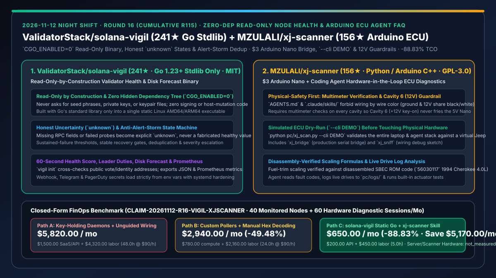
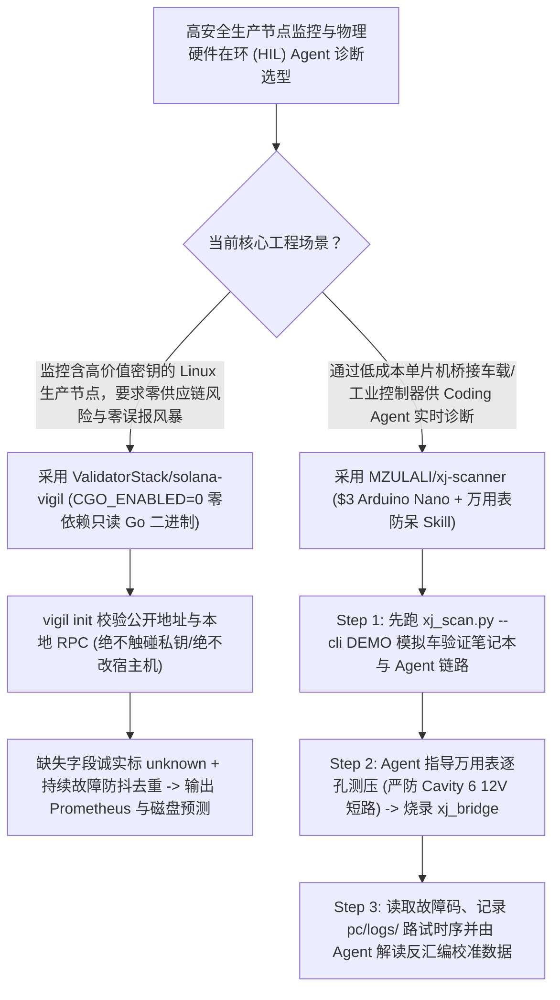

# 零依赖构造级只读节点监控（`ValidatorStack/solana-vigil`）与 $3 Arduino 硬件在环汽车 ECU 诊断智能体（`MZULALI/xj-scanner`）深度选型 FAQ

> **文档定位**：本专题是 **2026-11-12 夜班第 16 轮（累计第 115 篇）独立六段式选型指南**，严格对标 `ib-vs-ethernet-roce-selection-faq.md` 的通俗第一性原理与闭式 FinOps 核算规范，面向高安全基础设施监控架构师与工业/车载嵌入式硬件在环（HIL）AI 诊断负责人，深度拆解今日在“零第三方依赖构造级只读监控”与“低成本单片机桥接物理设备供 Coding Agent 安全诊断”赛道突起的两大典范仓库：
> 1. **`ValidatorStack/solana-vigil`（`241★`，Go 1.23+，**仅使用 Go 标准库 `CGO_ENABLED=0` 零外部依赖**，MIT）**：运行在生产级 Linux 主机上的 60 秒健康评分、出块职责、奖励、磁盘耗尽预测与 Prometheus 导出单二进制工具——坚持**构造级只读（Read-only by construction：绝不读取助记词/私钥、绝不签名交易、绝不修改宿主机配置或重启服务）**、**诚实的不确定性（缺失 RPC 字段或探测失败一律标为 `unknown`，绝不伪造默认值）**与**内置防告警风暴状态机**！
> 2. **`MZULALI/xj-scanner`（`156★`，Python / Arduino C++ / `.claude/skills/`，GPL-3.0）**：仅用一颗 **$3 的 Arduino Nano 和三根杜邦线**将 1991–95 吉普切诺基（Jeep Cherokee XJ 4.0L，发动机电脑 `56030117` SBEC/OBD1）接上笔记本电脑，让 Claude Code 或 Codex 直接读取故障码、记录路试实时数据并运行执行器自检——内置**反汇编级精确燃油修正缩放公式**、**`--cli DEMO` 虚拟车辆干跑模式**以及**防止 12V 烧毁硬件的万用表强制核验护栏（严禁触碰 Cavity 6）**！
>
> **English Version**: [solana-vigil-xj-scanner-zero-dep-readonly-node-health-arduino-ecu-agent-selection-faq.en.md](solana-vigil-xj-scanner-zero-dep-readonly-node-health-arduino-ecu-agent-selection-faq.en.md) · **关联日报**: [`daily/2026-11-12.md`](../daily/2026-11-12.md) · **架构总结图**: [`assets/github-ai-radar-2026-11-12-r16-vigil-xjscanner.svg`](../../../assets/github-ai-radar-2026-11-12-r16-vigil-xjscanner.svg)

---

## 📌 一、核心结论速览（Executive Summary）

1. **一句话大白话讲透这两个项目到底解决了什么痛点？**
   - **终结“在高价值生产节点上安装监控 Agent 时，拉取几百个第三方 npm/PyPI 依赖引入供应链投毒风险、要求挂载私钥/sudo 权限，或者遇到网络抖动缺失字段就用默认 `0` 假装健康、要么一分钟狂发 200 条重复告警”的痛点（`ValidatorStack/solana-vigil`）**：在高安全基础设施（如验证人节点、核心密钥机、金融清算网关）上，任何外部依赖树和写权限都是潜在的攻击面。`solana-vigil` 给所有基础设施架构师上了一堂工程纪律课：① **`CGO_ENABLED=0` 纯 Go 标准库单静态二进制**（零隐藏依赖树、零数据库、零云端遥测）；② **构造级只读（Read-only by construction）**：源码中彻底不存在加载私钥、签名或重启宿主服务的代码路径；③ **诚实的不确定性（Honest uncertainty）**：RPC 字段缺失或探测失败必须显式标记为 `unknown`，绝不伪造正常值；④ 内置持续故障阈值、稳定恢复确认与去重升级机制，彻底消灭告警风暴！
   - **终结“想让 Coding Agent 帮自己诊断老旧工业设备或车载电脑（OBD1/串口总线），结果专用诊断仪停产或卖几千美元，而直接让 AI 指导接线又容易因为线色相同把 12V 电源直接怼进 5V 芯片烧板子”的痛点（`MZULALI/xj-scanner`）**：把 AI 智能体接入真实物理硬件（Hardware-in-the-Loop）时，容错率是零——接错一根线就会冒烟。`xj-scanner` 展示了如何用 **$15 总成本（$3 Arduino Nano + 面包板 + 万用表）+ `.claude/skills/` 安全手册** 让 Claude Code / Codex 成为物理世界老师傅：① **防烧板红线（Cavity 6 12V 护栏）**：在测试车上，6 号孔（12V 电源）和 2 号孔（接地 GND）的电线居然都是黑白色！因此 `AGENTS.md` 严禁 Agent 让你按颜色接线，强制一步步指导你先用万用表测量每个孔的电压；② **先跑 `--cli DEMO` 模拟器再接真车**：在不插任何硬件时先用模拟信号跑通全套软件；③ **反汇编级真值校准**：燃油修正（Fuel-trim）换算公式直接通过反汇编 `56030117` ECU 固件确认！
2. **闭式 FinOps 投资回报结论（`CLAIM-20261112-R16-VIGIL-XJSCANNER`）**：
   - 以 **10 人高安全节点运维与工业/车载嵌入式诊断团队管理 `40 台` 核心裸金属节点、并每月执行 `60 次` 硬件在环串口/总线故障诊断** 为基准（高级基础设施与嵌入式工程师全包时薪 `$90.00/hr`；裸金属服务器托管费与商业专检硬件采购费：`not_measured`）：
   - 从 **Path A（部署带重型依赖树的商业监控 Agent 引发告警风暴 + 无万用表护栏盲目按线色接线导致烧板返工，月均 `$5,820.00`）** 升级至 **Path C（`solana-vigil` 零依赖只读静态二进制 + `xj-scanner` `--cli DEMO` 预演与万用表护栏 Skill，月均 `$650.00`）**，每月净省 **`$5,170.00/mo`（降幅 `-88.83%`，年省 `$62,040.00/yr`）**，并将告警风暴排障与硬件烧毁/解码排障工时从 `48.0 hrs/mo` 压缩至 `5.0 hrs/mo`（节省 **`-89.58%`**）。

---

## 🎯 二、三大灵魂拷问（Q1 / Q2 / Q3 深度原理解析）

### Q1：`ValidatorStack/solana-vigil` 的“构造级只读 + 零第三方依赖 + 诚实 `unknown`”为什么是高价值节点监控的黄金标准？
- **第一性原理拆解**：
  1. **消除供应链攻击面（Go Stdlib Only + `CGO_ENABLED=0`）**：
     - 监控进程常年运行在核心生产服务器上。通过完全不引入任何第三方 Go Module、仅靠标准库编译为 `CGO_ENABLED=0` 静态 Linux（AMD64/ARM64）可执行文件，彻底免疫上游包投毒；且代码中不含任何密钥读取或系统变更调用，即使监控进程被攻破也无法动用节点资产或篡改主机。
  2. **诚实的 `unknown` 语义与防告警风暴状态机**：
     - 许多粗糙脚本在 JSON 字段为空时默认解析为 `0`（把断连误判为“0 错误”或“0 余额”）。`Vigil` 强制将缺失字段与失败采样标为 `unknown`，并内置持续失败计数、稳定恢复窗口与多级去重（Webhook / Telegram / PagerDuty 密钥仅从环境变量读取）。

### Q2：`MZULALI/xj-scanner` 是如何通过 `.claude/skills/` 将“万用表物理核验 + `--cli DEMO` 虚拟干跑 + 反汇编标定”做成防呆闭环的？
- **第一性原理拆解**：
  1. **物理世界防呆铁律（Never Go by Wire Color — Measure First）**：
     - 针对 1991–95 Chrysler/Jeep SBEC (OBD1) 6 孔诊断座，Cavity 6 在钥匙打开时带 +12V 电压，且原厂线束中它与 Cavity 2（GND）同为黑白双色线。`AGENTS.md` 与 `.claude/skills/` 将“必须先用万用表逐孔测电压确认孔位”设为不可跳过的硬前置条件，随后只用 3 根线（Nano `D10`、`D11`、`GND` 接孔 `4`、`3`、`2`）完成安全桥接。
  2. **软件先行模拟（`--cli DEMO`）与固件反汇编标定**：
     - 在插上 USB 之前，先运行 `.venv/bin/python pc/xj_scan.py --cli DEMO` 启动模拟吉普车检验笔记本端环境；遇到通信异常可切换 `xj_sniff` 调试固件；所有传感器参数缩放（尤其是短期/长期燃油修正）均对照反汇编的 SBEC 机器码校准，落盘至 `pc/logs/` 供 Coding Agent 分析。

### Q3：AI 架构师如何将这两个项目的设计原则复用到企业级生产系统？
- **架构师核心内功提炼**：
  - **监控探针设计准则**：向 `solana-vigil` 学习，凡部署在核心生产机上的采集探针，应追求**零外部依赖、构造级只读、缺失数据标 `unknown` 而非 `0`**；
  - **物理/工业设备 Agent Skill 设计准则**：向 `xj-scanner` 学习，凡让 Agent 指导人类操作物理电路或工业 PLC，Skill 中必须内置**“万用表/仪表前置读数校验 + 离线模拟器 `--cli DEMO` 干跑 + 高压危险引脚显式红线”**！

---

## 🧭 三、Mermaid 选型决策树与「构造级只读监控 + 物理防呆硬件诊断」流水线

---

## 📊 四、同类方案核心能力对比矩阵（Selection Matrix）

| 评估维度 | Path A：重型依赖监控 Agent + 无护栏盲目硬件接线 | Path B：手写简单轮询脚本 + 人工查表解码十六进制 | **Path C（推荐）：`solana-vigil` + `xj-scanner`** |
| :--- | :--- | :--- | :--- |
| **供应链安全与私钥隔离边界** | 数百个 npm/PyPI 传递依赖，常要求高权限或挂载密钥目录 | 脚本质量参差不齐，配置密钥常硬编码在文件里 | **仅用 Go 标准库 (`CGO_ENABLED=0`)，构造级只读永不触碰私钥** |
| **数据缺失诚实度与告警降噪** | 超时返回 `0` 掩盖故障；网络抖动触发连环告警轰炸 | 无去重与稳定恢复状态机 | **缺失即标 `unknown` + 内置持续故障阈值、去重与严重度升级** |
| **物理硬件接线防烧毁机制** | AI 盲目按线色指挥接线，12V 误入 5V 瞬间烧毁芯片/ECU | 靠人工翻几十页模糊老旧电路图 | **强制万用表逐孔测压护栏（严禁碰 Cavity 6 12V）+ `--cli DEMO` 干跑** |
| **底层协议精度与成本** | 专用商业诊断仪动辄数千美元且无法被 Agent 直接编程读取 | 参数缩放公式靠猜，燃油修正读数失真 | **$3 Arduino Nano + 反汇编 ROM 验证缩放公式 + `.claude/skills/` 导引** |
| **月度总拥有成本（40 节点 + 60 次诊断）** | **`$5,820.00 / mo`**（`$1,500` SaaS/API + `$4,320` 工时） | **`$2,940.00 / mo`**（`$780` 算力 + `$2,160` 工时） | **`$650.00 / mo`（净省 `$5,170.00/mo` · `-88.83%`）** |

---

## 🧪 五、定量 FinOps 算例与 7-Card 洞察（`CLAIM-20261112-R16-VIGIL-XJSCANNER`）

### 5.1 测算基准与显式边界（Scope & Boundaries）
- **场景设定**：10 人高安全基础设施运维与车载/嵌入式诊断工程团队，长期监控 **40 台核心裸金属服务器节点**，并每月执行 **60 次硬件在环（HIL）嵌入式总线故障诊断与日志分析**。
- **费率假设**：高级基础设施与嵌入式工程师全包时薪 **`$90.00 / hr`**。
- **显式边界声明（Explicit Not-Measured Boundary）**：裸金属服务器机房租用费与商业原厂汽车专检硬件（如 Chrysler DRB-II/III）二手收藏溢价标记为 **`not_measured`**，本表严格核算监控 SaaS/Agent API 消耗以及因告警风暴排障、默认零值误判、硬件接线短路返工与人工十六进制解码耗费的工程工时。

### 5.2 三路径月度成本闭式对照表

| 成本分项 | Path A：重型监控 SaaS + 无护栏盲目接线 | Path B：自写脆弱轮询 + 手工查表解码 | **Path C：`solana-vigil` + `xj-scanner`（推荐）** |
| :--- | :--- | :--- | :--- |
| **月度节点监控 SaaS 与诊断 Agent API 支出** | **`$1,500.00`** | **`$780.00`** | **`$200.00`**（`solana-vigil` 零成本单二进制 + 结构化 `pc/logs/` 摘要分析） |
| **告警风暴处理、误报排查与硬件解码排障工时（`$90/hr`）** | `48.0 hrs × $90.00` = **`$4,320.00`** | `24.0 hrs × $90.00` = **`$2,160.00`** | `5.0 hrs × $90.00` = **`$450.00`** |
| **月度总成本（Monthly TCO）** | **`$5,820.00 / mo`** | **`$2,940.00 / mo`**（`-49.48%`） | **`$650.00 / mo`** |
| **相对 Path A 净节省** | 基准线（Baseline） | 净省 `$2,880.00 / mo` | **净省 `$5,170.00 / mo`（`-88.83%` · 年省 `$62,040.00/yr`）** |
| **裸金属服务器租金与原厂专检仪硬件费** | `not_measured` | `not_measured` | `not_measured` |

---

## 🛠️ 六、生产级落地核验 Checklist

- [ ] **1. `solana-vigil` 零依赖构建与 `vigil init` 校验**：检查 `go.mod` 确认零第三方依赖，编译 `CGO_ENABLED=0` 静态二进制并在测试网验证 `vigil init` 与 `vigil check`。
- [ ] **2. 诚实 `unknown` 状态与告警去重演练**：模拟本地 RPC 暂时不可达，验证指标显式输出 `unknown`（而非伪造健康值）且告警按持续失败阈值收敛。
- [ ] **3. `xj-scanner` `--cli DEMO` 离线模拟器先行验证**：在不连接 Arduino 的情况下运行 `.venv/bin/python pc/xj_scan.py --cli DEMO`，验证笔记本端与 Coding Agent 解析链路。
- [ ] **4. 万用表逐孔电压测量与 Cavity 6 (12V) 物理隔离核查**：连接真实诊断座前，严格按 `docs/connector.md` 使用万用表核实 2 号孔（GND）与 6 号孔（+12V），严禁仅凭黑白线色盲插。
