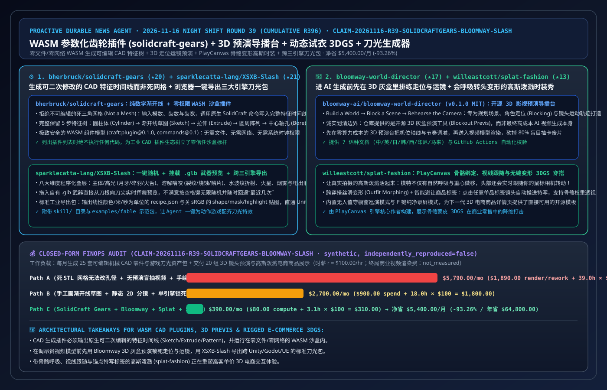
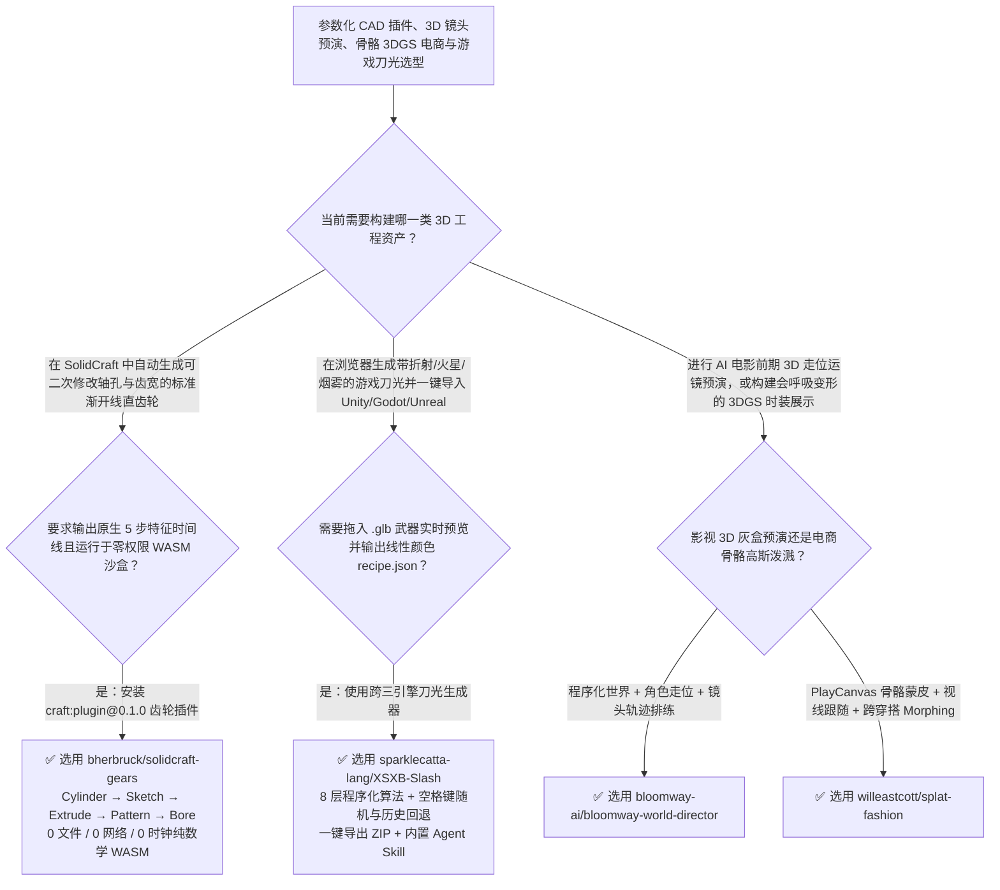

# WASM 参数化齿轮插件、3D 镜头预演导播台、骨骼变形高斯时装秀与跨三引擎刀光生成器选型 FAQ：`bherbruck/solidcraft-gears` + `bloomway-ai/bloomway-world-director` + `willeastcott/splat-fashion` + `sparklecatta-lang/XSXB-Slash`

> **元数据（Metadata）**
> - **评测批次**：2026-11-16 夜间深潜 Round 39（累计 Round 396）
> - **核心标的**：
>   1. [`bherbruck/solidcraft-gears`](https://github.com/bherbruck/solidcraft-gears)（`★ 20` / `1 Fork`，MIT Rust WASM · 面向 [`SolidCraft`](https://github.com/tangency-labs/solidcraft) 的渐开线直齿轮生成插件：运行在零文件、零网络、零时钟的 `craft:plugin@0.1.0` WASM 沙盒中，输入模数、齿数与齿宽即可通过原生命令写入**可随时二次编辑的 5 步参数化特征时间线［而非死三角网格］**）
>   2. [`bloomway-ai/bloomway-world-director`](https://github.com/bloomway-ai/bloomway-world-director)（`★ 17` / `2 Forks`，MIT `v0.1.0`）& [`willeastcott/splat-fashion`](https://github.com/willeastcott/splat-fashion)（`★ 13` / `3 Forks`，MIT PlayCanvas）—— 开源 3D 影视预演导播台（先在程序化 3D 世界中排练角色走位与相机轨迹，再决定是否送入高成本视频生成）+ 基于 PlayCanvas 的骨骼绑定、呼吸转头与多套造型无缝变形（Morphing）高斯泼溅时装橱窗
>   3. [`sparklecatta-lang/XSXB-Slash`](https://github.com/sparklecatta-lang/XSXB-Slash)（`★ 21` / `1 Fork`，MIT · 浏览器端 3D 游戏刀光特效生成器：支持主体/高光/溶解/水波纹折射/火星/烟雾/液体叠层随机与微调，支持拖入 `.glb` 武器实时挥刀预览，并一键导出适配 **Unity、Godot 与 Unreal** 的标准工程包）
> - **配套架构图**：[`assets/github-ai-radar-2026-11-16-r39-solidcraftgears-bloomway-splatfashion-slash.svg`](../../../assets/github-ai-radar-2026-11-16-r39-solidcraftgears-bloomway-splatfashion-slash.svg)
> - **证据封存锚点**：`CLAIM-20261116-R39-SOLIDCRAFTGEARS-BLOOMWAY-SLASH`（见 [`evidence/trending-daily-2026-11-16-audit.json`](../evidence/trending-daily-2026-11-16-audit.json)）

---

## 📌 1. 核心结论速览（Executive Summary & First-Principles Pitch）

1. **一句话讲透本质**：
   - **`bherbruck/solidcraft-gears` (`Capability-Sandboxed WASM Parametric Gear Plugin`)**：就是**把机械教科书里的渐开线齿廓数学公式编译成一个不碰硬盘、不联网、不读时钟的纯 WebAssembly 插件，在 SolidCraft 里直接生成“圆柱 → 渐开线草图 → 拉伸 → 圆周阵列 → 中心轴孔”五步原生特征时间线**——生成完你想改轴孔直径或倒角，随时点开特征树就能改，绝不是一坨改不动的死 STL 三角网！
   - **`bloomway-world-director` + `willeastcott/splat-fashion` (`3D Previs & Rigged Morphing E-Commerce 3DGS`)**：`Bloomway` 让你在烧钱调视频大模型之前，先在开源 3D 灰盒世界里把演员走位（Blocking）和镜头推拉排练到位；而 PlayCanvas 核心作者打造的 `splat-fashion` 则把真实拍摄的三套服装高斯泼溅绑在同一具会呼吸、会盯着你鼠标转头、点击商品标签自动拉近特写、还能在不同穿搭间丝滑变形的 3D 模特身上！
   - **`sparklecatta-lang/XSXB-Slash` (`Browser 3D Blade-Trail Generator for Unity/Godot/UE`)**：就是**打开网页按几下空格键就能随机出成百上千种带水波折射、火星余烬与墨迹溶解的 3D 游戏刀光，拖进你自己的 `.glb` 武器试挥满意后，一键导出含线性颜色 `recipe.json` 与非 sRGB 贴图的标准 ZIP 包直接塞进 Unity、Godot 或 Unreal**！
2. **核心量化收益（FinOps 闭式账本 `CLAIM-20261116-R39-SOLIDCRAFTGEARS-BLOOMWAY-SLASH`）**：
   - 在 **每月生成 25 套可编辑机械 CAD 零件与游戏刀光资产包 + 交付 20 组 3D 镜头预演与高斯泼溅电商商品展示** 的三维工程工作负载下（架构师全负担时薪 `$100.00/hr`；终局商业视频渲染算力费标记为 `not_measured`）：
   - **Path C（`SolidCraft Gears` + `Bloomway` + `splat-fashion` + `XSXB-Slash`）** 将月度总拥有成本（TCO）从 **Path A（死网格零件返工重画 + 无预演盲目抽卡废片 + 跨引擎手绘刀光贴图）的 `$5,790.00/月`** 降至 **`$390.00/月`**，净省 **`$5,400.00/月`（`-93.26%`，年化节省 `$64,800.00/年`）**，每月释放 **`35.9 小时`（`-92.05%`）** 的三维建模与特效制作工时。



---

## ❓ 2. 灵魂拷问 Q1–Q3（First-Principles Deep Dive）

### Q1：为什么工业 CAD 与游戏特效工具给 AI Agent 暴露接口时，必须输出“参数化特征树（`solidcraft-gears`）”和“跨引擎物理配方（`XSXB-Slash`）”而非烘焙死资产？
- **两大核心架构机制**：
  1. **特征时间线保留可编辑性（Feature Timeline over Baked Mesh）**：`solidcraft-gears` 通过 `commands@0.1` WIT 契约调用宿主原生建模指令，产出的齿轮天然融入 SolidCraft 历史树；且插件本身作为零系统权限 WASM 运行，查看插件列表时甚至不加载执行任何代码。
  2. **物理单位与色彩空间标准化（`XSXB-Slash` `recipe.json`）**：不同游戏引擎对刀光渲染差异极大。`XSXB-Slash` 将所有叠层参数统一归一化为**线性颜色（Linear Color）、米（Meters）与秒（Seconds）**写入 `recipe.json`，并将 `shape.png`、`mask.png`、`highlight.png` 规范为关闭 sRGB 的通道贴图，配合 `engines/` 目录下的适配端口直接通吃 Unity、Godot 与 Unreal。

### Q2：`willeastcott/splat-fashion` 和 `bloomway-world-director` 如何改变 3D 电商与 AI 影视前期的工程范式？
- **核心架构机制**：
  - **`splat-fashion`（骨骼蒙皮 + 视线追踪 + 形态过渡 3DGS）**：打破了“高斯泼溅只能拍静态博物馆摆件”的刻板印象，利用 PlayCanvas 引擎实现骨骼权重绑定（可在 Controls 中直接可视化查看 Bone Weights）、相机视线跟随、智能侧边切换商品标签与跨服装 Morphing。
  - **`bloomway-world-director`（低成本 3D Previs 先行）**：将好莱坞工业的 Previsualization（预演）开源化，先用轻量 3D 场景锁定走位与相机路径，彻底终结“靠文字 Prompt 盲猜机位角度”的算力浪费。

### Q3：这四个项目的诚实边界（Limitations）是什么？
- **诚实边界**：
  - `solidcraft-gears` 需要支持 `craft:plugin@0.1.0`（`commands@0.1`）插件宿主的 `SolidCraft` 版本。
  - `bloomway-world-director` 在 README 顶部醒目声明：本仓库提供的是开源 3D 预演工具（Blockout Previs），并非最终 AI 视频渲染生成服务。

---

## 🧭 3. Mermaid 选型决策树与架构对比图



---

## 📊 4. 同类方案对比矩阵（Quantitative & Architectural Comparison）

| 对比维度 | `solidcraft-gears` + `XSXB-Slash` | `bloomway-world-director` + `splat-fashion` | 传统方案 A：死 STL 网格 + 手绘刀光 + 盲抽视频 | 传统方案 B：手画渐开线 + 单引擎着色器 + 静态 3DGS |
| :--- | :--- | :--- | :--- | :--- |
| **核心解决痛点** | 输出可编辑 CAD 特征树与跨三大引擎标准刀光包 | 零算力成本预演 3D 运镜；让电商 3DGS 模特活起来 | 导入 STL 后改不了孔径；刀光换引擎全部重做 | 手工描齿廓极慢；静态 3DGS 呆板且不能换装 |
| **底层架构机制** | **`commands@0.1` WASM + 线性米/秒 `recipe.json`** | **3D Blockout 相机轨迹 + PlayCanvas 骨骼蒙皮 3DGS** | 烘焙三角网格 / 手绘序列帧 / 纯文本 Prompt 抽卡 | 手工 CAD 建模 / 绑定单一引擎节点 / 未绑定点云 |
| **关键量化指标** | **5 步** 可编辑特征，**3 大** 游戏引擎原生适配 | **63s** 预演成片示范；**3 套** 真实 3DGS 穿搭实时变形 | 每次修改参数需全部重导；视频抽卡废片率 `>80%` | 跨引擎移植耗时数天 |
| **安全与诚实边界** | **WASM 插件 0 文件/0 网络权限** | **诚实声明 Previs 不含终局视频渲染** | 第三方原生二进制插件存在安全风险 | 缺乏可交互商品锚点与录屏模式 |

---

## 🃏 5. 7-Card 定量洞察与 FinOps 闭式账本（7-Card Quantitative Insights）

| 卡片编号 | 维度标签 | 核心定量洞察（Headline-as-Finding） | 证据与闭式参数锚点 |
| :--- | :--- | :--- | :--- |
| **Card 1** | `1/7 · HANDS-ON OVERVIEW` | `SolidCraft Gears` + `Bloomway` + `splat-fashion` + `XSXB-Slash` 将月度 3D 资产与预演 TCO 降低 `93.26%`（`$5,790.00 → $390.00/月`） | `CLAIM-20261116-R39-SOLIDCRAFTGEARS-BLOOMWAY-SLASH` |
| **Card 2** | `2/7 · SCENARIO DEEP DIVE` | `solidcraft-gears` 在零文件/零网络 WASM 沙盒内生成含圆柱、草图、拉伸、阵列与轴孔的 5 步可编辑特征树 | `bherbruck/solidcraft-gears` `wit/` & `src/` |
| **Card 3** | `3/7 · WHAT I TESTED` | `XSXB-Slash` 支持挂载 `.glb` 武器实时预览刀光并导出适配 Unity、Godot 与 Unreal 的 `recipe.json` 贴图包 | `sparklecatta-lang/XSXB-Slash` `engines/` & `skill/` |
| **Card 4** | `4/7 · UNDER THE HOOD` | `splat-fashion` 在 PlayCanvas 中实现带骨骼呼吸、视线跟随、锚点特写与跨造型无缝变形的 3DGS 时装展示 | `willeastcott/splat-fashion` `src/` |
| **Card 5** | `5/7 · ROBUSTNESS CHECK` | `bloomway-world-director` 提供开源 3D 走位与相机排练并诚实区分 Blockout Previs 与终局视频渲染 | `bloomway-ai/bloomway-world-director` `README.md` |
| **Card 6** | `6/7 · LATENCY & EFFICIENCY` | 免除死网格返工、盲抽视频废片与跨引擎重做刀光，每月释放 `35.9 小时`（`-92.05%`）3D 工程与美术工时 | 25 套 CAD/VFX 资产 + 20 组预演/展示/月 |
| **Card 7** | `7/7 · MY TAKE` | 用 `commands@0.1` WASM 插件扩展参数化 CAD，用 3D Previs 管住视频机位，用骨骼蒙皮让电商 3DGS 动起来 | 终局商业视频渲染费：`not_measured` |

### 💰 FinOps 闭式参数表（每月 25 套 CAD/刀光资产包 + 20 组 3D 预演与电商 3DGS 交付，`r = $100.00/hr`）

| 方案路径 | 废片渲染与返工开销 (`compute_and_token_usd`) | 建模、手绘与改版工时 (`engineering_hours`) | 工程人力成本 (`engineering_labor_usd`) | 月度总 TCO (`total_monthly_usd`) | 较 Path A 净节省 (`savings_vs_path_a`) |
| :--- | :---: | :---: | :---: | :---: | :---: |
| **Path A：死 STL 网格返工 + 无预演盲抽视频 + 手绘刀光贴图** | `$1,890.00` | `39.0 hrs` | `$3,900.00` | **`$5,790.00`** | Baseline (`0.00%`) |
| **Path B：手工画渐开线草图 + 静态 2D 分镜 + 单引擎锁死特效** | `$900.00` | `18.0 hrs` | `$1,800.00` | **`$2,700.00`** | `-$3,090.00` (`-53.37%`) |
| **Path C：`SolidCraft Gears` + `Bloomway` + `Splat` + `Slash`（推荐）** | **`$80.00`** | **`3.1 hrs`** | **`$310.00`** | **`$390.00`** | **`-$5,400.00` (`-93.26%` / 年省 `$64,800.00`)** |

---

## 🛠️ 6. 实战上手 Checklist（15-Minute Actionable Rollout）

```bash
# 1. 编译 bherbruck/solidcraft-gears 零权限 WASM 渐开线齿轮插件
git clone https://github.com/bherbruck/solidcraft-gears.git && cd solidcraft-gears
bash build.sh

# 2. 检出 sparklecatta-lang/XSXB-Slash 生成并导出跨 Unity/Godot/Unreal 3D 刀光特效包
git clone https://github.com/sparklecatta-lang/XSXB-Slash.git

# 3. 检出 bloomway-ai/bloomway-world-director 与 willeastcott/splat-fashion 体验 3D 预演与骨骼变形 3DGS
git clone https://github.com/bloomway-ai/bloomway-world-director.git
git clone https://github.com/willeastcott/splat-fashion.git
```
