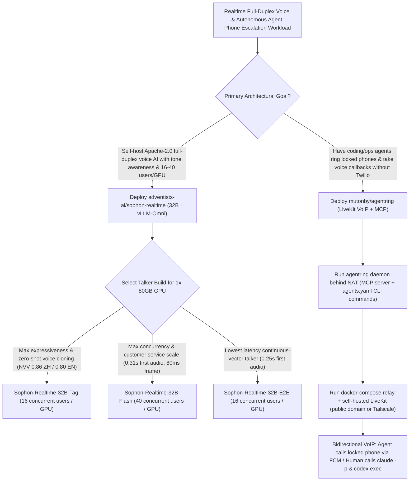

# 0.25s Full-Duplex Paralinguistic Voice Models (`adventists-ai/sophon-realtime`) & Zero-Twilio Self-Hosted VoIP Agent Telephony (`mutonby/agentring`) Selection FAQ

> **Positioning**: This standalone guide is **Round 38 of the 2026-11-11 Night Shift (Cumulative Guide #83)**, written in the plain-language, first-principles, closed-form FinOps style of `ib-vs-ethernet-roce-selection-faq.md` for Realtime Voice AI Architects and 24/7 Autonomous Agent Operations Leads evaluating two fast-rising open-source projects:
> 1. **`adventists-ai/sophon-realtime` (`260★`, Python / `vLLM-Omni` + `CUDA MPS`, Apache-2.0)**: An open 32B full-duplex paralinguistic voice model family (`Tag`, `Flash`, and `E2E` sharing one 32B brain, plus v1.1 zero-shot real-time voice cloning) powered by `DuplexJev` that ranks **#1 overall on Paralinguistic Understanding (`48.6`, beating Gemini 3.8 Flash `46.9` and Qwen3-Omni `44.6`)**, **#1 among open full-duplex models on `VoiceBench` (`82.8`) and `Big Bench Audio` (`81.8%`)**, and hits **`48% Pass@1` (`100%` response rate) on `Full-Duplex-Bench v3` tool calling**—serving **16 to 40 concurrent users on a single 80GB GPU** with **`0.25 s` (`E2E`) to `0.31 s` (`Flash`) first-audio latency**;
> 2. **`mutonby/agentring` (`368★`, Python daemon + TypeScript relay + self-hosted LiveKit + Kotlin Android app, Apache-2.0)**: Enables AI agents (Claude Code, Codex, OpenCode, Grok Build, OpenClaw, Hermes) to **ring your locked phone like a real call through Android Doze over self-hosted LiveKit VoIP—with zero phone numbers, zero Twilio, and zero per-minute PSTN fees**—so you can talk through blockers with a voice AI and return the transcript, or tap "Call agent" while driving to consult your coding agents mid-call.
>
> **中文版 FAQ**: [sophon-realtime-agentring-full-duplex-voice-voip-mcp-selection-faq.md](sophon-realtime-agentring-full-duplex-voice-voip-mcp-selection-faq.md) · **Architecture Summary SVG**: [`assets/github-ai-radar-2026-11-11-r38-sophon-agentring.svg`](../../../assets/github-ai-radar-2026-11-11-r38-sophon-agentring.svg)

---

## 📌 1. Executive Summary

1. **In plain English, what problems do these two repositories actually solve?**
   - **Ending Tone-Deaf Cascaded Voice Pipelines (`adventists-ai/sophon-realtime`)**: Traditional `ASR → Text LLM → TTS` pipelines strip out emotion, emphasis, sarcasm, laughter, and sighs, cannot draft replies while listening, and often read tags like `[sigh]` aloud literally. `Sophon-Realtime` combines `DuplexJev` (an open speech-decision ear scoring `#1` overall on paralinguistic understanding at `48.6`) with a 32B brain (`VoiceBench 82.8`, `Big Bench Audio 81.8%`) and three talker builds (`Tag`, `Flash`, `E2E`) that naturally perform laughter, sighs, and breaths (`NVV-SuperBench 0.86` ZH / `0.80` EN) at **`0.25 s`–`0.31 s` first audio** and **16–40 concurrent users on one 80GB GPU**.
   - **Ending Missed Slack Alerts & Expensive Twilio PSTN Integration (`mutonby/agentring`)**: When a long-running migration or deployment hits a wall at 2 AM, chat notifications sit unread for hours, while wiring up Twilio requires phone numbers, KYC, and per-minute PSTN charges. `agentring` pairs a NAT-friendly Python MCP daemon (outbound WSS only) with a self-hosted TypeScript/LiveKit relay and a Kotlin Android app: calling the `call` MCP tool wakes a locked phone in Android Doze, lets you talk through the decision with a realtime voice AI, and hands the transcript back to your agent (or lets you call your agents from the app while driving).
2. **Closed-Form FinOps Verdict (`CLAIM-20261111-R38-SOPHON-AGENTRING`)**:
   - For an Enterprise Customer Operations & 24/7 DevOps Team handling **45,000 minutes/month of full-duplex voice interactions** and **300 urgent human-in-the-loop agent escalation calls per month** (senior SRE/Platform Engineer loaded rate `$90.00/hr`; mobile carrier cellular data plans and handset hardware depreciation: `not_measured`):
   - Upgrading from **Path A (Commercial per-minute Realtime Voice API + Twilio PSTN trunking + stalled overnight runs from missed pings, `$6,020.00/mo`)** to **Path C (`Sophon-Realtime` 32B on 1×80GB GPU + `agentring` self-hosted LiveKit VoIP & MCP callback, `$860.00/mo`)** saves **`$5,160.00/mo` (`-85.71%`, `$61,920.00/yr`)** and cuts voice pipeline maintenance and overnight stall recovery labor from `44.0 hrs/mo` to `5.0 hrs/mo` (**`-88.64%`**).

---

## 🎯 2. Three Core Architectural Questions (Q1 / Q2 / Q3 Deep-Dive)

### Q1: How do `Sophon-Realtime`'s `Tag`, `Flash`, and `E2E` builds share one 32B brain while trading off expressiveness, latency (`0.25s`), and concurrency (`40 users/GPU`)?
- **First-Principles Breakdown**:
  1. **Shared 32B Brain + `DuplexJev` Speech-Decision Ear**:
     - Listens continuously while the user speaks, detects barge-in/turn-taking, understands vocal tone (`48.6` on LISTEN, StressTest, and MSPB combined), and executes `Full-Duplex-Bench v3` tool calls at **`48% Pass@1` (`100%` response rate)**.
  2. **Three Specialized Talker Architectures on a Single 80GB GPU**:
     - **`Tag` Build**: Brain writes sound tags (`[laughter]`, `[sigh]`, `<strong>…</strong>`) performed by an expressive speech model (`NVV-SuperBench 0.86` ZH / `0.80` EN, `16` concurrent users/GPU via `vLLM-Omni`, plus v1.1 zero-shot voice cloning);
     - **`Flash` Build**: Lighter speech model running **one forward pass per `80 ms` frame**, delivering **`0.31 s` first audio** and scaling to **`40` concurrent users per 80GB GPU**;
     - **`E2E` Build (v1.1.3)**: Replaces speech tokens with a compact `~350M` parameter talker that streams continuous voice vectors directly into a waveform decoder—achieving **`0.25 s` first audio** (`16` concurrent users/GPU via `CUDA MPS`).

### Q2: How does `mutonby/agentring` ring a locked phone behind NAT without phone numbers or Twilio, and consult CLI agents mid-call?
- **First-Principles Breakdown**:
  1. **Outbound-Only WSS Daemon + Self-Hosted LiveKit + Firebase FCM Push**:
     - The local `daemon` (Python CLI + MCP server + voice AI) connects outbound over WSS to your `relay` (TypeScript behind Caddy, or local/Tailscale Docker). High-priority FCM push wakes the Android app out of Doze to present the native call screen, while call audio flows through self-hosted **LiveKit** WebRTC.
  2. **Bidirectional Agent Voice Loop (`call`, `send_message`, `get_replies` & `agents.yaml`)**:
     - Any MCP-capable harness can call you when blocked, and missed calls automatically convert into actionable messages. Conversely, tapping "Call agent" lets the voice AI consult `claude -p`, `codex exec`, `opencode run`, `openclaw agent`, or `hermes -z` asynchronously mid-call.

### Q3: How can Solution Architects combine `Sophon-Realtime` and `agentring`?
- **Sovereign Voice Escalation Stack**:
  - Serve **`Sophon-Realtime`** (`Flash` or `E2E`) via its OpenAI `GPT-Live`-compatible endpoint on a single 80GB GPU for customer-facing voice channels and wire **`agentring`** to your coding/ops agents for zero-Twilio VoIP human-in-the-loop escalations.

---

## 🧭 3. Mermaid Decision Tree & Full-Duplex VoIP Architecture

---

## 📊 4. Architectural Comparison Matrix

| Evaluation Dimension | Path A: Commercial Realtime API + Twilio PSTN | Path B: Cascaded `ASR-LLM-TTS` + Chat Pings | **Path C (Recommended): `Sophon-Realtime` + `agentring`** |
| :--- | :--- | :--- | :--- |
| **Paralinguistic Tone & Non-Verbal Speech** | Proprietary black-box; no weight ownership | ASR strips emotion/sighs; TTS reads tags literally | **`#1` Paralinguistic (`48.6`) + `NVV-SuperBench 0.86` natural laughter/sighs** |
| **First-Audio Latency & GPU Density** | Metered per minute (`$0.04–$0.06/min`) | `>1.5s` turn-taking lag; clumsy barge-in handling | **`0.25s` (`E2E`) / `0.31s` (`Flash`), `16–40` concurrent users per 80GB GPU** |
| **Agent Phone Escalation & Callbacks** | Requires phone numbers, KYC & Twilio per-min fees | Slack/email pings missed on locked phones in Doze | **Zero phone numbers/Twilio; FCM wakes locked phone + mid-call CLI consults** |
| **Licensing & Auditability** | Closed SaaS audio processing | Fragmented multi-vendor logs | **Apache-2.0 weights/code + `48%` FDB v3 tool use + auditable transcripts** |
| **Monthly TCO (45k Min + 300 Calls)** | **`$6,020.00 / mo`** (`$2,060` API/PSTN + `$3,960` labor) | **`$3,060.00 / mo`** (`$1,080` compute + `$1,980` labor) | **`$860.00 / mo` (Saves `$5,160.00/mo` · `-85.71%`)** |

---

## 🧪 5. Closed-Form FinOps Example & 7-Card Insights (`CLAIM-20261111-R38-SOPHON-AGENTRING`)

### 5.1 Workload & Scope Boundary
- **Workload**: An Enterprise Customer Operations & 24/7 DevOps Team handling **45,000 minutes/month of full-duplex voice interactions** and **300 urgent human-in-the-loop agent phone escalations per month**.
- **Rates**: Senior SRE / Platform Engineer loaded rate at **`$90.00 / hr`**.
- **Explicit Scope Boundary**: Mobile carrier cellular data plans and personal handset hardware depreciation are marked **`not_measured`**.

### 5.2 Closed-Form Monthly Cost Breakdown

| Cost Component | Path A: Commercial Realtime API + Twilio PSTN | Path B: Cascaded ASR-LLM-TTS + Paging SaaS | **Path C: `Sophon-Realtime` + `agentring` (Recommended)** |
| :--- | :--- | :--- | :--- |
| **Voice API / 80GB GPU Slice & Telephony Relay Spend** | **`$2,060.00`** (`$1,800` Audio API + `$260` Twilio) | **`$1,080.00`** | **`$410.00`** (1×80GB GPU `vLLM-Omni` slice + self-hosted LiveKit) |
| **Stalled Overnight Deploys & Voice Ops Labor (`$90/hr`)** | `44.0 hrs × $90.00` = **`$3,960.00`** | `22.0 hrs × $90.00` = **`$1,980.00`** | `5.0 hrs × $90.00` = **`$450.00`** |
| **Total Monthly TCO** | **`$6,020.00 / mo`** | **`$3,060.00 / mo`** (`-49.17%`) | **`$860.00 / mo`** |
| **Net Savings vs. Path A** | Baseline | Saves `$2,960.00 / mo` | **Saves `$5,160.00 / mo` (`-85.71%` · `$61,920.00/yr`)** |
| **Cellular Data Plans & Handset Depreciation** | `not_measured` | `not_measured` | `not_measured` |

---

## 🛠️ 6. Production Verification Checklist

- [ ] **1. `sophon-realtime serve` with `CUDA MPS` on 1×80GB GPU**: Launch `Tag` (`16` users), `Flash` (`40` users), or `E2E` (`0.25s` first audio) and verify OpenAI `GPT-Live` protocol compatibility and per-turn transcript generation.
- [ ] **2. Zero-Shot Voice Cloning & Paralinguistic Tag Verification**: Test v1.1 zero-shot voice cloning with a short reference clip and verify that `[laughter]` and `[sigh]` tags are performed vocally rather than spoken as literal words.
- [ ] **3. Self-Hosted `agentring` Relay & LiveKit Deployment**: Deploy `docker-compose.yml` (or `docker-compose.local.yml` over Tailscale) and verify WebRTC audio routing through the self-hosted LiveKit container.
- [ ] **4. Multi-Harness MCP & `agents.yaml` Registration**: Connect coding agents via `npx skills add mutonby/agentring` (or `agentring connect openclaw` / `hermes`) and register `claude -p` and `codex exec` in `agents.yaml` for mid-call voice consultation.
- [ ] **5. Android Doze Ringing & Missed-Call Fallback**: Lock the paired Android phone, trigger the `call` MCP tool from an agent, and verify both native call screen wakeup and automatic fallback to a replyable notification message when unanswered.
