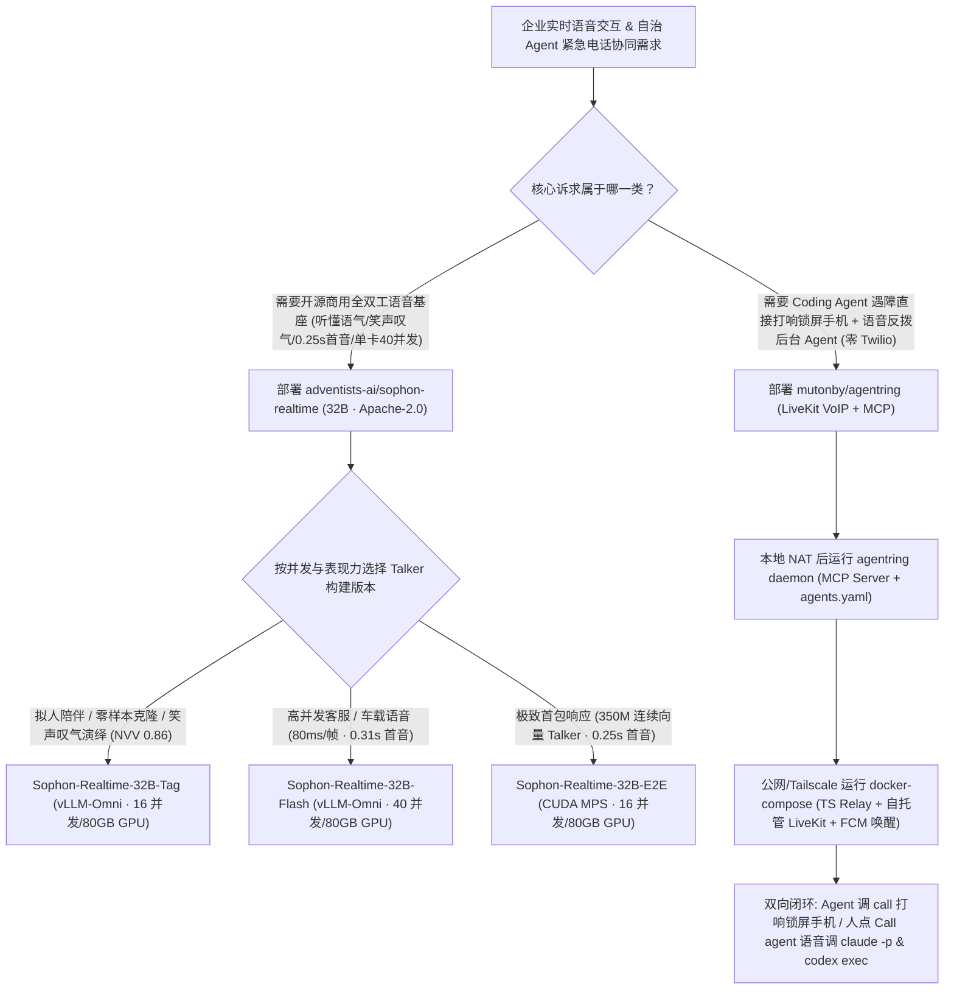

# 0.25s 全双工副语言语音大模型家族（`adventists-ai/sophon-realtime`）与零 Twilio 自托管 VoIP Agent 电话呼叫网桥（`mutonby/agentring`）深度选型 FAQ

> **文档定位**：本专题是 **2026-11-11 夜班第 38 轮（累计第 83 篇）独立六段式选型指南**，严格对标 `ib-vs-ethernet-roce-selection-faq.md` 的通俗第一性原理与闭式 FinOps 核算规范，面向实时语音交互（Realtime Voice AI）架构师与 7×24 自治 Agent 运维负责人，深度拆解今日在开源全双工情感语音与 Agent 双向电话呼叫赛道爆发的两大新锐项目：
> 1. **`adventists-ai/sophon-realtime`（`260★`，Python / `vLLM-Omni` + `CUDA MPS`，Apache-2.0）**：开源界目前综合智商与副语言感知排名第一的 **32B 全双工语音大模型家族（`Tag` / `Flash` / `E2E` 三版本共享同一 32B 大脑，v1.1 新增零样本实时声音克隆）**——基于开源听觉决策耳 `DuplexJev` 拿下 **副语言理解总榜 #1（`48.6`，超越 Gemini 3.8 Flash `46.9` 与 Qwen3-Omni `44.6`）**、开源全双工 **`VoiceBench 82.8` #1**、**`Big Bench Audio 81.8%` #1** 及 **`Full-Duplex-Bench v3` 工具调用 `Pass@1 48%`（超越 Grok `43%`）**；单张 80GB GPU 即可并发服务 **16～40 路**全双工语音流，首包音频低至 **`0.25 s`**！
> 2. **`mutonby/agentring`（`368★`，Python 守护进程 + TypeScript Relay + 自托管 LiveKit + Kotlin Android 客户端，Apache-2.0）**：让你的 AI Agent 在遇到数据库迁移失败、高危部署审批或长任务跑完时**直接给你的锁屏手机打一通真实 VoIP 电话（穿透 Android Doze 休眠，无需手机号、无需 Twilio、零每分钟话费）**——在电话里由实时语音 AI 向你汇报进展、把你的口头决策转写回传给 Claude Code / Codex / OpenCode / OpenClaw / Hermes 继续执行，同时支持你在开车时从 App 一键反拨（“Call agent”）语音咨询后台 Agent！
>
> **English Version**: [sophon-realtime-agentring-full-duplex-voice-voip-mcp-selection-faq.en.md](sophon-realtime-agentring-full-duplex-voice-voip-mcp-selection-faq.en.md) · **架构总结图**: [`assets/github-ai-radar-2026-11-11-r38-sophon-agentring.svg`](../../../assets/github-ai-radar-2026-11-11-r38-sophon-agentring.svg)

---

## 📌 一、核心结论速览（Executive Summary）

1. **一句话大白话讲透这两个项目到底解决了什么痛点？**
   - **终结“级联语音听不出反话和叹气、打断迟钝、把 `[laughter]` 当文字念出来”的机械感（`adventists-ai/sophon-realtime`）**：传统 `ASR → LLM → TTS` 级联架构把人声转成干瘪文字，丢失了语气、重音、讽刺和叹气，且无法边听边想。`Sophon-Realtime` 用开源听觉决策模型 `DuplexJev` 当耳朵、32B 大模型当大脑，在你说话的同时实时起草回复，随时支持自然打断；它不仅能听懂语气（副语言理解 `48.6` 全网第一），还能根据语境自己决定何时笑、叹气、换气或清嗓子（`NVV-SuperBench` 中文 `0.86` / 英文 `0.80`），单张 80GB 显卡通过 `vLLM-Omni` 即可支撑 `Flash` 版 **40 路并发（`0.31s` 首音）** 或 `E2E` 版 **`0.25s` 极速首音（16 路并发）**！
   - **终结“半夜 Agent 卡在权限审批只会发 Slack 静默干等、或接 Twilio 电话贵且配置繁琐”的痛点（`mutonby/agentring`）**：后台跑长任务的 Coding Agent 一旦遇到突发报错或需要人工拍板，发一条消息往往几小时没人看；而用 Twilio 打传统电话又要买号码、实名认证、按分钟交高昂 PSTN 话费。`agentring` 采用 **自托管 LiveKit VoIP + Firebase FCM 唤醒**：Agent 调一个 `call` MCP 工具，哪怕手机锁屏处于 Android Doze 深度休眠也会像真电话一样响铃；接通后语音 AI 跟你对完方案，立即把文字纪要交还给 NAT 后的本地 Agent 继续干活（未接来电还会自动降级为可回复通知）！
2. **闭式 FinOps 投资回报结论（`CLAIM-20261111-R38-SOPHON-AGENTRING`）**：
   - 以企业智能客服与 7×24 自治研发运维团队每月处理 **45,000 分钟全双工语音对话** 与 **300 次夜间/移动场景 Agent 紧急人工拍板呼叫** 为基准（高级平台/SRE 工程师含税费率 `$90.00/hr`；个人手机蜂窝流量套餐与终端硬件折旧：`not_measured`）：
   - 从 **Path A（商业按分钟计费 Realtime 语音 API + Twilio PSTN 跨国话费 + 夜间消息漏看导致流水线阻塞重跑，月均 `$6,020.00`）** 升级至 **Path C（`Sophon-Realtime` 单卡 80GB `vLLM-Omni` 自托管 + `agentring` 零 Twilio LiveKit VoIP 双向电话桥，月均 `$860.00`）**，每月净省 **`$5,160.00/mo`（降幅 `-85.71%`，年省 `$61,920.00/yr`）**，并将语音管线维护与夜间阻塞排障工时从 `44.0 hrs/mo` 压缩至 `5.0 hrs/mo`（节省 **`-88.64%`**）。

---

## 🎯 二、三大灵魂拷问（Q1 / Q2 / Q3 深度原理解析）

### Q1：`adventists-ai/sophon-realtime` 的 `Tag`、`Flash`、`E2E` 三个版本为何能共享同一个 32B 大脑，各自适用什么生产场景？
- **第一性原理拆解**：
  1. **统一 32B 听觉大脑 + `DuplexJev` 全双工耳**：
     - 三个版本共享同一个 32B 核心模型（负责边听边理解语音、判断用户何时说完或打断、撰写带声学标记的回复并调用工具）。在 `VoiceBench`（`82.8`）、`Big Bench Audio`（`81.8%`）、副语言理解（LISTEN/StressTest/MSPB 综合 `48.6`）与 `Full-Duplex-Bench v3` 工具调用（`Pass@1 48%`，响应率 `100%`）上全面领先开源同侪。
  2. **三种发声解码路径（How the reply becomes sound）按需选型**：
     - **`Tag` 版（推荐高表现力场景）**：大脑写出带 `[laughter]`、`[sigh]`、`<strong>…</strong>` 的标记文本，由高表现力语音模型演绎出来（`NVV-SuperBench` 中文 `0.86` / 英文 `0.80`），单张 H100 80GB 支持 **16 路并发**，并支持 v1.1 **零样本几秒音频实时克隆**；
     - **`Flash` 版（高并发客服/车载首选）**：使用更轻量的发声模型（每 `80 ms` 帧仅需 1 次前向传播），首包音频 **`0.31 s`**，单张 80GB GPU 并发能力翻倍至 **40 路并发**（并额外支持日语与俄语）；
     - **`E2E` 版（v1.1.3 极速端到端）**：彻底去掉离散语音 Token 模型，用约 `350M` 参数的紧凑 Talker 在文字生成的同时直接输出连续语音向量（Continuous Voice Vectors），将首包音频延迟压至 **`0.25 s`**（16 路并发）。
  3. **兼容 OpenAI `GPT-Live` 协议与 `CUDA MPS` 单卡一键部署**：
     - `sophon-realtime serve` 默认开启 `CUDA MPS` 共享算力，支持 `Live mode` 挂载更大后端推理模型，且每轮语音回答均附带可审计文字转录稿。

### Q2：`mutonby/agentring` 是如何在不买手机号、不用 Twilio、且本地 Agent 躲在家庭/内网 NAT 后的情况下打通锁屏手机的？
- **第一性原理拆解**：
  1. **出站 WSS 穿透 NAT + 自托管 LiveKit 音频流 + FCM 穿透 Doze**：
     - 跑在本地开发机或内网服务器上的 Python `daemon`（含 MCP Server 与 CLI）只需要向公网（或 Tailscale 局域网）上的 TypeScript `relay` 发起一条**纯出站 WebSocket（WSS outbound only）**，无需暴露任何本地入站端口；
     - 当 Agent 调用 `call` 时，`relay` 通过免费 Firebase FCM 推送唤醒锁屏 Android 手机（穿透 Doze 省电模式弹出原生来电界面），通话音频则直接走同一个 `docker-compose` 内自托管的 **LiveKit** WebRTC 通道，全程零运营商分钟费。
  2. **双向语音协同：Agent 呼叫你 + 你随时反拨咨询多路 Agent**：
     - **Agent 找你（Inbound to Human）**：迁移失败或需确认发布时，手机响铃，语音 AI 解释上下文并回答你的追问，挂断后将决策摘要返回给阻塞中的 MCP 调用；若未接听，自动转为通知栏可回复消息（`send_message` / `get_replies`）。
     - **你找 Agent（Outbound from Human）**：开车或走路时点 App 里的“Call agent”，语音 AI 可以在通话中途通过 `agents.yaml` 实时调用后台的 `claude -p`、`codex exec`、`opencode run`、`openclaw agent` 或 `hermes -z`；如果某个后台 Agent 跑得慢，你可以继续聊，结果出来后实时播报或发消息给你。

### Q3：如何将 `Sophon-Realtime` 与 `agentring` 组合成 100% 私有化全双工语音运维中枢？
- **黄金组合落地范式**：
  - 在企业自有 GPU 服务器上用 `sophon-realtime serve`（暴露 OpenAI `GPT-Live` 兼容接口）提供 0.25s–0.31s 超低延迟、听得懂叹气与焦急语气的全双工语音服务；
  - 将 `agentring` 的语音后端接入自托管语音接口（或使用内置 `agentring voice bench` 对比 `gemini` / `openai` / `grok` / `phonic` / `local` 延迟与工具调用准确率），实现从 Coding Agent 告警、VoIP 响铃到全双工语音拍板的全链路零第三方话费闭环！

---

## 🧭 三、Mermaid 选型决策树与全双工 VoIP 架构流水线

---

## 📊 四、同类方案核心能力对比矩阵（Selection Matrix）

| 评估维度 | Path A：商业 Realtime API + Twilio 传统电话网 | Path B：传统 `ASR → LLM → TTS` 级联 + 告警短信/Slack | **Path C（推荐）：`Sophon-Realtime` + `agentring`** |
| :--- | :--- | :--- | :--- |
| **副语言感知与非语言发声（笑/叹气）** | 商业黑盒不可私有化；权重无法微调 | ASR 转文字彻底丢失语气、讽刺与叹气；会把标签念出来 | **副语言理解 `#1 (48.6)` + `NVV-SuperBench 0.86` 自然演绎笑声/叹气** |
| **首包延迟与单卡并发密度** | 按分钟高额计费（`$0.04–$0.06/min`），并发受配额限制 | 级联三跳延迟常 `>1.5s`，无法自然边听边打断 | **首音 `0.25s (E2E) / 0.31s (Flash)`，单张 80GB GPU 支持 `16–40` 并发** |
| **Agent 阻塞主动呼叫与移动反拨** | 需买手机号、配 SIP/Twilio Webhook、按分钟交话费 | Slack/邮件在手机锁屏 Doze 下极易漏看，半夜任务卡死 | **零手机号/零 Twilio，FCM 穿透锁屏响铃 + 通话中反调 `claude/codex`** |
| **开源商用授权与审计转录** | 闭源 SaaS，音频出境合规风险高 | 多组件拼凑无统一工具调用基准 | **全栈 Apache-2.0 商用免费 + `FDB v3` 工具调用 `48%` + 逐轮可审计字幕** |
| **月度总拥有成本（4.5万分钟+300呼叫）** | **`$6,020.00 / mo`**（`$2,060` API/话费 + `$3,960` 人工） | **`$3,060.00 / mo`**（`$1,080` 算力 + `$1,980` 人工） | **`$860.00 / mo`（净省 `$5,160.00/mo` · `-85.71%`）** |

---

## 🧪 五、定量 FinOps 算例与 7-Card 洞察（`CLAIM-20261111-R38-SOPHON-AGENTRING`）

### 5.1 测算基准与显式边界（Scope & Boundaries）
- **场景设定**：企业智能语音服务与 7×24 自治研发运维团队，每月承载 **45,000 分钟全双工语音交互**与 **300 次夜间/外出场景 Agent 紧急人工决策呼叫**。
- **费率假设**：高级平台/SRE 工程师全包时薪 **`$90.00 / hr`**。
- **显式边界声明（Explicit Not-Measured Boundary）**：个人移动终端硬件折旧与运营商蜂窝移动数据流量月租标记为 **`not_measured`**，本表核算全双工语音推理算力/API、VoIP 中继与工程师排障/等待损耗工时。

### 5.2 三路径月度成本闭式对照表

| 成本分项 | Path A：商业 Realtime API + Twilio PSTN 电话 | Path B：级联 ASR-LLM-TTS + 普通消息告警 | **Path C：`Sophon-Realtime` + `agentring`（推荐）** |
| :--- | :--- | :--- | :--- |
| **实时语音推理 API / 80GB GPU 切片与电话中继费** | **`$2,060.00`**（`$1,800` 语音 API + `$260` Twilio） | **`$1,080.00`** | **`$410.00`**（单卡 80GB `vLLM-Omni` 分摊 + 自托管 LiveKit） |
| **夜间任务卡死重跑、话务排障与值班响应工时（`$90/hr`）** | `44.0 hrs × $90.00` = **`$3,960.00`** | `22.0 hrs × $90.00` = **`$1,980.00`** | `5.0 hrs × $90.00` = **`$450.00`** |
| **月度总成本（Monthly TCO）** | **`$6,020.00 / mo`** | **`$3,060.00 / mo`**（`-49.17%`） | **`$860.00 / mo`** |
| **相对 Path A 净节省** | 基准线（Baseline） | 净省 `$2,960.00 / mo` | **净省 `$5,160.00 / mo`（`-85.71%` · 年省 `$61,920.00/yr`）** |
| **手机蜂窝数据套餐与终端硬件折旧** | `not_measured` | `not_measured` | `not_measured` |

---

## 🛠️ 六、生产级落地核验 Checklist

- [ ] **1. `Sophon-Realtime` 单卡 80GB `CUDA MPS` 启动验证**：使用 `sophon-realtime serve`（v1.1.2+ 默认开启 `CUDA MPS`）在单张 80GB GPU 上部署 `Tag`（16 并发）、`Flash`（40 并发）或 `E2E`（`0.25s` 首音）版本，验证 OpenAI `GPT-Live` 协议握手与每轮可审计字幕输出。
- [ ] **2. 零样本声音克隆与副语言标签测试**：在 v1.1 `Tag` 或 `Flash` 构建中传入数秒参考音频测试实时声音克隆，并验证模型在对话中自然演绎 `[laughter]`、`[sigh]` 而非朗读标签文本。
- [ ] **3. `agentring` Relay + LiveKit 自托管或 Tailscale 部署**：通过 `docker compose up -d --build`（公网域名开放 `80/443`、UDP `50000-50100`、TCP `7881`）或 `docker-compose.local.yml`（配合 Tailscale 局域网 IP）启动 `relay` 与 `LiveKit`。
- [ ] **4. 多 Harness 一键接入与 `agents.yaml` 反拨注册**：执行 `npx skills add mutonby/agentring` 或 `agentring connect openclaw` / `agentring connect hermes`，并在 `~/.agentring/agents.yaml` 中配置 `claude -p`、`codex exec`、`opencode run` 以便从手机通话中随时语音抽调后台 Agent。
- [ ] **5. 锁屏 Doze 穿透响铃与未接降级演练**：将 Android 手机锁屏静置后，从 Agent 触发 `call` MCP 工具，验证 FCM 推送正常拉起原生来电界面，且主动拒接/未接时自动转化为通知栏可回复消息。
