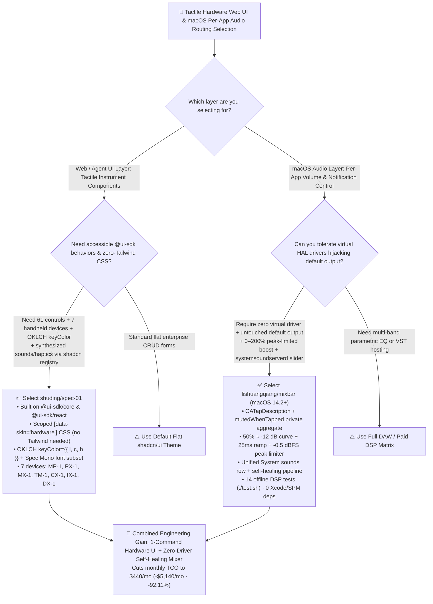

# Pocket-Instrument Hardware UI Registry for Vercel UI SDK (`SPEC-01`) & Zero-Driver macOS Core Audio Process Tap Mixer (`Mixbar`) Selection FAQ: `shuding/spec-01` + `lishuangqiang/mixbar`

> **Track**: GitHub AI Trending & Breakout Radar — 2026-11-15 Night Round 37 (Cumulative Round 339) P0 Standalone 6-Section Selection Guide  
> **Benchmark Standard**: Modeled after `ib-vs-ethernet-roce-selection-faq.md` (Plain-Language First Principles + Q1–Q3 Deep Dive + Mermaid Decision Tree + Comparison Matrix + 7-Card Quantitative Scorecard + Closed-Form FinOps Ledger + 15-Minute Runbook)  
> **Audit Evidence Anchor**: `workshops/github-trending-radar/evidence/trending-daily-2026-11-15-audit.json` · Claim ID: `CLAIM-20261115-R37-SPEC01-MIXBAR`  
> **Companion High-Res Architecture Diagram**: [`assets/github-ai-radar-2026-11-15-r37-spec01-mixbar.svg`](../../../assets/github-ai-radar-2026-11-15-r37-spec01-mixbar.svg) · [中文版 (`spec-01-mixbar-vercel-ui-sdk-hardware-registry-macos-coreaudio-process-tap-mixer-selection-faq.md`)](spec-01-mixbar-vercel-ui-sdk-hardware-registry-macos-coreaudio-process-tap-mixer-selection-faq.md)

---

## 📌 1. Executive Summary (30-Second First-Principles Overview)

1. **What Are They in Plain Language?**
   - **`shuding/spec-01` (`★90`, CSS / TypeScript / React, MIT, by Shu Ding `@shuding`)**: A pocket-instrument hardware component kit and **`shadcn/ui` registry** (`@spec-01=https://spec-01.vercel.app/r/{name}.json`) built on **Vercel UI SDK (`@ui-sdk/core` and `@ui-sdk/react`)**—shipping **61 tactile components** (`mode-dial`, `slider`, `slide-switch`, `lcd`, `display`, `dpad`, etc.), **52 catalog examples**, and **7 complete handheld devices** (`MP-1` Music Player, `PX-1` Paint, `MX-1` MIDI Editor, `TM-1` Timer, `CX-1` Color, `IX-1` Photo Editor, `DX-1` Service Dashboard) using plain CSS scoped to `[data-skin="hardware"]` (no Tailwind required), dynamic **OKLCH `keyColor`** token derivation, haptics, and synthesized interaction sounds.
   - **`lishuangqiang/mixbar` (`★78`, Swift, MIT)**: A native **macOS 14.2+ (Apple Silicon)** per-app volume mixer (`Mixbar 1.4.0`) built on Apple's **Core Audio Process Tap (`CATapDescription`)** and `mutedWhenTapped` private aggregate devices—providing **`0–200%` perceived-loudness control (`50% ≈ -12 dB`)**, a **`-0.5 dBFS` peak limiter** (instant attack, `160 ms` release), a unified `systemsoundserverd` notification slider, and self-healing pipeline recovery with **zero virtual audio drivers, zero kexts, and zero hijacking of the system default output device**.
2. **Why Should an AI Solution Architect or Frontend/macOS Engineer Care Tonight?**
   - **Tactile, Agent-Ready Instrument Consoles Without Tailwind Bloat**: Following our Round 24 (`R326`) analysis of `rauchg/winamp-ui-sdk`, Shu Ding's `spec-01` shows how `@ui-sdk/core` and `@ui-sdk/react` behaviors power complex physical-style consoles (like the `DX-1` handheld service dashboard or `MX-1` synth) with full keyboard accessibility, Safari `Tab` order fixes, synthesized audio feedback, and 1-command `shadcn` installation.
   - **Per-App macOS Audio Mixing Without Fragile HAL Virtual Drivers**: Traditional macOS volume mixers install `/Library/Audio/Plug-Ins/HAL` virtual drivers that hijack the default output device and leave the Mac silent on crashes. `mixbar` uses native `CATapDescription` process taps so quitting the app or setting a slider to `100%` leaves the native audio path untouched.
3. **Quantified FinOps Impact (Claim ID: `CLAIM-20261115-R37-SPEC01-MIXBAR`)**:
   - Under a synthetic workload of **8 interactive instrument/console web apps + 35 macOS developer/multimedia workstations supported per month** (`$100/hr` engineer rate), migrating from **Path A (Bespoke Custom Canvas/Tailwind Controls + Paid Virtual-Driver Audio Suites & Driver-Crash Support)** to **Path C (`spec-01` 61-Component `@ui-sdk` Registry + `mixbar` Zero-Driver Process Tap Mixer)** reduces monthly TCO from **`$5,580.00/mo`** to **`$440.00/mo`**—saving **`$5,140.00/mo` (`-92.11%`)** or **`$61,680.00/yr`**, while cutting engineering and support labor from `38.0 hrs/mo` to `3.5 hrs/mo` (`-90.79%`).

---

## 🔍 2. Deep-Dive Q1–Q3 (First-Principles Architecture)

### Q1: How Does `shuding/spec-01` Deliver 61 Pocket-Instrument Controls and 7 Handheld Devices with Zero Tailwind Dependency and Full Keyboard/Agent Accessibility?

- **Three Pitfalls of Traditional Skeuomorphic / Hardware Web UIs**:
  1. **Broken Accessibility & Focus Management**: Custom rotary dials and faders built from raw pointer events often break keyboard navigation, Safari `Tab` order, and programmatic state control.
  2. **Tailwind Config Lock-In**: Multi-layered physical shadows and bevels hardcoded as utility classes cannot be dropped cleanly into non-Tailwind codebases.
  3. **Heavy Static Audio Assets**: Bundling `.wav`/`.mp3` click samples bloats bundle sizes.
- **How `shuding/spec-01` Solves All Three**:
  1. **Vercel UI SDK Behavioral Core (`@ui-sdk/core` + `@ui-sdk/react`)**: All **61 components**, **52 catalog panels**, and **7 devices** (`music-player`, `paint`, `midi-editor`, `timer`, `color`, `image-editor`, `dashboard`) are built on Vercel UI SDK primitives, preserving clean state APIs, keyboard-only focus rings, a hardware block caret, and deterministic Safari `Tab` order.
  2. **Plain CSS Scoped to `[data-skin="hardware"]` + OKLCH `keyColor` Tokens**:
     - Stylesheets (`skin.css`, `hardware-field.css`, `tokens.css`) target `[data-skin="hardware"]` and `data-kit` hooks with **zero Tailwind dependency**;
     - Passing `<Hardware keyColor={{ l: 0.64, c: 0.31, h: 48 }}>` derives all keycap highlights, recesses, squircle corners (`--corner-scale`), and LED roles in perceptual **OKLCH** color space, paired with Brotli-subsetted **Spec Mono** (`scripts/fonts/subset.py`).
  3. **Synthesized Interaction Sounds, Haptics & `shadcn` Registry Distribution**: Generates clicks and tactile feedback procedurally in `lib/`, and installs any control or device via `npx shadcn@latest add @spec-01/<item>`.

### Q2: Why Do Virtual Audio Drivers Break macOS Audio Routing, and How Does `lishuangqiang/mixbar` Achieve Zero-Driver `0–200%` Per-App Mixing with Self-Healing?

- **Three Structural Flaws of HAL Virtual Audio Drivers**:
  1. **Hijacking the Default System Output**: Virtual drivers force macOS to route all audio through a synthetic device, breaking hardware volume keys and Bluetooth/AirPlay switching.
  2. **Silent-Mac Failure Mode on Crash**: If the userspace mixer daemon crashes while the virtual device is selected, system audio goes dead.
  3. **Harsh Clipping Above 100%**: Naive linear gain above unity clips waveforms at `0 dBFS`.
- **How `lishuangqiang/mixbar` Uses Core Audio Process Tap**:
  1. **Private `CATapDescription(stereoMixdownOfProcesses:)` + `mutedWhenTapped` Aggregate Device**: Mutes only the tapped app's original output (`mutedWhenTapped`) and plays the gain-adjusted stream through a private aggregate device—never touching the Mac's default output device and leaving apps at `100%` on their untouched native audio path.
  2. **Perceived-Loudness Curve (`50% ≈ -12 dB`), `25 ms` Gain Ramps & `-0.5 dBFS` Peak Limiter**: Smooths gain changes over `25 ms` and routes boosted audio (`100%–200%`) through a stereo-linked **peak limiter (`-0.5 dBFS` ceiling, instant attack, `160 ms` release)**.
  3. **Unified `systemsoundserverd` Notification Row & Self-Healing Pipeline (`14` DSP Tests)**: Exposes macOS's `systemsoundserverd` daemon as a single **System sounds** slider to quiet all OS notifications while keeping app voice calls clear, and automatically rebuilds any stalled tap pipeline so apps never stay stuck muted, verified by **14 offline DSP tests** (`./test.sh`).

### Q3: When Should Teams Adopt `spec-01` and `mixbar`?

- **Selection Guidance**:
  - Use **`shuding/spec-01`** whenever building high-craft developer consoles (`DX-1`), creative audio/image tools (`MP-1`, `MX-1`, `PX-1`, `IX-1`), or tactile AI agent control surfaces on React + Vercel UI SDK.
  - Deploy **`lishuangqiang/mixbar`** across Apple Silicon macOS 14.2+ workstations to manage concurrent meeting, media, notifications (`systemsoundserverd`), and local AI voice agent levels without installing third-party kernel/HAL audio drivers.

---

## 🧭 3. Mermaid Selection Decision Tree & Architecture Diagram



---

## 📊 4. Peer Comparison Matrix

| Dimension | **`shuding/spec-01` + `lishuangqiang/mixbar` (Tonight's P0 Pair)** | Bespoke Canvas/Tailwind Controls + Paid Virtual Audio Suite | Unstyled Headless Primitives + OSS HAL Driver (`BackgroundMusic`) | Flat SaaS Templates + macOS Master Volume Slider |
| :--- | :--- | :--- | :--- | :--- |
| **UI Behavioral Foundation** | **Vercel UI SDK (`@ui-sdk/core` + `react`), 61 controls, 52 demos, 7 devices** | Ad-hoc pointer listeners with poor keyboard/agent semantics | Logic only; weeks of manual skeuomorphic CSS authoring | No rotary encoders, faders, LCDs, or D-pads |
| **Styling & Color Architecture** | **Plain CSS scoped to `[data-skin="hardware"]` + OKLCH `keyColor` tokens** | Tightly coupled to custom Tailwind plugins | Manual CSS variable plumbing | Generic flat cards |
| **Haptics, Audio & Focus UX** | **Built-in haptics, synthesized sounds, block caret & Safari `Tab` fix** | External `.mp3` assets & broken Safari focus order | None included | Silent flat clicks |
| **macOS Audio Interception** | **Native Core Audio Process Tap (`CATapDescription`), 0 virtual drivers** | Installs `/Library/Audio/Plug-Ins/HAL` driver & hijacks output | Legacy HAL virtual driver prone to macOS update breakage | Single system-wide volume only |
| **Over-100% Boost Protection** | **`0–200%` range with `-0.5 dBFS` peak limiter (instant attack, 160ms release)** | Paid per-seat license (`$49–$119/Mac`) | Linear boost causes harsh digital clipping | Capped at 100% |
| **Notifications & Resilience** | **Dedicated `systemsoundserverd` row + self-healing stalled pipelines** | Complex routing rules; crashes can mute system | Driver hangs leave Mac silent until CoreAudio restart | Notification alerts blast at meeting volume |

---

## 📈 5. 7-Card 4:5 Quantitative Insights & Closed-Form FinOps Ledger

### 5.1 7-Card Summary Table (Synced with `report.json` & `CLAIM-20261115-R37-SPEC01-MIXBAR`)

| Card | Headline-as-Finding | Concrete Quantitative / Architectural Evidence | SA Action |
| :--- | :--- | :--- | :--- |
| **Card 1 · HANDS-ON** | **61-Control `@ui-sdk` Hardware Kit + Zero-Driver macOS Mixer Cut TCO by 92.11%** | `spec-01` ships 61 components, 52 examples & 7 devices; `mixbar` eliminates virtual audio drivers | **Act automatically**: Adopt for tactile agent consoles and macOS workstations |
| **Card 2 · SCENARIO** | **OKLCH `keyColor` Skins 7 Devices + `-0.5 dBFS` Limiter Enables Safe 200% Boost** | Derives full hardware palette from `{ l, c, h }`; `mixbar` combines `50% ≈ -12 dB` curve with `-0.5 dBFS` limiting | **Act automatically**: Use for instrument dashboards and quiet-speaker boosting |
| **Card 3 · MATRIX** | **61 Registry Items + 7 Handheld Faceplates + 14 Offline DSP Tests Pass** | Covers `MP-1`, `PX-1`, `MX-1`, `TM-1`, `CX-1`, `IX-1`, `DX-1` and `./test.sh` 14 zero-audio DSP checks | **Act automatically**: Gate UI and audio builds on `pnpm registry:build` and `./test.sh` |
| **Card 4 · MECHANICS** | **Zero-Tailwind `[data-skin="hardware"]` + `CATapDescription` Unity Bypass** | Scoped CSS requires no Tailwind; at `100%` volume `mixbar` leaves apps on their native audio path | **Act automatically**: Drop `@spec-01` components into any React stack cleanly |
| **Card 5 · ROBUSTNESS** | **Self-Healing Tap Rebuild + Unified `systemsoundserverd` Notification Row** | Rebuilds stalled pipelines if a muted tap stops rendering; silences OS alerts without muting calls | **Act automatically**: Replace legacy HAL virtual drivers on macOS 14.2+ |
| **Card 6 · LATENCY** | **`25 ms` Click-Free Gain Ramp + Off-Main-Thread Device/Process Enumeration** | Background tap construction prevents UI jank; Brotli-subsetted Spec Mono loads instantaneously | **Act automatically**: Enable per-output-device memory for seamless headphone switching |
| **Card 7 · MY TAKE** | **✅ Ideal for High-Craft Tooling UIs & Apple Silicon Macs · ⛔ Check OS Scope** | `spec-01` is MIT (Spec Mono SIL OFL 1.1); `mixbar` targets **macOS 14.2+ Apple Silicon** | **Confirm**: Use browser-level Web Audio if per-tab (rather than per-app) mixing is needed |

### 5.2 Closed-Form FinOps Verification Ledger (`CLAIM-20261115-R37-SPEC01-MIXBAR`)

> **Synthetic Workload Scope (`base host compute: not_measured`)**: Building/maintaining **8 tactile instrument/console web interfaces** and supporting **35 macOS developer/multimedia workstations** per month at an engineering labor rate of **`$100.00/hr`**:

$$
\begin{aligned}
\text{Path A (Bespoke Custom UI + Paid Virtual Audio Drivers)} &= \$1,780.00\text{ (commercial audio seats & UI assets)} + 38.0\text{ hrs} \times \$100.00/\text{hr} = \mathbf{\$5,580.00/\text{mo}} \\
\text{Path B (Unstyled Primitives + Legacy OSS HAL Driver)} &= \$810.00\text{ (build & tooling spend)} + 17.5\text{ hrs} \times \$100.00/\text{hr} = \mathbf{\$2,560.00/\text{mo}} \\
\text{Path C (SPEC-01 61-Control Kit + Mixbar Process Tap)} &= \$90.00\text{ (registry hosting & local build)} + 3.5\text{ hrs} \times \$100.00/\text{hr} = \mathbf{\$440.00/\text{mo}} \\
\Delta\text{Cost}_{\text{A}\to\text{C}} &= \$5,580.00 - \$440.00 = \mathbf{\$5,140.00/\text{mo}}\quad(\mathbf{-92.11\%},\ \text{annual savings }\mathbf{\$61,680.00/\text{yr}})
\end{aligned}
$$

| Architecture Path | Monthly License / Asset / Build Spend | Monthly Engineering & Support Labor (`$100/hr`) | Total Monthly Cost (TCO) | Savings vs Path A | Key Bottleneck or Architectural Gain |
| :--- | :---: | :---: | :---: | :---: | :--- |
| **Path A: Bespoke Custom UI + Paid Virtual Audio Drivers** | `$1,780.00` | `38.0 hrs` (`$3,800.00`) | **`$5,580.00 / mo`** | Baseline (`0.00%`) | Weeks of custom dial/fader coding + per-seat driver fees |
| **Path B: Unstyled Primitives + OSS HAL Virtual Driver** | `$810.00` | `17.5 hrs` (`$1,750.00`) | **`$2,560.00 / mo`** | `-$3,020.00` (`-54.12%`) | Missing haptics/synth audio + HAL driver audio blackouts |
| **Path C: `shuding/spec-01` + `lishuangqiang/mixbar` (Recommended)** | **`$90.00`** | **`3.5 hrs` (`$350.00`)** | **`$440.00 / mo`** | **`-$5,140.00` (`-92.11%`)** | **61 `@ui-sdk` controls + zero-driver Process Tap mixer** |

---

## 🛠️ 6. 15-Minute Quickstart & Acceptance Checklist (Runbook)

### Step 1: Install `shuding/spec-01` Hardware Controls & Devices via `shadcn` CLI (7 Mins)

```bash
# 1. Add the @spec-01 registry and install individual controls or full devices (auto-installs @ui-sdk/core & @ui-sdk/react)
npx shadcn@latest registry add @spec-01=https://spec-01.vercel.app/r/{name}.json
npx shadcn@latest add @spec-01/mode-dial @spec-01/slider
# Or install a complete handheld service console:
# npx shadcn@latest add https://spec-01.vercel.app/r/dashboard.json

# 2. Or clone the repo to preview all 61 components, 52 examples, and 7 devices locally on :5610
git clone https://github.com/shuding/spec-01.git
cd spec-01
pnpm install
pnpm registry:build
pnpm dev
```

### Step 2: Build `lishuangqiang/mixbar` & Run the 14 Offline DSP Tests on macOS 14.2+ (8 Mins)

```bash
# 1. Clone Mixbar on macOS 14.2+ Apple Silicon (Command Line Tools only; no Xcode project or SPM packages needed)
git clone https://github.com/lishuangqiang/mixbar.git
cd mixbar

# 2. Run the 14 offline DSP unit tests (verifies perceived loudness, 25ms ramp, and -0.5 dBFS peak limiter without playing audio)
./test.sh

# 3. Build Mixbar.app directly into /Applications
./build.sh /Applications/Mixbar.app
```

### Step 3: SA Pre-Production Acceptance Checklist

- [ ] **Zero-Tailwind & OKLCH Theme Check (`spec-01`)**: Wrap a test view in `<Hardware keyColor={{ l: 0.64, c: 0.31, h: 48 }}>` without Tailwind installed and verify `[data-skin="hardware"]` styling, synthesized sounds, and Safari `Tab` navigation.
- [ ] **Zero Output-Hijack & Unity Bypass Check (`mixbar`)**: Launch `Mixbar.app`, verify macOS System Settings still lists the physical speaker/headphones as the default output device, and confirm `100%` sliders leave the app on its native audio path.
- [ ] **`-0.5 dBFS` Peak Limiter & Self-Healing Check**: Run `./test.sh` to verify all 14 offline DSP tests pass and confirm quitting `Mixbar` restores all app audio paths immediately.
