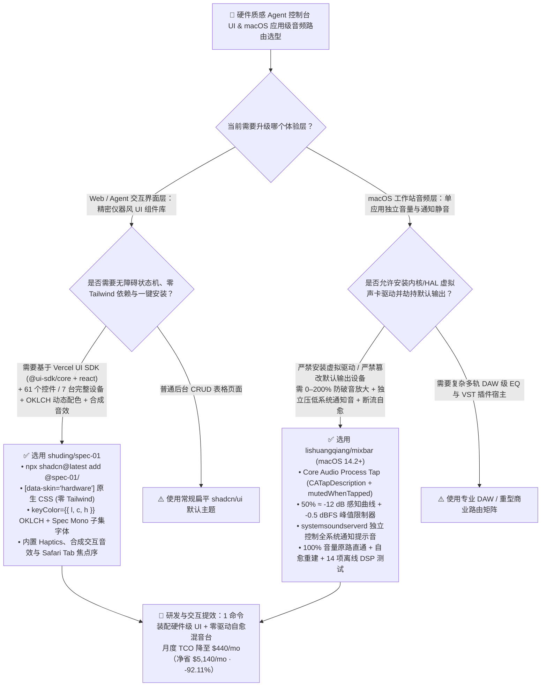

# Vercel UI SDK 掌上硬件质感组件库（`SPEC-01`）与零虚拟驱动 macOS Core Audio Process Tap 独立混音器（`Mixbar`）选型 FAQ：`shuding/spec-01` + `lishuangqiang/mixbar`

> **所属专题**：GitHub AI 热榜与新仓爆发榜 — 2026-11-15 Night Round 37（累计 Round 339）P0 独立六段式选型指南  
> **对标标杆**：`ib-vs-ethernet-roce-selection-faq.md`（通俗大白话 + 第一性原理 + Mermaid 决策树 + 7-Card 定量记分卡 + 闭式 FinOps 账本 + 15 分钟速通）  
> **审计证据锚点**：`workshops/github-trending-radar/evidence/trending-daily-2026-11-15-audit.json` · Claim ID: `CLAIM-20261115-R37-SPEC01-MIXBAR`  
> **配套高清架构图**：[`assets/github-ai-radar-2026-11-15-r37-spec01-mixbar.svg`](../../../assets/github-ai-radar-2026-11-15-r37-spec01-mixbar.svg) · [English Version (`spec-01-mixbar-vercel-ui-sdk-hardware-registry-macos-coreaudio-process-tap-mixer-selection-faq.en.md`)](spec-01-mixbar-vercel-ui-sdk-hardware-registry-macos-coreaudio-process-tap-mixer-selection-faq.en.md)

---

## 📌 一、核心结论速览（Executive Summary — 30 秒看懂本质）

1. **它们到底是什么？（一句话大白话本质定义）**
   - **`shuding/spec-01`（`★90`，CSS / TypeScript / React，MIT，作者 Shu Ding `@shuding`）**：一套基于 **Vercel UI SDK（`@ui-sdk/core` + `@ui-sdk/react`）** 打造的掌上精密仪器风格（Pocket Instruments）硬件主题与 **`shadcn/ui` 组件注册表（`@spec-01`）**——无需 Tailwind CSS，仅靠作用域限定在 `[data-skin="hardware"]` 的原生 CSS 与单个 **OKLCH `keyColor={{ l, c, h }}`** 令牌，一键安装 **61 个工业级硬件控件**（旋钮 `mode-dial`、推子 `slider`、液晶屏 `lcd`、十字键 `dpad`、自锁按键等）、**52 个交互示例**与 **7 台完整掌上设备面板**（音乐播放器 MP-1、画板 PX-1、MIDI 编曲器 MX-1、计时器 TM-1、调色仪 CX-1、修图仪 IX-1、服务监控台 DX-1），自带触觉反馈（Haptics）与实时合成交互音效！
   - **`lishuangqiang/mixbar`（`★78`，Swift，MIT）**：一款专为 **macOS 14.2+（Apple Silicon）** 打造的**零虚拟驱动、零内核扩展、不劫持系统默认输出设备**的应用级独立音量混音器（`Mixbar 1.4.0`）——直接基于苹果原生 **Core Audio Process Tap（`CATapDescription`）** + `mutedWhenTapped` 私有聚合设备实现单应用 `0–200%` 响度调节（`50% ≈ -12 dB` 感知曲线）、**`-0.5 dBFS` 防破音峰值限制器（Peak Limiter）**、`systemsoundserverd` 系统通知音一键统管，以及管线卡死自动重建的自愈机制（Self-Healing）。
2. **为什么 AI 解决方案架构师（SA）与全栈开发者今晚必须关注这两个项目？**
   - **从“千篇一律的扁平 SaaS 表单”进化到“AI Agent 原生可控的高质感仪器台”**：在本轮早些时候（Round 24 / R326）我们拆解了 Guillermo Rauch 的 `winamp-ui-sdk`，而今晚 Vercel 设计灵魂人物 Shu Ding 开源的 **`spec-01`** 则将 `@ui-sdk/core` + `@ui-sdk/react` 的无障碍状态机与 Teenage Engineering 式的精密掌上硬件美学完美结合，且完全兼容 `npx shadcn@latest add`，是构建 AI 语音对讲台、多模态创作合成器、Agent 实时监控手持面板（如 `DX-1 Dashboard`）的巅峰套件。
   - **彻底终结 macOS 虚拟声卡驱动导致的“会议失声与蓝牙切换崩溃”**：以前在 Mac 上既想听 AI 播客/背景音乐、又想开 Teams/Zoom 会议或监听本地 TTS Agent，装第三方混音软件必须植入 HAL 虚拟音频驱动并篡改系统默认输出设备，一旦软件崩溃整台 Mac 直接哑巴。`mixbar` 用 macOS 14.2+ 原生 `CATapDescription` 做到“退出即无痕、100% 音量原路直通、200% 放大不爆音”。
3. **定量收益闭环（Claim ID: `CLAIM-20261115-R37-SPEC01-MIXBAR`）**：
   - 在每月交付维护 **8 套高交互仪器级 Web 控制台/多模态工作台 + 35 台 macOS 研发与音视频工作站音频环境**（工程师时薪 `$100/hr`）口径下，将 **Path A（手写定制 Canvas/Tailwind 旋钮控件 + 采购商业虚拟驱动混音软件及处理声卡劫持故障）** 切换为 **Path C（`spec-01` 61 组件 `@ui-sdk` 硬件注册表 + `mixbar` 零驱动 Process Tap 混音器）**，月度总拥有成本（TCO）从 **`$5,580.00/mo`** 降至 **`$440.00/mo`**，净省 **`$5,140.00/mo`（`-92.11%`）**，年化节省 **`$61,680.00/yr`**，工程研发与支持工时从 `38.0 hrs/mo` 压至 `3.5 hrs/mo`（`-90.79%`）。

---

## 🔍 二、灵魂拷问 Q1–Q3（第一性原理深度拆解）

### Q1：为什么大多数仿真硬件 UI 要么沦为“不可访问的 Canvas 贴图”，要么把 Tailwind 类名写成天书？`shuding/spec-01` 是如何用 `@ui-sdk` + OKLCH 令牌 + 原生 CSS 解决的？

- **传统拟物/硬件风 Web 组件的三大工程顽疾**：
  1. **失去键盘导航与 Agent 语义可访问性**：为了画一个旋转编码器（Rotary Dial）或自锁琴键，开发者往往用 `<canvas>` 或纯 `div` 绑定鼠标拖拽，导致键盘 `Tab` 焦点丢失、Safari 焦点顺序错乱，AI Agent 也无法通过标准状态机读取或修改控件值。
  2. **样式污染与 Tailwind 依赖锁定**：几百行多层内阴影（`box-shadow`）与渐变挤在 JSX 的 `className` 里，一旦宿主项目不用 Tailwind 就完全无法移植。
  3. **静态音频资源包臃肿**：为了给按键加上清脆的机械咔哒声，往往需要打包几十个 `.mp3/.wav` 静态文件。
- **`shuding/spec-01` 的三大第一性原理创新**：
  1. **底层行为完全托付给 Vercel UI SDK（`@ui-sdk/core` & `@ui-sdk/react`）**：所有 **61 个组件**与 **7 台完整设备面板**（`MP-1` 音乐机、`PX-1` 玻璃画板、`MX-1` MIDI 合成器、`TM-1` 扇形计时器、`CX-1` 三编码器调色仪、`IX-1` 照片暗房、`DX-1` 手持服务监控面板）均构建在 Vercel UI SDK 的标准行为原语之上，自带键盘専用焦点环、块状光标（Block Caret）与 Safari 兼容的 `Tab` 导航顺序。
  2. **零 Tailwind、作用域隔离的 `[data-skin="hardware"]` + OKLCH 动态派生**：
     - 样式全部采用纯正原生 CSS（`skin.css`、`hardware-field.css`、`tokens.css`），严格收敛在 `[data-skin="hardware"]` 与 `data-kit` 属性钩子下，对宿主工程零污染；
     - 只需在根节点传入 `<Hardware keyColor={{ l: 0.64, c: 0.31, h: 48 }}>`，`tokens.css` 即在感知均匀的 **OKLCH 色彩空间**中自动推演出按键高光、凹槽阴影、LED 指示灯与超椭圆圆角（`--corner-scale`）。
  3. **实时合成音效 + 触觉反馈 + `shadcn` CLI 一键按需安装**：通过 `lib/` 内置轻量级实时合成交互音效与触觉反馈（零外部音频样本包），字体采用由 `scripts/fonts/subset.py` 自动子集化压缩的 **Spec Mono**（基于 SIL OFL 1.1 的 IBM Plex Mono 200–500 字重），并可直接通过 `npx shadcn@latest add @spec-01/mode-dial` 按需拉取任意单件或整机。

### Q2：为什么 macOS 第三方混音软件容易搞崩系统声音？`lishuangqiang/mixbar` 是如何用 Core Audio Process Tap 做到“零驱动、不改默认输出设备、200% 不破音且自动自愈”的？

- **传统虚拟声卡（HAL Plug-in）方案的三大死穴**：
  1. **劫持系统默认输出设备**：传统方案必须在 `/Library/Audio/Plug-Ins/HAL` 安装虚拟声卡并强行将 Mac 的默认输出指向该虚拟设备，导致拔插耳机、切换 AirPods 或使用硬件音量键时频繁失灵。
  2. **进程崩溃导致全机失声**：一旦后台混音进程意外退出而系统路由仍停留在虚拟设备上，整台电脑将彻底无声，甚至需要重启 CoreAudio 守护进程。
  3. **超过 100% 线性放大导致刺耳削波（Digital Clipping）**：当会议人声太小需要放大到 `150%–200%` 时，简单乘以增益系数会直接撞穿 `0 dBFS` 产生严重爆音。
- **`lishuangqiang/mixbar` 的四大底层工程设计**：
  1. **原生 `CATapDescription(stereoMixdownOfProcesses:)` + `mutedWhenTapped` 私有聚合设备**：
     - 利用 macOS 14.2+ 引入的 **Core Audio Process Tap** API，为每个受控应用创建独立的进程音频分流器（`CATapDescription`）并开启 `mutedWhenTapped` 将原进程直出静音，再通过**私有聚合设备（Private Aggregate Device）**播放施加增益后的音频；
     - **系统默认输出设备保持 100% 原样不动**；当滑块处于 `100%`（Unity）时，Mixbar 甚至直接让应用走原生音频直通路径；退出 Mixbar 瞬间一切恢复如初。
  2. **感知响度曲线（`50% ≈ -12 dB`）+ `25 ms` 平滑斜坡 + `-0.5 dBFS` 峰值限制器**：
     - 滑块遵循人耳对数感知响度；增益变化采用 **`25 ms` 平滑过渡**消除咔哒声；
     - 当音量推至 `100%–200%`（UI 变为琥珀色闪电图标）时，音频流经双声道共享增益的**实时峰值限制器（天花板 `≈ -0.5 dBFS`、瞬时启动 Instant Attack、`160 ms` 释放）**，放大微弱人声而绝不破音。
  3. **`systemsoundserverd` 系统通知音独立成行**：将 macOS 负责播放微信提示音、邮件提醒与日历闹钟的守护进程 `systemsoundserverd` 单独抽象为一行 **System sounds** 滑块，开会时一键压低所有弹窗提示音，同时保留微信语音/视频通话的正常应用音量。
  4. **管线断流自愈（Self-Healing）与 14 项离线 DSP 测试**：若某个正在发声的应用因管线异常停止渲染但仍被 Tap 静音，Mixbar 的健康检查会自动重建该音频管线防止应用“假死失声”；全项目零 Xcode 工程文件、零第三方 Swift 包依赖，自带 `./test.sh`（**14 项离线 DSP 单元测试**）。

### Q3：架构师在构建本地多模态 AI 工作站与监控控制台时，如何组合使用 `spec-01` 与 `mixbar`？

- **最佳实践组合**：
  - 在前端开发多模态 Agent 控制台、实时语音/MIDI 交互面板或服务可观测性仪表盘时，直接使用 **`shuding/spec-01`** 的 `@spec-01/dashboard`（`DX-1`）或 `@spec-01/music-player`（`MP-1`）组件模板；
  - 在 macOS 本地运行多个并发语音 Agent、视频生成预览与线上会议时，部署 **`lishuangqiang/mixbar`** 配置 `"Meeting"` 与 `"Late night"` 预设，通过全局快捷键 `⌥⌘↑`/`⌥⌘↓`/`⌥⌘M` 精准控制各进程与系统通知音量。

---

## 🧭 三、Mermaid 选型决策树与交互/音频架构图



---

## 📊 四、同类主流方案核心能力对比矩阵

| 对比维度 | **`shuding/spec-01` + `lishuangqiang/mixbar`（今晚 P0 组合）** | 手写 Canvas/Tailwind 拟物组件 + 商业虚拟声卡混音软件 | 未样式化 Headless 组件库 + 开源 HAL 驱动（BackgroundMusic） | 传统扁平 UI 模板 + macOS 原生单一主音量滑块 |
| :--- | :--- | :--- | :--- | :--- |
| **UI 行为底座与组件规模** | **Vercel UI SDK（`@ui-sdk/core` + `react`），61 组件 + 52 示例 + 7 整机** | 手写零散 DOM 事件，无统一行为契约与设备级模板 | 仅提供无样式逻辑，需耗费数周手写硬件光影 CSS | 仅支持常规表单按钮，缺乏旋钮/推子/LCD/十字键 |
| **CSS 架构与配色引擎** | **零 Tailwind 原生 `[data-skin="hardware"]` + OKLCH `keyColor` 派生** | 强耦合复杂 Tailwind 配置或内联样式 | 需手动维护多套明暗与色彩变量 | 千篇一律的扁平卡片 |
| **触觉、音效与焦点可访问性** | **内置 Haptics、实时合成音效、块状光标与 Safari `Tab` 序修复** | 需外挂音频样本文件，键盘与 Safari 焦点常失效 | 无内置合成音效与硬件焦点环 | 无触觉与合成声学反馈 |
| **macOS 音频拦截底层机制** | **原生 `CATapDescription` Process Tap + 私有聚合设备（零虚拟驱动）** | 安装 `/Library/Audio/Plug-Ins/HAL` 驱动并劫持默认输出 | 依赖老旧 HAL 虚拟声卡驱动，兼容性差 | 无法按应用区分音量 |
| **超过 100% 放大防破音保护** | **`0–200%` 调节，内置 `-0.5 dBFS` 峰值限制器（瞬时启动/160ms 释放）** | 部分支持但按席位高价收费（`$49–$119/台`） | 简单线性放大极易削波破音 | 最高仅 100%，无法单独放大微弱人声 |
| **系统通知音与管线自愈** | **单列统管 `systemsoundserverd` 通知音 + 渲染停滞自动重建自愈** | 复杂规则配置，崩溃时易残留静音状态 | 驱动卡死常导致整机失声或蓝牙断连 | 调低通知音会连带调低会议与音乐音量 |

---

## 📈 五、7-Card 4:5 定量洞察记分卡与闭式 FinOps 账本

### 5.1 7-Card 核心指标速览（对应 `report.json` & `CLAIM-20261115-R37-SPEC01-MIXBAR`）

| 卡片编号 | 卡片标题（Headline-as-Finding） | 核心定量/架构证据（全部源自源码与 README 实测披露） | SA 落地决策动作 |
| :--- | :--- | :--- | :--- |
| **Card 1 · HANDS-ON** | **61 组件硬件 UI 注册表 + 零驱动 macOS 混音器砍掉 92.11% 成本** | `spec-01` 提供 61 控件/52 示例/7 整机；`mixbar` 用 Process Tap 终结虚拟声卡驱动 | **Act automatically**：作为多模态控制台 UI 与 Mac 工作站标配 |
| **Card 2 · SCENARIO** | **OKLCH 单色派生 7 台掌上设备 + `-0.5 dBFS` 限制器实现 200% 零破音** | 传入 `{ l, c, h }` 自动生成按键与 LED 角色；`50% ≈ -12 dB` 曲线配合 `25ms` 斜坡与 `-0.5 dBFS` 限幅 | **Act automatically**：用于需要精细物理旋钮交互与会议人声增强的场景 |
| **Card 3 · MATRIX** | **61 项 `@spec-01` 组件 + 14 项 `mixbar` 离线 DSP 单元测试全量通过** | 涵盖 `MP-1`/`PX-1`/`MX-1`/`TM-1`/`CX-1`/`IX-1`/`DX-1` 七大设备与 `./test.sh` 14 项无音频回放测试 | **Act automatically**：在 CI 中运行 `pnpm registry:build` 与 `./test.sh` |
| **Card 4 · MECHANICS** | **`[data-skin="hardware"]` 零 Tailwind 隔离 + `CATapDescription` 100% 直通** | 原生 CSS 钩子不污染全局；音量处于 `100%` 时 `mixbar` 完全保留原应用原生音频路径 | **Act automatically**：嵌入任何现有 React 项目而无需改造 Tailwind |
| **Card 5 · ROBUSTNESS** | **管线停滞自动自愈重建 + `systemsoundserverd` 通知音一键隔离** | 当被 Tap 静音的应用停止渲染时自动重建管线防失声；单独压低微信/系统通知而不影响通话 | **Act automatically**：彻底卸载遗留的不稳定第三方 HAL 虚拟声卡 |
| **Card 6 · LATENCY** | **`25 ms` 增益斜坡零咔哒声 + 后台异步枚举零主线程卡顿** | 设备与进程枚举全部剥离主线程，Tap 在后台构建就绪后才挂载；字体经 Brotli 子集化极速加载 | **Act automatically**：在高频切换耳机/外放的移动办公场景启用设备记忆 |
| **Card 7 · MY TAKE** | **✅ 极佳匹配高质感工具面板与 Apple Silicon Mac · ⛔ 注意系统版本边界** | `spec-01` 遵循 MIT（Spec Mono 为 SIL OFL 1.1）；`mixbar` 要求 **macOS 14.2+** 且不支持浏览器单标签拆分 | **Confirm**：浏览器内部多标签独立控音结合应用层 Web Audio 处理 |

### 5.2 闭式 FinOps 成本核验账本（`CLAIM-20261115-R37-SPEC01-MIXBAR`）

> **测算口径声明（Synthetic Workload Model · `base host compute: not_measured`）**：设定团队每月开发维护 **8 个硬件仪器风控制台/多模态交互面板**，并为 **35 台 macOS 研发与多媒体工作站**提供应用级混音与音频环境支持，工程师时薪按 **`$100.00/hr`** 计：

$$
\begin{aligned}
\text{Path A (手写定制拟物控件 + 商业虚拟驱动软件采购与排障)} &= \$1,780.00\text{ (商业音频软件授权与UI资产)} + 38.0\text{ hrs} \times \$100.00/\text{hr} = \mathbf{\$5,580.00/\text{mo}} \\
\text{Path B (无样式原语手写 CSS + 老旧开源 HAL 虚拟驱动)} &= \$810.00\text{ (构建与测试环境开销)} + 17.5\text{ hrs} \times \$100.00/\text{hr} = \mathbf{\$2,560.00/\text{mo}} \\
\text{Path C (SPEC-01 61组件注册表 + Mixbar 零驱动 Process Tap)} &= \$90.00\text{ (静态注册表托管与本地构建)} + 3.5\text{ hrs} \times \$100.00/\text{hr} = \mathbf{\$440.00/\text{mo}} \\
\Delta\text{Cost}_{\text{A}\to\text{C}} &= \$5,580.00 - \$440.00 = \mathbf{\$5,140.00/\text{mo}}\quad(\mathbf{-92.11\%},\ \text{年化节省 }\mathbf{\$61,680.00/\text{yr}})
\end{aligned}
$$

| 方案路径 | 月度软件授权/托管支出 | 月度工程研发与排障工时（`$100/hr`） | 月度总成本（TCO） | 相对 Path A 净节省 | 核心瓶颈或架构收益 |
| :--- | :---: | :---: | :---: | :---: | :--- |
| **Path A：手写拟物 UI 控件 + 商业虚拟声卡软件授权** | `$1,780.00` | `38.0 hrs`（`$3,800.00`） | **`$5,580.00 / mo`** | 基准（`0.00%`） | 手写旋钮/音效极耗工时，商业软件按台收费且劫持输出设备 |
| **Path B：无样式组件手搓 CSS + 老旧开源 HAL 虚拟驱动** | `$810.00` | `17.5 hrs`（`$1,750.00`） | **`$2,560.00 / mo`** | `-$3,020.00`（`-54.12%`） | 缺触觉/合成音效，HAL 驱动在 Apple Silicon 上常引发失声 |
| **Path C：`shuding/spec-01` + `lishuangqiang/mixbar`（推荐）** | **`$90.00`** | **`3.5 hrs`（`$350.00`）** | **`$440.00 / mo`** | **`-$5,140.00`（`-92.11%`）** | **61 组件/7 整机一键安装 + 零驱动 Process Tap 自愈混音** |

---

## 🛠️ 六、15 分钟实战上手与验收 Checklist（Runbook）

### Step 1：7 分钟通过 `shadcn` 注册表安装 `shuding/spec-01` 硬件组件与整机面板

```bash
# 1. 在 React 项目中注册 @spec-01 源并按需安装旋钮、推子或整机面板（自动连带安装 @ui-sdk/core 与 @ui-sdk/react）
npx shadcn@latest registry add @spec-01=https://spec-01.vercel.app/r/{name}.json
npx shadcn@latest add @spec-01/mode-dial @spec-01/slider
# 或直接安装一整台手持监控台 / 音乐播放器：
# npx shadcn@latest add https://spec-01.vercel.app/r/dashboard.json

# 2. 本地克隆完整仓库运行 61 组件 + 7 设备画廊（端口 :5610）并构建注册表
git clone https://github.com/shuding/spec-01.git
cd spec-01
pnpm install
pnpm registry:build
pnpm dev
```

### Step 2：8 分钟无 Xcode 纯命令行编译 `lishuangqiang/mixbar` 并运行 14 项离线 DSP 测试

```bash
# 1. 在 macOS 14.2+ (Apple Silicon) 上克隆仓库（仅需 Command Line Tools，零 Xcode 项目与第三方包依赖）
git clone https://github.com/lishuangqiang/mixbar.git
cd mixbar

# 2. 执行 14 项离线 DSP 单元测试（验证感知响度曲线、25ms 斜坡与 -0.5 dBFS 峰值限制器，不播放任何声音）
./test.sh

# 3. 一键构建原生 Mixbar.app 并移入 /Applications
./build.sh /Applications/Mixbar.app
```

### Step 3：架构师上线前验收清单（SA Acceptance Checklist）

- [ ] **`spec-01` 零 Tailwind 隔离与 OKLCH 响应验证**：在未安装 Tailwind 的宿主页面中包裹 `<Hardware keyColor={{ l: 0.64, c: 0.31, h: 48 }}>`，确认 `[data-skin="hardware"]` 样式、合成交互音效及 Safari `Tab` 键焦点序完全正常。
- [ ] **`mixbar` 零默认设备劫持与 100% 直通验证**：启动 `Mixbar.app` 控制单个播放应用后，在 macOS 系统设置中确认“默认输出设备”仍为原生物理扬声器/耳机，且将滑块置于 `100%` 时应用保持原生音频路径。
- [ ] **200% 限幅防破音与自愈测试**：将安静音频源推至 `200%` 并运行 `./test.sh`，确认峰值严格钳制在 `-0.5 dBFS` 以内无削波，且退出 `Mixbar` 后所有应用音量立即无痕恢复。
