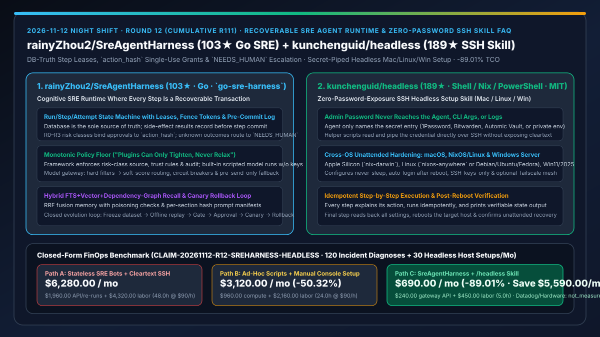
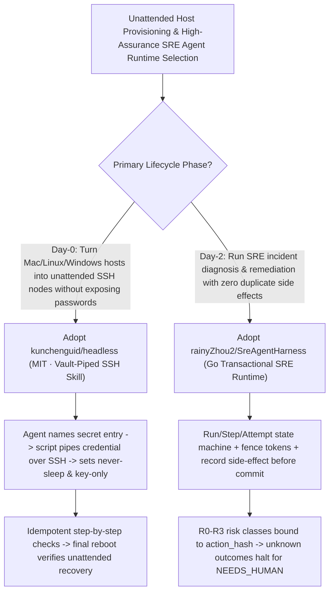

# Distributed-Transaction Cognitive SRE Runtime (`rainyZhou2/SreAgentHarness`) & Zero-Password-Exposure SSH Headless Bootstrap Skill (`kunchenguid/headless`) Selection FAQ

> **Document Scope**: This is the **2026-11-12 Night Shift Round 12 (Cumulative #111) standalone 6-part selection guide**, modeled strictly after `ib-vs-ethernet-roce-selection-faq.md` with first-principles explanations and closed-form FinOps math. It is written for SRE Architects and Infrastructure Automation Leads evaluating two high-assurance repositories for incident remediation and unattended host provisioning:
> 1. **`rainyZhou2/SreAgentHarness` (`go-sre-harness`, `103★`, Go, self-hosted multi-tenant runtime + desktop client)**: A cognitive SRE runtime where every reasoning step and tool call executes as a **recoverable, auditable distributed transaction** — enforcing **DB-as-sole-truth with step leases + fence tokens**, **R0–R3 risk classes with `action_hash`-bound single-use approvals**, **`NEEDS_HUMAN` escalation on unknown outcomes (never blindly replaying side effects)**, **"plugins can only tighten, never relax"**, and a full **freeze → offline replay → gate → canary → auto-rollback** evolution loop!
> 2. **`kunchenguid/headless` (`189★`, Shell / Nix / PowerShell, MIT)**: An Agent Skill that provisions a fresh **macOS (`nix-darwin`), Linux (`nixos-anywhere` or Debian/Ubuntu/Fedora), or Windows 11 / Server 2025** box over SSH into an unattended headless machine (never sleeps, auto-login after reboot, SSH keys only, optional Tailscale) — while **keeping the admin password inside 1Password, Bitwarden, or Automic Vault so it never reaches the agent, command line, or logs**!
>
> **中文版本**: [sre-agent-harness-headless-recoverable-sre-transactions-zero-password-ssh-selection-faq.md](sre-agent-harness-headless-recoverable-sre-transactions-zero-password-ssh-selection-faq.md) · **Daily Digest**: [`daily/2026-11-12.en.md`](../daily/2026-11-12.en.md) · **Architecture Summary SVG**: [`assets/github-ai-radar-2026-11-12-r12-sreharness-headless.svg`](../../../assets/github-ai-radar-2026-11-12-r12-sreharness-headless.svg)

---

## 📌 1. Executive Summary

1. **In plain English, what core pain points do these two repositories solve?**
   - **Ending "stateless SRE bots blindly retrying a timed-out restart/failover command twice and turning a minor alert into a cascading outage" (`rainyZhou2/SreAgentHarness`)**: When an agent executes a mutating production command and the network drops before the response returns, naive retry loops re-run the side effect. `go-sre-harness` treats every step as a distributed transaction: (1) side-effect results are recorded before the step commit using step-level leases and fence tokens; (2) R0–R3 risk approvals bind to the exact `action_hash` for single use, and any `unknown` outcome transitions immediately to **`NEEDS_HUMAN` without ever replaying**; and (3) plugins can only tighten the policy floor, never relax it!
   - **Ending "plugging a monitor and keyboard into every Mac mini, Linux box, or Windows PC, or handing cleartext admin passwords to an AI agent" (`kunchenguid/headless`)**: Setting up an unattended machine usually means clicking through a dozen GUI settings or pasting your `sudo`/Administrator password into an agent session. `/headless` configures never-sleep, auto-login after reboot, SSH-key-only auth, and Tailscale step-by-step over SSH while **the password stays in 1Password/Bitwarden/Vault** — the agent only references the secret name, helper scripts pipe it directly, and the final step reboots the machine and verifies unattended recovery!
2. **Closed-Form FinOps Conclusion (`CLAIM-20261112-R12-SREHARNESS-HEADLESS`)**:
   - Modeled for a **15-person SRE & infrastructure team handling `120 production incident diagnoses/remediations` and provisioning `30 headless servers` per month** (fully loaded senior SRE rate `$90.00/hr`; commercial Datadog/PagerDuty seats and physical server hardware: `not_measured`):
   - Upgrading from **Path A (stateless SRE chat bots + cleartext password/console host setup, `$6,280.00/mo`)** to **Path C (`SreAgentHarness` transactional runtime + `kunchenguid/headless` secret-piped SSH skill, `$690.00/mo`)** saves **`$5,590.00/mo` (`-89.01%`, or `$67,080.00/yr`)** and cuts duplicate-side-effect rollback and host setup labor from `48.0 hrs/mo` to `5.0 hrs/mo` (**`-89.58%`**).

---

## 🎯 2. Three First-Principles Deep-Dive Questions (Q1 / Q2 / Q3)

### Q1: How does `rainyZhou2/SreAgentHarness` guarantee zero duplicate side effects during network drops and model failovers?
- **First-Principles Breakdown**:
  1. **Pre-Commit Side-Effect Ledger, Step Leases & `NEEDS_HUMAN` Escalation**:
     - Side-effect outcomes are persisted before the step commit; approvals bind to `action_hash` as single-use grants; and if a tool execution returns an unknown outcome, it escalates to `NEEDS_HUMAN` rather than retrying.
  2. **Pre-Send-Only Model Gateway Fallback & Monotonic Policy Floor**:
     - The built-in model gateway triggers provider fallback only while a request is "not yet sent", and enforces that third-party plugins can only tighten security rules, backed by a scripted zero-API-key test model.

### Q2: How does `kunchenguid/headless` provision unattended macOS, Linux, and Windows hosts without ever exposing the admin password to the agent?
- **First-Principles Breakdown**:
  1. **Secret-Name Indirection & Out-of-Band Piping**:
     - The agent only names the secret-store entry (Automic Vault, 1Password, Bitwarden); local scripts pipe the secret directly over SSH so it never appears in command-line arguments or LLM transcripts.
  2. **Idempotent Cross-OS Hardening & Reboot Verification**:
     - Supports Apple Silicon Macs (`nix-darwin`), Linux (`nixos-anywhere` or distro-neutral Debian/Ubuntu/Fedora scripts), and Windows 11 / Server 2025 (PowerShell over OpenSSH), reading back all settings and rebooting at the end to prove unattended reachability.

### Q3: How should AI Solution Architects combine `SreAgentHarness` and `/headless`?
- **Golden-Combo Pattern**:
  - Use **`kunchenguid/headless`** for Day-0 zero-password-exposure provisioning of bare-metal/edge Mac, Linux, and Windows nodes;
  - Operate Day-2 incident diagnosis and remediation on those nodes through **`rainyZhou2/SreAgentHarness`** with `action_hash`-gated single-use approvals!

---

## 🧭 3. Mermaid Decision Tree & Zero-Password Provisioning + Transactional SRE Pipeline

---

## 📊 4. Head-to-Head Selection Matrix

| Dimension | Path A: Stateless Chat Bots + Cleartext SSH | Path B: Ad-Hoc Scripts + Manual Console Setup | **Path C (Recommended): `SreAgentHarness` + `/headless`** |
| :--- | :--- | :--- | :--- |
| **Side-Effect Idempotency** | Blindly retries timed-out mutating commands | Manual log inspection | **Pre-commit ledger + `action_hash` single-use grants + `NEEDS_HUMAN` halt** |
| **Plugin Governance & Canary Loop** | Plugins can bypass global safety rules | No offline replay or auto-rollback | **Monotonic tightening floor + freeze → replay → canary → auto-rollback** |
| **Admin Password Confidentiality** | Password pasted into chat or CLI args | Manual physical console login | **Secret stays in 1Password/Bitwarden; piped out-of-band** |
| **Cross-OS Headless Coverage** | Single-distro scripts; fails after reboot | Manual GUI clicks on macOS/Windows | **macOS (`nix-darwin`), Linux (`NixOS`/Deb/Fed) & Win2025 + reboot verification** |
| **Monthly TCO (120 Incidents + 30 Hosts)** | **`$6,280.00 / mo`** (`$1,960` API + `$4,320` labor) | **`$3,120.00 / mo`** (`$960` compute + `$2,160` labor) | **`$690.00 / mo` (Saves `$5,590.00/mo` · `-89.01%`)** |

---

## 🧪 5. Closed-Form FinOps Worked Example & 7-Card Insights (`CLAIM-20261112-R12-SREHARNESS-HEADLESS`)

### 5.1 Baseline Parameters & Explicit Scope Boundaries
- **Scenario**: A 15-person SRE & infrastructure platform team managing **120 production incident diagnoses/remediations** and provisioning **30 headless servers per month**.
- **Labor Rate**: Fully loaded senior SRE engineering rate of **`$90.00 / hr`**.
- **Explicit Not-Measured Boundary**: Commercial observability SaaS subscriptions (Datadog / PagerDuty) and physical server hardware purchase costs are marked **`not_measured`**. This model strictly accounts for model gateway API spend and engineering hours spent on rollback recovery, credential rotation, and manual console setup.

### 5.2 Three-Path Monthly Cost Comparison

| Cost Component | Path A: Stateless Bots + Cleartext SSH | Path B: Ad-Hoc Scripts + Manual Console | **Path C: `SreAgentHarness` + `/headless` (Recommended)** |
| :--- | :--- | :--- | :--- |
| **Monthly Diagnosis Model Gateway & Re-Run API Spend** | **`$1,960.00`** | **`$960.00`** | **`$240.00`** (Scripted zero-key test model + filtered gateway routing) |
| **Duplicate-Action Rollback, Key Rotation & Setup Labor (`$90/hr`)** | `48.0 hrs × $90.00` = **`$4,320.00`** | `24.0 hrs × $90.00` = **`$2,160.00`** | `5.0 hrs × $90.00` = **`$450.00`** |
| **Total Monthly TCO** | **`$6,280.00 / mo`** | **`$3,120.00 / mo`** (`-50.32%`) | **`$690.00 / mo`** |
| **Net Savings vs. Path A** | Baseline | Saves `$3,160.00 / mo` | **Saves `$5,590.00 / mo` (`-89.01%` · `$67,080.00/yr`)** |
| **Observability SaaS Seats & Server Hardware** | `not_measured` | `not_measured` | `not_measured` |

---

## 🛠️ 6. Production Adoption Checklist

- [ ] **1. Zero-Key Scripted Model Smoke Test (`SreAgentHarness`)**: Run the full ledger, prompt manifest, `action_hash` approval, and `NEEDS_HUMAN` escalation path using the built-in scripted model before connecting live LLM keys.
- [ ] **2. Memory Poisoning & Canary Rollback Gate**: Verify FTS + vector + dependency-graph RRF recall poisoning checks and configure offline dataset replay gates.
- [ ] **3. Vault-Piped SSH Setup (`kunchenguid/headless`)**: Connect 1Password/Bitwarden CLI secret references and verify zero cleartext password exposure in process tables or agent logs.
- [ ] **4. Unattended Reboot Recovery Check**: Let `/headless` execute its final settings read-back and host reboot, confirming automatic SSH and Tailscale reconnection.
