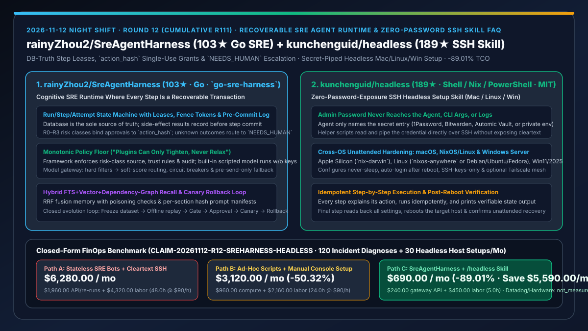
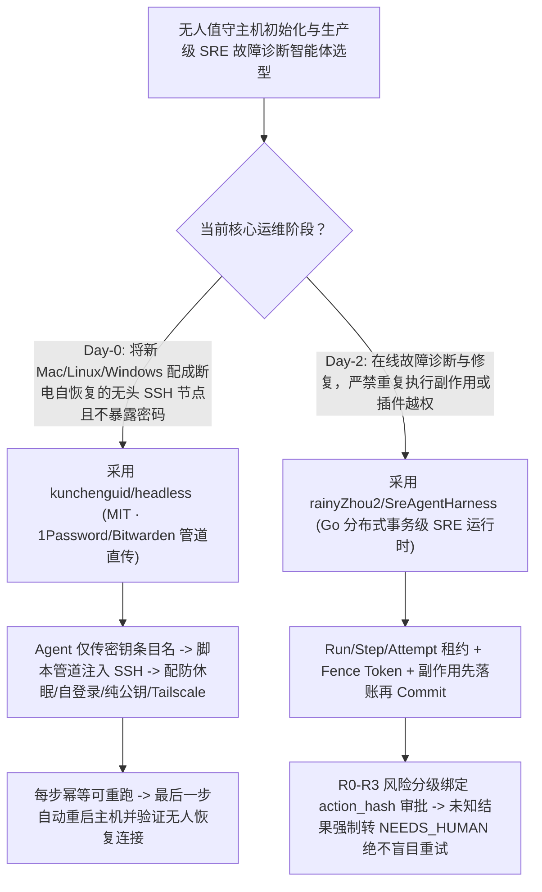

# 分布式事务级 SRE 故障诊断智能体运行时（`rainyZhou2/SreAgentHarness`）与零密码暴露跨平台无头主机配置技能（`kunchenguid/headless`）深度选型 FAQ

> **文档定位**：本专题是 **2026-11-12 夜班第 12 轮（累计第 111 篇）独立六段式选型指南**，严格对标 `ib-vs-ethernet-roce-selection-faq.md` 的通俗第一性原理与闭式 FinOps 核算规范，面向 SRE 稳定性架构师与混合云/边缘主机运维负责人，深度拆解今日在生产级高可靠 SRE Agent 运行时与零密码泄露远程装机赛道突起的两大开源标杆：
> 1. **`rainyZhou2/SreAgentHarness`（`go-sre-harness`，`103★`，Go，支持多租户自托管与桌面客户端）**：将每个推理步骤与工具调用都作为**可恢复、可审计的分布式事务（Recoverable, auditable distributed transaction）**执行的 SRE 认知运行时——坚持**“数据库是唯一真相源”**、**`R0–R3` 风险分级与绑定 `action_hash` 的单次授权（副作用先落账再提交步骤，未知结果一律转交 `NEEDS_HUMAN` 绝不盲目重试）**、**“插件只能收紧权限绝不能放宽”**以及**“冻结数据集 → 离线回放 → 门禁 → 人工审批 → 金丝雀发布 → 自动回滚”**完整演进闭环！
> 2. **`kunchenguid/headless`（`189★`，Shell / Nix / PowerShell，MIT）**：通过 SSH 将一台刚装好系统的 **Mac（Apple Silicon `nix-darwin`）、Linux（`nixos-anywhere` 或 Debian/Ubuntu/Fedora）或 Windows 11 / Server 2025** 一步步改造为全天候无人值守无头服务器（禁止休眠、重启自动登录、仅允许 SSH 密钥、可选加入 Tailscale）的 Agent Skill——**管理员密码永远留在你的 1Password / Bitwarden / Automic Vault 中由脚本管道直传，Agent 全程只能引用条目名称，密码绝不出现在命令行或日志里**！
>
> **English Version**: [sre-agent-harness-headless-recoverable-sre-transactions-zero-password-ssh-selection-faq.en.md](sre-agent-harness-headless-recoverable-sre-transactions-zero-password-ssh-selection-faq.en.md) · **关联日报**: [`daily/2026-11-12.md`](../daily/2026-11-12.md) · **架构总结图**: [`assets/github-ai-radar-2026-11-12-r12-sreharness-headless.svg`](../../../assets/github-ai-radar-2026-11-12-r12-sreharness-headless.svg)

---

## 📌 一、核心结论速览（Executive Summary）

1. **一句话大白话讲透这两个项目到底解决了什么痛点？**
   - **终结“让通用 Agent 处理生产故障时，因为网络闪断不确定重启命令有没有生效就自动盲目重试第二次、或者插件配置失误绕过了高危审批”的痛点（`rainyZhou2/SreAgentHarness`）**：在线上故障排障中，“命令执行超时/结果未知”时盲目重试往往会把小故障放大为全站雪崩。`go-sre-harness` 用分布式系统第一性原理重塑了 Agent 运行时：① **步级租约（Step Leases）+ 栅栏令牌（Fence Tokens）**，且工具副作用结果必须在 Step Commit 之前先写入持久化账本；② 审批令牌严格绑定参数哈希（`action_hash`）且仅限单次消费；一旦工具返回状态为 `unknown`，系统**强制进入 `NEEDS_HUMAN` 挂起态，绝不自动重放副作用**；③ 模型网关仅在请求“尚未发出（Not yet sent）”时才允许触发跨模型 Fallback，彻底杜绝半途重发！
   - **终结“把机房 Mac mini、桌下 Linux 主机或 Windows PC 配成无人值守服务器时，要么得接显示器键盘改十几项电源/自动登录设置，要么得把 sudo/管理员明文密码发给 AI 导致密码永久留在云端对话记录里”的痛点（`kunchenguid/headless`）**：`headless` Skill 让 Agent 通过 SSH 逐步完成所有无人值守加固（防休眠、断电重启自动登录、关闭密码 SSH 仅留公钥、接入 Tailscale），而**管理员密码始终锁在本机 1Password / Bitwarden / Vault 里**——Agent 只传递密钥名称，底层脚本通过标准输入管道（Pipe）注入远端，且最后一步会自动回读所有配置并真实重启机器验证能否无人恢复连入！
2. **闭式 FinOps 投资回报结论（`CLAIM-20261112-R12-SREHARNESS-HEADLESS`）**：
   - 以 **15 人 SRE 与基础设施平台团队每月处置 `120 起` 生产告警诊断与修复事务、并交付维护 `30 台` 跨 Mac/Linux/Windows 无头构建与推理节点** 为基准（高级 SRE 工程师全包时薪 `$90.00/hr`；商业 Datadog/PagerDuty 订阅与物理服务器采购费：`not_measured`）：
   - 从 **Path A（无状态聊天 Bot 重复执行副作用导致故障升级 + 人工接显示器装机或在日志中泄露明文密码事后轮换，月均 `$6,280.00`）** 升级至 **Path C（`SreAgentHarness` 分布式事务级防重放运行时 + `kunchenguid/headless` 零密码暴露幂等装机，月均 `$690.00`）**，每月净省 **`$5,590.00/mo`（降幅 `-89.01%`，年省 `$67,080.00/yr`）**，并将二次故障回滚与现场装机排障工时从 `48.0 hrs/mo` 压缩至 `5.0 hrs/mo`（节省 **`-89.58%`**）。

---

## 🎯 二、三大灵魂拷问（Q1 / Q2 / Q3 深度原理解析）

### Q1：`rainyZhou2/SreAgentHarness` 是如何通过「`action_hash` 单次审批 + 未知结果转 `NEEDS_HUMAN` + 仅未发送前 Fallback」保证零重复副作用的？
- **第一性原理拆解**：
  1. **`Run / Step / Attempt` 状态机、栅栏令牌与先记账后提交（Record Before Step Commit）**：
     - 即使进程在工具执行刚完成、Step 尚未 Commit 的瞬间崩溃，由于副作用结果已在 Commit 前落入数据库账本，恢复后也绝不会误判为未执行而重跑第二次。
  2. **`R0–R3` 风险分级、`action_hash` 绑定与单向收紧插件模型**：
     - 审批单不仅绑定工具名，更精确绑定调用参数的 `action_hash` 且仅生效一次；若外部命令因超时等原因结果未知（Unknown outcome），直接升级为 `NEEDS_HUMAN` 严禁自动重试；同时框架强制“插件只能收紧策略底线、绝不能放宽（Plugins can only tighten, never relax）”，且内置无 API Key 脚本模型供 CI 全链路压测。

### Q2：`kunchenguid/headless` 是如何做到“Agent 全程看不见管理员密码”却能把 Mac、Linux、Windows 配成重启自愈的无头主机的？
- **第一性原理拆解**：
  1. **密钥引用与数据面管道彻底分离（Name Reference vs Secret Pipe）**：
     - Agent 在推理与调用命令时只传递密钥库中的条目名（如 1Password / Bitwarden / Automic Vault 条目名），由本机受控脚本读取密文并通过 SSH 标准输入管道喂给远端提权命令，密码永不落入进程参数列表（`ps aux`）或大模型上下文日志。
  2. **跨三大操作系统幂等加固与重启真机核验**：
     - 针对 Apple Silicon Mac 采用 Determinate Nix + `nix-darwin`，针对 Linux 支持 `nixos-anywhere` 一键替换 NixOS 或保持 Debian/Ubuntu/Fedora 发行版中立脚本，针对 Windows 11 / Server 2025 采用 OpenSSH 可重入 PowerShell 脚本；最后一步强制重启目标机并验证无需人工干预即可重新 SSH 连入。

### Q3：AI 架构师如何将这两个项目组合成无人值守边缘/机房运维体系？
- **黄金组合落地范式**：
  - 新机器上架时，用 **`kunchenguid/headless`** 在零密码暴露的前提下将其初始化为接入 Tailscale 的无头节点；
  - 日常运维与告警响应时，由 **`rainyZhou2/SreAgentHarness`** 统一托管诊断与修复动作，确保任何高危变更都有 `action_hash` 审批与防重放事务保护！

---

## 🧭 三、Mermaid 选型决策树与「零密码装机 + 事务级 SRE 诊断」流水线

---

## 📊 四、同类方案核心能力对比矩阵（Selection Matrix）

| 评估维度 | Path A：无状态聊天运维 Bot + 明文密码装机 | Path B：手写 Ansible/Shell + 普通审批流 | **Path C（推荐）：`SreAgentHarness` + `/headless`** |
| :--- | :--- | :--- | :--- |
| **副作用防重放与超时处理** | 网络抖动即自动重试，常导致重复重启或重复扩容 | 靠人工看日志判断，缺乏步级租约与 Fence Token | **先记账后提交 + `action_hash` 单次授权 + 未知结果转 `NEEDS_HUMAN`** |
| **插件权限与演进安全闭环** | 插件可随意覆盖全局安全规则 | 无离线回放与金丝雀自动回滚门禁 | **插件只能收紧不能放宽 + 冻结数据集离线回放 → 金丝雀自动回滚** |
| **远程装机管理员密码保护** | 把明文 sudo 密码直接发在 Prompt 或写在命令行参数里 | 需人工接显示器键盘去机房现场配置 | **密码留在 1Password/Bitwarden 管道直传，Agent 永不接触明文** |
| **跨 OS 无头加固与重启验证** | 仅支持单一 Linux 发行版，重启后常卡在登录界面 | 脚本不可重入，Windows/macOS 需手工点 UI | **全覆盖 macOS (`nix-darwin`) / Linux (`NixOS`/Deb/Fed) / Win2025 并自动重启验活** |
| **月度总拥有成本（120 故障 + 30 装机）** | **`$6,280.00 / mo`**（`$1,960` API + `$4,320` 工时） | **`$3,120.00 / mo`**（`$960` 算力 + `$2,160` 工时） | **`$690.00 / mo`（净省 `$5,590.00/mo` · `-89.01%`）** |

---

## 🧪 五、定量 FinOps 算例与 7-Card 洞察（`CLAIM-20261112-R12-SREHARNESS-HEADLESS`）

### 5.1 测算基准与显式边界（Scope & Boundaries）
- **场景设定**：15 人 SRE 与基础设施团队，每月通过智能体辅助处置 **120 起生产环境故障诊断与修复**，并初始化/重置 **30 台跨 macOS、Linux 与 Windows Server 的无头服务器节点**。
- **费率假设**：高级 SRE 工程师全包时薪 **`$90.00 / hr`**。
- **显式边界声明（Explicit Not-Measured Boundary）**：商业监控告警 SaaS（Datadog / PagerDuty）席位费与物理服务器采购硬件成本标记为 **`not_measured`**，本表严格核算诊断模型网关 API 支出以及因重复副作用事故回滚、明文密钥泄露轮换与机房现场接显示器装机耗费的工程工时。

### 5.2 三路径月度成本闭式对照表

| 成本分项 | Path A：无状态运维 Bot + 明文密码装机 | Path B：手写脚本 + 现场人工装机 | **Path C：`SreAgentHarness` + `/headless`（推荐）** |
| :--- | :--- | :--- | :--- |
| **月度故障诊断模型网关与重跑 API 支出** | **`$1,960.00`** | **`$960.00`** | **`$240.00`**（内置无 Key 脚本验证 + 软硬过滤模型网关路由） |
| **重复副作用事故回滚、密钥轮换与装机工时（`$90/hr`）** | `48.0 hrs × $90.00` = **`$4,320.00`** | `24.0 hrs × $90.00` = **`$2,160.00`** | `5.0 hrs × $90.00` = **`$450.00`** |
| **月度总成本（Monthly TCO）** | **`$6,280.00 / mo`** | **`$3,120.00 / mo`**（`-50.32%`） | **`$690.00 / mo`** |
| **相对 Path A 净节省** | 基准线（Baseline） | 净省 `$3,160.00 / mo` | **净省 `$5,590.00 / mo`（`-89.01%` · 年省 `$67,080.00/yr`）** |
| **商业监控 SaaS 席位与物理服务器硬件费** | `not_measured` | `not_measured` | `not_measured` |

---

## 🛠️ 六、生产级落地核验 Checklist

- [ ] **1. `SreAgentHarness` 无 API Key 全链路冒烟测试**：先使用内置 Scripted Model 跑通账本记录、Prompt Manifest 哈希校验、`action_hash` 审批绑定与 `NEEDS_HUMAN` 升级分支。
- [ ] **2. 记忆防投毒与金丝雀回滚闭环验证**：验证 FTS + Vector + 依赖图 RRF 融合召回中的投毒检查（Poisoning Checks），并配置离线回放门禁。
- [ ] **3. `kunchenguid/headless` 零密码日志审计**：配置 1Password / Bitwarden CLI 密钥引用，跑完一次远程无头初始化后扫描全部终端历史与 Agent 轨迹，确认零明文密码残留。
- [ ] **4. 断电/重启无人恢复真机验收**：执行 `/headless` 最后一步自动重启目标 Mac/Linux/Windows 主机，验证无需接显示器即可通过 SSH 密钥与 Tailscale 重新连入。
