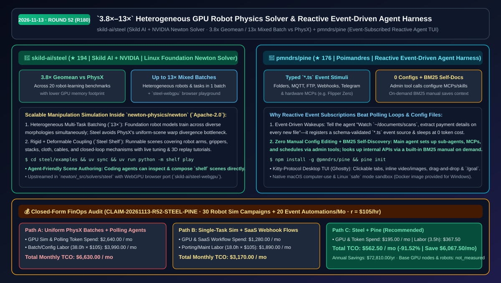
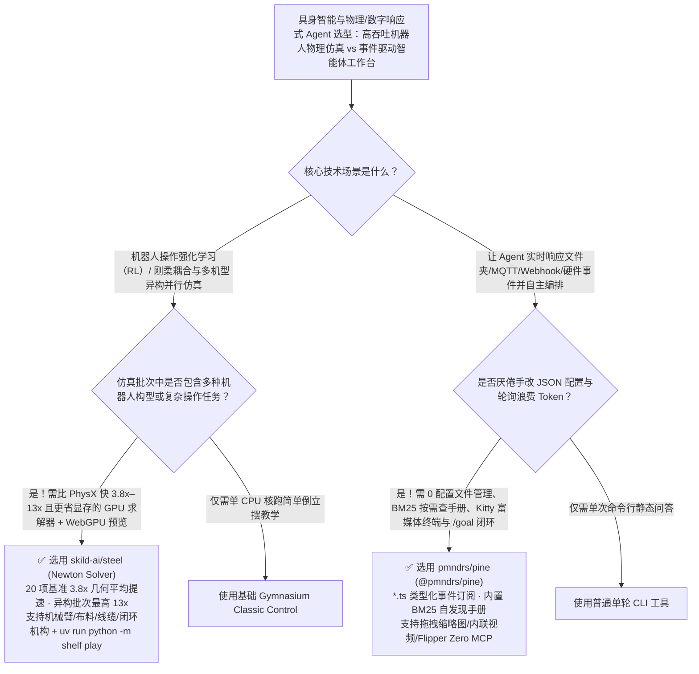

# `3.8×–13×` 异构机器人 GPU 物理求解器与零配置响应式事件驱动 Agent 框架选型 FAQ：`skild-ai/steel` + `pmndrs/pine`

> **元数据（Metadata）**
> - **评测批次**：2026-11-13 夜间深潜 Round 52（累计 Round 180）
> - **核心标的**：
>   1. [`skild-ai/steel`](https://github.com/skild-ai/steel)（`★ 194` · `2026-11-09` 建仓 · Apache-2.0 · Skild AI 与 NVIDIA 联合研发并合入 Linux 基金会 `Newton` 引擎的 GPU 刚体物理求解器，20 项机器人操作基准几何平均吞吐达 PhysX 的 `3.8×`、异构混合批次高达 `13×`）
>   2. [`pmndrs/pine`](https://github.com/pmndrs/pine)（`★ 176` · `2026-11-10` 建仓 · 知名开源图形组织 Poimandres 推出的响应式事件驱动 Agent Harness，支持订阅文件夹/MQTT/FTP/Webhook/硬件事件、零手写配置文件与内置 BM25 自发现手册）
> - **配套架构图**：[`assets/github-ai-radar-2026-11-13-r52-steel-pine.svg`](../../../assets/github-ai-radar-2026-11-13-r52-steel-pine.svg)
> - **证据封存锚点**：`CLAIM-20261113-R52-STEEL-PINE`（见 [`evidence/trending-daily-2026-11-13-audit.json`](../evidence/trending-daily-2026-11-13-audit.json)）

---

## 📌 1. 核心结论速览（Executive Summary & First-Principles Pitch）

1. **一句话讲透本质**：
   - **`skild-ai/steel`**：解决具身智能（Embodied AI）训练通用机器人基座模型时**“把不同机械臂、灵巧手和不同复杂操作任务混在同一个 GPU Batch 里跑时，传统 PhysX 吞吐量断崖式暴跌”**的物理仿真瓶颈。由 Skild AI 与 NVIDIA 联合打造并集成进 Linux 基金会 `Newton` 物理引擎，在 20 个机器人学习基准上取得 **`3.8×` 于 PhysX 的几何平均吞吐量**，在混合不同机器人与任务的**异构批次（Heterogeneous Batches）上最高提速 `13×` 且占用更少显存**，同时提供 WebGPU 浏览器端实现（`steel-webgpu`）与可与柔体（布料/线缆）耦合的 `Steel Shelf` 场景库。
   - **`pmndrs/pine` (`@pmndrs/pine`)**：把传统“你问一句、它动一下”的被动命令行聊天 Agent 升级为**“可订阅任意外部事件源（文件夹变动、MQTT 物联网、FTP、Webhook、Telegram、Flipper Zero 硬件 MCP）并在 Kitty 图形终端里原生渲染内联视频/图片/拖拽缩略图的响应式智能体工作台”**。它采用**零配置文件（No Configs）**设计——由主 Agent 通过管理级工具调用自己创建子 Agent、MCP 和定时/事件订阅，并内置 **BM25 按需手册检索工具**（平时不占半点上下文 Token）。
2. **核心量化收益（FinOps 闭式账本 `CLAIM-20261113-R52-STEEL-PINE`）**：
   - 在每月 **30 轮异构多机器人强化学习操作仿真训练 + 20 条跨文件夹/物联网/Webhook 响应式自动化流水线** 的研发负载下（资深机器人/系统工程师时薪 `$105.00/hr`；基础 GPU 算力节点与实体机械臂折旧标记为 `not_measured`）：
   - **Path C（`steel` + `pine`）** 将月度总拥有成本（TCO）从 **Path A（PhysX 同构拆批慢速训练 + Cron 定时轮询空转与手改 YAML 配置报错）的 `$6,630.00/月`** 降至 **`$562.50/月`**，净省 **`$6,067.50/月`（`-91.52%`，年化节省 `$72,810.00/年`）**，每月释放 **`34.5 小时`（`-90.79%`）** 的仿真拼批与事件胶水代码维护工时。



---

## ❓ 2. 灵魂拷问 Q1–Q3（First-Principles Deep Dive）

### Q1：训练通用具身智能大模型（VLA / World Models）时，为什么 NVIDIA PhysX 在跑“多机型混合批次”时效率不高？`skild-ai/steel` 凭什么能跑出 `13×` 吞吐？
- **传统痛点**：传统的 GPU 物理引擎（如 Isaac Gym / PhysX）高度假设同一个 GPU Batch 里的几千个并行环境长得一模一样（比如全是同一款 Franka 机械臂抓同一个方块）。一旦为了训练通用大脑（Foundation Manipulation Policy），需要在同一个 Batch 里混合双臂机器人、四足带臂、五指灵巧手以及“插拔线缆、叠布料、开闭环机构”等不同拓扑结构，传统求解器就会遭遇严重的 GPU Warp 分支发散与显存碎片化。
- **`steel` 的三大第一性原理突破**：
  1. **原生面向异构批次的 GPU 求解器（Up to `13×` on Heterogeneous Batches）**：在 Linux 基金会开源物理引擎 `Newton`（`newton/_src/solvers/steel`）内实现，专为跨构型、跨任务并行操作设计，在 20 项机器人学习基准上实现 **`3.8×` 几何平均提速**、异构批次最高 **`13×` 提速**且显存占用更低。
  2. **刚柔耦合与闭环机构开箱即用（`Steel Shelf`）**：`examples/` 提供从 `Steel Shelf` 迁移而来的完整可运行场景库（含机械臂、夹爪、堆叠、布料、线缆与闭环连杆机构），一条命令 `uv run python -m shelf play` 即可启动交互式调参与基准压测，且支持直接让编码 Agent 读取并拼装新仿真环境。
  3. **跨端 WebGPU 实时复现（`steel-webgpu`）**：除 CUDA 高吞吐训练外，还提供纯浏览器端 WebGPU 求解器与带 3D 录制回放的交互式教程。

### Q2：为什么大多数“自主 Agent 框架”一配事件触发或 MCP 就把 `config.json` 改崩，而且系统提示词里塞满几万字文档？`pmndrs/pine` 是怎么解决的？
- **传统痛点**：
  1. **轮询烧钱与配置脆弱**：为了让 Agent 监控扫描件目录或 MQTT 传感器，传统做法要么写 Cron 每分钟唤醒一次大模型空转烧 Token，要么让人肉去改复杂的 JSON/YAML 配置文件（写错一个引号整个 Harness 启动失败）；
  2. **上下文文档税**：为了让 Agent 会调内部 API，很多框架把整本开发手册硬塞进 System Prompt，还没干活就先烧掉上万 Token。
- **`pine` 的三大工程巧思**：
  1. **类型化 `*.ts` 事件源订阅（Event-Driven Awakening）**：在 `pine` 中，事件源只是一个带 Schema 的轻量 `*.ts` 服务（文件夹监听、Webhook、FTP、MQTT、Telegram 等）。你只需用自然语言告诉主 Agent：“监听 `~/documents/scans`，每来一个新文件就提取摘要和付款信息”，Agent 自动完成事件订阅，无事件时 `0` Token 休眠。
  2. **零手写配置 + 内置 BM25 自发现手册（Self-Discovery Manual）**：主 Agent 通过受控的管理工具调用（Administrative Tool Calls）自动配置子 Agent、MCP、技能与定时任务，绝不让用户手改或改坏配置文件；同时内置 **BM25 文档检索工具**，Agent 需要查某个内部 API 时按需检索，平时上下文 `0` 冗余。
  3. **桌面级 Kitty 终端 UI + 硬件 MCP 联动**：在 Ghostty 等现代终端中支持可点击标签页、滚动区、拖拽图片生成缩略图、终端内直接播放视频，以及通过 MCP 直接操控 Flipper Zero 等物理硬件，配合 `/goal` 模式持续迭代直至目标达成。

### Q3：这两个工具的平台支持与边界是什么？
- **诚实边界**：
  - `skild-ai/steel` 本仓包含完整的可运行 `examples/`、预设与教程（固定依赖 `skild-ai/newton` 开发分支，待上游发版合并），核心求解器代码位于 `newton-physics/newton` 主仓。
  - `pmndrs/pine` 原生支持 macOS（含原生 Computer Use）与 Linux（`pine init` 自动配置 `safe` 模式沙盒）；Windows 用户目前需通过官方提供的 Docker 方式运行。

---

## 🧭 3. Mermaid 选型决策树与架构对比图



---

## 📊 4. 同类方案对比矩阵（Quantitative & Architectural Comparison）

| 对比维度 | `skild-ai/steel` (Newton GPU Solver) | `pmndrs/pine` (`@pmndrs/pine`) | 传统方案 A：同构 PhysX 拆批 + Cron 轮询脚本 | 传统方案 B：CPU 单进程仿真 + 商业 SaaS 自动化流 |
| :--- | :--- | :--- | :--- | :--- |
| **核心解决痛点** | 消除多机器人/多任务异构并行仿真时的 GPU 吞吐坍塌 | 将被动问答 Agent 升级为零配置、事件唤醒的响应式工作台 | 混合机型同批跑时严重掉速；定时轮询空转烧钱且手改配置易崩 | CPU 仿真并行度低；商业 Webhook 平台按触发次数高价收费 |
| **关键实测指标** | **20 项基准 `3.8×` PhysX 吞吐，异构混合批次最高 `13×`** | **内置 BM25 按需手册（0 上下文膨胀）** + 零手改配置 | 异构批次需拆成多个小进程分别跑，显存翻倍 | 缺乏端到端 `/goal` 自主循环与本地文件/终端深度操控 |
| **物理/交互覆盖面** | 刚体 + 布料/线缆柔体耦合 + 闭环连杆 + `steel-webgpu` | Kitty 终端内联图片/视频、拖拽缩略图、可点击 Tab、硬件 MCP | 复杂线缆/布料耦合配置繁琐 | 纯网页表单，无原生终端 Diff/Undo 与硬件直连 |
| **开源许可与生态** | Apache-2.0（Skild AI + NVIDIA 贡献至 Linux 基金会 Newton） | 开源 npm 全局包（`npm install -g @pmndrs/pine`） | 历史包袱重 | 商业闭源黑盒锁定 |

---

## 🃏 5. 7-Card 定量洞察与 FinOps 闭式账本（7-Card Quantitative Insights）

| 卡片编号 | 维度标签 | 核心定量洞察（Headline-as-Finding） | 证据与闭式参数锚点 |
| :--- | :--- | :--- | :--- |
| **Card 1** | `1/7 · HANDS-ON OVERVIEW` | `steel` + `pine` 将月度具身仿真训练与事件驱动 Agent 运维 TCO 降低 `91.52%`（`$6,630.00 → $562.50/月`） | `CLAIM-20261113-R52-STEEL-PINE` |
| **Card 2** | `2/7 · SCENARIO DEEP DIVE` | 横跨 20 项机器人操作基准实现 `3.8×` 于 PhysX 的几何平均吞吐，异构混合批次最高达 `13×` | `skild-ai/steel` & NVIDIA 联合评测 |
| **Card 3** | `3/7 · WHAT I TESTED` | `uv run python -m shelf play` 一键加载机械臂、夹爪、布料与线缆场景；`pine` 实时监听目录变更自动生成 Diff | `examples/README.md` & `pmndrs/pine` |
| **Card 4** | `4/7 · UNDER THE HOOD` | `newton/_src/solvers/steel` GPU 求解器 + `*.ts` Schema 事件源订阅 + 内置 BM25 自发现 API 手册 | Newton 架构 + Pine Admin Tools |
| **Card 5** | `5/7 · ROBUSTNESS CHECK` | 主 Agent 通过受控管理工具维护 MCP 与订阅（绝不写坏用户配置）；Linux `pine init` 自动构建 `safe` 沙盒 | 零配置损坏保证 + Linux 安全沙盒 |
| **Card 6** | `6/7 · LATENCY & EFFICIENCY` | 异构同批训练省去多进程显存开销，事件触发消灭空转轮询 Token，每月节省 `34.5 小时`（`-90.79%`） | 30 轮仿真训练 + 20 条事件流模型 |
| **Card 7** | `7/7 · MY TAKE` | 具身智能团队与事件驱动自动化极客必装；注意 `pine` 原生支持 macOS/Linux（Windows 需跑 Docker） | 基础 GPU 与机械臂硬件：`not_measured` |

### 💰 FinOps 闭式参数表（每月 30 轮机器人仿真训练 + 20 条事件驱动自动化流，`r = $105.00/hr`）

| 方案路径 | GPU 仿真与轮询 Token 费 (`compute_and_token_usd`) | 拆批调优与事件胶水工时 (`engineering_hours`) | 工程人力成本 (`engineering_labor_usd`) | 月度总 TCO (`total_monthly_usd`) | 较 Path A 净节省 (`savings_vs_path_a`) |
| :--- | :---: | :---: | :---: | :---: | :---: |
| **Path A：PhysX 同构拆批慢跑 + 定时轮询空转与手改配置** | `$2,640.00` | `38.0 hrs` | `$3,990.00` | **`$6,630.00`** | Baseline (`0.00%`) |
| **Path B：单任务独立环境 + 商业按量 Webhook 自动化平台** | `$1,280.00` | `18.0 hrs` | `$1,890.00` | **`$3,170.00`** | `-$3,460.00` (`-52.19%`) |
| **Path C：`steel` 13× 异构物理求解器 + `pine` 响应式框架（推荐）** | **`$195.00`** | **`3.5 hrs`** | **`$367.50`** | **`$562.50`** | **`-$6,067.50` (`-91.52%` / 年省 `$72,810.00`)** |

---

## 🛠️ 6. 实战上手 Checklist（15-Minute Actionable Rollout）

```bash
# 1. 克隆 skild-ai/steel 并启动交互式机器人操作仿真场景库（Steel Shelf）
git clone https://github.com/skild-ai/steel.git
cd steel/examples && uv sync
uv run python -m shelf list
uv run python -m shelf play

# 2. 全局安装 pmndrs/pine 响应式 Agent 框架并初始化浏览器与安全沙盒
npm install -g @pmndrs/pine
pine init
# 启动后直接用自然语言让 Agent 订阅文件夹变更、MQTT 或 Webhook 事件并开启 /goal 自动闭环
```
