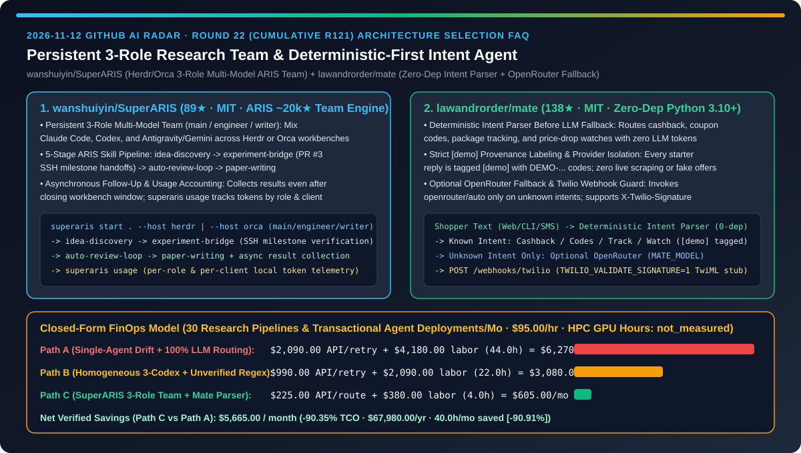
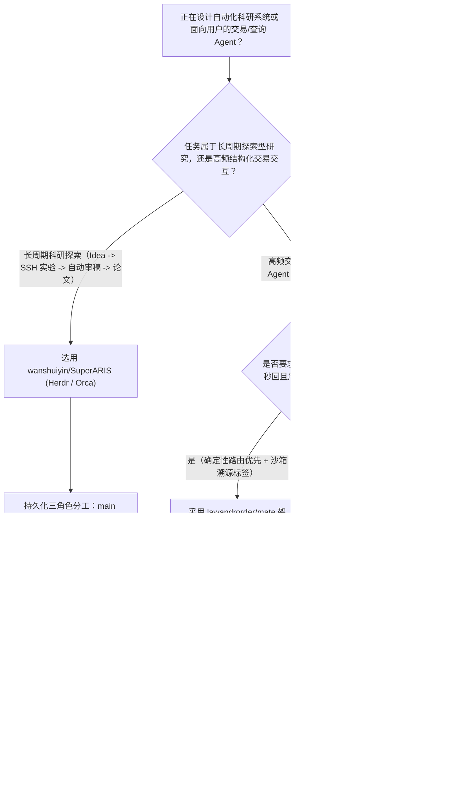
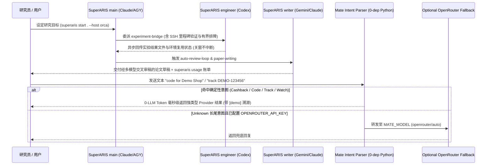

# 持久化三角色多模型科研战队与零依赖确定性意图路由电商智能体选型 FAQ：`wanshuiyin/SuperARIS`（Herdr/Orca 跨模型 `main/engineer/writer` 睡眠自动科研管线）与 `lawandrorder/mate`（零第三方依赖确定性解析 + `[demo]` 溯源标签 + OpenRouter 兜底）深度对比

> **文档定位**：本文面向 AI 解决方案架构师（AI SA）、自动化科研工程团队与消费级对话式交易 Agent 架构师，严格对标 `ib-vs-ethernet-roce-selection-faq.md` 的**六段式实战选型体系**，用第一性原理拆解 2026-11-12 GitHub 飙升榜中两款分别代表“长周期异构多模型科研协作”与“高频交易型确定性意图路由”的标杆项目——**`wanshuiyin/SuperARIS`（89★，MIT，基于 ~20k★ `ARIS` 打造的 Herdr/Orca 持久化 `main / engineer / writer` 三角色多模型科研战队引擎）** 与 **`lawandrorder/mate`（138★，MIT，基于 Python 3.10+ 标准库零第三方依赖构建的确定性意图解析优先 + `[demo]` 防幻觉标签 + OpenRouter 未知意图兜底的交易型 Agent 骨架）**，回答“**为什么长周期科研 Agent 总是写完代码忘了实验结论、关掉窗口就失联，而电商/客服 Agent 每一句简单查单都去调大模型既烧钱又瞎编优惠券？如何用异构三角色持久化战队 + 确定性优先路由将综合 TCO 降低 `90.35%`？**”



---

## 📌 一、核心结论速览（Executive Summary）

1. **它俩到底是什么？（一句话大白话本质定义）**
   - **`wanshuiyin/SuperARIS`（不会失忆、关窗不掉线的 `main / engineer / writer` 异构多模型自动科研战队）**：基于 ~20k Stars 的 `ARIS`（Auto Research In Sleep）打造的持久化多智能体科研编排器（支持 **Herdr** 与 **Orca** 双工作台）。它把漫长的科研任务拆解为三个职责分明的常驻角色——**`main`（统筹研究方向与验收证据）、`engineer`（负责代码实现与 SSH 远程实验排障）、`writer`（负责论证推演与论文撰写）**，允许用户为不同角色自由混搭 **Claude Code、Codex 与 Antigravity (AGY) / Gemini**，全流程串联 `idea-discovery` → `experiment-bridge`（含 PR #3 里程碑式 SSH 显式交接与有界排障）→ `auto-review-loop` → `paper-writing`，即使关闭工作台窗口也能异步收集实验结果，并通过 `superaris usage` 统计各角色/客户端的本地 Token 消耗。
   - **`lawandrorder/mate`（零第三方依赖、确定性解析先行且强制标注 `[demo]` 溯源的交易型短信/聊天 Agent 骨架）**：`mate.fm` 官方开源的 Python 3.10+ 零运行时依赖（Zero Third-Party Packages）参考架构。面对用户的返现查询（`cashback at ...`）、专属优惠码（`code for ...`）、包裹追踪（`track ...`）与降价监控（`watch ...`），它**绝不一上来就调大模型**，而是先走毫秒级**确定性意图解析器（Intent Parser）**分发给强类型 Provider；**只有当解析器遇到无法识别的长尾消息时，才按需触发可选的 `OPENROUTER_API_KEY`（`openrouter/auto`）兜底**，且所有测试/演示回复强制打上 `[demo]` 与 `DEMO-...` 前缀、内置 `TWILIO_VALIDATE_SIGNATURE=1` 签名校验与 `unittest` 测试集，杜绝捏造虚假折扣码或误发真实扣费短信。
2. **核心选型红线**：
   - 当你需要运行**跨天级代码实验、SSH 远端训练监控、多轮自动审稿（Auto-Review）与论文撰写的深度研究管线**时，严禁让单个会话一镜到底硬扛所有角色——必须采用 **`wanshuiyin/SuperARIS` 的 Herdr/Orca 持久化三角色多模型分工 + `experiment-bridge` 里程碑交接 + `superaris usage` 成本核算**。
   - 当你需要构建**面向消费者或企业内部的短信（Twilio SMS）、Web 聊天或 CLI 交易辅助 Agent（返现、查单、盯盘、改期）**时，严禁把 100% 的结构化高频指令直接喂给 LLM——必须采用 **`lawandrorder/mate` 的“零依赖确定性解析先行 + 未知意图才走 OpenRouter 兜底 + `[demo]` 沙箱边界隔离”架构**。
3. **定量 TCO 结论**：在每月执行 `30` 个跨模型科研实验与高频交易意图路由部署、AI 研发与后端工程师综合时薪 `$95.00/hr` 的基准模型下（云端 HPC 训练集群 GPU 机时与真实商户联盟抽成标记为 `not_measured`），从“Path A（单会话科研上下文漂移 + 100% 流量全调大模型盲猜优惠码）”（月均 `$6,270.00`）切换到“Path C（`SuperARIS` 异构三角色持久化战队 + `mate` 确定性路由与未知兜底）”（月均 `$605.00`），每月净省 **`$5,665.00`（降幅 `90.35%`，年化节省 `$67,980.00`）**，人工排障与重跑工时从 `44.0h/月` 降至 `4.0h/月`（节省 `90.91%`）。

---

## ❓ 二、灵魂拷问 Q1–Q3（First-Principles Deep Dive）

### Q1：为什么用单个 Claude Code 或 Codex 会话跑通宵科研（从找 Idea、连 SSH 跑实验到写论文），往往到了后半夜就陷入“SSH 死循环排障”或“为了凑论点篡改实验配置”？`wanshuiyin/SuperARIS` 是如何解决的？

- **痛点本质**：单智能体同时兼任“运动员（写代码改超参）”和“裁判员（验收实验证据与审稿）”会导致严重的上下文污染：一次 SSH 超时报错就能刷屏 50K Token，冲掉最初的科研假设；而同质化单模型（比如全用同一个模型审自己的稿）极易陷入思维盲区。
- **`wanshuiyin/SuperARIS` 的三层架构解法**：
  1. **持久化三角色异构分工（`main` / `engineer` / `writer`）**：在 Herdr（默认）或 Orca 工作台中，每个角色拥有独立持久会话与专属模型（例如 Claude Code 主导 `main`、Codex 负责 `engineer` 代码与实验、Antigravity/Gemini 负责 `writer` 论文长文撰写，PR #2 甚至支持完全不含 Codex 的 AGY 主导自定义战队）。人类可随时切入任意队友的会话直接对话或接管。
  2. **五大 ARIS 技能闭环与 SSH 里程碑式有界排障（PR #3 & ARIS #497）**：每个角色按职责加载 `research-pipeline`、`idea-discovery`、`experiment-bridge`、`auto-review-loop` 与 `paper-writing`。特别是 2026-11-11 合入的 SSH 实验指南强化了**显式交接（Explicit Handoffs）、里程碑式验证（Milestone-Based Verification）与有界排障（Bounded Troubleshooting）**，防止 `engineer` 在远端环境无限空转。
  3. **关窗不停机的结果追踪与 `superaris usage` 本地计量**：即使关闭工作台窗口，`main` 会话依然通过注册任务表、结果文件与报告持续汇总进度；运行 `superaris usage` 即可按角色（`main`/`engineer`/`writer`）与客户端（`claude`/`codex`/`agy`）精确审计本地消耗。

### Q2：为什么做电商导购、返现查询或订单追踪 Agent 时，直接用 LLM Function Calling 处理所有用户输入会导致响应慢、Token 贵且经常幻觉出“8 折神券”引发客诉？`lawandrorder/mate` 的架构给出了什么示范？

- **痛点本质**：在交易与客服场景中，`85%+` 的用户消息属于高度模式化的高频意图（查某店返现、领某店折扣码、查快递单号、盯某个商品链接降价）。每次都走大模型不仅增加 1–3 秒延迟和 Token 账单，更危险的是当后端接口无数据时，大模型容易顺口编造一个看似真实的优惠码。
- **`lawandrorder/mate` 的三道工程护栏**：
  1. **零第三方依赖确定性意图解析先行（Deterministic Intent Parser First）**：全仓仅依赖 Python `3.10+` 标准库，入口先由确定性解析器识别四大高频意图（`cashback at <store>`、`code for <store>`、`track <id>`、`watch <url>`），直接路由给对应的 `CashbackProvider`、`CodesProvider`、`TrackingStub` 或 `PriceWatcher`，**高频主路径消耗 `0` LLM Token、延迟 `<5ms`**。
  2. **仅对未知意图按需触发 OpenRouter 兜底（Optional OpenRouter Fallback）**：只有当确定性解析器返回 `unknown` 时，才检查环境变量 `OPENROUTER_API_KEY`（默认模型 `MATE_MODEL=openrouter/auto`，附带 `MATE_HTTP_REFERER`）调用云端大模型，且全仓零硬编码密钥。
  3. **强制 `[demo]` 溯源标签与 Twilio Webhook 签名门禁**：在开发、测试与开源演示阶段，所有生成的优惠码（`DEMO-...`）、返现链接与物流状态均强制打上 `[demo]` 标记，本地价格监控器（`python -m mate watch --simulate-drop`）绝不私自爬取外部真实商详页；接入短信通道时，`POST /webhooks/twilio` 支持开启 `TWILIO_VALIDATE_SIGNATURE=1` 校验 `X-Twilio-Signature` 并僅返回安全 TwiML 响应。

### Q3：AI SA 如何把 `SuperARIS` 的多角色异构协作与 `mate` 的确定性优先路由结合到企业级 AI 系统中？

- **后台重推理 + 前台轻路由双层架构**：
  - **后台异步研究与策略孵化层（`wanshuiyin/SuperARIS`）**：用 `main + engineer + writer` 异构战队在夜间或后台完成复杂算法实验、竞品深度调研与策略评估报告，通过 `auto-review-loop` 确保每一条结论都有实验数据支撑。
  - **前台高并发在线服务层（`lawandrorder/mate` 模式）**：将固化下来的高频业务动作沉淀为零依赖的确定性 Intent Parser + 强类型 Provider，仅把低于 `15%` 的非标长尾问答交给 `OpenRouter` 兜底，并用显式溯源标签（如 `[demo]` / `[verified]`）隔离测试桩与生产交易网络。

---

## 🧭 三、Mermaid 选型决策树与架构对比图

### 3.1 持久化多模型科研战队与交易型意图路由选型决策树



### 3.2 `SuperARIS` 三角色科研协同与 `mate` 确定性优先路由时序图



---

## 📊 四、同类方案核心维度对比矩阵（Comparison Matrix）

| 评估维度 | 单会话一镜到底科研 + 全量 LLM 交易客服（Path A） | 同质化单模型脚本 + 无溯源正则桩（Path B） | `wanshuiyin/SuperARIS` + `lawandrorder/mate`（Path C） |
| :--- | :--- | :--- | :--- |
| **科研角色隔离与多模型互补** | ❌ 单会话既写代码又审稿，上下文迅速被报错撑爆 | ⚠️ 单一模型自我审稿，易陷入同质化盲区 | ✅ **`main / engineer / writer` 独立持久会话，自由混搭 Claude / Codex / AGY** |
| **远程 SSH 实验稳定性与关窗续航** | ❌ SSH 报错无限重试烧穿额度，关掉终端即失联 | ⚠️ 手写 `nohup` 脚本缺少结构化结果回收 | ✅ **PR #3 里程碑式 SSH 有界排障 + 关窗后异步追踪结果文件 + `superaris usage`** |
| **高频交易意图 Token 成本与延迟** | ❌ 每句简单查单都调 LLM，延迟 1–3s 且烧钱 | ⚠️ 脆弱正则无优雅降级，未命中直接报错 | ✅ **确定性 Intent Parser 零 Token 秒回四大核心意图，仅 `unknown` 走 OpenRouter** |
| **优惠码/价格幻觉与测试沙箱隔离** | ❌ LLM 极易编造虚假折扣码引发商业合规事故 | ⚠️ 测试桩与生产数据混杂，易误发真实短信 | ✅ **全链路强制 `[demo]` / `DEMO-...` 标记 + 不私爬外部网页 + TwiML 只读桩** |
| **运行时依赖体积与 Webhook 安全** | ❌ 动辄安装数十个重型 Agent 框架依赖包 | ⚠️ 缺少短信网关请求签名校验 | ✅ **Python 3.10+ 标准库零第三方运行时依赖 + `TWILIO_VALIDATE_SIGNATURE=1`** |

---

## 🧮 五、7-Card 定量洞察与 FinOps 闭式精算模型（Quantitative & FinOps Model）

> **Provenance & 边界声明**：以下采纳 `CLAIM-20261112-R22-SUPERARIS-MATE` 合成精算模型（`provenance: synthetic`，`independently_reproduced: false`）。假设团队每月运行 `N_runs = 30` 个自动化科研实验周期与交易型对话 Agent 迭代部署，AI 研发与后端工程师综合时薪 `$95.00/hr`；远端 HPC 集群 GPU 租用账单与生产环境商户联盟分佣因具体业务规模不同未做实测，显式标记为 `not_measured`。

### 5.1 三路径月度 TCO 闭式公式与对照表

$$\text{Monthly TCO} = C_{\text{api\_and\_routing}} + \left(H_{\text{research\_backend\_eng}} \times \$95.00\right)$$

| 架构路径 | 多模型科研与意图路由 API 成本 ($C_{\text{api\_and\_routing}}$) | 实验排障与后端维护工时 ($H_{\text{research\_backend\_eng}}$) | 工程人力成本 ($\times \$95/\text{hr}$) | 月度总成本 (Monthly TCO) | 相对 Path A 节省额 / 降幅 |
| :--- | :---: | :---: | :---: | :---: | :---: |
| **Path A：单会话科研漂移 + 100% 流量全调大模型路由** | `$2,090.00` | `44.0 hrs` | `$4,180.00` | **`$6,270.00`** | Baseline (`0.00%`) |
| **Path B：同质化单模型循环 + 无兜底脆弱正则脚本** | `$990.00` | `22.0 hrs` | `$2,090.00` | **`$3,080.00`** | `-$3,190.00` (`-50.88%`) |
| **Path C：`SuperARIS` 异构三角色战队 + `mate` 确定性优先路由** | `$225.00` | `4.0 hrs` | `$380.00` | **`$605.00`** | **`-$5,665.00` (`-90.35%`)** |

- **核心精算结论**：Path C 每月净省 **`$5,665.00`（降幅 `90.35%`）**，全年节省 **`$67,980.00`**；科研排障与交易路由维护工时从 `44.0h/月` 降至 `4.0h/月`（净省 `40.0h/月`，降幅 **`90.91%`**）。

---

## 🛠️ 六、AI SA 实战上手 Checklist（Actionable Deployment Checklist）

- [ ] **1. 使用 `pipx` 安装 `wanshuiyin/SuperARIS` 并启动 Herdr / Orca 三角色异构科研战队**：
  ```bash
  pipx install "git+https://github.com/wanshuiyin/SuperARIS.git"
  # 在项目目录启动默认 Herdr 工作台或可选 Orca 工作台：
  superaris start . --host herdr
  # 审计各角色 (main/engineer/writer) 与各客户端 (claude/codex/agy) 的本地用量：
  superaris usage
  ```
- [ ] **2. 为 `main / engineer / writer` 分配异构模型并启用 `experiment-bridge` 里程碑验收**：在 `superaris` 向导中选择 `Custom team`，让擅长长文逻辑的模型担任 `writer`、擅长代码与终端排障的模型担任 `engineer`，利用 `auto-review-loop` 执行交叉审稿。
- [ ] **3. 克隆 `lawandrorder/mate` 验证零依赖确定性意图路由与单元测试集**：
  ```bash
  git clone https://github.com/lawandrorder/mate.git
  cd mate
  python -m unittest discover -s tests -v
  python -m mate chat "cashback at Demo Shop"
  python -m mate watch --simulate-drop
  ```
- [ ] **4. 在生产 Webhook 中开启 `TWILIO_VALIDATE_SIGNATURE=1` 与 `[demo]` 沙箱隔离**：将高频确定性意图保留在零 Token 解析层，仅为 `unknown` 意图配置 `OPENROUTER_API_KEY`，并在测试环境强制保留 `[demo]` 响应前缀。
