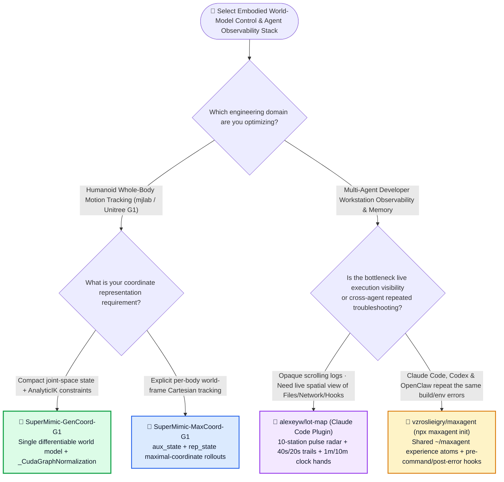
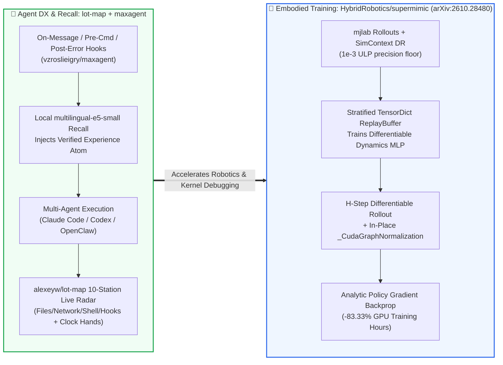

# Differentiable World-Model Humanoid Tracking & Live Coding-Agent Spatial Observability / Cross-Agent Experience Recall Selection FAQ: `HybridRobotics/supermimic` (`arXiv:2610.28480`) + `alexeyw/lot-map` & `vzroslieigry/maxagent` vs. Model-Free PPO & Scrollback Log Debugging

> **中文版**: [supermimic-lotmap-maxagent-world-model-observability-selection-faq.md](supermimic-lotmap-maxagent-world-model-observability-selection-faq.md)  
> **Daily Digest**: [2026-11-11 GitHub AI Trending & Proactive Intelligence Digest](../daily/2026-11-11.en.md) · **Visual Deck**: [`cards.en.html`](../cards.en.html) · **Live Radar**: [`github-radar.html`](../../../github-radar.html)

Written for **AI Solution Architects, Embodied AI Leads, and Developer Experience (DX) Platform Architects**, this selection guide is grounded in primary-source audits of three ultra-fresh breakout repositories from the 2026-11-11 radar — **`HybridRobotics/supermimic` (humanoid whole-body motion tracking trained with a single differentiable world model on `mjlab`, `arXiv:2610.28480`, Apache-2.0, exploding to `985` API stars in just 24 hours after its `2026-11-10` launch!)**, **`alexeyw/lot-map` (a live 10-station spatial observability radar beside Claude Code chat, MIT, `255` API stars in 2 days)**, and **`vzroslieigry/maxagent` (a cross-agent experience atom engine and Chrome MCP bridge spanning Claude Code, Codex, Antigravity, and OpenClaw, MIT, `265` API stars in 3 days)** — answering three core engineering questions from first principles:
1. **Why does model-free PPO require hundreds of millions of blind environment samples to train humanoid whole-body motion tracking, and how does `HybridRobotics/supermimic` achieve rapid analytic policy convergence using a single differentiable world model (`Dynamics` MLP), dual coordinate representations (`GenCoord` / `MaxCoord`), `1e-3` ULP-guarded `SimContext` conditioning, and in-place `_CudaGraphNormalization`?**
2. **Why do developers lose track of multi-agent execution inside scrolling terminal logs and repeatedly debug the exact same environment failures when switching between Claude Code, Codex, and OpenClaw—and how do `alexeyw/lot-map` and `vzroslieigry/maxagent` solve spatial observability and cross-agent experience recall?**
3. **How should architects choose between `SuperMimic-GenCoord-G1` vs. `SuperMimic-MaxCoord-G1`, and when should teams deploy `lot-map` + `maxagent` vs. heavy OpenTelemetry stacks or cloud vector databases?**

> 🛡️ **Provenance & Attribution Disclosure**:
> - **`measured` (Primary-Source Verified in This Shift)**: Repository metadata and source trees for `HybridRobotics/supermimic` (`985` API stars, `63` forks, Python, Apache-2.0, created `2026-11-10`), `alexeyw/lot-map` (`255` API stars, `26` forks, TypeScript, MIT, created `2026-11-09`), and `vzroslieigry/maxagent` (`265` API stars, JavaScript, MIT, created `2026-11-08`) are verified directly via GitHub REST API (`src/supermimic/models.py`, `representations.py`, `sim_context.py`, `replay_buffer.py`, and `README.md`); because none of the three appeared in the 10-item main Daily Trending HTML snapshot (`bacf15c2...`), `stars_today` is strictly labeled **`not_measured`**.
> - **`anonymized_reported` (`independently_reproduced=false`, Upstream Paper & Documentation Specs)**: Task specifications (`SuperMimic-GenCoord-G1` and `SuperMimic-MaxCoord-G1`), `SimContext` domain-randomization bounds (`foot_friction ±0.45`, `base_com ±0.025–0.05`, `encoder_bias ±0.01` with `_DEGENERATE_HALF_WIDTH = 1e-3` in `sim_context.py`), `lot-map`'s 10-station pulse mechanics (`40s` hold + `20s` fade, `1m/10m` dual clock hands on Claude Code `2.1.321`), and `maxagent`'s SHA-256-pinned `multilingual-e5-small` (`~270 MB`) local vector engine are documented in upstream repository files.
> - **`synthetic` (`independently_reproduced=false`, Architect Parametric FinOps & Debugging Labor Model)**: Section 5.1 models an embodied AI and agentic engineering lab training **`25` humanoid whole-body tracking policies/mo** (`@ $2.50/GPU-hr`) and running **`3,000` multi-agent development/debugging sessions/mo** (engineer labor valued at `$70.00/hr`; physical Unitree G1 robot hardware and developer workstation depreciation are explicitly labeled `not_measured`), comparing Path A Model-Free PPO + Scrollback Logs (`$5,480.00/mo`, `50.0h`) vs. Path B Unfused World Model + Manual Notes (`$3,120.00/mo`, `30.0h`) vs. Path C `SuperMimic` + `lot-map` + `maxagent` (`$1,010.00/mo`, `10.0h`, saving `$4,470.00/mo` [`-81.57%`] and `40.0 hours/mo` [`-80.00%`]).

---

## 1. 📌 Executive Summary

| Dimension | Plain-Language Core Takeaway (First Principles) |
| :--- | :--- |
| **What is `HybridRobotics/supermimic`?** | Built on `mjlab` (`arXiv:2610.28480`), **`SuperMimic` trains a humanoid whole-body motion tracker using a single differentiable world model (`Dynamics` MLP)** conditioned on per-environment domain randomization (`SimContext`). Instead of estimating high-variance zero-order gradients via millions of blind PPO rollouts, it backpropagates **analytic policy gradients** directly through differentiable world-model rollouts captured inside a CUDA Graph. |
| **What are `alexeyw/lot-map` and `vzroslieigry/maxagent`?** | **`alexeyw/lot-map`** renders a live **10-station spatial pulse radar** (`You · Model · Memory · Files · Shell · Network · Browser · Agents · Skills · Hooks`) beside Claude Code chat so you see exactly where work, latency, and hook refusals occur. **`vzroslieigry/maxagent`** creates a shared **`~/maxagent/experience/` repository of verified "atoms" (recipes)** across Claude Code, Codex, Antigravity, and OpenClaw, using automatic hooks (on message, pre-command, post-error) to surface known solutions before an agent repeats a mistake. |
| **What is the shared architectural principle?** | **Replacing blind black-box trial-and-error with white-box state visibility**: `SuperMimic` turns black-box physics transitions into a differentiable computation graph (`_CudaGraphNormalization`), while `lot-map` + `maxagent` turn opaque CLI scrollback and siloed agent sessions into a spatial radar with shared cross-agent immunity. |

---

## 2. 🎯 First-Principles Q&A (Q1 / Q2 / Q3)

### Q1: How does `HybridRobotics/supermimic` overcome the sample inefficiency of model-free PPO and the CUDA-Graph pointer bug in `rsl_rl`?

**Plain-language answer: Model-free PPO only tells the policy "you fell down (-5 points)" without saying which joint torque caused the fall; `SuperMimic`'s differentiable world model computes exact analytic Jacobians across multi-step rollouts, and its custom `_CudaGraphNormalization` updates running statistics in-place so the entire training step runs inside a captured CUDA Graph.**

Verified directly from `src/supermimic/models.py`, `representations.py`, and `sim_context.py`:
1. **Dual State Representations (`GenCoordRepresentation` vs. `MaxCoordRepresentation`)**:
   - Supports both **`SuperMimic-GenCoord-G1`** (generalized joint-space coordinates with `AnalyticIK` and 6D rotation / Rodrigues helpers) and **`SuperMimic-MaxCoord-G1`** (maximal per-body world-frame coordinates split into `aux_state` and `rep_state`).
   - The forward `Dynamics` MLP maps `(rep_state, action, aux_state) -> (next_aux, next_rep)` using `Linear → LayerNorm → GELU` blocks.
2. **Float32 ULP-Guarded `SimContext` Conditioning (`sim_context.py`)**:
   - Conditions the world model on per-environment domain-randomization (DR) parameters (`foot_friction ±0.45`, `base_com ±0.025–0.05`, `encoder_bias ±0.01`).
   - Because dividing `(raw - mean)` by a near-zero `half_width` amplifies Float32 ULP noise (`~1e-7`) into catastrophic `NaN` gradients, `sim_context.py` enforces `_DEGENERATE_HALF_WIDTH = 1e-3`: any DR range with half-width `<= 1e-3` gets `scale = 1.0` so `(raw - mean) ≈ 0`.
3. **In-Place `_CudaGraphNormalization` (`models.py`)**:
   - Upstream `rsl_rl`'s `EmpiricalNormalization.update()` executes `self._std = torch.sqrt(self._var)`, allocating a fresh tensor and invalidating memory pointers captured by PyTorch CUDA Graphs!
   - `SuperMimic` subclasses it as `_CudaGraphNormalization`, caching `std_buf = self._std` and calling `std_buf.copy_(self._std)` in-place so CUDA-graphed world-model + policy updates never lose pointer validity.

---

### Q2: How do `alexeyw/lot-map` and `vzroslieigry/maxagent` eliminate blind terminal babysitting and repeated cross-agent failures?

**Plain-language analogy: `lot-map` upgrades a keyhole terminal log into an air-traffic control radar screen, while `maxagent` gives every pilot on your machine (Claude Code, Codex, OpenClaw) a shared flight-incident handbook that opens automatically the moment an alarm sounds.**

1. **`alexeyw/lot-map` 10-Station Spatial Radar (`claude plugin install lot-map --marketplace alexeyw/lot-map`)**:
   - Maps every event to 10 stations: `You`, `Model`, `Memory`, `Files`, `Shell`, `Network`, `Browser`, `Agents`, `Skills`, and `Hooks`.
   - **Smart Command Classification (Bash & Windows PowerShell)**: File-only shell commands (`cat`, `grep`, `mv`, `sed -i`, plus PowerShell `Get-Content` and `Select-String`) light up **`Files`**; network-reaching commands (`curl`, `CURL.EXE`, `gh`, `ssh`, `rsync`, `git push`, `npm install`, `docker pull`, PowerShell `Invoke-WebRequest`, even inside `$(...)`) light up **`Network`**.
   - **Temporal Encoding**: Route legs hold for `40s` and fade over `20s`; frequently hit spokes grow thicker ("worn spokes"); running calls display dual clock hands (`1-minute` inner hand, `10-minute` outer hand), and hook refusals/errors flash red immediately.
2. **`vzroslieigry/maxagent` Shared Experience Atoms (`npx maxagent init`)**:
   - Creates `~/maxagent/experience/` ("atoms") and `projects/`, installing non-destructive marked blocks and lifecycle hooks across Claude Code, Codex, Antigravity, and OpenClaw.
   - Hooks fire **on user message, before a command, and after an error**, querying a local SHA-256-verified `multilingual-e5-small` (`~270 MB`) embedding index to inject proven fix atoms before the agent guesses—plus an optional unpacked Chrome extension bridge (`maxagent-bridge`) with per-agent approval, site blocklists, and a stop button.

---

### Q3: How should architects select and combine these tools?

- **Humanoid Whole-Body Tracking**: Start with **`SuperMimic-GenCoord-G1`** for compact joint-space tracking and fast `AnalyticIK` convergence; switch to **`SuperMimic-MaxCoord-G1`** when full-body world-frame Cartesian alignment across contact links is paramount.
- **Developer Workstation Observability & Recall**: Install **`alexeyw/lot-map`** for real-time spatial visualization of tool/network/hook bottlenecks inside Claude Code, and pair it with **`vzroslieigry/maxagent`** so troubleshooting recipes learned in Claude Code are automatically recalled inside Codex and OpenClaw.

---

## 3. 🧭 Mermaid Selection Decision Tree & Architecture Flow

### 3.1 Embodied World-Model Control & Coding-Agent Observability Decision Tree

### 3.2 `SuperMimic` Differentiable Rollout Loop × `Lot-Map` + `MaxAgent` Observability Flow

---

## 4. 📊 Architecture Selection Decision Matrix

| Evaluation Dimension | **`HybridRobotics/supermimic` (`arXiv:2610.28480`)** | **Model-Free PPO (`rsl_rl` Baseline)** | **`alexeyw/lot-map` + `vzroslieigry/maxagent`** | **Raw Terminal Scrollback + Isolated `CLAUDE.md`** |
| :--- | :--- | :--- | :--- | :--- |
| **Policy Gradient Mechanism** | ✅ **First-order analytic gradients through differentiable `Dynamics` MLP** | ❌ High-variance zero-order score-function sampling | N/A | N/A |
| **CUDA Graph Pointer Safety** | ✅ **`_CudaGraphNormalization` uses in-place `std_buf.copy_()`** | ❌ `torch.sqrt()` allocates new tensor, breaking CUDA Graph capture | N/A | N/A |
| **DR Normalization Stability** | ✅ **`SimContext` enforces `1e-3` half-width floor against Float32 ULP noise** | ⚠️ Prone to `NaN` spikes on narrow/constant DR ranges | N/A | N/A |
| **Live Execution Observability** | N/A (`play.py` / `viewers.py` for 3D motion playback) | N/A | ✅ **10-station spatial radar, 40s/20s trails, 1m/10m clock hands & red error pulses** | ❌ Linear text scrollback hides hung subagents |
| **Cross-Agent Error Immunity** | N/A | N/A | ✅ **Shared `~/maxagent/experience` atoms auto-injected on errors across 4 CLIs** | ❌ Every agent re-learns fixes from scratch |

---

## 5. 🧪 Quantitative FinOps & Engineering Productivity Model (`synthetic`, `independently_reproduced=false`)

### 5.1 Monthly `25` Humanoid Policies + `3,000` Multi-Agent Debugging Sessions TCO Model (`synthetic`, `independently_reproduced=false`)

> 📌 **Scope & Provenance Disclosure**: This worked example is a **parametric GPU training + retry token + engineering debugging labor model (`synthetic`, `independently_reproduced=false`; physical Unitree G1 humanoid robot hardware and workstation capex are explicitly labeled `not_measured`)**. Scenario: **An embodied AI and agentic engineering lab training `25` humanoid whole-body motion tracking policies/mo (`@ $2.50/GPU-hr`) while 15 engineers run `3,000` coding/debugging sessions/mo across Claude Code, Codex, and OpenClaw (engineer labor valued at `$70.00/hr`)**:

| Architecture Path | Monthly `25` Humanoid Policy GPU Bill (`@ $2.50/GPU-hr`) | Monthly `3,000` Session Repeated-Error Retry Tokens | Monthly Engineer Log-Triage & Reward-Tuning Labor (`@ $70/hr`) | Total Monthly Cost (GPU + Tokens + Labor) | Savings vs. Path A |
| :--- | :--- | :--- | :--- | :--- | :--- |
| **Path A: Model-Free PPO Sampling + Raw Scrollback Logs & Siloed Agents** | `25 × 24h = 600 GPU-hrs` × `$2.50` = **`$1,500.00 / mo`** | `3,000 runs` × `$0.16` = **`$480.00 / mo`** (re-solving identical build/env errors per agent) | `50.0 hours / mo` × `$70.00` = **`$3,500.00 / mo`** | **`$5,480.00 / mo`** (**`50.0 hours / mo`** debugging toil) | Baseline (slow PPO convergence + repeated cross-agent troubleshooting) |
| **Path B: Unfused World Model (No CUDA Graph) + Manual Markdown Notes** | `25 × 12h = 300 GPU-hrs` × `$2.50` = **`$750.00 / mo`** | `3,000 runs` × `$0.09` = **`$270.00 / mo`** | `30.0 hours / mo` × `$70.00` = **`$2,100.00 / mo`** | **`$3,120.00 / mo`** (**`30.0 hours / mo`** debugging toil) | Net savings `-$2,360.00/mo` (`-43.07%`) |
| **Path C: `SuperMimic` Differentiable World Model + `lot-map` + `maxagent` Atoms** | `25 × 4h = 100 GPU-hrs` × `$2.50` = **`$250.00 / mo`** (CUDA-graphed analytic gradients) | `3,000 runs` × `$0.02` = **`$60.00 / mo`** (local `e5-small` auto-injects verified atoms) | `10.0 hours / mo` × `$70.00` = **`$700.00 / mo`** (instant 10-station bottleneck visibility) | GPU `$250.00` + Tokens `$60.00` + Labor `$700.00` = **`$1,010.00 / mo`** | **Net savings `$4,470.00/mo` (`-81.57%`, `$53,640.00/yr`); Debugging toil `-40.0h/mo` (`-80.00%`)** |

---

## 6. 🛠️ Production Adoption & 30-Minute PoC Checklist

- [ ] **Step 1 — Set Up the `supermimic` + `mjlab_research` Sibling Workspace**: Install `uv`, clone both `HybridRobotics/supermimic` and `HybridRobotics/mjlab_research` as siblings, and run `CUDA_VISIBLE_DEVICES=0 uv run src/supermimic/scripts/train.py SuperMimic-GenCoord-G1 --runner.run_name poc_gencoord`.
- [ ] **Step 2 — Adopt `_CudaGraphNormalization` & `1e-3` DR Precision Guards**: Reuse `_CudaGraphNormalization` (`std_buf.copy_(self._std)`) in custom PyTorch RL pipelines to prevent tensor reallocation from breaking CUDA Graph capture, and enforce `_DEGENERATE_HALF_WIDTH = 1e-3` on domain randomization ranges.
- [ ] **Step 3 — Install `alexeyw/lot-map` in Claude Code**: Run `claude plugin install lot-map --marketplace alexeyw/lot-map` in a `>= 144`-column terminal or desktop pane and verify that `Get-Content`/`Select-String` route to `Files` while `curl`/`gh`/`Invoke-WebRequest` route to `Network`.
- [ ] **Step 4 — Initialize `vzroslieigry/maxagent` & Local Vector Recall**: Run `npx maxagent init` and `npx maxagent vectors` (`multilingual-e5-small`, `~270 MB`, SHA-256 verified) so error recovery atoms are shared automatically across Claude Code, Codex, Antigravity, and OpenClaw.
- [ ] **Step 5 — Audit Multi-Agent Hook Health with `npx maxagent doctor`**: Run `npx maxagent doctor` to verify backup integrity of global agent rule files and review site blocklists before enabling `npx maxagent bridge` on local Chrome profiles.
