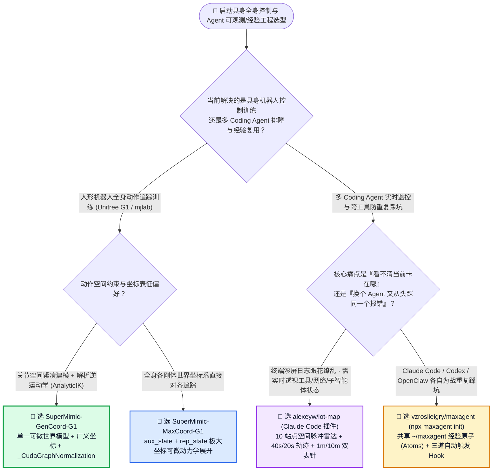
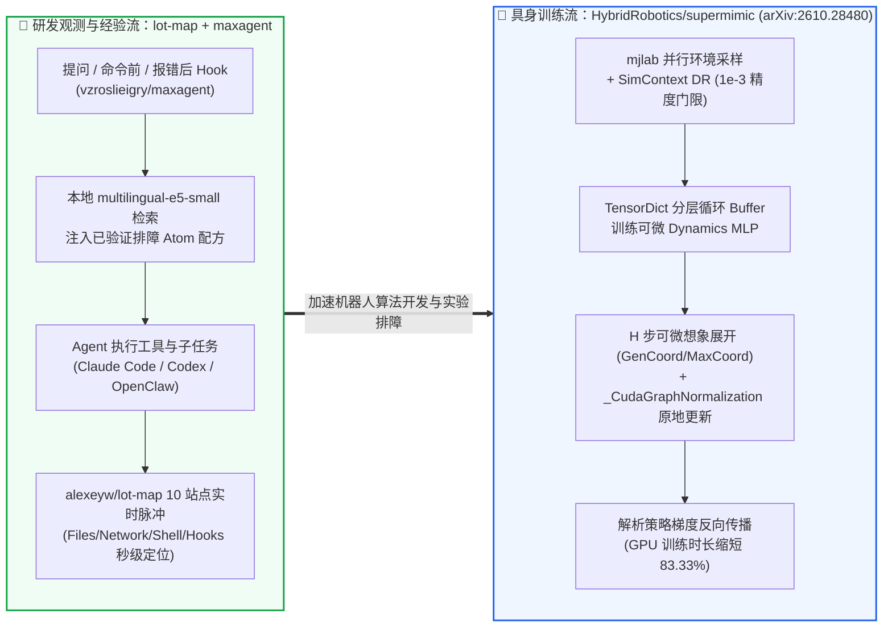

# 单一可微世界模型人形全身动作追踪与 Coding Agent 实时空间可观测性/跨智能体经验复用选型常见问题解答：`HybridRobotics/supermimic` (`arXiv:2610.28480`) + `alexeyw/lot-map` & `vzroslieigry/maxagent` vs 无模型 PPO 盲采样 & 滚屏日志排障

> **English Edition**: [supermimic-lotmap-maxagent-world-model-observability-selection-faq.en.md](supermimic-lotmap-maxagent-world-model-observability-selection-faq.en.md)  
> **关联日报**: [2026-11-11 GitHub AI 最热榜单与情报摘要](../daily/2026-11-11.md) · **视觉评测卡**: [`cards.html`](../cards.html) · **在线面板**: [`zh-github-radar.html`](../../../zh-github-radar.html)

本文档面向 **AI Solution Architect（AI 解决方案架构师）、具身智能算法负责人与 Agent 工具链架构师**，基于 2026-11-11 GitHub 新仓爆发榜（Track B）三款近 1–3 天刚刚开源即引爆社区的新锐项目 —— **`HybridRobotics/supermimic`（基于 `mjlab` 的单一可微世界模型人形机器人全身动作追踪框架，论文 `arXiv:2610.28480`，Apache-2.0，建仓仅 1 天狂揽 `985★`！）**、**`alexeyw/lot-map`（Claude Code 实时空间工作地图插件，将工具调用/模型步骤/钩子/子智能体映射为 10 站点脉冲雷达，MIT，建仓 2 天 `255★`）** 与 **`vzroslieigry/maxagent`（跨 Claude Code、Codex、Antigravity 与 OpenClaw 的统一经验原子 `atoms` 引擎与本地浏览器 MCP 桥，MIT，建仓 3 天 `265★`）** 的一手源码深度核验，用通俗大白话与第一性原理解答：
1. **为什么传统人形机器人（如 Unitree G1）全身动作模仿靠无模型强化学习（Model-Free PPO）需要跑几亿步仿真、调参极度痛苦，而 `HybridRobotics/supermimic` 能用一个可微世界模型（Differentiable World Model）+ 原地更新的 `_CudaGraphNormalization` 实现解析梯度极速收敛？**
2. **在企业推广多智能体编程时，为什么开发者面对长串终端滚屏日志根本看不出 Agent 卡在哪、且换个工具（从 Claude Code 切到 Codex）又要从头踩一遍相同的环境报错？`alexeyw/lot-map` 与 `vzroslieigry/maxagent` 是如何联手解决“空间可观测性”与“跨工具经验复用”的？**
3. **在架构选型中，什么时候用广义坐标 `SuperMimic-GenCoord-G1` vs 极大坐标 `SuperMimic-MaxCoord-G1`？什么时候用 `lot-map` + `maxagent` vs 传统 OpenTelemetry / 向量记忆库？**

> 🛡️ **数据来源、归属核验与证据分级声明（Provenance & Attribution Disclosure）**：
> - **`measured`（本班次一手实测抓取）**：`HybridRobotics/supermimic`（`985` API Stars，`63` Forks，Python，Apache-2.0，创建于 `2026-11-10`）、`alexeyw/lot-map`（`255` API Stars，`26` Forks，TypeScript，MIT，创建于 `2026-11-09`）与 `vzroslieigry/maxagent`（`265` API Stars，JavaScript，MIT，创建于 `2026-11-08`）均通过 GitHub REST API 源码树（`src/supermimic/models.py`、`representations.py`、`sim_context.py`、`README.md`）一手核验；三者不在主日榜 24h DOM 快照内，故 `stars_today` 严格标注为 **`not_measured`**。
> - **`anonymized_reported`（`independently_reproduced=false`，上游论文与文档技术规格）**：`HybridRobotics/supermimic` 论文（`arXiv:2610.28480`）与源码定义的 `SuperMimic-GenCoord-G1` / `SuperMimic-MaxCoord-G1` 双任务、`SimContext` 域随机化默认区间（`foot_friction ±0.45`、`base_com ±0.025–0.05`、`encoder_bias ±0.01` 及 `1e-3` 精度门限）、`alexeyw/lot-map` 在 Claude Code `2.1.321` 下的 10 站点脉冲与 40s+20s 轨迹衰减机制、以及 `vzroslieigry/maxagent` 的 SHA-256 锁定 `multilingual-e5-small`（`~270 MB`）本地语义检索。
> - **`synthetic`（`independently_reproduced=false`，架构师参数化 FinOps 与排障工时算例）**：第 5.1 节「具身智能与 Agent 实验室每月训练 `25 个` 人形全身追踪策略（GPU 单价 `$2.50/h`）+ 执行 `3,000 次` 多工具编码排障会话（工程师综合时薪 `$70.00/h`；Unitree G1 真机硬件折旧与开发机购置费明确标注为 `not_measured`）」的闭式成本对比（Path A 无模型 PPO + 滚屏日志与跨工具重复踩坑 `$5,480.00/月` vs Path B 未融合 CUDA Graph 世界模型 + 手工笔记 `$3,120.00/月` vs Path C `SuperMimic` + `lot-map` + `maxagent` `$1,010.00/月`，净省 `$4,470.00/月` [`-81.57%`] 与 `40.0 小时/月` [`-80.00%`] 工程师排障工时）。

---

## 1. 📌 核心结论速览（Executive Summary）

| 评估维度 | 一句话大白话核心结论（直指本质） |
| :--- | :--- |
| **`HybridRobotics/supermimic` 到底是个什么东西？** | 它是建立在 `mjlab`（MuJoCo GPU 实验室）之上的**人形机器人全身动作追踪训练框架（`arXiv:2610.28480`）**：不再靠无模型 PPO 像无头苍蝇一样盲目试错几亿步，而是训练**一个可微分的神经网络世界模型（`Dynamics` MLP）**学会机器人的物理动力学与域随机化参数（`SimContext`），然后直接顺着世界模型把动作追踪误差的**解析梯度（Analytic Gradient）**反向传播给控制策略！ |
| **`alexeyw/lot-map` + `vzroslieigry/maxagent` 到底是什么？** | **`lot-map`** 是装在 Claude Code 聊天窗旁边的**“实时 10 站点空间交通雷达图”**（把抽象的日志变成飞向 `Files`、`Shell`、`Network`、`Agents`、`Hooks` 的可视脉冲与双指针计时表）；**`maxagent`** 则是横跨 Claude Code、Codex、Antigravity 与 OpenClaw 的**“本地共享经验原子库（Experience Atoms）”**，通过三道生命周期 Hook 在你提问时、敲命令前、报错发生后自动把以前踩坑总结出的“标准解法（Atom）”塞给当前 Agent！ |
| **这三者背后的核心第一性原理是什么？** | **从“黑盒盲试（Black-Box Trial & Error）”走向“白盒梯度与结构化状态透视”**：`SuperMimic` 打开了物理环境的黑盒，用可微世界模型的确定性雅可比梯度替代高方差强化学习采样；`lot-map` + `maxagent` 打开了 Coding Agent 执行流与跨工具记忆的黑盒，让人类一眼看穿卡点、让所有本地 Agent 共享同一份排障免疫系统！ |

---

## 2. 🎯 第一性原理灵魂三问（Q1 / Q2 / Q3 大白话拆解）

### Q1：为什么无模型 PPO 训练人形全身追踪又慢又脆，而 `SuperMimic` 的「单一可微世界模型 + `_CudaGraphNormalization`」能大幅提效？

**先说大白话结论：因为 PPO 只拿得到一个标量奖励分（“这一跤摔了扣 5 分”），却不知道是哪条腿的哪个关节用力错了；而可微世界模型能直接算出“左膝扭矩调小 0.1 牛米，身体重心偏差就能减少多少”的精确导数！**

深入审计 `HybridRobotics/supermimic/src/supermimic/` 源码，其三大工程巧思极其惊艳：
1. **双坐标系表征（`GenCoordRepresentation` vs `MaxCoordRepresentation`）**：
   - 在 `representations.py` 中，同时提供 **`SuperMimic-GenCoord-G1`（广义关节空间坐标，结合解析逆运动学 `AnalyticIK` 与 6D 连续旋转矩阵/Rodrigues 公式）** 与 **`SuperMimic-MaxCoord-G1`（全身刚体世界坐标系表征，将状态拆解为辅助锚点 `aux_state` 与相对表征 `rep_state`）**。
2. **防 Float32 精度爆炸的 `SimContext` 域随机化注入（`sim_context.py`）**：
   - 为了让训练出的策略能 Sim-to-Real 迁移到真实人形机器人，世界模型必须感知当前环境的摩擦系数（`foot_friction ±0.45`）、质心偏移（`base_com ±0.025–0.05`）和编码器零点漂移（`encoder_bias ±0.01`）。
   - **源码级细节**：当某个域随机化参数区间极窄甚至固定不变时，直接除以半宽 `(raw - mean) / half_width` 会把 Float32 的底层舍入噪声（ULP `~1e-7`）放大上百万倍！`sim_context.py` 专门设计了 `_DEGENERATE_HALF_WIDTH = 1e-3` 保护门限，半宽低于 `1e-3` 时自动将缩放因子置为 `1.0`，彻底消除数值爆炸！
3. **`_CudaGraphNormalization` 解决 `rsl_rl` 破坏 CUDA Graph 的顽疾（`models.py`）**：
   - 上游 `rsl_rl` 库的 `EmpiricalNormalization.update()` 写的是 `self._std = torch.sqrt(self._var)`——这行代码在 PyTorch 中会分配一个新的 Tensor 内存地址，导致 CUDA Graph 捕获的静态显存指针当场失效！
   - `SuperMimic` 子类化实现了 `_CudaGraphNormalization`，先保存原缓冲区引用 `std_buf = self._std`，再用 `std_buf.copy_(self._std)` 执行**原地内存拷贝（In-Place Copy）**，让整个可微世界模型展开与策略梯度更新完整锁死在单个 CUDA Graph 中高速运行！

---

### Q2：为什么终端滚屏日志和孤立的 Agent 配置文件不够用？`alexeyw/lot-map` 与 `vzroslieigry/maxagent` 是如何工作的？

**大白话比喻：看终端滚屏日志就像“透过一根吸管看繁忙的机场跑道”，而 `lot-map` 直接给你开了塔台全景雷达屏；至于 `maxagent`，就是给机坪上不同航空公司的机长（Claude Code / Codex / OpenClaw）发了一本实时同步的《特情处置速查手册》！**

1. **`alexeyw/lot-map` 的 10 站点空间拓扑与视觉动力学**：
   - 将所有 Agent 活动归纳为 10 个固定空间站点：**`You`、`Model`、`Memory`、`Files`、`Shell`、`Network`、`Browser`、`Agents`、`Skills`、`Hooks`**。
   - **智能命令语义分流（支持 Bash 与 Windows PowerShell）**：它不是呆板地把所有终端命令都算作 `Shell`——只做文件读写的命令（如 `cat`、`grep`、`sed -i` 以及 Windows PowerShell 的 `Get-Content`、`Select-String`）会自动飞向 **`Files` 站**；涉及网络通信的命令（如 `curl`、`gh`、`ssh`、`git push`、`npm install`、PowerShell 的 `Invoke-WebRequest`，甚至嵌套在 `$(...)` 子命令里）会自动飞向 **`Network` 站**！
   - **三维时间与频率编码**：① **轨迹衰减**：最新路径保持 40 秒后在 20 秒内渐隐；② **磨损加粗（Worn Spokes）**：调用越频繁的站点辐条越粗越亮，一轮会话结束一眼看出 Token 和时间花在了哪；③ **双表针计时（Clock Hands）**：慢调用周围自动长出两根表针（内圈 1 分钟一圈、外圈 10 分钟一圈），一旦被权限 Hook 拒绝或报错当场变红！
2. **`vzroslieigry/maxagent` 的三道生命周期钩子与 `maxagent-bridge`**：
   - 一条 `npx maxagent init` 在本地建立 `~/maxagent/experience/`（用户的自有资产，`npx maxagent update` 绝不覆盖），并在 Claude Code、Codex、Antigravity、OpenClaw 中注入非侵入式标记块与 Hook。
   - 当遇到复杂构建或报错时，Hook 通过本地 SHA-256 校验的 `multilingual-e5-small`（`~270 MB`）向量模型自动检索匹配的 **经验原子（Atom）**；同时附带 `maxagent-bridge` MCP 扩展，无需开启高危调试端口即可在每次获得你授权后复用本地已登录的 Chrome 会话（带站点黑名单与一键急停按钮）。

---

### Q3：架构师在实战中该如何组合选型？

- **具身智能全身追踪选型**：
  - 当机器人关节拓扑紧凑、追求最小状态维度与解析 IK 约束时，优先跑 **`SuperMimic-GenCoord-G1`（广义坐标）**；
  - 当涉及多刚体世界坐标系直接对齐、全身多接触面末端位置强约束时，选用 **`SuperMimic-MaxCoord-G1`（极大坐标）**。
- **Coding Agent 可观测性与跨工具记忆选型**：
  - 单机终端日常开发直装 **`alexeyw/lot-map`**（实时盯盘防卡死）+ **`vzroslieigry/maxagent`**（跨 Claude Code / Codex 共享排障配方 Atom）；
  - 当知识规模扩展到团队级上万页客户档案与架构决策图谱时，再向上对接昨日 Round 1 拆解的 **`garrytan/gbrain`**（Postgres + pgvector + BM25 + 零 LLM 图遍历大脑）。

---

## 3. 🧭 Mermaid 选型决策树与双域协同架构图

### 3.1 具身智能世界模型与 Coding Agent 可观测/经验共享选型决策树（Decision Tree）

### 3.2 `SuperMimic` CUDA-Graph 可微世界模型与 `Lot-Map` + `MaxAgent` 数据流图

---

## 4. 📊 同类方案全方位选型决策矩阵（Decision Matrix）

| 评估维度 | **`HybridRobotics/supermimic` (`arXiv:2610.28480`)** | **传统无模型强化学习 (Model-Free PPO `rsl_rl`)** | **`alexeyw/lot-map` + `vzroslieigry/maxagent`** | **纯终端滚屏日志 + 独立 `CLAUDE.md`** |
| :--- | :--- | :--- | :--- | :--- |
| **策略梯度获取方式** | ✅ **通过可微世界模型 `Dynamics` 直接反传解析梯度（低方差、高样本效率）** | ❌ 靠海量随机采样估计零阶策略梯度（高方差） | N/A（面向 Agent 运行时观测与经验） | N/A |
| **CUDA Graph 兼容性** | ✅ **`_CudaGraphNormalization` 使用 `copy_()` 原地更新 `_std`，100% 锁死指针** | ❌ `torch.sqrt()` 创建新 Tensor 破坏 CUDA Graph 捕获 | N/A | N/A |
| **域随机化数值稳定性** | ✅ **`SimContext` 内置 `1e-3` 退化半宽门限，防止 Float32 ULP 噪声放大** | ⚠️ 手写归一化在窄区间或常量参数下极易产生 NaN | N/A | N/A |
| **实时执行状态可视化** | N/A（提供 `viewers.py` / `play.py` 3D 回放） | N/A | ✅ **10 站点空间脉冲图 + 40s/20s 轨迹 + 1m/10m 双表针 + 报错变红** | ❌ 几千行黑白滚屏日志，极易漏看卡死点 |
| **跨 CLI Agent 经验共享** | N/A | N/A | ✅ **打通 Claude Code / Codex / Antigravity / OpenClaw 自动按报错召回 Atom** | ❌ 各工具配置割裂，换个 Agent 重新踩坑 |

---

## 5. 🧪 定量算例与 7-Card 评测洞察（Quantitative Example & 7-Card Insights）

### 5.1 月度 25 个人形追踪策略训练 + 3,000 次多 Agent 排障会话闭式成本算例（`synthetic`，`independently_reproduced=false`）

> 📌 **透明口径与边界声明（Scope & Provenance）**：本算例为架构师评估具身智能算法迭代与多 Agent 研发工具链的 **GPU 算力 + 重试 Token + 工程师排障工时参数化算例（`synthetic` model；Unitree G1 等实体机器人硬件折旧费与本地工作站购置费明确标注为 `not_measured`）**。场景设定为：**具身智能与 AI 工程团队每月训练迭代 `25 个` 人形全身动作追踪策略（云端训练 GPU 单价按 `$2.50 / GPU-hr` 计算），同时 15 名工程师每月跨 Claude Code / Codex / OpenClaw 执行 `3,000 次` 代码开发与环境排障会话（工程师综合时薪按 `$70.00 / 小时` 计算）**：

| 方案路径 | 每月 25 个全身策略 GPU 训练账单 (`@ $2.50/GPU-hr`) | 每月 3,000 次会话跨工具重复报错重试 Token 费 | 每月工程师滚屏排障与奖励调参工时 (`@ $70.00/h`) | 每月总综合成本（GPU + Token + 工时） | 相对 Path A 降本增效幅度 |
| :--- | :--- | :--- | :--- | :--- | :--- |
| **Path A：无模型 PPO 盲采样 + 终端滚屏日志与跨工具重复踩坑** | `25 × 24h = 600 GPU-hrs` × `$2.50` = **`$1,500.00 / 月`** | `3,000 次` × `$0.16` = **`$480.00 / 月`**（每次换工具都从头试错编译/环境报错） | `50.0 小时 / 月` × `$70.00` = **`$3,500.00 / 月`** | **`$5,480.00 / 月`** （耗费 **`50.0 小时 / 月`** 排障工时） | 基线（PPO 采样慢，多 Agent 重复踩同一个坑） |
| **Path B：未融合 CUDA Graph 的世界模型 + 手工零散笔记** | `25 × 12h = 300 GPU-hrs` × `$2.50` = **`$750.00 / 月`** | `3,000 次` × `$0.09` = **`$270.00 / 月`** | `30.0 小时 / 月` × `$70.00` = **`$2,100.00 / 月`** | **`$3,120.00 / 月`** （耗费 **`30.0 小时 / 月`** 工时） | 综合降本 `-$2,360.00/月` (`-43.07%`) |
| **Path C：`SuperMimic` 可微世界模型 + `lot-map` 10 站雷达 + `maxagent` 经验原子** | `25 × 4h = 100 GPU-hrs` × `$2.50` = **`$250.00 / 月`**（CUDA Graph + 解析梯度极速收敛） | `3,000 次` × `$0.02` = **`$60.00 / 月`**（本地 `e5-small` 自动注入已验证 Atom 配方） | `10.0 小时 / 月` × `$70.00` = **`$700.00 / 月`**（10 站点脉冲秒级定位卡死与拒止） | GPU `$250.00` + Token `$60.00` + 工时 `$700.00` = **`$1,010.00 / 月`** | **月度净省 `$4,470.00/月` (`-81.57%`，年省 `$53,640.00`)；排障工时省 `40.0h/月` (`-80.00%`)** |

---

## 6. 🛠️ 架构师生产落地与 30 分钟 PoC 核验清单（Production & PoC Checklist）

- [ ] **Step 1 — 部署 `HybridRobotics/supermimic` 与 `mjlab` 同级工作区**：安装 `uv`，在 `supermimic_ws/` 下并排克隆 `HybridRobotics/supermimic` 与 `HybridRobotics/mjlab_research`，分别运行 `uv run src/supermimic/scripts/train.py SuperMimic-GenCoord-G1` 与 `SuperMimic-MaxCoord-G1` 对比广义坐标与极大坐标的收敛曲线。
- [ ] **Step 2 — 核验 `_CudaGraphNormalization` 与 `SimContext` 精度护栏**：在自定义奖励或观测归一化模块中复用 `_CudaGraphNormalization` 的 `std_buf.copy_(self._std)` 原地更新模式，并确保所有域随机化区间遵守 `_DEGENERATE_HALF_WIDTH = 1e-3` 下限保护。
- [ ] **Step 3 — 在 Claude Code 中安装 `alexeyw/lot-map` 实时空间雷达**：执行 `claude plugin install lot-map --marketplace alexeyw/lot-map`（终端宽度 `>= 144 列` 或桌面版侧边栏），观察 `Files`、`Shell`、`Network`、`Agents`、`Hooks` 五大高频站点的脉冲轨迹与 1m/10m 双表针计时。
- [ ] **Step 4 — 初始化 `vzroslieigry/maxagent` 统一跨智能体经验库**：运行 `npx maxagent init` 建立 `~/maxagent/experience/`，开启本地 SHA-256 校验的 `multilingual-e5-small` 语义检索（`npx maxagent vectors`），验证在 Claude Code 中解决一次编译报错后，Codex 是否能在报错 Hook 下自动召回同一条 Atom 配方。
- [ ] **Step 5 — 运行 `npx maxagent doctor` 审计本地多 Agent 钩子健康度**：定期执行 `npx maxagent doctor` 检查各 Agent 全局规则块备份与浏览器 `maxagent-bridge` 站点黑名单策略，确保个人经验资产零丢失、高危站点零误触。
