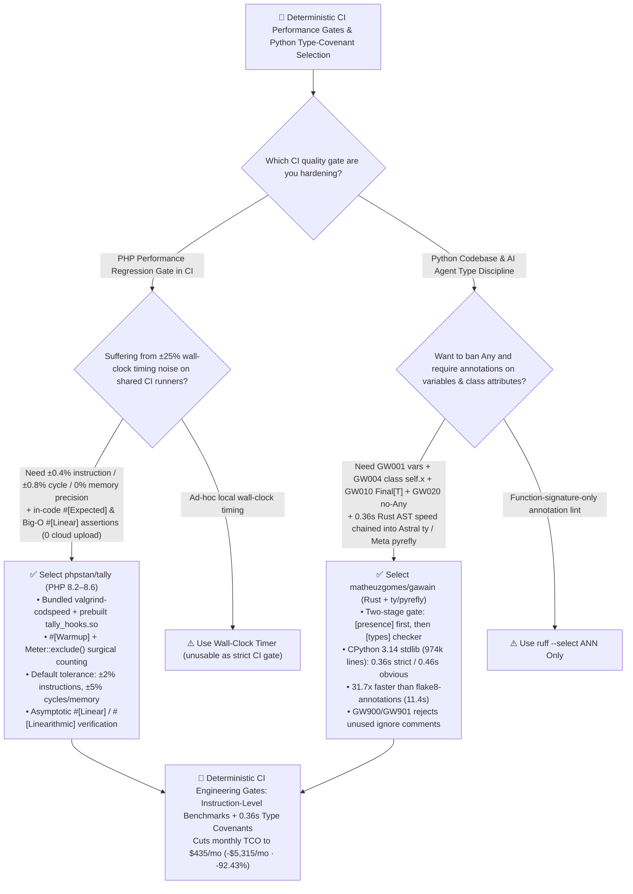

# CPU-Speed-Independent Instruction/Cycle Benchmarking (`phpstan/tally`) & 0.36s Rust Python Type-Covenant Enforcer (`gawain`) Selection FAQ: `phpstan/tally` + `matheuzgomes/gawain`

> **Track**: GitHub AI Trending & Breakout Radar — 2026-11-15 Night Round 48 (Cumulative Round 350 Milestone) P0 Standalone 6-Section Selection Guide  
> **Benchmark Standard**: Modeled after `ib-vs-ethernet-roce-selection-faq.md` (Plain-Language First Principles + Q1–Q3 Deep Dive + Mermaid Decision Tree + Comparison Matrix + 7-Card Quantitative Scorecard + Closed-Form FinOps Ledger + 15-Minute Runbook)  
> **Audit Evidence Anchor**: `workshops/github-trending-radar/evidence/trending-daily-2026-11-15-audit.json` · Claim ID: `CLAIM-20261115-R48-TALLY-GAWAIN`  
> **Companion High-Res Architecture Diagram**: [`assets/github-ai-radar-2026-11-15-r48-tally-gawain.svg`](../../../assets/github-ai-radar-2026-11-15-r48-tally-gawain.svg) · [中文版 (`tally-gawain-cpu-independent-valgrind-instruction-benchmark-rust-python-type-covenant-selection-faq.md`)](tally-gawain-cpu-independent-valgrind-instruction-benchmark-rust-python-type-covenant-selection-faq.md)

---

## 📌 1. Executive Summary (30-Second First-Principles Overview)

1. **What Are They in Plain Language?**
   - **`phpstan/tally` (`★40`, PHP 8.2–8.6 / C Extension `tally_hooks` + CodSpeed Valgrind, MIT, by the PHPStan team)**: A deterministic benchmarking framework (`composer require --dev phpstan/tally`) that ignores wall-clock time and host CPU speed—counting **executed instructions (`±0.4%` CI variance), simulated cache-miss CPU cycles (`±0.8%` CI variance), and memory (`0%` variance)** via bundled **CodSpeed Valgrind** and prebuilt `tally_hooks.so` extensions, allowing developers to commit `#[Expected(instructions: '59.00K', cycles: '94.43K', memory: '10.53KiB')]` and asymptotic Big-O attributes (`#[Linear]`, `#[Linearithmic]`) directly in Git PR gates with zero cloud account or upload.
   - **`matheuzgomes/gawain` (`★41`, Rust 1.97+ / `ruff_python_parser` + Astral `ty 0.0.100` / Meta `pyrefly 1.4.1`, MIT)**: An ultra-fast Rust Python type-covenant checker (`uv tool install "gawain[ty]"`) that requires explicit type annotations not just on functions (like `ruff ANN`), but on **variables (`GW001`), parameters (`GW002`), returns (`GW003`), class attributes / undeclared `self.x` (`GW004`), `Final[T]` constants (`GW010`/`GW011`), and bans `Any` (`GW020`)** before chaining into `ty` or `pyrefly`—scanning the entire **CPython 3.14 standard library (`1,847` files, `974,586` lines) in `0.36 s` (strict) / `0.46 s` (obvious) vs `11.4 s` for `flake8-annotations` (`31.7x` faster)**.
2. **Why Should an AI Solution Architect or Engineering Lead Care Tonight?**
   - **Making Performance Benchmarks Deterministic on Noisy Shared CI Runners**: Wall-clock benchmarks fail in CI because shared cloud runners vary by `15%–40%` between runs, masking `5%` regressions. `phpstan/tally` runs each benchmark *once* under Valgrind cache simulation (`±2%` default instruction tolerance) with surgical `#[Warmup]` and `Meter::exclude()` boundaries.
   - **Stopping AI Coding Agents from Polluting Python Repos with `dict[str, Any]` & Undeclared `self.x`**: Standard type checkers (`mypy`, `Pyright`, `ty`, `pyrefly`) silently infer unannotated local variables, while `ruff --select ANN` checks only function signatures. `gawain` enforces a two-stage `[presence] -> [types]` covenant across variables, class bodies, constants, and `Any` bans in `0.36 s`.
3. **Quantified FinOps Impact (Claim ID: `CLAIM-20261115-R48-TALLY-GAWAIN`)**:
   - Under a synthetic workload of **400 monthly PR performance benchmark gates + 60 Python service/agent repository type-covenant audits** (`$100/hr` engineer rate), migrating from **Path A (Dedicated Bare-Metal Timing Runners / Paid Perf SaaS + Slow `flake8-annotations` & Runtime `Any` Bug Triage)** to **Path C (`phpstan/tally` Offline Valgrind Instruction Gate + `gawain` `0.36s` Rust Covenant Checker)** reduces monthly TCO from **`$5,750.00/mo`** to **`$435.00/mo`**—saving **`$5,315.00/mo` (`-92.43%`)** or **`$63,780.00/yr`**, while cutting engineering labor from `39.0 hrs/mo` to `3.5 hrs/mo` (`-91.03%`).

---

## 🔍 2. Deep-Dive Q1–Q3 (First-Principles Architecture)

### Q1: Why Do Wall-Clock Benchmarks Fail in CI, and How Does `phpstan/tally` Achieve `±0.4%` Instruction Stability with Zero External Setup?

- **Three Engineering Pillars of `phpstan/tally`**:
  1. **Bundled `valgrind-codspeed` + Prebuilt `tally_hooks.so` (PHP 8.2–8.6, `x86_64` & `aarch64`)**: Ships CodSpeed's Valgrind (`--mode=simulation`) and `tally_hooks.so` inside the Composer package. `tally run` loads `tally_hooks.so` via `-d extension=` only for the benchmarked process (no `php.ini` edits, no `codspeed` CLI, no cloud upload). Across CI runs, instructions vary by at most **`0.4%`**, simulated cycles by **`0.8%`**, and memory by **`0.0%`**.
  2. **Surgical Counting Boundaries (`#[Warmup]`, `Meter`, `#[Before]`/`#[After]`)**: Uses `callgrind.h` client requests to exclude data providers (`#[DataProvider]`), setup hooks, `#[Warmup(calls)]` (e.g., separating `74.63K` cold regex-compilation instructions from `797` warm execution instructions), and `$this->meter->exclude(...)` / `pause()` / `resume()` blocks.
  3. **In-Code `#[Expected]` & Asymptotic Complexity Attributes**: Enforces `MetricTolerance(instructions: 0.02, cycles: 0.05, memory: 0.05, cyclesAtLeast: 2000)` or checks growth curves via `#[Constant]`, `#[Logarithmic]`, `#[Linear]`, `#[Linearithmic]`, `#[Quadratic]`, `#[Polynomial]`, and `#[Exponential]`.

### Q2: How Does `matheuzgomes/gawain` Enforce Complete Python Type Covenants in `0.36 Seconds` Across 974,586 Lines of Code?

- **Three Architectural Pillars of `gawain`**:
  1. **Comprehensive Covenant Rules (`GW001–GW020` & `GW900/901`)**:
     - `GW001`: unannotated variable assignment; `GW002`/`GW003`: unannotated parameter/return;
     - `GW004`: unannotated class attribute or `self.x` not declared in the class body;
     - `GW010`/`GW011`: constants missing `Final[T]` or using bare `Final`;
     - **`GW020`: bans `Any` in any type annotation**;
     - `GW900`/`GW901`: flags broken or unused `# gawain: ignore[...]` comments.
  2. **Pragmatic `obvious` Mode vs Total `strict` Mode**: Default `obvious` mode allows unannotated single-assignment literals (`retries = 3`), literal containers (`ids = [1, 2, 3]`), and constructor calls (`user = User("ada")`), while requiring annotations on computed calls (`total = compute()`); `strict` mode requires an annotation on every assignment.
  3. **Two-Stage `[presence]` $\to$ `[types]` Execution (`ty 0.0.100` / `pyrefly 1.4.1`)**: Built in Rust on `ruff_python_parser`, `gawain` checks presence rules first (`0.36 s` strict / `0.46 s` obvious on CPython 3.14's `1,847` files and `974,586` lines vs `11.4 s` for `flake8-annotations`), running `ty` or `pyrefly` only after all `[presence]` errors are fixed.

### Q3: How Should Engineering Teams Deploy `tally` and `gawain` in CI?

- **Deployment Standard**:
  - Use **`phpstan/tally`** on standard Linux CI runners to gate hot-path PHP methods on instruction, cycle, and memory counts (`±2%` instruction tolerance).
  - Run **`matheuzgomes/gawain`** (`gawain check src/`) in pre-commit and PR gates to prevent AI agents and developers from introducing `Any` (`GW020`), undeclared `self.x` attributes (`GW004`), or untyped variables (`GW001`).

---

## 🧭 3. Mermaid Selection Decision Tree & Architecture Diagram



---

## 📊 4. Peer Comparison Matrix

| Dimension | **`phpstan/tally` + `matheuzgomes/gawain` (Tonight's P0 Pair)** | Bare-Metal Timing Runners + `flake8-annotations` + `mypy` | Shared-Runner Wall-Clock Bench + `ruff --select ANN` | Commercial Perf SaaS + Unannotated Type Inference |
| :--- | :--- | :--- | :--- | :--- |
| **CI Run-to-Run Variance** | **`±0.4%` instructions, `±0.8%` cycles, `0.0%` memory (1 run per case)** | `±3%–8%` turbo/thermal drift on bare metal | **`±15%–40%` wall-clock noise on shared CI VMs** | Accurate but requires cloud account & data upload |
| **Expectation & Big-O Gates** | **In-code `#[Expected]` + `#[Linear]`/`#[Linearithmic]` attributes** | External baseline scripts | No instruction-level Big-O curve fitting | External web dashboard rules |
| **Python Annotation Scope** | **Variables (`GW001`), params (`GW002`), returns (`GW003`), class attrs (`GW004`), `Final[T]` (`GW010`)** | **Functions only (ignores local variables and class attributes)** | **Functions only (ignores `self.x` and variables)** | None enforced |
| **`Any` Ban & Class Body Check** | **`GW020` bans `Any`; `GW004` requires declaring all `self.x` on class** | Requires stitching multiple plugins | Allows undeclared `self.x` in `__init__` | `dict[str, Any]` proliferates silently |
| **974k-Line CPython Speed** | **`0.36 s` (strict) / `0.46 s` (obvious) in Rust** | **`11.4 s` on `flake8-annotations` (`31.7x` slower)** | `0.35 s` (checks functions only) | N/A |
| **Chained Type Checker** | **Pinned `ty 0.0.100` or `pyrefly 1.4.1` extras** | Separate slow `mypy` invocation | Separate command pipeline | Runtime `TypeError` in production |

---

## 📈 5. 7-Card 4:5 Quantitative Insights & Closed-Form FinOps Ledger

### 5.1 7-Card Summary Table (Synced with `report.json` & `CLAIM-20261115-R48-TALLY-GAWAIN`)

| Card | Headline-as-Finding | Concrete Quantitative / Architectural Evidence | SA Action |
| :--- | :--- | :--- | :--- |
| **Card 1 · HANDS-ON** | **`±0.4%` Instruction Benchmark + `0.36s` Python Type Covenant Cut TCO 92.43%** | `tally` counts instructions/cycles/memory offline; `gawain` scans 974k lines in `0.36s` | **Act automatically**: Add both to PR CI pipelines |
| **Card 2 · SCENARIO** | **`#[Warmup(1)]` Isolates `797` Warm vs `74.63K` Cold Instructions + `31.7x` Lint Speedup** | Separates one-time regex compilation from steady-state cost; `gawain` beats `flake8-annotations` `0.36s vs 11.4s` | **Act automatically**: Use `#[Warmup]` and `gawain` in pre-commit hooks |
| **Card 3 · MATRIX** | **PHP 8.2–8.6 `x64`/`arm64` Extensions + `GW001–GW020` Covenant Matrix Verified** | Bundled `valgrind-codspeed` + `tally_hooks.so`; `gawain` pins `ty 0.0.100` & `pyrefly 1.4.1` | **Act automatically**: Install `uv tool install "gawain[pyrefly]"` or `"gawain[ty]"` |
| **Card 4 · MECHANICS** | **Callgrind Client-Request Hooks + Two-Stage `[presence] -> [types]` Gate** | `-d extension=` leaves `php.ini` untouched; `gawain` skips type checking until presence errors are fixed | **Act automatically**: Enforce zero `GW020` (`Any`) in AI-generated Python PRs |
| **Card 5 · ROBUSTNESS** | **Asymptotic `#[Linear]` Complexity Checks + `GW900/901` Unused-Ignore Gate** | Verifies scaling formulas across data sizes; rejects stale `# gawain: ignore` comments | **Act automatically**: Annotate core algorithms with `#[Linear]` or `#[Linearithmic]` |
| **Card 6 · LATENCY** | **Single-Execution Valgrind Simulation + Sub-Half-Second Million-Line AST Scan** | Eliminates thousands of timing warmup iterations; Rust parser finishes in `<0.5s` | **Act automatically**: Run on standard shared Linux CI runners |
| **Card 7 · MY TAKE** | **✅ Ideal for Deterministic CI Gates · ⛔ Take `#[Expected]` Numbers from CI** | Instruction counts depend on the exact PHP build/libc, so record `#[Expected]` values on the CI runner | **Confirm**: Choose `--checker pyrefly` if `ty` beta diagnostic changes are undesired |

### 5.2 Closed-Form FinOps Verification Ledger (`CLAIM-20261115-R48-TALLY-GAWAIN`)

> **Synthetic Workload Scope (`base host compute: not_measured`)**: **400 monthly PR performance benchmark gates + 60 Python service/agent repository type-covenant audits** at an engineering labor rate of **`$100.00/hr`**:

$$
\begin{aligned}
\text{Path A (Bare-Metal Timing Runners + Slow Lint & Any Triage)} &= \$1,850.00\text{ (bare-metal CI & perf SaaS)} + 39.0\text{ hrs} \times \$100.00/\text{hr} = \mathbf{\$5,750.00/\text{mo}} \\
\text{Path B (Shared Wall-Clock Benchmarks + Function-Only ANN)} &= \$830.00\text{ (flaky rerun compute)} + 18.0\text{ hrs} \times \$100.00/\text{hr} = \mathbf{\$2,630.00/\text{mo}} \\
\text{Path C (phpstan/tally Instruction Gate + gawain 0.36s Gate)} &= \$85.00\text{ (shared Linux CI 1-pass compute)} + 3.5\text{ hrs} \times \$100.00/\text{hr} = \mathbf{\$435.00/\text{mo}} \\
\Delta\text{Cost}_{\text{A}\to\text{C}} &= \$5,750.00 - \$435.00 = \mathbf{\$5,315.00/\text{mo}}\quad(\mathbf{-92.43\%},\ \text{annual savings }\mathbf{\$63,780.00/\text{yr}})
\end{aligned}
$$

| Architecture Path | Monthly CI / SaaS Spend | Monthly Engineering Labor (`$100/hr`) | Total Monthly Cost (TCO) | Savings vs Path A | Key Bottleneck or Architectural Gain |
| :--- | :---: | :---: | :---: | :---: | :--- |
| **Path A: Bare-Metal Timing Runners + Slow Type QA** | `$1,850.00` | `39.0 hrs` (`$3,900.00`) | **`$5,750.00 / mo`** | Baseline (`0.00%`) | High runner cost + `dict[str, Any]` runtime bugs |
| **Path B: Shared Wall-Clock Bench + `ruff ANN` Only** | `$830.00` | `18.0 hrs` (`$1,800.00`) | **`$2,630.00 / mo`** | `-$3,120.00` (`-54.26%`) | `±25%` timing noise masks regressions + misses `self.x` attrs |
| **Path C: `phpstan/tally` + `matheuzgomes/gawain` (Recommended)** | **`$85.00`** | **`3.5 hrs` (`$350.00`)** | **`$435.00 / mo`** | **`-$5,315.00` (`-92.43%`)** | **`±0.4%` instruction PR gate + `0.36s` full type covenant** |

---

## 🛠️ 6. 15-Minute Quickstart & Acceptance Checklist (Runbook)

### Step 1: Install `phpstan/tally` & Run Deterministic Instruction Benchmarks (7 Mins)

```bash
# 1. Require phpstan/tally on Linux x86_64 or aarch64 (PHP 8.2+ with posix; valgrind-codspeed & tally_hooks are bundled)
composer require --dev phpstan/tally

# 2. Run benchmarks and verify instruction, cycle, and memory counts against #[Expected] attributes
vendor/bin/tally run
# Update #[Expected] attributes after a verified optimization:
# vendor/bin/tally accept
```

### Step 2: Install `matheuzgomes/gawain` & Audit Python Presence + Type Covenants (8 Mins)

```bash
# 1. Install gawain with pinned Astral ty (0.0.100) or Meta pyrefly (1.4.1)
uv tool install "gawain[ty]"
# Or: uv tool install "gawain[pyrefly]"

# 2. Run two-stage [presence] + [types] verification in obvious or strict mode
gawain check src/
gawain check src/ --mode strict --format json
```

### Step 3: SA Pre-Production Acceptance Checklist

- [ ] **Instruction/Cycle Stability Check (`tally`)**: Run `vendor/bin/tally run` twice on a benchmark with `#[Warmup(1)]` and verify instruction variance is `<=0.4%`, cycle variance `<=0.8%`, and memory variance `0%`.
- [ ] **Presence & `Any`-Ban Covenant Check (`gawain`)**: Verify `gawain check` flags unannotated computed variables (`GW001`), undeclared `self.x` class attributes (`GW004`), unannotated constants (`GW010`), and `Any` annotations (`GW020`) with exit code `1`.
- [ ] **Stale Ignore Comment Check (`GW900/GW901`)**: Confirm unused `# gawain: ignore[...]` comments are flagged by `GW901`.
