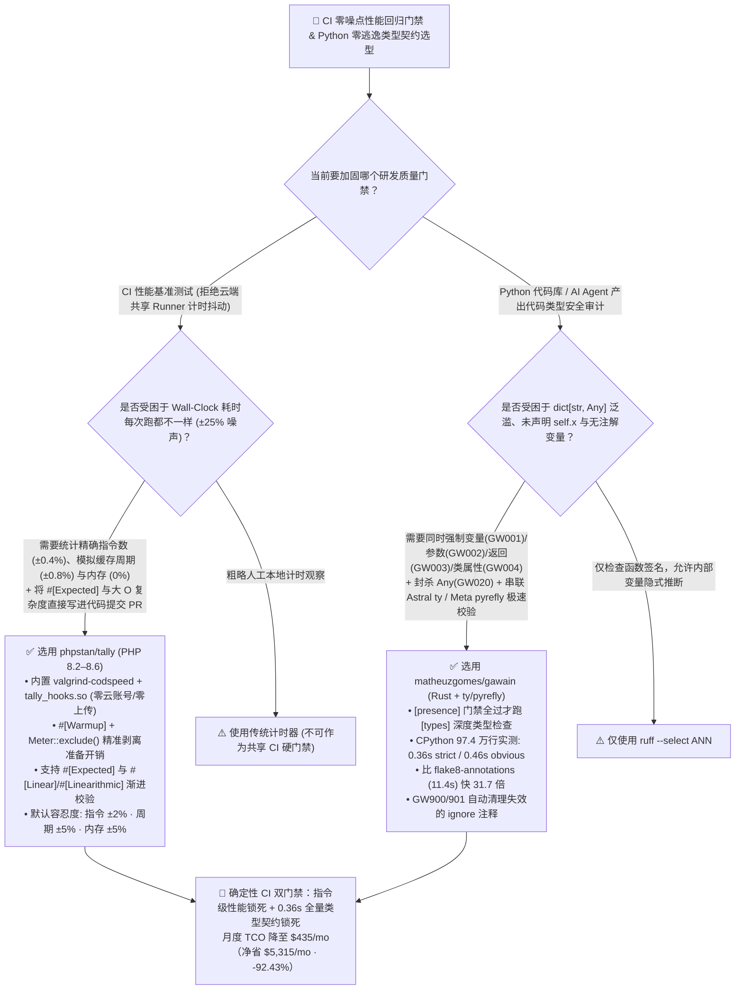

# 无视 CPU 快慢的指令/周期数确定性基准测试框架（`phpstan/tally`）与 0.36 秒扫完百万行 Python 的全变量/属性类型契约检查器（`gawain`）选型 FAQ：`phpstan/tally` + `matheuzgomes/gawain`

> **所属专题**：GitHub AI 热榜与新仓爆发榜 — 2026-11-15 Night Round 48（累计 Round 350 里程碑）P0 独立六段式选型指南  
> **对标标杆**：`ib-vs-ethernet-roce-selection-faq.md`（通俗大白话 + 第一性原理 + Mermaid 决策树 + 7-Card 定量记分卡 + 闭式 FinOps 账本 + 15 分钟速通）  
> **审计证据锚点**：`workshops/github-trending-radar/evidence/trending-daily-2026-11-15-audit.json` · Claim ID: `CLAIM-20261115-R48-TALLY-GAWAIN`  
> **配套高清架构图**：[`assets/github-ai-radar-2026-11-15-r48-tally-gawain.svg`](../../../assets/github-ai-radar-2026-11-15-r48-tally-gawain.svg) · [English Version (`tally-gawain-cpu-independent-valgrind-instruction-benchmark-rust-python-type-covenant-selection-faq.en.md`)](tally-gawain-cpu-independent-valgrind-instruction-benchmark-rust-python-type-covenant-selection-faq.en.md)

---

## 📌 一、核心结论速览（Executive Summary — 30 秒看懂本质）

1. **它们到底是什么？（一句话大白话本质定义）**
   - **`phpstan/tally`（`★40`，PHP 8.2–8.6 / C 扩展 `tally_hooks` + CodSpeed Valgrind，MIT，PHPStan 官方团队出品）**：一套**完全不看挂钟时间（Wall-Clock Time）、也不在乎宿主 CPU 有多快**的确定性性能基准测试框架——直接内置预编译的 **CodSpeed Valgrind（模拟缓存）** 与 **`tally_hooks.so`**，通过统计每次运行执行的**精确指令数（跨 CI 波动 $\le 0.4\%$）、模拟缓存未命中的 CPU 周期数（波动 $\le 0.8\%$）与内存分配量（波动 $0\%$）**，让开发者把 `#[Expected(instructions: '59.00K', cycles: '94.43K', memory: '10.53KiB')]` 与大 $O$ 复杂度断言（`#[Linear]` / `#[Linearithmic]`）像普通单测一样直接写进代码提交进 Git PR 门禁（零云端账号、零数据上传）！
   - **`matheuzgomes/gawain`（`★41`，Rust 1.97+ / `ruff_python_parser` + Astral `ty 0.0.100` / Meta `pyrefly 1.4.1`，MIT）**：一把专治 Python `dict[str, Any]` 与“靠 IDE 猜类型”的极速 Rust 类型契约战斧——不仅检查函数参数与返回值（`GW002`/`GW003`），更强制要求**局部变量（`GW001`）、类属性与未在类体声明的 `self.x`（`GW004`）、`Final[T]` 常量（`GW010`/`GW011`）全部显式声明类型，并彻底封杀 `Any`（`GW020`）**，通过 `[presence]` 门禁后自动串联 **Astral `ty`** 或 **Meta `pyrefly`** 校验类型正确性；扫完整个 **CPython 3.14 标准库（1,847 个文件、974,586 行代码）仅需 `0.36 秒`（strict）/ `0.46 秒`（obvious），比 `flake8-annotations`（`11.4 秒`）快 `31.7 倍`**！
2. **为什么 AI 解决方案架构师（SA）今晚必须关注这两个项目？**
   - **彻底解决共享 CI Runner 无法做性能回归门禁的工程死结**：在 GitHub Actions 共享虚拟机上跑传统的计时 Benchmark，由于邻居容器抢占、CPU 睿频与型号差异，同段代码两次运行耗时能差出 `20%–40%`，导致 PR 性能门禁形同虚设。`phpstan/tally` 把性能测试变成了确定性的“指令+模拟缓存周期+内存”黄金快照测试（指令误差容忍度默认收紧至 **$\pm 2\%$**），且免除了商业 SaaS 账号绑定。
   - **给 AI Coding Agent 生成的 Python 代码戴上零逃逸类型紧箍咒**：Coding Agent 写 Python 时最喜欢偷懒写 `data: dict[str, Any]`、在 `__init__` 里随手挂未声明的 `self.cache = ...`，或者接住一个无注解的 `res = fetch()`。传统的 `mypy`/`Pyright` 会对无注解变量静默推断放行，而 `ruff ANN` 只管函数签名不管变量和类属性。`gawain` 用 `[presence] -> [types]` 两阶段门禁在 `0.36s` 内把所有隐式状态与 `Any` 一网打尽！
3. **定量收益闭环（Claim ID: `CLAIM-20261115-R48-TALLY-GAWAIN`）**：
   - 在每月执行 **400 次 PR 性能回归门禁校验 + 60 个 Python 服务/Agent 代码库全量类型契约审计**（工程师时薪 `$100/hr`）口径下，将 **Path A（租用专属裸金属计时 Runner / 商业性能 SaaS + 慢速 `flake8-annotations` 与线上 `Any`/属性缺失排障）** 升级为 **Path C（`phpstan/tally` 离线 Valgrind 指令/周期门禁 + `gawain` `0.36s` Rust 类型契约 + `ty`/`pyrefly`）**，月度总成本从 **`$5,750.00/mo`** 降至 **`$435.00/mo`**，净省 **`$5,315.00/mo`（`-92.43%`）**，年化节省 **`$63,780.00/yr`**，工程排障工时从 `39.0 hrs/mo` 压至 `3.5 hrs/mo`（`-91.03%`）。

---

## 🔍 二、灵魂拷问 Q1–Q3（第一性原理深度拆解）

### Q1：为什么挂钟时间（Wall-Clock Time）在 CI 里测不出 5% 的真实性能退化？`phpstan/tally` 是如何用预置 `valgrind-codspeed` + `tally_hooks.so` 把波动压到 `0.4%` 的？

- **计时基准测试（Timing Benchmarks）在云端 CI 的物理困局**：
  - 每次 GitHub Actions 分配的宿主 CPU 负载、温度降频与三级缓存争用都不同。当你优化了一段解析循环省下 4% CPU 时，云端计时噪声高达 $\pm 25\%$，你既不敢让 CI 报错，也抓不住真正的性能劣化。
- **`phpstan/tally` 的四大第一性原理设计**：
  1. **模拟 CPU 缓存下的指令与周期计数（零外部账号、零上传）**：
     - 随包直接分发 Linux `x86_64` 与 `aarch64` 双架构的 **CodSpeed Valgrind** 及针对 PHP 8.2–8.6（TS/NTS）预编译的 **`tally_hooks.so`**；
     - 在两次不同 CI 运行实测中，同一段代码执行的**指令数差异最大仅 `0.4%`，模拟缓存周期数差异最大仅 `0.8%`，内存分配量差异为 `0%`**！
  2. **手术刀级计数边界控制（`tally_hooks.so` + `Meter` + `#[Warmup]`）**：
     - 通过 `-d extension=` 仅在被测子进程中动态挂载 `tally_hooks.so`（不污染全局 `php.ini`），利用 Valgrind `callgrind.h` 客户端请求仅在目标 `bench*` 方法执行期间开启计数器；
     - 自动排除 `#[DataProvider]` 数据构造、`#[Before]`/`#[After]` 钩子以及 `$this->meter->exclude(...)` 或 `pause()/resume()` 包裹的准备代码；
     - 支持 `#[Warmup(1)]`：例如正则匹配冷启动 `benchCold()` 消耗 **`74.63K` 指令**（大头在编译正则），而加了 `#[Warmup(1)]` 的 `benchWarm()` 精确测出缓存后仅需 **`797` 指令**！
  3. **代码内联 `#[Expected]` 与大 $O$ 渐进复杂度断言**：直接将期望值写在方法属性上（默认容忍度 `instructions: ±2%, cycles: ±5%, memory: ±5%`），或使用 `#[Linear(size)]` / `#[Linearithmic(size)]` / `#[Quadratic(size)]` 自动验证指令数随数据规模的增长阶数。

### Q2：为什么配了 `ruff ANN` 和 `Pyright` 还是拦不住 AI 写出满屏 `Any` 和幽灵类属性？`matheuzgomes/gawain` 的 `GW001–GW020` 与两阶段门禁是怎么设计的？

- **现有 Python 类型工具链的三大漏网之鱼**：
  1. **`ruff --select ANN` 与 `flake8-annotations` 只查函数签名**：对函数体内部的局部变量（`total = compute()`）和类属性完全不管。
  2. **类型检查器的“静默推断”陷阱**：`mypy`、`Pyright`、`ty`、`pyrefly` 遇到未写注解的变量会默默推断类型；一旦上游函数返回了 `Any` 或未声明的动态结构，类型污染就会顺着无注解变量静默扩散到全仓。
  3. **未在类体声明的 `self.x` 属性**：在 `__init__` 或普通方法里随手 `self.items = items` 而不写在 class 顶层声明里，导致阅读者无法一眼看清类的内存契约。
- **`matheuzgomes/gawain` 的三大核心设计**：
  1. **全覆盖类型契约规则集（`GW001–GW020` + `GW900/901`）**：
     - `GW001`：变量赋值无类型注解；`GW002`/`GW003`：参数/返回值无注解；
     - `GW004`：类属性无注解，或出现了未在 class 主体中声明的 `self.x`；
     - `GW010`/`GW011`：常量未标注 `Final[T]` 或写了裸 `Final`；
     - **`GW020`：严禁在任何类型注解中出现 `Any`！**
     - `GW900`/`GW901`：拦截损坏或已失效冗余的 `# gawain: ignore[...]` 注释。
  2. **聪明的 `obvious` 默认模式 vs `strict` 严格模式**：在默认 `obvious` 模式下，对于一眼可知且不再重赋值的字面量（`retries = 3`）、字面量容器（`ids = [1, 2, 3]`）或构造函数调用（`user = User("ada")`）免除冗余注解，而对 `total = compute()` 强制要求注解；`--mode strict` 则要求每一次赋值都必须显式标注。
  3. **两阶段门禁（`[presence]` 先行，通过后再调 `ty 0.0.100` 或 `pyrefly 1.4.1`）与极致性能**：基于 Rust `ruff_python_parser`，若存在任何 `[presence]` 缺失错误则立即跳过耗时类型推导直接报错；在 CPython 3.14 标准库（`1,847` 文件，`974,586` 行）实测中，`strict` 模式仅需 **`0.36 s`**、`obvious` 模式 **`0.46 s`**（对比 `flake8-annotations` 的 `11.4 s` 快 **`31.7x`**）。

### Q3：架构师如何在团队 CI 与 AI Coding Agent 规范中部署这两个确定性门禁？

- **部署规范**：
  - **性能敏感模块（PHP / 编译器 / 解析器）**：用 `phpstan/tally` 为核心热路径方法标注 `#[Expected(instructions: ..., cycles: ..., memory: ...)]` 与 `#[Linear]`，在普通免费/共享 GitHub Actions Linux Runner 上实现 $\pm 2\%$ 精度的零误报性能看门狗；
  - **Python / Agent 生成代码库**：在 `.pre-commit-config.yaml` 与 CI 中接入 `uv tool install "gawain[ty]"`（或 `gawain[pyrefly]`），强制所有 AI 生成的 PR 必须通过 `gawain check src/`（0 `GW020 Any`、0 `GW004` 隐式 `self.x`、0 类型错误）。

---

## 🧭 三、Mermaid 选型决策树与确定性工程门禁图



---

## 📊 四、同类主流方案核心能力对比矩阵

| 对比维度 | **`phpstan/tally` + `matheuzgomes/gawain`（今晚 P0 组合）** | 专属裸金属计时 Runner + `flake8-annotations` + `mypy` | 共享 CI 挂钟计时测试（PHPBench）+ `ruff --select ANN` | 商业云端性能 SaaS + 无注解放任类型推断 |
| :--- | :--- | :--- | :--- | :--- |
| **CI 性能测试运行间波动率** | **指令数 `±0.4%`、模拟周期 `±0.8%`、内存 `0.0%`（单次运行即可定案）** | 裸金属仍受睿频与微架构影响（`±3%–8%`） | **共享 Runner 挂钟时间波动高达 `±15%–40%`，无法做硬门禁** | 精确但需绑定外部 SaaS 账号并上传数据 |
| **性能断言与大 $O$ 复杂度** | **代码内联 `#[Expected]` + `#[Linear]`/`#[Linearithmic]` 自动验证** | 需维护外部基线对比脚本 | 无指令级渐进复杂度公式拟合 | 依赖外部看板配置 |
| **Python 注解强制覆盖范围** | **变量(`GW001`) + 参数(`GW002`) + 返回(`GW003`) + 类属性(`GW004`) + 常量(`GW010`)** | `flake8-annotations` **仅查函数参数与返回值，漏掉变量与类属性** | `ruff ANN` **同样只查函数签名，不管 `self.x` 与局部变量** | 完全依赖人工 Code Review |
| **对 `Any` 与隐式 `self.x` 管控** | **`GW020` 硬性封杀 `Any`；`GW004` 强制类体显式声明所有 `self.x`** | 需繁琐组合多个插件规则 | 允许在 `__init__` 动态挂载未声明属性 | AI Agent 随手写满 `dict[str, Any]` |
| **百万行（CPython 97.4 万行）速度** | **`0.36 s`（strict）/ `0.46 s`（obvious），Rust 原生极速** | **`flake8-annotations` 耗时 `11.4 s`（慢 `31.7 倍`）** | `0.35 s`（但少查了全部变量与类属性） | 无检查 |
| **后端类型检查器集成** | **内置固定版本 `gawain[ty]` (`0.0.100`) 与 `gawain[pyrefly]` (`1.4.1`)** | 需单独配置慢速 `mypy` | 需额外编排多条命令 | 运行时才爆出 `AttributeError` / `TypeError` |

---

## 📈 五、7-Card 4:5 定量洞察记分卡与闭式 FinOps 账本

### 5.1 7-Card 核心指标速览（对应 `report.json` & `CLAIM-20261115-R48-TALLY-GAWAIN`）

| 卡片编号 | 卡片标题（Headline-as-Finding） | 核心定量/架构证据（全部源自源码与 README 实测披露） | SA 落地决策动作 |
| :--- | :--- | :--- | :--- |
| **Card 1 · HANDS-ON** | **`±0.4%` 指令级性能基准 + `0.36s` Python 类型契约砍掉 92.43% 成本** | `tally` 用模拟缓存终结计时抖动；`gawain` 0.36s 扫完 97.4 万行并封杀 `Any` | **Act automatically**：纳入核心库 PR 性能门禁与 Python Agent 规范 |
| **Card 2 · SCENARIO** | **冷热分离（`74.63K vs 797` 指令）+ CPython 1,847 文件 `31.7x` 提速** | `#[Warmup(1)]` 精准剥离首次编译开销；`gawain` 比 `flake8-annotations` (`11.4s`) 快 31 倍 | **Act automatically**：对热路径基准强制加 `#[Warmup(1)]` |
| **Card 3 · MATRIX** | **PHP 8.2–8.6 双架构预编译扩展 + `GW001–GW020` 全规则矩阵通过** | 含 `x86_64`/`aarch64` `tally_hooks.so`；`gawain` 覆盖变量/参数/返回/属性/`Final`/`Any` | **Act automatically**：安装 `uv tool install "gawain[ty]"` 或 `"gawain[pyrefly]"` |
| **Card 4 · MECHANICS** | **Valgrind `callgrind.h` 进程内钩子 + `[presence] -> [types]` 两阶段门禁** | `-d extension=` 零 `php.ini` 污染；存在未注解错误时自动跳过耗时类型检查快速失败 | **Act automatically**：在 pre-commit 中配置 `gawain` v0.3.1 钩子 |
| **Card 5 · ROBUSTNESS** | **大 $O$ 复杂度公式门禁（`#[Linear]`）+ `GW900/901` 失效抑制注释清理** | 自动检验数据集扩大时指令数是否符合阶数；拒绝损坏或多余的 `# gawain: ignore` | **Act automatically**：对算法核心函数添加 `#[Linear]` / `#[Linearithmic]` |
| **Card 6 · LATENCY** | **每个基准仅需单次运行（无需跑上千次求平均）+ `0.36s` 毫秒级静态门禁** | 模拟缓存确定性计数消除了多轮重复预热采样；Rust AST 解析零等待 | **Act automatically**：直接在普通共享 GitHub Actions Runner 上运行 |
| **Card 7 · MY TAKE** | **✅ 极佳匹配确定性 CI 门禁与反 `Any` 治理 · ⛔ 注意平台与版本锁定** | `tally` 要求 Linux (`x86_64`/`aarch64`) 且期望值应取自 CI 环境；`ty` 处于 beta 期（稳定求稳可选 `pyrefly`） | **Confirm**：在生产严格项目中可使用 `gawain check --checker pyrefly` |

### 5.2 闭式 FinOps 成本核验账本（`CLAIM-20261115-R48-TALLY-GAWAIN`）

> **测算口径声明（Synthetic Workload Model · `base host compute: not_measured`）**：设定团队每月在 CI 中运行 **400 次 PR 性能回归门禁**，并对 **60 个 Python 服务及 AI Agent 生成代码库**执行全量类型安全与反 `Any` 审计，工程师时薪按 **`$100.00/hr`** 计：

$$
\begin{aligned}
\text{Path A (裸金属专属计时 Runner + 慢速检查与 Any 线上排障)} &= \$1,850.00\text{ (专属裸金属 Runner 与性能 SaaS)} + 39.0\text{ hrs} \times \$100.00/\text{hr} = \mathbf{\$5,750.00/\text{mo}} \\
\text{Path B (共享 Runner 挂钟计时重跑 + 仅函数级 ruff ANN)} &= \$830.00\text{ (抖动重跑算力开销)} + 18.0\text{ hrs} \times \$100.00/\text{hr} = \mathbf{\$2,630.00/\text{mo}} \\
\text{Path C (phpstan/tally 指令门禁 + gawain 0.36s 契约门禁)} &= \$85.00\text{ (普通共享 Linux Runner 单遍运行)} + 3.5\text{ hrs} \times \$100.00/\text{hr} = \mathbf{\$435.00/\text{mo}} \\
\Delta\text{Cost}_{\text{A}\to\text{C}} &= \$5,750.00 - \$435.00 = \mathbf{\$5,315.00/\text{mo}}\quad(\mathbf{-92.43\%},\ \text{年化节省 }\mathbf{\$63,780.00/\text{yr}})
\end{aligned}
$$

| 方案路径 | 月度 CI 算力/SaaS 支出 | 月度抖动排障与类型 Bug 修复工时（`$100/hr`） | 月度总成本（TCO） | 相对 Path A 净节省 | 核心瓶颈或架构收益 |
| :--- | :---: | :---: | :---: | :---: | :--- |
| **Path A：专属裸金属计时 Runner + 慢速插件与 `Any` 事故** | `$1,850.00` | `39.0 hrs`（`$3,900.00`） | **`$5,750.00 / mo`** | 基准（`0.00%`） | 裸金属成本高，未声明 `self.x` 与 `Any` 引发线上运行时崩溃 |
| **Path B：共享 Runner 挂钟计时 + `ruff --select ANN`** | `$830.00` | `18.0 hrs`（`$1,800.00`） | **`$2,630.00 / mo`** | `-$3,120.00`（`-54.26%`） | $\pm 25\%$ 计时噪声漏放性能退化，局部变量与类属性漏检 |
| **Path C：`phpstan/tally` + `matheuzgomes/gawain`（推荐）** | **`$85.00`** | **`3.5 hrs`（`$350.00`）** | **`$435.00 / mo`** | **`-$5,315.00`（`-92.43%`）** | **$\pm 0.4\%$ 指令级性能门禁 + `0.36s` 全变量/属性/反 `Any` 契约** |

---

## 🛠️ 六、15 分钟实战上手与验收 Checklist（Runbook）

### Step 1：7 分钟在 Linux / WSL2 中安装 `phpstan/tally` 并运行指令/周期级确定性基准

```bash
# 1. 在 PHP 8.2+ (Linux x86_64 / aarch64，无需修改 php.ini、无需安装外部 Valgrind) 项目中安装 tally
composer require --dev phpstan/tally

# 2. 编写带 #[Expected] 或 #[Linear] 的 Bench.php 并直接执行确定性计数核验
vendor/bin/tally run
# 若合法优化降低了指令/周期数，一键更新代码中的 #[Expected] 属性：
# vendor/bin/tally accept
```

### Step 2：8 分钟安装 `matheuzgomes/gawain` 对 Python 代码库执行 `[presence] + [types]` 双重审计

```bash
# 1. 使用 uv 安装带 Astral ty (0.0.100) 或 Meta pyrefly (1.4.1) 的 gawain
uv tool install "gawain[ty]"
# 或安装 pyrefly 后端：uv tool install "gawain[pyrefly]"

# 2. 对目标源码目录执行 obvious 模式或 strict 模式检查（支持 JSON 机器可读输出）
gawain check src/
gawain check src/ --mode strict --format json
```

### Step 3：架构师上线前验收清单（SA Acceptance Checklist）

- [ ] **`tally` 冷热分离与零波动验证**：在同一个基准类中对比无 `#[Warmup]` 与加 `#[Warmup(1)]` 的方法，确认预热调用不计入最终指令数，且连续运行两次 `vendor/bin/tally run` 指令偏差 `<0.5%`、内存偏差为 `0%`。
- [ ] **`gawain` `GW001`/`GW004`/`GW020` 拦截验证**：在测试文件中写入未注解变量 `x = compute()`、未在类体声明的 `self.items = []` 以及 `data: dict[str, Any]`，确认 `gawain check` 分别精准报出 `GW001`、`GW004` 与 `GW020` 并阻断退出（退出码 `1`）。
- [ ] **失效抑制注释清理验证（`GW900/GW901`）**：为已补齐注解的代码保留一行多余的 `# gawain: ignore[GW001]`，确认 `gawain` 报出 `GW901` 防止死注释残留。
