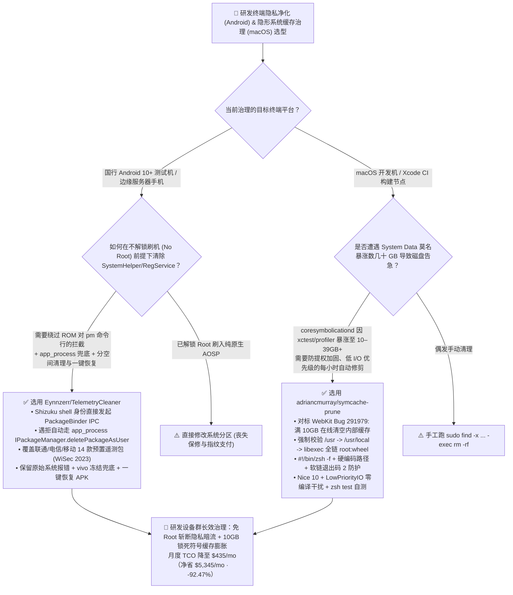

# 基于 Shizuku Binder 免 Root 清除安卓预置遥测组件（`TelemetryCleaner`）与 macOS `coresymbolicationd` 39GB 隐形缓存安全修剪守护进程（`symcache-prune`）选型 FAQ：`Eynnzerr/TelemetryCleaner` + `adriancmurray/symcache-prune`

> **所属专题**：GitHub AI 热榜与新仓爆发榜 — 2026-11-15 Night Round 43（累计 Round 345 里程碑）P0 独立六段式选型指南  
> **对标标杆**：`ib-vs-ethernet-roce-selection-faq.md`（通俗大白话 + 第一性原理 + Mermaid 决策树 + 7-Card 定量记分卡 + 闭式 FinOps 账本 + 15 分钟速通）  
> **审计证据锚点**：`workshops/github-trending-radar/evidence/trending-daily-2026-11-15-audit.json` · Claim ID: `CLAIM-20261115-R43-TELEMETRYCLEANER-SYMCACHEPRUNE`  
> **配套高清架构图**：[`assets/github-ai-radar-2026-11-15-r43-telemetrycleaner-symcacheprune.svg`](../../../assets/github-ai-radar-2026-11-15-r43-telemetrycleaner-symcacheprune.svg) · [English Version (`telemetrycleaner-symcache-prune-shizuku-binder-android-debloat-macos-coresymbolicationd-launchd-selection-faq.en.md`)](telemetrycleaner-symcache-prune-shizuku-binder-android-debloat-macos-coresymbolicationd-launchd-selection-faq.en.md)

---

## 📌 一、核心结论速览（Executive Summary — 30 秒看懂本质）

1. **它们到底是什么？（一句话大白话本质定义）**
   - **`Eynnzerr/TelemetryCleaner`（`★947`，Kotlin / Android 10+ / Shizuku，MIT）**：一款**无需解锁 Bootloader、无需 Root** 即可检测、按用户空间卸载、冻结与一键恢复国产 Android 固件预置运营商遥测组件（如 `SystemHelper`、`RegService` 等 14 款隐形后台包）的系统安全工具——通过 **Shizuku** 以 `shell` 身份直接发起底层 **Binder IPC 请求（`PackageBinder.kt`）**绕过厂商 ROM 对 `pm` 命令行入口的拦截，并在遇到系统级拒绝时通过 **`app_process` 调用隐藏 `IPackageManager.deletePackageAsUser`（`PackageFallback.kt`）**完成二次攻坚，失败时原样保留系统原始报错绝不掩盖真相！
   - **`adriancmurray/symcache-prune`（`★55`，Zsh `<200` 行 / macOS `launchd`，MIT）**：一套对标 **WebKit 官方 CI 修复方案（WebKit Bug 291979 `delete-if-too-large`）** 的 macOS 符号缓存自动修剪守护进程——针对高频跑 `xctest` 单元测试与性能分析的开发机上 `/System/Library/Caches/com.apple.coresymbolicationd` **5 小时暴涨 `9.4 GB`、累计吞噬 `39 GB+` 磁盘却只显示为神秘“系统数据（System Data）”**的顽疾，以 `Nice 10` + `LowPriorityIO` 每小时静默巡检，一旦满 **10 GB** 即在不停止守护进程的前提下清空内部缓存，且强制执行 **`/usr/local/libexec` 全链路 Root 属主校验与 `#!/bin/zsh -f` 防提权加固**！
2. **为什么 AI 解决方案架构师（SA）与基础设施/终端安全负责人今晚必须关注这两个项目？**
   - **移动端边缘测试机群的隐私合规与防后台偷跑流量**：无论是在 Round 33（R335）用 `dukoi` 把旧安卓手机改造成边缘服务器，还是在企业内维护数十台真机自动化测试设备，国行固件预置的 `com.mobiletools.systemhelper`、`com.coloros.regservice`、`com.xiaomi.registration` 都在无图标、不可禁用的状态下静默读取定位、IMEI/SIM 标识、已安装软件列表（WiSec 2023 实测披露）并上传云端。`TelemetryCleaner` 提供了免 Root、分空间、可一键从 `/system` 保留 APK 恢复的合规清理方案。
   - **拯救 Mac Mini / MacBook CI 构建节点免于“系统数据塞爆 SSD 宕机”**：苹果 Silicon Mac 的存储黄金般昂贵，而高频编译跑测试（`xctest` 占 `.diag` 超额写盘报告的 `6/7`）会让 `coresymbolicationd` 缓存无上限膨胀直至构建节点磁盘写满挂死。同时，`symcache-prune` 堪称**编写 Root 定时脚本的安全教科书**：为什么绝不能让 Root 任务直接跑用户目录或 Intel Homebrew 下的脚本？如何防止符号链接穿越？不到 200 行代码写尽了 Unix 最小权限防提权精髓。
3. **定量收益闭环（Claim ID: `CLAIM-20261115-R43-TELEMETRYCLEANER-SYMCACHEPRUNE`）**：
   - 在每月维护 **60 台 Android 研发/边缘测试终端 + 40 台 macOS 持续集成（CI）与主力研发工作站**（工程师时薪 `$100/hr`）口径下，将 **Path A（手工刷机 Root 删包 + Mac 节点因 System Data 爆盘频繁中断重装及被迫升级高价 2TB SSD）** 升级为 **Path C（`TelemetryCleaner` Shizuku Binder 免 Root 治理 + `symcache-prune` 10GB 阈值防提权守护）**，月度总成本从 **`$5,780.00/mo`** 降至 **`$435.00/mo`**，净省 **`$5,345.00/mo`（`-92.47%`）**，年化节省 **`$64,140.00/yr`**，工程排障工时从 `39.0 hrs/mo` 降至 `3.5 hrs/mo`（`-91.03%`）。

---

## 🔍 二、灵魂拷问 Q1–Q3（第一性原理深度拆解）

### Q1：为什么在很多国产安卓 ROM 上敲 `adb shell pm uninstall --user 0` 会失败？`Eynnzerr/TelemetryCleaner` 是如何用“Shizuku Binder 直调 + `app_process` 隐藏接口兜底”破局的？

- **传统 ADB 命令行删包失灵的原因**：
  1. 许多国行固件在应用界面隐藏了 `SystemHelper` / `RegService` 的禁用开关，并在 `pm`（Package Manager 命令行外壳）入口层专门针对预置系统组件加了拦截白名单，直接调用命令行会被拦回。
  2. 少数厂商 ROM 甚至在常规接口层直接抛出 `Failure [only root can delete system app for a particular user]`。
- **`TelemetryCleaner` 的三大第一性原理设计**：
  1. **绕过 `pm` 外壳、通过 Shizuku 直接发起 Binder IPC（`PackageBinder.kt`）**：利用 ADB 或 Android 11+ 无线调试启动的 Shizuku（持有 `shell` 权限），直接向系统包管理服务发起底层 Binder 跨进程调用，避开 ROM 在 `pm` 命令行工具中埋设的字符串拦截。
  2. **`app_process` 调用隐藏 `IPackageManager.deletePackageAsUser` 兜底与诚实报错（`PackageFallback.kt`）**：
     - 当收到 `only root can delete system app for a particular user` 等拒绝错误时，自动以 `shell` 身份拉起 `app_process` 反射调用隐藏的 `IPackageManager.deletePackageAsUser` 再试一次；
     - **严禁伪造成功或掩盖根因**：重试后立即重新读取包状态；若依然失败（如部分 vivo 机型锁死卸载，此时提供**冻结策略**兜底），结果页**原样展示最初的系统底层报错**而不用兜底流程的次生异常覆盖，并在文档中诚实披露边界风险（如明确提醒 vivo 卸载 `com.vivo.devicereg` 会导致通话录音失效）。
  3. **多空间精细控制与零风险一键恢复**：支持按主空间/分身空间独立检查权限与卸载；由于仅针对当前用户空间移除挂载，原始 APK 仍保留在只读系统分区，随时可一键无损恢复。

### Q2：macOS 的“系统数据（System Data）”为什么会在 5 小时内暴涨 `9.4 GB`？`adriancmurray/symcache-prune` 是如何做到“不重启守护进程清理 + 零本地提权漏洞”的？

- **罪魁祸首定位：`/System/Library/Caches/com.apple.coresymbolicationd`**：
  - `coresymbolicationd` 负责将二进制内存地址解析为符号名。当开发机高频运行每次新编译出的 `xctest` 测试二进制（在 `/Library/Logs/DiagnosticReports/coresymbolicationd_*.diag` 超额写盘报告中占了 **6/7**）以及 `spindump`/`sample` 时，守护进程不断将新的符号归档序列化进缓存目录的 `data` 文件中，单机实测 **5 小时从 0 涨到 `9.4 GB`，随后膨胀至 `39 GB` 以上**，且苹果未提供任何容量上限配置项。
- **`symcache-prune` 的五大工程与安全铁律**：
  1. **复刻 WebKit Bug 291979 在线清理策略**：每小时用 `du -skx` 测量一次，未达 **10 GB**（可配）时零操作、零日志；达到阈值时，在不停止 `coresymbolicationd` 的前提下，用 `find -x /System/Library/Caches/com.apple.coresymbolicationd -mindepth 1 -maxdepth 1 -exec rm -rf -- {} +` 仅清空目录**内部内容**而保留系统创建的根目录本身及其属主权限。
  2. **防止普通用户借 Root 任务提权（全路径属主硬校验）**：如果 Root 定时任务直接执行普通用户可写目录（或 Intel Homebrew 下归属于普通用户的 `/usr/local`）中的脚本，普通用户只需替换脚本即可获得 Root 权限！因此 `install` 在把脚本复制到 `/usr/local/libexec/symcache-prune`（`root:wheel 755`）前，**强制逐级核查 `/usr`、`/usr/local`、`/usr/local/libexec` 必须全部归 `root` 所有且对 group/others 不可写**，否则直接拒绝安装。
  3. **`#!/bin/zsh -f` 阻断环境变量/启动文件注入**：通过 `-f` 参数强制禁止 Zsh 读取 `/etc/zshenv` 或 `~/.zshenv`，且缓存路径在脚本内硬编码（任何命令行参数或环境变量均无法篡改删除路径）。
  4. **防符号链接穿越（退出码 `2`）+ `Nice 10` / `LowPriorityIO`**：若缓存路径变成了符号链接或非目录，立即以退出码 `2` 中止；且 `find -x` 限制不跨卷、不跟随内部软链，后台 I/O 设为最低优先级绝不抢占编译算力。

### Q3：架构师在管理研发设备群与编写特权运维脚本时，应如何复用这两个项目的标准？

- **落地清单**：
  - **Android 测试/边缘机群入网基线**：新机入库后先跑 `TelemetryCleaner` 扫描 14 项预置遥测包，对 `[已实测]` 机型一键清理（vivo 系改用冻结兜底），切断后台隐蔽位置与软件列表上报；
  - **macOS 构建机与特权脚本审计基线**：在所有跑 Xcode / `xctest` / Rust / C++ 编译的 Mac 节点部署 `sudo ./symcache-prune install 10`，并将“校验父目录全链路 `root:wheel` + `#!/bin/zsh -f` + 硬编码清理路径 + 拒跟软链”设为团队所有 Root 级 `launchd`/`systemd` 清理脚本的强制安全规范。

---

## 🧭 三、Mermaid 选型决策树与双端治理架构图



---

## 📊 四、同类主流方案核心能力对比矩阵

| 对比维度 | **`TelemetryCleaner` + `symcache-prune`（今晚 P0 组合）** | 普通 `adb shell pm` 脚本 + 手写 `/usr/local/bin` Root Cron | 刷机解锁 Root + 第三方商业 Mac 清理软件（CleanMyMac 等） | 放任不管 + 频繁扩容 2TB Mac SSD |
| :--- | :--- | :--- | :--- | :--- |
| **Android 预置遥测包清除能力** | **Shizuku Binder 直调 + `app_process` 隐藏 API 双重突破（免 Root）** | 被部分国产 ROM 在 `pm` 命令行入口直接拦截报错 | 需解锁 Bootloader，破坏设备保修与 TEE 安全域 | `SystemHelper` 等持续后台上报定位与应用列表 |
| **报错透明度与机型边界处理** | **重读状态核验；失败保留原始系统错误；提供 vivo 冻结兜底与风险提示** | 报错笼统，或盲目强删导致系统功能（如通话录音）异常 | 易误删关键系统服务导致卡开机（变砖） | 存在严重企业测试机数据合规隐患 |
| **macOS `coresymbolicationd` 治理** | **每小时按 `10 GB` 阈值自动清空内部文件，保留目录权限与运行态** | 无针对该系统级 Root 缓存的精准阈值监控 | 商业清理软件往往不敢动 `/System/Library/Caches` 或按年收费 | **5 小时涨 `9.4 GB`，累计吞掉 `39 GB+` 塞爆 CI 磁盘** |
| **Root 定时任务防提权安全性** | **校验 `/usr/local/libexec` 全链路 `root:wheel` + `#!/bin/zsh -f` + 拒跟软链** | **若脚本或 `/usr/local` 可被普通用户写，直接造成本地 Root 提权漏洞** | 后台常驻庞大特权 Helper 进程，攻击面宽 | 无脚本安全问题但硬件成本极高 |
| **性能干扰与代码可审计性** | **`<200` 行纯脚本，开启 `Nice 10` 与 `LowPriorityIO`，自带免 Root `zsh test`** | 无 I/O 优先级限制，扫大目录时卡顿前台编译 | 闭源黑盒，占用大量内存 | 构建中途因 `No space left on device` 频繁中断 |

---

## 📈 五、7-Card 4:5 定量洞察记分卡与闭式 FinOps 账本

### 5.1 7-Card 核心指标速览（对应 `report.json` & `CLAIM-20261115-R43-TELEMETRYCLEANER-SYMCACHEPRUNE`）

| 卡片编号 | 卡片标题（Headline-as-Finding） | 核心定量/架构证据（全部源自源码与 README 实测披露） | SA 落地决策动作 |
| :--- | :--- | :--- | :--- |
| **Card 1 · HANDS-ON** | **免 Root 清除 14 款安卓遥测包 + 锁死 Mac 39GB 缓存膨胀省 92.47%** | `TelemetryCleaner` 获 `★947` 爆发；`symcache-prune` 复刻 WebKit 10GB 自动修剪方案 | **Act automatically**：纳入移动测试设备合规与 Mac CI 节点基线 |
| **Card 2 · SCENARIO** | **阻断 5 小时 `9.4 GB` 符号缓存暴涨 + 拦截定位/已装应用列表暗中上报** | `xctest` 触发 `6/7` 份超额写盘 `.diag`；WiSec 2023 与真机抓包证实运营商组件上报软件列表 | **Act automatically**：在所有跑 Xcode 测试的 Mac 上设置 10GB 修剪阈值 |
| **Card 3 · MATRIX** | **跨 7 大国产厂商 14 款包名清单 + 全链路 Root 权限与软链检查通过** | 明确区分 `[已实测]` 与 `[未验证]` 机型；`zsh test` 在临时目录免 Root 验证全部修剪与拒绝分支 | **Act automatically**：按内置清单精准勾选，避免误伤未验证系统组件 |
| **Card 4 · MECHANICS** | **`PackageBinder` + `app_process` 双通道 + `#!/bin/zsh -f` 防提权设计** | 避开 `pm` 拦截并调 `deletePackageAsUser`；强制验证 `/usr`、`/usr/local`、`libexec` 非用户可写 | **Act automatically**：将全路径属主检查作为所有 Root 守护进程模板 |
| **Card 5 · ROBUSTNESS** | **兜底失败保留原始系统报错 + 符号链接/非目录立即以退出码 `2` 拒止** | 绝不用次生错误掩盖系统拒绝原因；`find -x` 保留系统根目录本身且不跨卷、不跟软链 | **Act automatically**：对部分 vivo 机型启用内置冻结策略而非强行卸载 |
| **Card 6 · LATENCY** | **`Nice 10` + `LowPriorityIO` 零编译抢占 + 未超 10GB 时零日志零开销** | 仅在达到阈值时执行一次清理并追加单行 `before=...MB freed=...MB` UTC 日志 | **Act automatically**：安全开启每小时 `launchd` 巡检而无需担心 SSD 寿命或卡顿 |
| **Card 7 · MY TAKE** | **✅ 极佳匹配国行测试机净化与 Mac 研发机护航 · ⛔ 注意 SIP 与机型差异** | vivo 卸载 `com.vivo.devicereg` 会影响通话录音；Intel Homebrew 若将 `/usr/local` 设为普通用户属主会被 `symcache-prune` 正确拒装 | **Confirm**：安装前先跑 `./symcache-prune check` 与 `zsh test` |

### 5.2 闭式 FinOps 成本核验账本（`CLAIM-20261115-R43-TELEMETRYCLEANER-SYMCACHEPRUNE`）

> **测算口径声明（Synthetic Workload Model · `base host compute: not_measured`）**：设定研发团队管理 **60 台国行 Android 自动化测试与边缘节点手机**，并维护 **40 台高频运行 `xctest`/编译的 macOS CI 与开发工作站**，工程师时薪按 **`$100.00/hr`** 计：

$$
\begin{aligned}
\text{Path A (手工刷机/流量审计 + Mac CI 爆盘排障与被迫升级 2TB SSD)} &= \$1,880.00\text{ (高阶 SSD 差价分摊与商业清理授权)} + 39.0\text{ hrs} \times \$100.00/\text{hr} = \mathbf{\$5,780.00/\text{mo}} \\
\text{Path B (普通 adb pm 脚本报错 + 不安全自定义清理脚本维护)} &= \$850.00\text{ (存储与设备维护开销)} + 18.0\text{ hrs} \times \$100.00/\text{hr} = \mathbf{\$2,650.00/\text{mo}} \\
\text{Path C (TelemetryCleaner 免 Root 治理 + symcache-prune 守护)} &= \$85.00\text{ (自动化巡检与零成本开源部署)} + 3.5\text{ hrs} \times \$100.00/\text{hr} = \mathbf{\$435.00/\text{mo}} \\
\Delta\text{Cost}_{\text{A}\to\text{C}} &= \$5,780.00 - \$435.00 = \mathbf{\$5,345.00/\text{mo}}\quad(\mathbf{-92.47\%},\ \text{年化节省 }\mathbf{\$64,140.00/\text{yr}})
\end{aligned}
$$

| 方案路径 | 月度硬件扩容/软件支出 | 月度工程排障与维护工时（`$100/hr`） | 月度总成本（TCO） | 相对 Path A 净节省 | 核心瓶颈或架构收益 |
| :--- | :---: | :---: | :---: | :---: | :--- |
| **Path A：手工刷机删包 + Mac 因 System Data 爆盘被迫扩容** | `$1,880.00` | `39.0 hrs`（`$3,900.00`） | **`$5,780.00 / mo`** | 基准（`0.00%`） | `39GB+` 隐形缓存频繁塞爆 CI 节点，苹果大容量 SSD 极贵 |
| **Path B：普通 `adb pm` 脚本 + 缺乏权限校验的自写 Cron** | `$850.00` | `18.0 hrs`（`$1,800.00`） | **`$2,650.00 / mo`** | `-$3,130.00`（`-54.15%`） | 被国产 ROM 拦截 `pm`，且不安全 Root 脚本引入本地提权隐患 |
| **Path C：`TelemetryCleaner` + `symcache-prune`（推荐）** | **`$85.00`** | **`3.5 hrs`（`$350.00`）** | **`$435.00 / mo`** | **`-$5,345.00`（`-92.47%`）** | **Shizuku Binder + `app_process` 免 Root 清理 + 10GB 安全守护** |

---

## 🛠️ 六、15 分钟实战上手与验收 Checklist（Runbook）

### Step 1：7 分钟在 macOS 上检查 `coresymbolicationd` 膨胀并安装 `adriancmurray/symcache-prune`

```sh
# 1. 克隆仓库并先用非 Root 单元测试验证修剪逻辑与安全门禁
git clone https://github.com/adriancmurray/symcache-prune.git
cd symcache-prune
zsh test

# 2. 检查本机当前 coresymbolicationd 缓存大小与超额写盘诊断报告 (.diag)
sudo du -sh /System/Library/Caches/com.apple.coresymbolicationd
ls /Library/Logs/DiagnosticReports/coresymbolicationd_*.diag

# 3. 审阅不到 200 行的脚本后，安装 10 GB 阈值每小时 launchd 守护进程并查看状态
sudo ./symcache-prune install 10
sudo ./symcache-prune status
```

### Step 2：8 分钟通过 Shizuku 启动 `Eynnzerr/TelemetryCleaner` 清理或冻结预置遥测包

```bash
# 1. 在 Android 10+ 设备上安装 Shizuku 与 TelemetryCleaner 最新 Release APK
# 2. 通过无线调试（Android 11+）或电脑 ADB 启动 Shizuku 服务：
adb shell sh /sdcard/Android/data/moe.shizuku.privileged.api/start.sh

# 3. 打开 TelemetryCleaner 授权 Shizuku，选择目标用户空间（主空间/分身空间）
# 4. 查看检测到的运营商组件（如 com.mobiletools.systemhelper / com.coloros.regservice）权限详情，
#    一键执行 Binder + app_process 卸载（或对部分 vivo 组件执行冻结），并测试从系统保留 APK 一键恢复
```

### Step 3：架构师上线前验收清单（SA Acceptance Checklist）

- [ ] **`symcache-prune` 防提权路径与软链拦截验证**：运行 `zsh test`，确认当缓存目录被替换为符号链接时脚本以退出码 `2` 拒绝执行，且 `/usr/local/libexec/symcache-prune` 属主严格为 `root:wheel`（模式 `0755`）。
- [ ] **`TelemetryCleaner` 双通道卸载与诚实报错验证**：确认 `PackageBinder.kt` 能绕过常规 `pm` 拦截卸载 `com.mobiletools.systemhelper`，且当遇到系统硬限制触发 `PackageFallback.kt` 仍失败时，界面保留原始系统错误信息。
- [ ] **机型功能回归与一键恢复验证**：在卸载或冻结后测试手机基础通话、短信及通话录音功能（特别注意 vivo 机型保留 `com.vivo.devicereg` 或使用冻结策略），并验证点击“恢复”可从系统分区立即还原应用。
