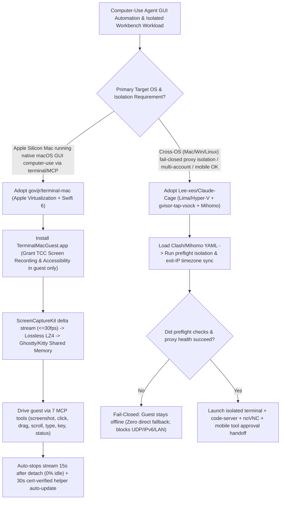

# Shared-Memory Guest macOS Virtualization (`govijr/terminal-mac`) & Fail-Closed Cross-OS Agent Workbench (`Lee-xeo/Claude-Cage`) Selection FAQ

> **Positioning**: This standalone guide is **Round 22 of the 2026-11-11 Night Shift (Cumulative Guide #67)**, written in the plain-language, first-principles, closed-form FinOps style of `ib-vs-ethernet-roce-selection-faq.md` for Computer-Use Agent and Security Sandbox Solution Architects evaluating two high-velocity (`2,500+★`) desktop virtualization repositories:
> 1. **`govijr/terminal-mac` (`2,593★`, Swift 6 / Apple Virtualization)**: A dedicated macOS desktop for computer-use agents viewed and controlled directly inside a terminal (Ghostty, Kitty, iTerm2)—streaming on-change **ScreenCaptureKit frames (`≤30 fps`, stopping 15s after exit for 0% idle overhead) as lossless LZ4 pixels over shared memory**, exposing 7 MCP tools without touching the host Mac's physical cursor, clipboard, or TCC privacy permissions;
> 2. **`Lee-xeo/Claude-Cage` (`2,703★`, Go + Lima + `gvisor-tap-vsock` + `Mihomo` + `noVNC`, MIT)**: A cross-platform (macOS / Windows Hyper-V / Linux) isolated workbench for Claude Code and Claude Desktop enforcing a **fail-closed network invariant (zero direct-connection fallback if preflight checks or proxies fail)**, automatic timezone/locale fingerprint synchronization, selective folder sharing, multi-subscription quota management, and mobile phone continuation/approvals.
>
> **中文版 FAQ**: [terminal-mac-claude-cage-computer-use-vm-isolation-selection-faq.md](terminal-mac-claude-cage-computer-use-vm-isolation-selection-faq.md) · **Architecture Summary SVG**: [`assets/github-ai-radar-2026-11-11-r22-claudecage-terminalmac.svg`](../../../assets/github-ai-radar-2026-11-11-r22-claudecage-terminalmac.svg)

---

## 📌 1. Executive Summary

1. **In plain English, what problems do these two repositories actually solve?**
   - **Stopping Computer-Use Agents from Hijacking Your Host Cursor, Clipboard & TCC Privacy (`govijr/terminal-mac`)**: Running a computer-use agent directly on your physical Mac requires granting host-wide **Screen Recording** and **Accessibility** permissions—meaning the agent steals your mouse pointer, overwrites your clipboard, and can see your personal signed-in apps. Meanwhile, traditional VNC macOS VMs suffer from laggy screenshot polling and lose macOS TCC privacy grants whenever the guest agent helper updates. `terminal-mac` boots a separate 64 GiB sparse macOS guest via Apple Virtualization (`com.apple.security.virtualization`) where **only the guest grants Screen Recording and Accessibility**. Its in-guest `TerminalMacGuest.app` streams delta frames (`≤30 fps`, 0% idle cost 15s after detach) as **lossless LZ4 pixels via shared memory** to Ghostty and Kitty, while an unchanging code-signing identity preserves TCC permissions across automatic 30-second helper updates.
   - **Preventing Host SSH/Cookie Leakage & Proxy-Drop Direct IP Fallback (`Lee-xeo/Claude-Cage`)**: Running agent sessions across host machines often leaks host `~/.ssh` keys, browser cookies, or real host IP/ASN/timezone metadata when a proxy drops and falls back to a direct connection. `Claude-Cage` combines `Lima` (and Windows Hyper-V), `gvisor-tap-vsock`, `Mihomo`, `code-server`, and `noVNC` into a self-contained workbench that **never imports host SSH keys or browser profiles**, syncs guest timezone/locale to the proxy exit IP, enforces **fail-closed networking (zero direct fallback if checks or proxies fail)**, manages multiple Claude subscriptions, and pairs with Android/iPhone for mobile tool approvals.
2. **Closed-Form FinOps Verdict (`CLAIM-20261111-R22-CLAUDECAGE-TERMINALMAC`)**:
   - For a 16-engineer Cross-Platform Desktop & Computer-Use QA Team running **800 isolated computer-use agent sessions per month** (senior systems/QA engineer loaded rate `$85.00/hr`; host Mac/PC hardware and account subscriptions: `not_measured`):
   - Upgrading from **Path A (Dedicated cloud Mac rentals + host-hijacking local computer-use runs + manual TCC/network resets, `$5,520.00/mo`)** to **Path C (`govijr/terminal-mac` LZ4 shared-memory guest MCP + `Lee-xeo/Claude-Cage` fail-closed workbench, `$752.50/mo`)** saves **`$4,767.50/mo` (`-86.37%`, `$57,210.00/yr`)** and cuts engineering setup and contention hours from `48.0 hrs/mo` to `6.5 hrs/mo` (**`-86.46%`**).

---

## 🎯 2. Three Core Architectural Questions (Q1 / Q2 / Q3 Deep-Dive)

### Q1: How does `govijr/terminal-mac` stream a live macOS desktop into a terminal with zero idle cost and update its guest helper without losing macOS TCC permissions?
- **First-Principles Breakdown**:
  1. **ScreenCaptureKit Delta Streaming (`≤30 fps`) Over LZ4 Shared Memory**:
     - Piping raw desktop bitmaps through a standard PTY chokes terminal emulators. `TerminalMacGuest.app` keeps a `ScreenCaptureKit` stream open only while a viewer is attached (stopping 15 seconds after the viewer detaches via `Ctrl+]`, so an idle desktop costs nothing), pre-scales frames to exact terminal pixel dimensions, compresses them with **lossless LZ4**, and transfers pixels to **Ghostty and Kitty via shared memory** (`Ctrl+G` opens a Mac shortcut palette so terminal `⌘` bindings don't collide).
  2. **7 MCP Computer-Use Tools & Zero Host TCC Grants**:
     - Exposes `screenshot`, `click`, `drag`, `scroll`, `type`, `key`, and `status` (`claude mcp add terminal-mac -- terminal-mac mcp`) plus an observe→act→verify `SKILL.md`. All input events stay inside the guest Mac; the host Mac never grants Screen Recording or Accessibility.
  3. **Designated Code Requirement Stability for 30-Second Auto-Updates (Build 4+)**:
     - macOS TCC binds Screen Recording and Accessibility approvals to a binary's code-signing identity. Because `terminal-mac` signs builds with a stable `"Govijr Code Signing"` certificate, the running guest helper detects a newer build in `/Volumes/My Shared Files/tools` within 30 seconds, verifies its designated code requirement, and replaces itself without re-prompting macOS privacy dialogs.

### Q2: How does `Lee-xeo/Claude-Cage` enforce its fail-closed network boundary and isolate host credentials?
- **First-Principles Breakdown**:
  1. **User-Space Virtual NIC (`gvisor-tap-vsock`) + `Mihomo` Fail-Closed Gate**:
     - Guest VMs (macOS, Windows 11 Hyper-V, Debian 12, Ubuntu 22.04) route all traffic through `gvisor-tap-vsock` into an embedded `Mihomo` proxy core.
     - By default, outbound internet permits **only proxied IPv4 TCP and proxied DNS**, blocking public UDP, IPv6, ICMP, and direct host/LAN access (unless Tailscale is explicitly enabled inside Cage). If preflight isolation checks fail or the proxy is unreachable, **there is no direct-connection fallback**—the guest remains strictly offline.
  2. **Explicit `sshocker`/SFTP Mounts, Multi-Account Pools & Mobile Handoff**:
     - Host Claude logins, browser cookies, and SSH keys are never imported automatically; only explicitly opened project folders are shared. Engineers can manage multiple Claude Code subscriptions, switch accounts on existing session history, and approve tool calls from Android or iPhone.

### Q3: When should Solution Architects choose `govijr/terminal-mac` vs. `Lee-xeo/Claude-Cage`?
- **Selection Rule**:
  - Choose **`govijr/terminal-mac`** on Apple Silicon Macs whenever coding agents need native macOS GUI automation (`screenshot`/`click`/`drag`/`type`) streamed directly into Ghostty/Kitty without disturbing the developer's physical mouse or clipboard.
  - Choose **`Lee-xeo/Claude-Cage`** across macOS, Windows, and Linux workstations whenever you need an all-in-one isolated workbench (`code-server` + `noVNC` + terminal) with fail-closed proxy enforcement, timezone/locale alignment, and mobile continuation.

---

## 🧭 3. Mermaid Decision Tree & Dual Virtualization Pipeline

---

## 📊 4. Architectural Comparison Matrix

| Evaluation Dimension | Path A: Cloud Mac Rental + Host-Hijacking Local Runs | Path B: Generic QEMU/VNC VM + Host Shared Network | **Path C (Recommended): `terminal-mac` + `Claude-Cage`** |
| :--- | :--- | :--- | :--- |
| **Host Cursor, Clipboard & TCC Privacy** | Steals physical mouse/clipboard; requires host TCC grants | Isolates mouse, but leaks host mounts and network state | **`terminal-mac` requires 0 host TCC grants; `Cage` blocks credential leaks** |
| **Frame Streaming & Idle Overhead** | High WAN latency; fixed monthly bare-metal rental fee | Slow PTY/VNC screenshot polling; burns CPU while idle | **ScreenCaptureKit delta stream + LZ4 shared memory; 0% idle after 15s** |
| **TCC Persistence Across Updates** | Rebuilding helper invalidates macOS privacy permissions | Manual guest reinstall and permission re-granting | **Stable signing identity enables 30s auto-update without losing TCC** |
| **Network Fail-Closed Guarantee** | Proxy drop falls back to direct host IP/timezone exposure | Requires custom firewall rules to block UDP/IPv6/LAN leaks | **`gvisor-tap-vsock + Mihomo` blocks UDP/IPv6/LAN with zero direct fallback** |
| **Monthly TCO (800 Sessions/Mo)** | **`$5,520.00 / mo`** (`$1,440` cloud + `$4,080` labor) | **`$2,885.00 / mo`** (`$760` VM + `$2,125` labor) | **`$752.50 / mo` (Saves `$4,767.50/mo` · `-86.37%`)** |

---

## 🧪 5. Closed-Form FinOps Example & 7-Card Insights (`CLAIM-20261111-R22-CLAUDECAGE-TERMINALMAC`)

### 5.1 Workload & Scope Boundary
- **Workload**: A 16-engineer cross-platform desktop and QA team running **800 isolated computer-use agent test and development sessions per month**.
- **Rates**: Dedicated cloud Mac/VM nodes at **`$180.00 / node / mo`** (`8 nodes = $1,440.00/mo`); senior systems/QA engineer loaded rate at **`$85.00 / hr`**.
- **Explicit Scope Boundary**: Developer workstation hardware depreciation and external proxy/Claude subscription fees are marked **`not_measured`**.

### 5.2 Closed-Form Monthly Cost Breakdown

| Cost Component | Path A: Cloud Mac Rental + Host Cursor Contention | Path B: Generic VNC Polling VMs + Unisolated Proxy | **Path C: `terminal-mac` + `Claude-Cage` (Recommended)** |
| :--- | :--- | :--- | :--- |
| **Cloud / Virtualization Infrastructure** | `8 × $180.00` = **`$1,440.00`** | **`$760.00`** | `800 × $0.25` = **`$200.00`** |
| **Cursor Contention, TCC Re-Grants & QA (`$85/hr`)** | `48.0 hrs × $85.00` = **`$4,080.00`** | `25.0 hrs × $85.00` = **`$2,125.00`** | `6.5 hrs × $85.00` = **`$552.50`** |
| **Total Monthly TCO** | **`$5,520.00 / mo`** | **`$2,885.00 / mo`** (`-47.74%`) | **`$752.50 / mo`** |
| **Net Savings vs. Path A** | Baseline | Saves `$2,635.00 / mo` | **Saves `$4,767.50 / mo` (`-86.37%` · `$57,210.00/yr`)** |
| **Host Hardware & Account Subscriptions** | `not_measured` | `not_measured` | `not_measured` |

---

## 🛠️ 6. Production Verification Checklist

- [ ] **1. `terminal-mac` Entitlement & Stable Signing Identity**: Run `bash scripts/create-signing-identity.sh` before `bash scripts/build.sh` and `./dist/terminal-mac doctor` so `com.apple.security.virtualization` and the `"Govijr Code Signing"` identity remain stable across guest helper updates.
- [ ] **2. Guest-Only TCC Verification**: Approve **Screen Recording** and **Accessibility** inside the guest's `TerminalMacGuest.app` (never on the host Mac), and verify `terminal-mac action default status` returns `true` (using `terminal-mac action default permissions` if stale grants need resetting).
- [ ] **3. Shared-Memory Terminal & MCP Loop Check**: Register `claude mcp add terminal-mac -- terminal-mac mcp` and `terminal-mac skills install`, then test `terminal-mac view default` inside Ghostty or Kitty (`Ctrl+G` shortcut palette, `Ctrl+]` detach).
- [ ] **4. `Claude-Cage` Fail-Closed Network Drill**: Configure an unreachable proxy endpoint in `Claude-Cage` and verify that the guest remains strictly offline with zero direct IPv4/IPv6/UDP fallback to the host NIC.
- [ ] **5. Shared Folder Git Hygiene & Multi-Instance Isolation**: Because edits inside shared Cage folders directly mutate host files and projects within the same Cage instance share the guest filesystem, keep Git working trees clean and provision separate Cage environments for untrusted projects.
