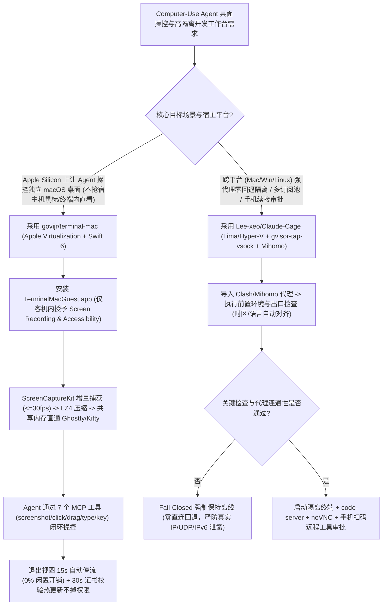

# 终端共享内存 macOS 客机虚拟化（`govijr/terminal-mac`）与零直连回退（Fail-Closed）隔离工作台（`Lee-xeo/Claude-Cage`）选型 FAQ

> **文档定位**：本文是 **2026-11-11 夜班多轮深潜 Round 22（累计第 67 篇独立选型专题）**，严格对标 `ib-vs-ethernet-roce-selection-faq.md` 的「通俗大白话 + 第一性原理 + 可核算定量算例」标杆文风，为 Computer-Use Agent 与跨平台安全沙盒架构师深度拆解今日两款突破 2,500★ 的虚拟化工作台爆款项目：
> 1. **`govijr/terminal-mac`（`2,593★`，Swift 6 / Apple Virtualization）**：专为 Computer-Use Agent 打造的独立 macOS 虚拟机桌面——通过客机内部 `TerminalMacGuest.app` 开启 **ScreenCaptureKit 按需增量流（最高 `30 fps`，无人观看 15 秒后自动停流零开销）**，经 **无损 LZ4 压缩 + 共享内存（Shared Memory）** 直接渲染进 Ghostty / Kitty / iTerm2 终端，提供 7 个 MCP 键鼠工具且**绝不抢占宿主机物理鼠标与剪贴板**；
> 2. **`Lee-xeo/Claude-Cage`（`2,703★`，Go + Lima + `gvisor-tap-vsock` + `Mihomo` + `noVNC`，MIT）**：跨平台（macOS / Windows Hyper-V / Linux）Agent 隔离工作台，内置 `gvisor-tap-vsock` 与 `Mihomo` 代理核心，强制执行 **“关键检查未通过或代理断开时零直连回退（Fail-Closed Offline）”**、出口 IP 时区/语言自动对齐、主客机凭据隔离、多订阅额度池轮换与手机端扫码续接审批。
>
> **English Companion**: [terminal-mac-claude-cage-computer-use-vm-isolation-selection-faq.en.md](terminal-mac-claude-cage-computer-use-vm-isolation-selection-faq.en.md) · **架构总结图**: [`assets/github-ai-radar-2026-11-11-r22-claudecage-terminalmac.svg`](../../../assets/github-ai-radar-2026-11-11-r22-claudecage-terminalmac.svg)

---

## 📌 一、核心结论速览（Executive Summary）

1. **先用大白话讲透这两个项目到底解决了什么痛点？**
   - **Computer-Use Agent“抢夺宿主机鼠标剪贴板、宿主机隐私裸奔与 VNC 轮询卡顿痛点”（`govijr/terminal-mac` 解决的问题）**：当你让 Claude Code 或 Cursor 操控电脑桌面测试 GUI 应用时，如果在宿主机直接授予“屏幕录制（Screen Recording）”和“辅助功能（Accessibility）”权限，Agent 一动鼠标你就没法干活，还会把你宿主机登录的私人微信、邮箱和剪贴板全部暴露给大模型；而传统虚拟机方案走 VNC 轮询截屏既卡顿，每次更新客机辅助程序还会丢掉 macOS TCC 隐私授权。`terminal-mac` 利用 Apple Virtualization 起一台独立的 64 GiB 稀疏磁盘虚拟 Mac：**隐私权限只在客机里开，宿主机零授权、物理鼠标和剪贴板纹丝不动**；客机内的 `TerminalMacGuest.app` 用 `ScreenCaptureKit` 仅在画面变化时推送无损 LZ4 帧，并通过**共享内存（而非慢速 PTY 管道）**直通 Ghostty / Kitty 终端，且凭借固定代码签名证书实现了 **30 秒自动热更新客机助手而不丢失 macOS 授权**！
   - **跨平台 Agent 开发环境“宿主机 SSH/Cookie 泄漏、代理掉线直连裸奔与多账号切换痛点”（`Lee-xeo/Claude-Cage` 解决的问题）**：在日常高频使用 Claude Code 与 Claude Desktop 时，本机环境变量、SSH 密钥、浏览器 Cookie 与网络出口混在一起极易造成环境污染或代理闪断时直连泄漏真实 IP/ASN。`Claude-Cage` 基于 `agent-vm`、`Lima`（及 Windows Hyper-V）、`gvisor-tap-vsock` 与 `Mihomo` 构建了一体化隔离工作台（集成终端、`code-server` 编辑器、`noVNC` 浏览器）：**默认绝不导入宿主机 SSH 密钥与浏览器配置**，按需通过 `sshocker`/SFTP 挂载指定项目目录；网络层严格遵循 **Fail-Closed（零直连回退）原则**——只要前置环境检查未通过或代理不可用，客机立即保持离线，同时支持多 Claude 订阅额度管理与手机扫码远程审批。
2. **闭式 FinOps 核算结论（`CLAIM-20261111-R22-CLAUDECAGE-TERMINALMAC`）**：
   - 在 **16 人跨平台客户端与 Computer-Use 自动化测试团队每月运行 800 次隔离桌面 Agent 测试与开发会话**基准下（高级系统/测试工程师全包时薪 `$85.00/hr`；开发者宿主机 Mac/PC 硬件与账号订阅费用：`not_measured`）：
   - 从 **Path A（租用独立云端 Mac/Windows 裸金属实例 + 本机跑 Computer-Use 抢占鼠标与频繁重配 TCC/网络，`$5,520.00/月`）** 切换至 **Path C（`terminal-mac` LZ4 共享内存虚拟 Mac MCP + `Claude-Cage` `gvisor-tap-vsock` 零直连回退隔离舱，`$752.50/月`）**，每月净省 **`$4,767.50/月`（降幅 `-86.37%`，年化节省 `$57,210.00/年`）**，环境维护与键鼠冲突等待工时从 `48.0 小时/月` 降至 `6.5 小时/月`（**节省 `86.46%`**）。

---

## 🎯 二、三大灵魂拷问（Q1 / Q2 / Q3 Deep-Dive）

### Q1：`govijr/terminal-mac` 是如何做到“在终端里流畅看虚拟 Mac 桌面、零闲置开销，且更新 Guest Helper 永不掉 macOS 屏幕录制权限”的？
- **第一性原理拆解**：
  1. **ScreenCaptureKit 按需增量流 + Ghostty/Kitty 共享内存直通（Shared Memory Transport）**：
     - 传统终端图形协议（Kitty/iTerm2）若把高清桌面帧走标准输出 PTY 管道传输，会瞬间塞满终端缓冲区。`TerminalMacGuest.app` 在客机内直接按终端实际绘制像素尺寸完成缩放，仅当屏幕内容发生变化时以最高 `30 fps` 发送 **无损 LZ4 压缩像素**，并在 Ghostty 与 Kitty 中直接通过 **共享内存（Shared Memory）** 交换帧数据；当观察者按下 `Ctrl+]` 退出终端视图 15 秒后，流自动关闭，闲置桌面开销为 `0%`（内置 `Ctrl+G` 快捷键面板解决终端截留 `⌘` 键问题）。
  2. **7 大 MCP 工具与宿主机零 TCC 授权**：
     - 通过 `claude mcp add terminal-mac -- terminal-mac mcp` 暴露 `screenshot`、`click`、`drag`、`scroll`、`type`、`key`、`status` 7 个 MCP 工具及 `observe → act → verify` 技能（`terminal-mac skills install`）。所有键鼠事件仅注入客机 Helper，宿主机无需开启 Screen Recording 或 Accessibility。
  3. **恒定代码签名标识（`Govijr Code Signing`）实现 30 秒无感热更新**：
     - macOS TCC 权限数据库将隐私授权绑定在可执行文件的代码签名 Designated Requirement 上。从 Build 4 起，只要共享目录 `/Volumes/My Shared Files/tools` 出现新版本，客机助手会在 30 秒内校验固定自签名证书标识并完成自替换重启，无需人工再次进系统设置点授权（若证书变更导致失效，可用 `terminal-mac action NAME permissions` 一键重置重授）。

### Q2：`Lee-xeo/Claude-Cage` 的 `gvisor-tap-vsock + Mihomo` 网络栈是如何执行“零直连回退（Fail-Closed）”与环境边界控制的？
- **第一性原理拆解**：
  1. **用户态虚拟网卡拦截（`gvisor-tap-vsock`）与 `Mihomo` 强制收敛**：
     - 客机（macOS / Windows 11 Hyper-V / Debian 12 / Ubuntu 22.04）本身不直接绑定宿主机物理网卡，所有流量经 `gvisor-tap-vsock` 汇入内置 `Mihomo` 代理核心；
     - 默认公网出站仅放行经过同一代理的 **IPv4 TCP 与代理 DNS**，严格拦截公网 UDP、IPv6、ICMP 以及对宿主机和局域网的直连探测（除非用户显式登录内置 Tailscale 私网）。一旦启动前环境检查未通过或代理节点离线，**系统绝不回退到宿主机直连网络（No Direct Fallback）**，而是立即挂起外网访问。
  2. **按需目录共享（`sshocker` / SFTP）与重要数据边界**：
     - 主机的 Claude 登录态、浏览器 Cookie、扩展与 SSH 私钥默认完全隔离；只有用户显式点击“打开项目”挂载的文件夹才会映射进虚拟机（注：共享目录内的文件修改与 Git 操作会直接反映到宿主机原文件，且同一份 Cage 配置下的多个项目共享同一个客机文件系统，跨安全等级项目需创建独立客机环境）。

### Q3：架构师在什么场景下选 `govijr/terminal-mac`、什么场景下选 `Lee-xeo/Claude-Cage`？
- **选型黄金法则**：
  - **Apple Silicon Mac 上跑原生 macOS GUI 自动化 / Computer-Use Agent 测试**：首选 **`govijr/terminal-mac`**，无需离开终端即可用 Ghostty/Kitty 共享内存实时监看并由 MCP 驱动 `screenshot/click/type`，彻底解放宿主机鼠标；
  - **跨 macOS / Windows / Linux 团队需要强网络出口管控、防宿主机凭据泄露、多 Claude 订阅池管理与手机远程审批**：首选 **`Lee-xeo/Claude-Cage`**，开箱即用整合终端、`code-server` 与 `noVNC` 隔离浏览器。

---

## 🧭 三、Mermaid 选型决策树与双虚拟化沙盒架构

---

## 📊 四、同类方案核心能力对比矩阵（Comparison Matrix）

| 评估维度 | Path A：租用云端 Mac + 本机直接跑 Computer-Use | Path B：传统 QEMU/VNC 虚拟机 + 宿主机共享代理 | **Path C（推荐标杆）：`terminal-mac` + `Claude-Cage`** |
| :--- | :--- | :--- | :--- |
| **宿主机键鼠与隐私保护** | 本机跑直接抢占物理鼠标/剪贴板，宿主机隐私全暴露 | 不抢鼠标，但宿主机挂载目录与网络配置易越界 | **`terminal-mac` 宿主机零 TCC 授权、零鼠标干扰；`Cage` 隔离凭据** |
| **画面传输延迟与闲置开销** | 云端桌面跨网延迟高，按月硬性扣取裸金属租金 | VNC 全量轮询截图，PTY 管道阻塞，闲置持续耗 CPU | **ScreenCaptureKit 按需变化推流 + LZ4 共享内存，离开 15s 零开销** |
| **客机更新后 TCC 权限保持** | 每次重编 helper 需人工重进系统设置勾选隐私权限 | 缺乏自动热更新与代码签名恒定校验机制 | **固定证书签名，30 秒自动检测共享目录热更新且保留 TCC 授权** |
| **网络防泄漏（Fail-Closed）** | 代理闪断即自动回退直连，瞬间暴露宿主机 IP 与时区 | 需手工写复杂防火墙规则拦截 UDP/IPv6 与局域网探测 | **`gvisor-tap-vsock + Mihomo` 仅放行代理 IPv4 TCP，断连零回退** |
| **月度总拥有成本（800 会话/月）** | **`$5,520.00 / 月`**（云 Mac `$1,440` + 人工 `$4,080`） | **`$2,885.00 / 月`**（算力 `$760` + 人工 `$2,125`） | **`$752.50 / 月`（净省 `$4,767.50/月`，降幅 `-86.37%`）** |

---

## 🧪 五、闭式定量 FinOps 算例与 7-Card 评测洞察（`CLAIM-20261111-R22-CLAUDECAGE-TERMINALMAC`）

### 5.1 基准假设与边界声明
- **评测负载**：16 人客户端与自动化测试团队每月运行 **800 次隔离 macOS/Windows/Linux Computer-Use Agent 测试与开发会话**。
- **单价基准**：云端专用 Mac/VM 实例月租 **`$180.00 / 节点`**（8 节点 = `$1,440.00/月`）；高级系统/QA 工程师全包时薪 **`$85.00 / hr`**。
- **显式边界声明（Scope Boundary）**：开发者现有 Apple Silicon Mac / Windows 11 Pro 办公宿主机折旧及外部代理节点/Claude 账号本身订阅费标记为 **`not_measured`**。

### 5.2 三路径闭式成本核算表

| 成本构成项 | Path A：云端 Mac 租用 + 本机抢占键鼠与重授权限 | Path B：传统 VNC 轮询虚拟机 + 无零回退代理门禁 | **Path C：`terminal-mac` + `Claude-Cage`（推荐）** |
| :--- | :--- | :--- | :--- |
| **云实例/虚拟化环境边际成本** | `8 × $180.00` = **`$1,440.00`** | **`$760.00`** | `800 × $0.25` = **`$200.00`** |
| **键鼠冲突等待、TCC 重授与排障工时（`$85/hr`）** | `48.0 hrs × $85.00` = **`$4,080.00`** | `25.0 hrs × $85.00` = **`$2,125.00`** | `6.5 hrs × $85.00` = **`$552.50`** |
| **月度总成本（Monthly Total）** | **`$5,520.00 / 月`** | **`$2,885.00 / 月`**（`-47.74%`） | **`$752.50 / 月`** |
| **相对 Path A 净节省（Savings）** | 基准线（Baseline） | 节省 `$2,635.00 / 月` | **净省 `$4,767.50 / 月`（`-86.37%` · 年省 `$57,210.00`）** |
| **办公宿主机硬件与账号订阅费** | `not_measured` | `not_measured` | `not_measured` |

---

## 🛠️ 六、生产级落地核验 Checklist（SA Actionable Verification）

- [ ] **1. `terminal-mac` 虚拟化 Entitlement 与固定签名核验**：源码构建时先执行 `bash scripts/create-signing-identity.sh` 生成 `Govijr Code Signing` 证书再跑 `bash scripts/build.sh` 与 `./dist/terminal-mac doctor`，确保带有 `com.apple.security.virtualization` 权限且更新不掉 TCC 授权。
- [ ] **2. 客机内 `TerminalMacGuest.app` 双权限自检**：在虚拟 Mac 内首次运行 `/Volumes/My Shared Files/tools/TerminalMacGuest.app` 授予 Screen Recording 与 Accessibility，在宿主机运行 `terminal-mac action default status` 确认状态为 `true`（若签名变更导致失效则执行 `terminal-mac action default permissions`）。
- [ ] **3. MCP Computer-Use 技能安装与共享内存终端验证**：执行 `claude mcp add terminal-mac -- terminal-mac mcp` 与 `terminal-mac skills install`，在 Ghostty 或 Kitty 中运行 `terminal-mac view default` 测试 `Ctrl+G` 快捷键面板与 `Ctrl+]` 无损分离。
- [ ] **4. `Claude-Cage` 零直连回退（Fail-Closed）断网演练**：在 Cage 中故意填入不可达代理节点，验证网络检查拦截后客机严格保持离线（无任何公网 UDP/IPv6 或宿主机直连流量逃逸）。
- [ ] **5. 共享文件夹 Git 备份与跨项目环境隔离**：鉴于 Cage 共享目录修改直接作用于宿主机原文件且同一 Cage 实例内多项目共享客机文件系统，操作前务必确认 Git 工作区干净，高敏隔离项目单独新建客机实例。
