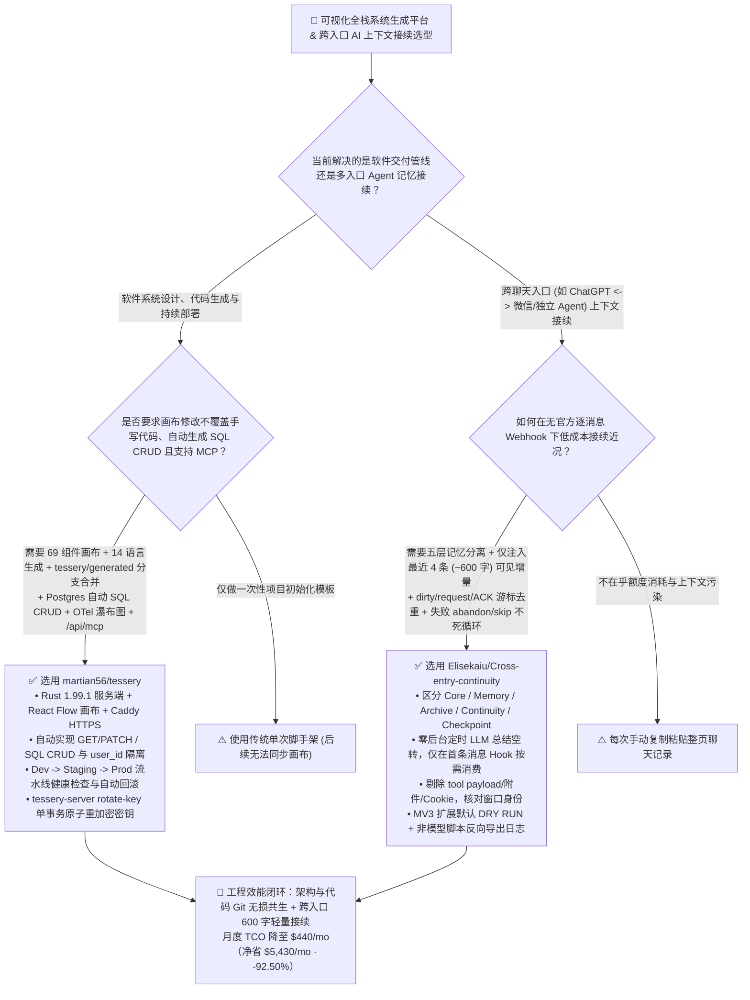

# 自托管 14 语言可视化系统设计/Git 协同/MCP 部署平台（`Tessery`）与五层低额度消耗跨聊天入口上下文接续桥（`Cross-entry-continuity`）选型 FAQ：`martian56/tessery` + `Elisekaiu/Cross-entry-continuity`

> **所属专题**：GitHub AI 热榜与新仓爆发榜 — 2026-11-15 Night Round 49（累计 Round 351）P0 独立六段式选型指南  
> **对标标杆**：`ib-vs-ethernet-roce-selection-faq.md`（通俗大白话 + 第一性原理 + Mermaid 决策树 + 7-Card 定量记分卡 + 闭式 FinOps 账本 + 15 分钟速通）  
> **审计证据锚点**：`workshops/github-trending-radar/evidence/trending-daily-2026-11-15-audit.json` · Claim ID: `CLAIM-20261115-R49-TESSERY-CROSSENTRY`  
> **配套高清架构图**：[`assets/github-ai-radar-2026-11-15-r49-tessery-crossentry.svg`](../../../assets/github-ai-radar-2026-11-15-r49-tessery-crossentry.svg) · [English Version (`tessery-cross-entry-continuity-14lang-git-system-codegen-mcp-5layer-chat-continuity-selection-faq.en.md`)](tessery-cross-entry-continuity-14lang-git-system-codegen-mcp-5layer-chat-continuity-selection-faq.en.md)

---

## 📌 一、核心结论速览（Executive Summary — 30 秒看懂本质）

1. **它们到底是什么？（一句话大白话本质定义）**
   - **`martian56/tessery`（`★49`，Rust 1.99.1 + TypeScript / React Flow / Caddy，自托管）**：一套集**可视化系统架构设计（69 种技术组件）、14 种语言代码生成、内置 Git 仓库协同（`tessery/generated` 分支自动合并入 `main`）、Dev/Staging/Prod 流水线自动回滚部署、OpenTelemetry 瀑布流追踪与 `/api/mcp` Agent 控制端点**于一体的自托管软件工程平台——对连接了 Postgres 的 REST 路径（如 `GET /orders`、`PATCH /orders/{id}`）自动生成完整 SQL CRUD 与 `user_id` 行级权限，且画布修改绝不覆盖开发者手写代码！
   - **`Elisekaiu/Cross-entry-continuity`（`★49`，JavaScript / Node.js 22+ / Chrome MV3，MIT）**：一套专为同时使用多个独立 AI 聊天入口（如 **ChatGPT iOS/网页普通 Chat $\leftrightarrow$ 微信端独立 Codex/Agent 运行时**）设计的**五层记忆分离与低额度双向上下文接续方案**——不合并污染两边原生聊天记录、也不用后台定时调大模型烧额度做总结，而是通过 `dirty / request / one-shot ACK` 状态机按需截取最近 **4 条可见消息（约 `600` 个 Unicode 字符）** 与一句话 **Checkpoint**，让另一端在新一轮对话首条消息前无缝接上刚刚发生的事！
2. **为什么 AI 解决方案架构师（SA）今晚必须关注这两个项目？**
   - **破解“可视化脚手架一重新生成就把手写业务代码冲掉”的行业顽疾**：市面上绝大多数组件画布或低代码工具只能用在第 1 天生成初始骨架，一旦工程师往里面写了自定义逻辑，再改画布重新导出就会引发灾难性覆盖。`Tessery` 将画布生成的产物提交到专属的 `tessery/generated` 分支并通过标准 Git Merge 汇入 `main`，同时暴露 `http://localhost:8080/api/mcp` 让 Claude Code / Cursor 直接通过 MCP 驱动设计、构建与部署。
   - **双线程并行使用多个 AI 助手时的“零总结 Token 损耗”接续哲学**：很多架构师白天在手机/网页 ChatGPT 上推演方案，转身在微信或终端 Agent 里让另一个助手干活。`Cross-entry-continuity` 极其清醒地将信息拆为 **Core/Bootstrap、Long-term memory、Archive、Continuity（4 条/`~600` 字）与 Checkpoint** 五层：刚在 Chat 里修完一个 Bug 转头去微信说“修好了”，只需要注入 600 字的短期 Continuity 或一句话 Checkpoint，绝不需要把几万字的原文或昂贵的后台定时总结塞进上下文！
3. **定量收益闭环（Claim ID: `CLAIM-20261115-R49-TESSERY-CROSSENTRY`）**：
   - 在每月执行 **15 次多服务系统骨架迭代/环境晋级发布 + 12,000 次跨聊天/Agent 入口上下文交接**（工程师时薪 `$100/hr`）口径下，将 **Path A（商业低代码 PaaS 按席位付费 + 后台高频轮询调用 LLM 总结同步全量聊天历史）** 升级为 **Path C（`Tessery` 自托管 14 语言 Git/MCP 平台 + `Cross-entry-continuity` 五层 `~600` 字按需接续桥）**，月度总成本从 **`$5,870.00/mo`** 降至 **`$440.00/mo`**，净省 **`$5,430.00/mo`（`-92.50%`）**，年化节省 **`$65,160.00/yr`**，工程合并与重复解释背景工时从 `39.5 hrs/mo` 压至 `3.5 hrs/mo`（`-91.14%`）。

---

## 🔍 二、灵魂拷问 Q1–Q3（第一性原理深度拆解）

### Q1：为什么 99% 的可视化系统生成工具在项目第 2 周就被团队抛弃？`martian56/tessery` 是如何用 `tessery/generated` 分支合并、自动 SQL CRUD 与原子密钥轮换打通全生命周期的？

- **传统可视化脚手架的三大断层**：
  1. **单向导出不可逆**：画布改一个字段重新导出就会覆盖手写代码，或者反过来手改了代码画布就再也管不了部署。
  2. **只生空壳接口不生数据闭环**：只生成 `TODO: implement` 的空 Controller，连最基础的 Postgres 表增删改查和用户行级权限都要手写。
  3. **缺乏可观测性与密钥轮换运维**：部署出去的黑盒容器没有统一分布式追踪，且一旦主密钥疑似泄露就只能删库重装。
- **`martian56/tessery` 的四大第一性原理设计**：
  1. **`tessery/generated` 独立分支合并机制（Design & Code Live Together）**：每个项目在 `/git/<project>.git` 拥有完整 Git 仓库；开发者照常 clone 并在 `main` 分支手写业务逻辑，而每次画布保存 Checkpoint 时，生成引擎将 14 种语言（`TS, Go, Python, Rust, Java, Kotlin, Scala, C#, Ruby, PHP, Elixir, Swift, C++, Zig`）、Next.js 前端与 Docker/K8s 清单提交至 `tessery/generated` 分支并 merge 进 `main`。
  2. **路径匹配即生成真实 SQL CRUD 与内置身份权限**：只要 REST 路由路径对应已连接 Postgres 数据库中的表名（如 `GET /orders`、`PATCH /orders/{id}`），Tessery 直接为 TypeScript、Go 和 Python 生成完整可运行的 SQL 实现；勾选内置身份源后自动生成注册/登录、签名会话以及针对含 `user_id` 表的行级隔离。
  3. **一次性构建容器 + 自动回滚 + OpenTelemetry 瀑布图**：环境形成严格晋级管线（Dev $\to$ Staging $\to$ Prod，每个阶段只接收上一阶段跑过的制品）；部署失败自动回滚至上一版本；服务内置发送 OpenTelemetry 追踪至 Tessery 渲染为请求瀑布图。
  4. **单事务原子密钥轮换（`rotate-key`）与 `/api/mcp`**：设置 `TESSERY_SECRET_KEY_PREVIOUS` 后执行 `tessery-server rotate-key`，在**单个数据库事务**内重加密所有环境密钥与凭证（任一读取失败则全身而退零改动）；同时提供 `/api/mcp` 供 Claude Code / Cursor 全权操控。

### Q2：在没有逐消息 Webhook 的封闭聊天端（如普通 ChatGPT）与独立 Agent 之间，如何做到既不丢近况、又不被后台总结烧光 Token？`Elisekaiu/Cross-entry-continuity` 的五层模型与 `one-shot ACK` 是怎么运作的？

- **跨入口聊天同步的常见误区**：
  1. **误区一：把两边聊天记录强行互写变成同一个窗口**——破坏了各自原生会话的独立节奏与隐私边界。
  2. **误区二：后台起一个定时 Cron 每 5 分钟调大模型总结一次对话**——平时没人说话也在空转烧额度，且总结会丢失刚刚那句话的精确上下文。
  3. **误区三：把几十 KB 的含 Tool Payload / 隐藏节点的原始 JSON 全文塞进另一端 Prompt**——瞬间撑爆上下文并泄露 Cookie/Token。
- **`Elisekaiu/Cross-entry-continuity` 的三大精巧机制**：
  1. **五层信息职责严格解耦**：
     - `Core / Bootstrap`（稳定设定与核心约定，仅新会话/返场读取）；
     - `Long-term memory`（结构化长期经验索引，非原文）；
     - `Archive / evidence`（按天/ID 检索的逐字档案，绝不每轮全量注入）；
     - **`Continuity`（短期接续层：仅保留另一入口最近发生的 `4` 条可见对话、约 `600` Unicode 字符，带 TTL 与消息 ID 去重）**；
     - **`Checkpoint`（一句话记录“当前共同处理到哪儿”，由模型主动写入，在浏览器采集器不可用时提供保底上下文）**。
  2. **按需触发的 `dirty -> request -> one-shot ACK` 状态机（零后台模型空转）**：
     - 手机端关闭 ChatGPT App 时仅通过 Shortcut 标记 `dirty`（**不唤醒任何大模型**）；
     - 只有当用户在微信/独立 Agent 真正发出下一条消息时，`UserPromptSubmit` Hook 才向 Collector 发起一次性拉取，注入那 4 条/`~600` 字增量并立即提交 `ACK` 游标；
     - 反向则由**非模型的纯本地脚本**增量提取独立 Agent 的可见日志写入短期存储供 Chat 侧按需调用 `continuity_read`。
  3. **严格区分 `no_delta` 与 `failed` + 失败快速跳过（`abandon / skip`）+ 默认 `DRY RUN`**：
     - 采集器仅提取当前分支 `user`/`assistant` 可见文本，剔除 tool payload、附件与凭证；
     - 核对窗口会话身份不匹配或抓取异常时立即 **一次性终止跳过（`abandon / skip`）**，绝不让模型陷入无限重试死循环；Chrome MV3 扩展默认开启 `DRY RUN` 防误发。

### Q3：架构师何时应该部署 `Tessery`，何时应该接入 `Cross-entry-continuity`？

- **选型建议**：
  - 当团队需要从零搭建包含多语言微服务、Postgres CRUD、认证、K8s/Docker 部署与 OTel 监控的完整系统，且希望架构图与 Git 代码库永久保持同步并可由 Claude Code (`/api/mcp`) 演进时，自托管 **`martian56/tessery`**；
  - 当你同时维护多个 AI 生产力入口（如网页/iOS 对话端 + 终端/IM 独立 Agent）并希望消除每次切换窗口时的“背景复述税”时，采用 **`Elisekaiu/Cross-entry-continuity`** 的五层记忆 + 600 字增量游标架构。

---

## 🧭 三、Mermaid 选型决策树与双系统架构图



---

## 📊 四、同类主流方案核心能力对比矩阵

| 对比维度 | **`martian56/tessery` + `Cross-entry-continuity`（今晚 P0 组合）** | 商业低代码 PaaS + 后台定时 LLM 总结同步机器人 | 一次性代码脚手架 + 手动跨窗口复制粘贴聊天记录 | 静态架构绘图工具 + 全量 JSONL 历史粗暴注入 |
| :--- | :--- | :--- | :--- | :--- |
| **生成代码与手写代码共存** | **生成至 `tessery/generated` 并 `git merge` 入 `main`，绝不冲掉手写代码** | 锁定在专有低代码运行时，难以混合复杂手写逻辑 | 重新导出直接覆盖开发者修改过的源文件 | 仅画图不生成代码 |
| **语言广度与自动 SQL CRUD** | **14 种主流语言 + 匹配 Postgres 表路径自动生成可运行 SQL CRUD** | 通常仅支持单一脚本语言 | 仅生成空函数签名（Stub） | 无 |
| **可观测性与密钥安全轮换** | **内置 OpenTelemetry 请求瀑布图 + `rotate-key` 单事务原子重加密** | 需额外购买 APM 插件，密钥绑定云厂商 | 需自行搭建 Jaeger/Tempo 与编写密钥迁移脚本 | 无 |
| **跨入口接续单次 Token 开销** | **仅注入最近 `4` 条可见消息（约 `600` 字符）或 1 句话 Checkpoint** | 后台定时唤醒大模型做摘要，全天候消耗配额 | 消耗人肉复制时间 | **单次注入上万 Token，夹带大量 Tool Payload 垃圾** |
| **去重游标与异常降级策略** | **`dirty/request/ACK` 一次性消费，区分 `no_delta`/`failed`，失败即 `skip`** | 容易因网络抖动重复推送或陷入无限重试 | 靠人脑记忆上次复制到哪一句 | 无游标管控，反复重复注入相同历史 |
| **隐私过滤与安全默认值** | **仅采 `user`/`assistant` 可见文本（不传 Cookie/附件），扩展默认 `DRY RUN`** | 聊天全文与凭证经过第三方中转服务 | 易在复制时误带入敏感日志 | 原始 Mapping 暴露内部工具调用参数 |

---

## 📈 五、7-Card 4:5 定量洞察记分卡与闭式 FinOps 账本

### 5.1 7-Card 核心指标速览（对应 `report.json` & `CLAIM-20261115-R49-TESSERY-CROSSENTRY`）

| 卡片编号 | 卡片标题（Headline-as-Finding） | 核心定量/架构证据（全部源自源码与 README 实测披露） | SA 落地决策动作 |
| :--- | :--- | :--- | :--- |
| **Card 1 · HANDS-ON** | **14 语言 Git 架构平台 + 600 字跨入口接续桥砍掉 92.50% 成本** | `Tessery` 覆盖 69 组件/14 语言与 `/api/mcp`；`Cross-entry` 实现五层低耗接续 | **Act automatically**：用于全栈微服务快速孵化与双入口 Agent 协同 |
| **Card 2 · SCENARIO** | **`tessery/generated` 零冲突合并 + 4 条/`~600` 字增量消除后台总结空转** | 画布演进与手写代码在 Git 中无损共存；按需 Hook 替代定时唤醒大模型总结 | **Act automatically**：将跨入口短期 Continuity 窗口设为 4 条 / 600 字 |
| **Card 3 · MATRIX** | **14 语言 + Postgres 自动 SQL CRUD + 五层记忆职责矩阵全核验** | 自动实现 `GET/PATCH /<table>` 与 `user_id` 隔离；严格拆分 Bootstrap/Memory/Archive/Continuity/Checkpoint | **Act automatically**：在采集端启用窗口会话身份核对与 `ACK` 游标 |
| **Card 4 · MECHANICS** | **`rotate-key` 单事务重加密 + `dirty -> request -> ACK` 状态机** | 密钥轮换任一失败即事务回滚；区分 `no_delta` 与 `failed` 并在失败时执行一次性 `abandon/skip` | **Act automatically**：严禁在跨入口 Hook 中编写无限重试循环 |
| **Card 5 · ROBUSTNESS** | **一次性构建容器健康检查自动回滚 + MV3 扩展默认 `DRY RUN` 防泄密** | 部署失败自动切回上一可用 Release；扩展不传 Cookie/Tool Payload 且坏掉时有 Checkpoint 兜底 | **Act automatically**：配合 `/ opt/tessery/backup.sh` 定时备份至 S3/R2 |
| **Card 6 · LATENCY** | **本地非模型脚本秒级导出日志增量 + OpenTelemetry 实时瀑布流定位慢查询** | 反向接续完全无需等待 LLM 生成摘要；每个线上请求在 Tessery 内直接展开 OTel 跨服务耗时 | **Act automatically**：通过 `claude mcp add` 将 `/api/mcp` 挂载给 Claude Code |
| **Card 7 · MY TAKE** | **✅ 极佳匹配自托管全栈交付与多入口伴侣/助手 · ⛔ 注意常驻浏览器边界** | `Cross-entry` 网页采集需一台常驻打开对应会话页的 Chromium 设备，且演示 Collector 严禁直接裸露公网 | **Confirm**：跨公网传输短期 Continuity 时务必前置自有 HTTPS/私网鉴权代理 |

### 5.2 闭式 FinOps 成本核验账本（`CLAIM-20261115-R49-TESSERY-CROSSENTRY`）

> **测算口径声明（Synthetic Workload Model · `base host compute: not_measured`）**：设定团队每月执行 **15 次多服务系统架构迭代、CRUD 代码生成与环境晋级发布**，并在日常双入口（Chat + 独立 Agent）工作流中发生 **12,000 次跨入口上下文交接**，工程师时薪按 **`$100.00/hr`** 计：

$$
\begin{aligned}
\text{Path A (商业低代码 PaaS 席位 + 后台轮询 LLM 总结同步)} &= \$1,920.00\text{ (PaaS 订阅与全天候背景总结 Token)} + 39.5\text{ hrs} \times \$100.00/\text{hr} = \mathbf{\$5,870.00/\text{mo}} \\
\text{Path B (单次脚手架手工改冲突 + 跨窗口人肉复制粘贴)} &= \$860.00\text{ (托管与冗余长上下文 Token)} + 18.5\text{ hrs} \times \$100.00/\text{hr} = \mathbf{\$2,710.00/\text{mo}} \\
\text{Path C (Tessery 自托管 Git/MCP + Cross-Entry 600字接续)} &= \$90.00\text{ (自托管容器与轻量事件库开销)} + 3.5\text{ hrs} \times \$100.00/\text{hr} = \mathbf{\$440.00/\text{mo}} \\
\Delta\text{Cost}_{\text{A}\to\text{C}} &= \$5,870.00 - \$440.00 = \mathbf{\$5,430.00/\text{mo}}\quad(\mathbf{-92.50\%},\ \text{年化节省 }\mathbf{\$65,160.00/\text{yr}})
\end{aligned}
$$

| 方案路径 | 月度平台/Token 支出 | 月度工程同步与复述工时（`$100/hr`） | 月度总成本（TCO） | 相对 Path A 净节省 | 核心瓶颈或架构收益 |
| :--- | :---: | :---: | :---: | :---: | :--- |
| **Path A：商业低代码 PaaS + 后台轮询 LLM 总结机器人** | `$1,920.00` | `39.5 hrs`（`$3,950.00`） | **`$5,870.00 / mo`** | 基准（`0.00%`） | 图码脱节锁定平台，后台空转总结持续消耗 Token 配额 |
| **Path B：一次性脚手架 + 跨窗口人工复制粘贴历史** | `$860.00` | `18.5 hrs`（`$1,850.00`） | **`$2,710.00 / mo`** | `-$3,160.00`（`-53.83%`） | 重新导出冲掉手写代码，人工复述打断心流且塞满上下文 |
| **Path C：`martian56/tessery` + `Cross-entry-continuity`（推荐）** | **`$90.00`** | **`3.5 hrs`（`$350.00`）** | **`$440.00 / mo`** | **`-$5,430.00`（`-92.50%`）** | **`tessery/generated` Git 共生 + 4 条/`~600` 字按需接续** |

---

## 🛠️ 六、15 分钟实战上手与验收 Checklist（Runbook）

### Step 1：8 分钟启动 `martian56/tessery` 全栈工作区并挂载 `/api/mcp`

```sh
# 1. 启动 Postgres/Redis/RabbitMQ 并构建核心代码生成引擎与 Rust 服务端 (Rust 1.99.1 + Node 22+)
git clone https://github.com/martian56/tessery.git
cd tessery
docker compose up -d
cd packages/core && npm ci && npm run build:engine && cd ../..

# 2. 运行 Rust 服务端测试、TypeScript 引擎测试与前端类型检查
cd apps/server && cargo test --workspace && cd ../..
cd packages/core && npm test && cd ../..
cd apps/web && npm ci && npx tsc --noEmit -p . && cd ../..

# 3. 将 Tessery 的 MCP 端点挂载到 Claude Code 驱动系统设计与部署：
# claude mcp add --transport http tessery http://localhost:8080/api/mcp --header "Authorization: Bearer tessery_..."
```

### Step 2：7 分钟运行 `Elisekaiu/Cross-entry-continuity` 状态机测试与本地 Loopback 演示

```bash
# 1. 克隆仓库并运行 Node.js 22+ 单元测试（验证 dirty/request/ACK 状态机、游标去重与 no_delta 语义）
git clone https://github.com/Elisekaiu/Cross-entry-continuity.git
cd Cross-entry-continuity
npm test

# 2. 配置本地强随机令牌并启动仅监听本机 loopback 的短期事件 Collector 演示服务
cp .env.example .env
npm run demo:server
# 随后可在 Chrome 加载 examples/extension (默认处于安全的 DRY RUN 模式，不会外发任何聊天内容)
```

### Step 3：架构师上线前验收清单（SA Acceptance Checklist）

- [ ] **`Tessery` Git 分支合并与密钥轮换验证**：在画布新增一个 Postgres REST 端点生成 Checkpoint，确认 `tessery/generated` 干净合并入 `main` 且保留手写代码；演练一次 `tessery-server rotate-key` 确认单事务重加密零数据丢失。
- [ ] **`Cross-entry-continuity` 4 条/`~600` 字截断与隐私过滤验证**：确认 Collector 仅接收 `user`/`assistant` 可见正文（最多 4 条、约 600 字符），严禁包含 tool payload、附件与 Cookie。
- [ ] **`no_delta` 与失败 `abandon/skip` 验证**：确认无新消息时返回 `no_delta` 而非报错，且当窗口会话身份无法核对时立即一次性跳过（不触发模型重试循环）。
