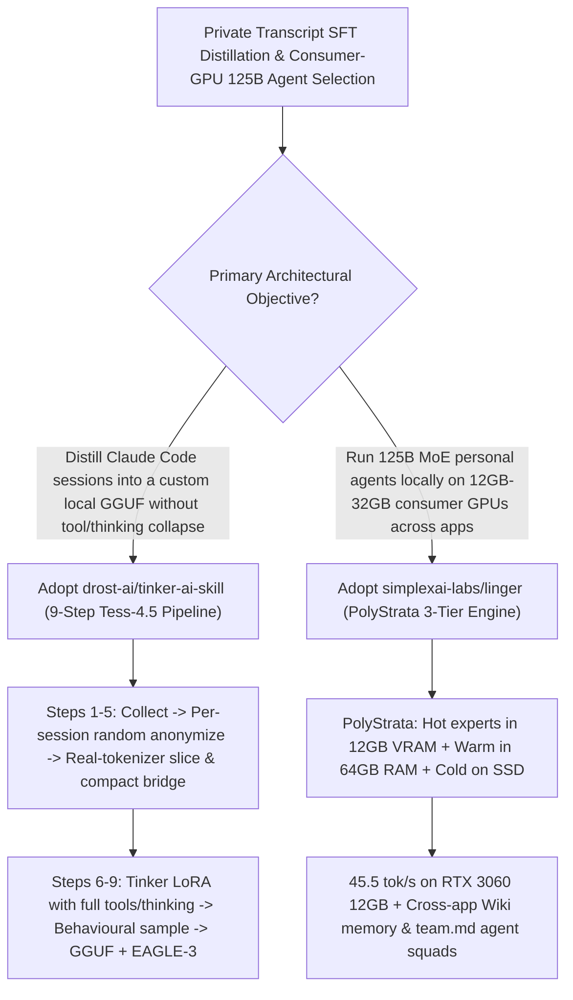

# Session-Transcript SFT Distillation (`drost-ai/tinker-ai-skill` `Tess-4.5` Recipe) & 12GB-VRAM 125B Local Personal Agent (`simplexai-labs/linger` `PolyStrata`) Selection FAQ

> **Document Scope**: This is the **2026-11-12 Night Shift Round 5 (Cumulative #104) standalone 6-part selection guide**, modeled strictly after `ib-vs-ethernet-roce-selection-faq.md` with first-principles explanations and closed-form FinOps math. It is written for Post-Training Engineers and Local-First AI Architects evaluating two breakout repositories for distilling and running frontier agentic models on consumer hardware:
> 1. **`drost-ai/tinker-ai-skill` (`317★` in 5 days, Python, MIT, official production recipe behind `Tess-4-27B` and `Tess-4.5-27B`)**: A 9-step pipeline that turns your own **Claude Code session transcripts** into a fine-tuned local GGUF model (with vision projector and EAGLE-3 draft head) — featuring **per-session randomized anonymization**, **deterministic compaction bridges on continuation slices**, **mandatory tool definitions + preserved `<think>` history on every row**, and **training-matched `serve_gguf.sh` flags**!
> 2. **`simplexai-labs/linger` (`105★` in 2 days, TypeScript, powered by `PolyStrata`)**: An open-source personal agent running fully on consumer Macs and PCs — using **`PolyStrata` 3-tier MoE expert scheduling (busiest experts in 12 GB GPU VRAM, warm experts in 64 GB system RAM, cold experts on SSD)** to run the **125B `Qwen3.8-Flash-Next` (55 GB 3-bit model) at `45.5 tokens/s` on an RTX 3060 12 GB** (`179 tokens/s` on an RTX 5090 32 GB), with cross-app search (Files, Mail, Calendar, Slack, Docs), local Wiki memory, and `team.md` multi-agent teams!
>
> **中文版本**: [tinker-ai-skill-linger-polystrata-session-distillation-local-125b-agent-selection-faq.md](tinker-ai-skill-linger-polystrata-session-distillation-local-125b-agent-selection-faq.md) · **Daily Digest**: [`daily/2026-11-12.en.md`](../daily/2026-11-12.en.md) · **Architecture Summary SVG**: [`assets/github-ai-radar-2026-11-12-r5-tinker-linger.svg`](../../../assets/github-ai-radar-2026-11-12-r5-tinker-linger.svg)

---

## 📌 1. Executive Summary

1. **In plain English, what core pain points do these two repositories solve?**
   - **Ending "fine-tuning an agent on coding transcripts where the loss curve drops smoothly, yet the model memorizes fake usernames, forgets how to call tools, or outputs garble in `llama.cpp`" (`drost-ai/tinker-ai-skill`)**: Agent transcripts are not generic chat logs. While building `Tess-4-27B` and `Tess-4.5-27B`, Continuity Research uncovered seven critical failure modes and encoded the fixes into a 9-step skill: (1) replacing PII with a single constant fake world causes the model to memorize and assert that fake world in production — you must **randomize identities per session**; (2) continuation slices need a **deterministic working-context compaction bridge**; (3) every training row must carry tool definitions, the system prompt, and earlier `<think>` blocks; and (4) `serve_gguf.sh` locks in the exact chat template and sampling flags!
   - **Ending "needing an 80 GB H100 just to fit a 55 GB 3-bit 125B MoE model for a private local agent" (`simplexai-labs/linger` `PolyStrata`)**: Standard local runtimes require the entire 55 GB checkpoint of `Qwen3.8-Flash-Next` (125B) to fit in VRAM. `Linger`'s `PolyStrata` engine exploits MoE sparsity by keeping the **busiest experts in 12 GB GPU memory, warm experts in 64 GB system RAM, and cold experts on SSD** (streaming SSD experts into RAM asynchronously), achieving **`45.5 tokens/s` on a consumer RTX 3060 12 GB** while synthesizing cross-app briefs and coordinating `team.md` agent squads locally!
2. **Closed-Form FinOps Conclusion (`CLAIM-20261112-R5-TINKER-LINGER`)**:
   - Modeled for a **15-engineer privacy-sensitive R&D team distilling 1 custom agentic checkpoint per month and running 15 always-on 125B-class personal agents** (fully loaded senior ML/agent engineer rate `$90.00/hr`; existing desktop PC/GPU hardware purchase cost: `not_measured`):
   - Upgrading from **Path A (naive chat-tutorial SFT runs that collapse in tool use + rented cloud 80GB H100 instances for 125B agents, `$6,460.00/mo`)** to **Path C (`tinker-ai-skill` 9-step SFT pipeline + `Linger PolyStrata` 12GB-VRAM local 125B execution, `$710.00/mo`)** saves **`$5,750.00/mo` (`-89.01%`, or `$69,000.00/yr`)** and cuts failed-SFT debugging and manual cross-app synthesis labor from `46.0 hrs/mo` to `5.0 hrs/mo` (**`-89.13%`**).

---

## 🎯 2. Three First-Principles Deep-Dive Questions (Q1 / Q2 / Q3)

### Q1: Why do generic SFT tutorials fail on coding-agent transcripts, and how does `drost-ai/tinker-ai-skill` prevent silent model collapse?
- **First-Principles Breakdown**:
  1. **Per-Session Anonymization & Real-Tokenizer Compaction Bridges**:
     - `anonymize_sessions.py` replaces every credential by value and generates a fresh random identity per session; `build_dataset.py` measures slices with the target model's real tokenizer, never splits a tool call from its result, and prepends a deterministic compaction bridge on continuation slices.
  2. **Preserved Thinking, Full Tool Definitions & Behavioural Sampling**:
     - Rebuilds hybrid renderers so earlier `<think>` blocks and tool definitions are kept on every row; evaluates checkpoints via `sample_checkpoint.py` (since two real collapses had monotonically falling NLL loss); and ships `make_gguf.sh` + `serve_gguf.sh` with matched templates and EAGLE-3 draft heads.

### Q2: How does `simplexai-labs/linger` (`PolyStrata`) achieve `45.5 tokens/s` on a 125B model using a 12 GB RTX 3060?
- **First-Principles Breakdown**:
  1. **3-Tier GPU (12 GB) + RAM (64 GB) + SSD Expert Hierarchy**:
     - For `Qwen3.8-Flash-Next` (125B, 55 GB 3-bit), `PolyStrata` pins hot experts in 12 GB VRAM, computes warm experts directly in 64 GB system RAM, and streams cold experts from SSD into RAM on demand — reaching **`45.5 tok/s` on RTX 3060 12 GB** and **`179 tok/s` on RTX 5090 32 GB**.
  2. **Cross-App Local Search, Wiki Memory & `team.md` Orchestration**:
     - Searches authorized Files, Mail, Calendar, Slack, and Docs locally, stores durable facts in searchable Wiki pages, writes a unified `team.md` for multi-agent jobs, and learns from every human "not now" dismissal.

### Q3: How should AI Solution Architects combine `tinker-ai-skill` and `Linger`?
- **Golden-Combo Pattern**:
  - Use **`drost-ai/tinker-ai-skill`** to distill your team's best Claude Code / Codex transcripts into a custom MoE GGUF checkpoint;
  - Run that custom checkpoint locally inside **`simplexai-labs/linger` (`PolyStrata`)** on standard 12GB–32GB developer workstations with zero cloud inference cost and 100% local data residency!

---

## 🧭 3. Mermaid Decision Tree & Transcript-to-Local-125B Pipeline

---

## 📊 4. Head-to-Head Selection Matrix

| Dimension | Path A: Generic Chat SFT + Cloud 80GB H100s | Path B: Uncompacted SFT + 8B Local Models | **Path C (Recommended): `tinker-ai-skill` + `Linger PolyStrata`** |
| :--- | :--- | :--- | :--- |
| **PII Anonymization & Generalization** | Constant dummy names memorized into weights | Regex leaks or broken paths | **Value-level credential scrubbing + per-session randomized identities** |
| **Long-Session Tool & Thinking Fidelity** | Strips `<think>` or drops tool schemas on slices | Truncates mid-turn | **Continuation compaction bridges + full tool schemas & thinking kept** |
| **125B MoE (55GB 3-bit) Hardware Requirement** | Requires `$2.50+/hr` 80 GB H100/A100 cloud GPU | Cannot fit; forced to use weak 8B models | **`PolyStrata` 3-tier offloading runs 125B at `45.5 tok/s` on RTX 3060 12GB** |
| **Cross-App Proactive Execution** | Passive cloud chat only | Isolated local chat window | **Searches Files/Mail/Calendar/Slack + local Wiki + `team.md` squads** |
| **Monthly TCO (1 SFT Run + 15 Local Agents)** | **`$6,460.00 / mo`** (`$2,320` GPU + `$4,140` labor) | **`$3,260.00 / mo`** (`$1,100` GPU + `$2,160` labor) | **`$710.00 / mo` (Saves `$5,750.00/mo` · `-89.01%`)** |

---

## 🧪 5. Closed-Form FinOps Worked Example & 7-Card Insights (`CLAIM-20261112-R5-TINKER-LINGER`)

### 5.1 Baseline Parameters & Explicit Scope Boundaries
- **Scenario**: A 15-engineer privacy-sensitive R&D team executing **1 monthly custom SFT distillation run** and operating **15 always-on 125B-class personal agents**.
- **Labor Rate**: Fully loaded senior ML/agent engineering rate of **`$90.00 / hr`**.
- **Explicit Not-Measured Boundary**: Existing developer workstation PC hardware (RTX 3060 12GB / RTX 5090 32GB + 64GB RAM) purchase depreciation is marked **`not_measured`**. This model strictly accounts for cloud fine-tuning/inference GPU spend and engineering hours lost to collapsed SFT runs, chat-template bugs, and manual cross-app search.

### 5.2 Three-Path Monthly Cost Comparison

| Cost Component | Path A: Naive Chat SFT + Cloud 80GB H100s | Path B: Uncompacted SFT + 8B Local Models | **Path C: `tinker-ai-skill` + `Linger` (Recommended)** |
| :--- | :--- | :--- | :--- |
| **Monthly Fine-Tuning & Inference GPU Spend** | **`$2,320.00`** | **`$1,100.00`** | **`$260.00`** (5-min synthetic dry-run + Tinker LoRA + $0 local inference) |
| **Collapsed-SFT Debugging, Template Fixes & Manual Search Labor (`$90/hr`)** | `46.0 hrs × $90.00` = **`$4,140.00`** | `24.0 hrs × $90.00` = **`$2,160.00`** | `5.0 hrs × $90.00` = **`$450.00`** |
| **Total Monthly TCO** | **`$6,460.00 / mo`** | **`$3,260.00 / mo`** (`-49.54%`) | **`$710.00 / mo`** |
| **Net Savings vs. Path A** | Baseline | Saves `$3,200.00 / mo` | **Saves `$5,750.00 / mo` (`-89.01%` · `$69,000.00/yr`)** |
| **Existing Workstation PC/GPU Hardware Depreciation** | `not_measured` | `not_measured` | `not_measured` |

---

## 🛠️ 6. Production Adoption Checklist

- [ ] **1. 5-Minute Synthetic Dry-Run (`make_sample_transcript.py`)**: Validate the 9-step pipeline on synthetic transcripts before touching real repository logs or spending compute budget.
- [ ] **2. Behavioural Sampling & Matched `serve_gguf.sh` Launch**: Audit checkpoints via `sample_checkpoint.py` and serve the exported GGUF using `serve_gguf.sh` to preserve thinking blocks and proper `min-p` sampling.
- [ ] **3. `Linger` (`PolyStrata`) 3-Tier Offloading Benchmark**: Deploy `Linger` on a 12GB+ VRAM / 64GB RAM workstation and verify `Qwen3.8-Flash-Next` (125B) token throughput across GPU, RAM, and SSD tiers.
- [ ] **4. Scoped App Permissions & `team.md` Review**: Grant `Linger` least-privilege access to local folders/apps and verify human approval gates on multi-agent `team.md` deliverables.
