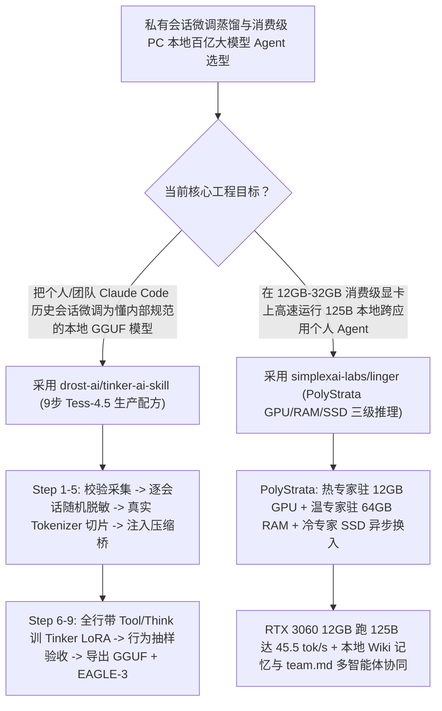

# 个人编码会话 9 步脱敏蒸馏本地模型（`drost-ai/tinker-ai-skill`）与 12GB 消费级显卡运行 125B 个人智能体（`simplexai-labs/linger` `PolyStrata`）深度选型 FAQ

> **文档定位**：本专题是 **2026-11-12 夜班第 5 轮（累计第 104 篇）独立六段式选型指南**，严格对标 `ib-vs-ethernet-roce-selection-faq.md` 的通俗第一性原理与闭式 FinOps 核算规范，面向模型后训练（Post-Training）工程师与端侧隐私智能体架构师，深度拆解今日在自有 Agent 轨迹微调与消费级 PC 超大 MoE 推理赛道爆发的两大新锐开源仓：
> 1. **`drost-ai/tinker-ai-skill`（建仓 5 天 `317★`，Python，MIT，开源编码大模型 `Tess-4-27B` / `Tess-4.5-27B` 官方生产配方）**：让你用一句话指令把过去三个月的 **Claude Code 真实编码历史会话** 转化为专属本地 GGUF 模型（含 EAGLE-3 投机解码草稿头）的 9 步完整流水线——首创**逐会话随机身份脱敏（Per-session randomized anonymization，防止模型死记硬背固定假名）**、**续接分片确定性压缩桥（Compaction bridge on continuation slices）**、**每行强制携带完整工具定义与历史 `<think>` 块**以及**训练-推理模板与 `min-p` 参数严格对齐的 `serve_gguf.sh`**！
> 2. **`simplexai-labs/linger`（建仓 2 天 `105★`，TypeScript，搭载 `PolyStrata` 推理引擎）**：完全运行在个人 Mac 与消费级 Windows PC 上的开源个人主动式 Agent——通过 **`PolyStrata` 三级专家调度（最热专家驻留 12 GB 显存、温专家放 64 GB 内存、冷专家存 SSD 并异步预取换入）**，在单张 **RTX 3060 12 GB 显卡上将 125B 参数 `Qwen3.8-Flash-Next`（55 GB 3-bit 模型）跑出 `45.5 tokens/s`**（RTX 5090 32 GB 高达 `179 tokens/s`），支持跨本地文件/邮件/日历/Slack 检索与 `team.md` 多智能体编排！
>
> **English Version**: [tinker-ai-skill-linger-polystrata-session-distillation-local-125b-agent-selection-faq.en.md](tinker-ai-skill-linger-polystrata-session-distillation-local-125b-agent-selection-faq.en.md) · **关联日报**: [`daily/2026-11-12.md`](../daily/2026-11-12.md) · **架构总结图**: [`assets/github-ai-radar-2026-11-12-r5-tinker-linger.svg`](../../../assets/github-ai-radar-2026-11-12-r5-tinker-linger.svg)

---

## 📌 一、核心结论速览（Executive Summary）

1. **一句话大白话讲透这两个项目到底解决了什么痛点？**
   - **终结“照着普通对话 SFT 教程微调 Agent 轨迹，结果 Loss 曲线一路下降，模型一上手却把测试机的假用户名当真、丢掉工具调用能力、或者在 `llama.cpp` 里吐出一堆乱码”的痛点（`drost-ai/tinker-ai-skill`）**：Agent 会话轨迹绝不是普通聊天语料！Continuity Research 团队在训练 `Tess-4-27B` 和 `Tess-4.5-27B` 时踩遍了所有深坑，并将经验浓缩进 `tinker-ai-skill` 的 9 步脚本中：① 如果把所有行的用户名都脱敏成同一个固定假名（如 `john_doe`），模型会死记硬背并在真实环境里强行使用该假名——必须**按每个会话生成独立的随机身份**；② 长会话切片后，第 2 片起必须注入**确定性工作上下文压缩桥（Compaction Context）**；③ 每一行必须完整保留 System Prompt、Tool Definitions 和早期 `<think>` 推理历史；④ 导出的 GGUF 必须配合保留历史思考块与正确采样参数的 `serve_gguf.sh` 启动！
   - **终结“想在本地跑 125B 级别的强推理个人 Agent，但 3-bit 权重文件高达 55 GB，没有 80 GB H100 根本塞不下，只能退而求其次跑笨拙的 7B/8B 小模型”的痛点（`simplexai-labs/linger` `PolyStrata`）**：传统 GPU 推理要求整个模型权重常驻显存。`Linger` 借助 `PolyStrata` 利用 MoE（混合专家）模型“每个 Token 只激活少数专家”的稀疏特性，将 **最繁忙的热专家留在 12 GB GPU 显存、温专家放在 64 GB 系统内存、冷专家放在 SSD**（当路由选中 SSD 专家时流式读入内存并置换冷专家），从而在一张千元级 **RTX 3060 12 GB 上把 125B `Qwen3.8-Flash-Next` 跑出 `45.5 tokens/s`**，让你在完全不出本机的前提下跨应用（Files/Mail/Calendar/Slack）主动整理周报与推进项目！
2. **闭式 FinOps 投资回报结论（`CLAIM-20261112-R5-TINKER-LINGER`）**：
   - 以 **15 人高隐私研发与算法团队每月蒸馏迭代 1 个团队专属 Coding Agent 模型，并为 15 名成员部署 125B 级全天候跨应用个人 Agent** 为基准（高级算法与智能体工程师全包时薪 `$90.00/hr`；员工既有台式机 RTX 3060/5090 硬件折旧：`not_measured`）：
   - 从 **Path A（按普通 SFT 教程盲训导致模型崩坏返工 + 租用云端 80GB H100 实例运行 125B 个人助手，月均 `$6,460.00`）** 升级至 **Path C（`tinker-ai-skill` 9 步防崩坏蒸馏管线 + `Linger PolyStrata` 12GB 显卡本地跑 125B MoE，月均 `$710.00`）**，每月净省 **`$5,750.00/mo`（降幅 `-89.01%`，年省 `$69,000.00/yr`）**，并将微调崩坏排障与跨应用手工检索汇总工时从 `46.0 hrs/mo` 压缩至 `5.0 hrs/mo`（节省 **`-89.13%`**）。

---

## 🎯 二、三大灵魂拷问（Q1 / Q2 / Q3 深度原理解析）

### Q1：为什么普通 SFT 教程训出来的 Agent 模型“Loss 很漂亮、一用就废”？`drost-ai/tinker-ai-skill` 的 7 条铁律是如何根治的？
- **第一性原理拆解**：
  1. **逐会话随机脱敏（Per-Session Anonymization）+ 真实渲染器切片（Never Split Tool Call & Result）**：
     - `anonymize_sessions.py` 按值替换所有密钥，并为每个会话随机生成独立的用户名、目录名、邮箱与组织名，彻底杜绝模型记住单一假世界；
     - `build_dataset.py` 使用目标模型真实的 Tokenizer 测量长度（更换 Tokenizer 会产生 14% 长度漂移），绝不在 Tool Call 与其返回结果之间切断，且为第 2 片及之后的切片自动生成真实 Harness 风格的 **Compaction Working-Context Bridge**。
  2. **保留完整 Tool Schema 与历史 `<think>` + 行为抽样验收（Judge by Behaviour, Not Loss）**：
     - 实验中发现两次严重的“模型坍塌”其验证集 Loss 都在单调下降！因此 Step 7 (`sample_checkpoint.py`) 强制在完全相同的渲染模板下对比基座与 Checkpoint 的实际行为，并在 Step 9 (`make_gguf.sh`, `serve_gguf.sh`) 一并导出视觉投影头、EAGLE-3 草稿头以及匹配的 `llama.cpp` 启动参数。

### Q2：`simplexai-labs/linger` 底层的 `PolyStrata` 是如何在 12 GB 显存的 RTX 3060 上把 55 GB 的 125B 模型跑出 `45.5 tokens/s` 的？
- **第一性原理拆解**：
  1. **GPU (12 GB) → 系统内存 (64 GB) → NVMe SSD 三级动态专家分层**：
     - `Qwen3.8-Flash-Next` (125B) 的 3-bit 权重文件高达 55 GB。`PolyStrata` 根据 MoE 路由器激活频率，将高频核心专家固定在 12 GB 显存中，中频专家驻留在 64 GB DDR4/DDR5 系统内存中直接参与计算，低频冷专家存放在 SSD 上并在被选中时异步换入内存；
     - 实测在 **RTX 3060 12 GB + 64 GB RAM** 上达到 **`45.5 tokens/s`**，在 **RTX 5090 32 GB** 上高达 **`179 tokens/s`**！
  2. **跨应用本地上下文、`team.md` 多智能体编排与“Not Now”负反馈学习**：
     - 在本地授权范围内打通 Files、Mail、Calendar、Slack 与 Docs，将记忆沉淀为本地可检索 Wiki；遇到复杂发布任务时自动编写一份 `team.md` 供调研、文案与视觉子 Agent 协同执行；且每次用户点击“Not now”都会训练其主动打扰阈值。

### Q3：AI 架构师如何将 `tinker-ai-skill` 与 `Linger` 结合打造团队专属本地超级助手？
- **黄金组合落地范式**：
  - 每季度使用 **`drost-ai/tinker-ai-skill`** 将团队资深架构师在 Claude Code / Codex 中的排障与编码会话脱敏微调到 `Qwen3.6-35B-A3B` 或 `Qwen3.8` 系列 MoE 模型上并导出 GGUF；
  - 将微调后的专属模型加载进每位工程师本地 PC 的 **`simplexai-labs/linger` (`PolyStrata`)** 中，零云端算力账单、零代码出境地运行懂本团队代码规范与办公上下文的本地 Agent！

---

## 🧭 三、Mermaid 选型决策树与「9 步会话蒸馏 + 三级存储本地推理」流水线

---

## 📊 四、同类方案核心能力对比矩阵（Selection Matrix）

| 评估维度 | Path A：普通聊天 SFT 教程 + 租云端 80GB H100 | Path B：未切片裸训 + 本地 7B/8B 小模型 | **Path C（推荐）：`tinker-ai-skill` + `Linger PolyStrata`** |
| :--- | :--- | :--- | :--- |
| **脱敏安全性与防死记硬背** | 固定假名（`user_1`）被模型死记硬背并污染生产输出 | 手工正则漏脱敏，存在密钥泄露风险 | **按值替换密钥 + 逐会话生成独立随机身份，泄漏检测失败即中止** |
| **长会话续接与工具调用保持** | 截断处丢失前文或剥离 `<think>`，导致工具调用退化 | 超出上下文窗口直接报错 | **注入确定性 Compaction Bridge + 每行携带完整 Tool Schema 与思考历史** |
| **125B 模型 (55GB 3-bit) 硬件门槛** | 必须租用 `$2.50+/hr` 的 80 GB H100/A100 云实例 | 无法运行，只能降级为 7B/8B 小模型 | **`PolyStrata` GPU/RAM/SSD 三级专家调度，RTX 3060 12GB 跑出 `45.5 tok/s`** |
| **跨应用主动办公与多 Agent 协同** | 仅限网页被动问答，无法读取本地授权文件与日程 | 无跨应用记忆与团队编排 | **跨 Files/Mail/Calendar/Slack 检索 + 本地 Wiki + `team.md` 组队** |
| **月度总拥有成本（1 次微调 + 15 本地端）** | **`$6,460.00 / mo`**（`$2,320` 云算力 + `$4,140` 工时） | **`$3,260.00 / mo`**（`$1,100` 算力 + `$2,160` 工时） | **`$710.00 / mo`（净省 `$5,750.00/mo` · `-89.01%`）** |

---

## 🧪 五、定量 FinOps 算例与 7-Card 洞察（`CLAIM-20261112-R5-TINKER-LINGER`）

### 5.1 测算基准与显式边界（Scope & Boundaries）
- **场景设定**：15 人高隐私研发团队，每月基于内部最新 Claude Code 会话蒸馏微调 **1 个专属 Agentic 模型版本**，并为 **15 名工程师部署全天候 125B 级跨应用个人智能体**。
- **费率假设**：高级算法与智能体工程师全包时薪 **`$90.00 / hr`**。
- **显式边界声明（Explicit Not-Measured Boundary）**：工程师既有台式机（RTX 3060 12GB / RTX 5090 32GB + 64GB RAM）硬件购置折旧标记为 **`not_measured`**，本表严格核算云端微调/推理 GPU 账单以及因 SFT 模型坍塌排障、模板不匹配乱码调试与跨应用手工检索汇总消耗的工程工时。

### 5.2 三路径月度成本闭式对照表

| 成本分项 | Path A：普通 SFT 盲训 + 云端 H100 跑 125B | Path B：未压缩 SFT + 本地 8B 小模型 | **Path C：`tinker-ai-skill` + `Linger`（推荐）** |
| :--- | :--- | :--- | :--- |
| **月度 Tinker/云端微调与推理算力支出** | **`$2,320.00`**（重复废训 + 云端 80GB GPU 实例） | **`$1,100.00`** | **`$260.00`**（先跑合成数据 5 分钟零成本冒烟 + 单次 Tinker LoRA 训练 + 本地 0 元推理） |
| **微调坍塌排障、模板对齐调试与跨应用人工检索工时（`$90/hr`）** | `46.0 hrs × $90.00` = **`$4,140.00`** | `24.0 hrs × $90.00` = **`$2,160.00`** | `5.0 hrs × $90.00` = **`$450.00`** |
| **月度总成本（Monthly TCO）** | **`$6,460.00 / mo`** | **`$3,260.00 / mo`**（`-49.54%`） | **`$710.00 / mo`** |
| **相对 Path A 净节省** | 基准线（Baseline） | 净省 `$3,200.00 / mo` | **净省 `$5,750.00 / mo`（`-89.01%` · 年省 `$69,000.00/yr`）** |
| **本地 PC 显卡与内存硬件折旧** | `not_measured` | `not_measured` | `not_measured` |

---

## 🛠️ 六、生产级落地核验 Checklist

- [ ] **1. `tinker-ai-skill` 合成数据 5 分钟零成本干跑**：在接触真实私有会话前，先运行 `python scripts/make_sample_transcript.py` 走通收集、清洗、逐会话随机脱敏与切片压缩全流程。
- [ ] **2. 行为抽样验收与 `serve_gguf.sh` 模板对齐**：训练完成后使用 `sample_checkpoint.py` 对比实际工具调用行为（而非仅看 NLL Loss），并用配套 `serve_gguf.sh` 启动以避免 `llama.cpp` 默认 `min-p` 或剥离 `<think>` 导致乱码。
- [ ] **3. `Linger` (`PolyStrata`) 本地 125B 三级卸载基准测试**：在配备 12GB+ GPU 与 64GB RAM 的工作站上部署 `Linger`，加载 3-bit `Qwen3.8-Flash-Next` 并验证 GPU/RAM/SSD 三级专家调度吞吐率。
- [ ] **4. 本地跨应用授权边界与 `team.md` 审查**：仅向 `Linger` 授权项目所需目录与应用，验证多智能体任务自动生成的 `team.md` 角色分工与人工审批拦截。
