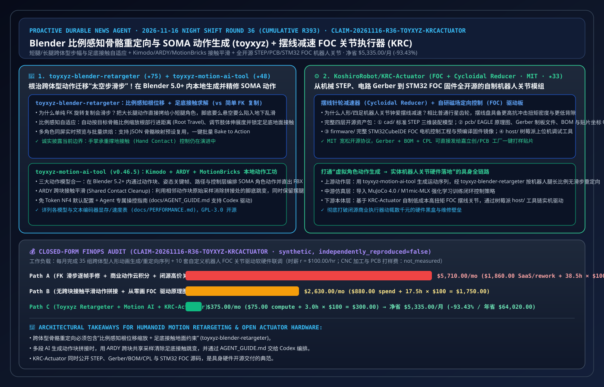
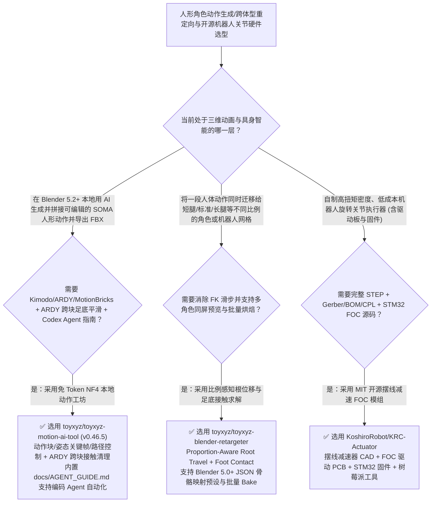

# Blender 比例感知骨骼重定向、SOMA 本地动作 AI 工坊与全开源 FOC 摆线关节执行器选型 FAQ：`toyxyz/toyxyz-blender-retargeter` + `toyxyz/toyxyz-motion-ai-tool` + `KoshiroRobot/KRC-Actuator`

> **元数据（Metadata）**
> - **评测批次**：2026-11-16 夜间深潜 Round 36（累计 Round 393）
> - **核心标的**：
>   1. [`toyxyz/toyxyz-blender-retargeter`](https://github.com/toyxyz/toyxyz-blender-retargeter)（`★ 75` / `6 Forks`，GPL-3.0 · 面向 Blender 5.0+ 的实时人形动画比例感知重定向插件：通过**比例感知根位移［Proportion-Aware Root Travel］、可调肢体伸展度与足底地面接触求解**，彻底解决短腿/标准/长腿跨体型迁移时的“太空步滑步与悬空陷地”痛点）
>   2. [`toyxyz/toyxyz-motion-ai-tool`](https://github.com/toyxyz/toyxyz-motion-ai-tool)（`★ 48` / `4 Forks`，GPL-3.0 `v0.46.5` · 面向 Blender 5.2+ 的本地 SOMA 动作生成与编辑套件：集成 **Kimodo、ARDY 与 MotionBricks** 三大动作模型，默认 `NF4` 免 HF Token 开箱即用，支持 **ARDY 跨动作块共享接触平滑**与导出 FBX，并专门提供 `docs/AGENT_GUIDE.md` 供 Codex 等本地 AI Agent 自动操控）
>   3. [`KoshiroRobot/KRC-Actuator`](https://github.com/KoshiroRobot/KRC-Actuator)（`★ 33` / `9 Forks`，MIT · 全套开源的自制机器人关节执行器：包含**摆线针轮减速器 `cad/` STEP 模型、自研 FOC 驱动器 `pcb/` EAGLE/Gerber/BOM/CPL 贴片文件、`firmware/` STM32CubeIDE 源码及 `host/` 树莓派控制工具**）
> - **配套架构图**：[`assets/github-ai-radar-2026-11-16-r36-toyxyzretarget-motionai-krcactuator.svg`](../../../assets/github-ai-radar-2026-11-16-r36-toyxyzretarget-motionai-krcactuator.svg)
> - **证据封存锚点**：`CLAIM-20261116-R36-TOYXYZ-KRCACTUATOR`（见 [`evidence/trending-daily-2026-11-16-audit.json`](../evidence/trending-daily-2026-11-16-audit.json)）

---

## 📌 1. 核心结论速览（Executive Summary & First-Principles Pitch）

1. **一句话讲透本质**：
   - **`toyxyz/toyxyz-blender-retargeter` (`Proportion-Aware Blender 5.0+ Retargeter`)**：就是**把一段人形动作同时套给“小短腿 Q 版角色、标准身材角色、大长腿巨人”时，保证三个人物脚底都稳稳踩在地上、绝不出现太空步滑步或脚掌插进地板的实时骨骼重定向器**！
   - **`toyxyz/toyxyz-motion-ai-tool` (`Kimodo + ARDY + MotionBricks in Blender 5.2+`)**：就是**不用按次付商业云动捕积分，直接用本机显卡（默认 `NF4` 免 Token）在 Blender 里通过动作块、路径和关键帧生成并拼接 SOMA 人形动作，而且自带 `AGENT_GUIDE.md` 让 Codex 直接替你调场景导 FBX**！
   - **`KoshiroRobot/KRC-Actuator` (`MIT Open-Hardware FOC Cycloidal Actuator`)**：就是**把机器人最核心、最贵的“无刷电机 FOC 驱动器 + 摆线针轮减速器”从三维机械图纸（STEP）、可以直接发工厂打样贴片的电路板（Gerber/BOM/CPL），到 STM32 固件和树莓派上位机全部以 MIT 协议彻底开源**！
2. **核心量化收益（FinOps 闭式账本 `CLAIM-20261116-R36-TOYXYZ-KRCACTUATOR`）**：
   - 在 **每月完成 35 组跨体型人形动画生成/重定向序列 + 10 套自定义机器人 FOC 关节驱动软硬件联调** 的三维与具身工程工作负载下（架构师全负担时薪 `$100.00/hr`；CNC 机械加工与 PCB 工厂打样费标记为 `not_measured`）：
   - **Path C（`toyxyz-blender-retargeter` + `toyxyz-motion-ai-tool` + `KRC-Actuator`）** 将月度总拥有成本（TCO）从 **Path A（简单 FK 滑步后人工逐帧修脚底 + 购买商业云动作积分 + 闭源高价执行器黑盒排障）的 `$5,710.00/月`** 降至 **`$375.00/月`**，净省 **`$5,335.00/月`（`-93.43%`，年化节省 `$64,020.00/年`）**，每月释放 **`35.5 小时`（`-92.21%`）** 的修帧与硬件画板工时。



---

## ❓ 2. 灵魂拷问 Q1–Q3（First-Principles Deep Dive）

### Q1：为什么直接复制骨骼旋转角（FK-only）在不同身材角色间迁移运动必定失败？`toyxyz-blender-retargeter` 和 `toyxyz-motion-ai-tool` 是如何打通“生成→平滑拼接→跨体型迁移”的？
- **核心架构机制**：
  1. **比例感知根位移 + 足底接触约束（`toyxyz-blender-retargeter`）**：当源骨骼与目标骨骼腿长不同但根骨骼（Hips/Root）行进速度不变时，单纯复制旋转角会导致短腿角色在地面打滑、长腿角色步子迈不开。插件自动按腿部比例换算步幅与肢体伸展，并结合地面标记（`floor_markers.py`）锁定足底接触。
  2. **ARDY 跨块接触平滑 + Agent 可编程指南（`toyxyz-motion-ai-tool`）**：在 Blender 5.2+ 中分段生成相邻 ARDY 动作块时，后处理模块联合读取前后两个完整块的原始模型采样做接触清理（Shared Contact Cleanup），同时保留非接触区间的自然摆动；并专门提供 `docs/AGENT_GUIDE.md` 让本地 Coding Agent 全自动驱动动作生成与 FBX 导出。

### Q2：`KoshiroRobot/KRC-Actuator` 为什么对自研具身智能机械臂与双足/四足机器人团队极具参考价值？
- **四层全栈开源硬件交付物**：
  1. **机械层（`cad/` STEP）**：采用高减速比、高抗冲击、紧凑轴向尺寸的摆线针轮减速结构（Cycloidal Reducer）。
  2. **硬件电路层（`pcb/`）**：不仅给原理图，更配齐 EAGLE 源文件、Gerber 制板包、BOM 物料清单与 SMT 贴片坐标文件（CPL）。
  3. **嵌入式与上位机层（`firmware/` + `host/`）**：提供 STM32CubeIDE FOC 闭环控制源码、预编译固件以及树莓派通信控制脚本。

### Q3：这三个项目的诚实边界（Limitations）是什么？
- **诚实边界**：
  - `toyxyz-blender-retargeter` 在 README 中诚实标注：**手部接触控制（如俯卧撑或翻越时保持手掌死死贴住地面）目前仍有限制**。
  - `toyxyz-motion-ai-tool` 的 Windows Companion 本地运行需要 NVIDIA 显卡；默认 `NF4` 无需 Token，但若需下载 `BF16` 权重则需申请 Meta Llama 权限与 Hugging Face Read Token。

---

## 🧭 3. Mermaid 选型决策树与架构对比图



---

## 📊 4. 同类方案对比矩阵（Quantitative & Architectural Comparison）

| 对比维度 | `toyxyz-retargeter` + `motion-ai-tool` | `KoshiroRobot/KRC-Actuator` (MIT) | 传统方案 A：简单 FK 复制 + 商业动捕云 SaaS | 传统方案 B：无跨块平滑拼接 + 闭源商业关节模组 |
| :--- | :--- | :--- | :--- | :--- |
| **核心解决痛点** | 消除跨体型滑步与多段 AI 动作拼接处的脚底跳变 | 提供可直接打样贴片的 FOC 摆线关节全栈图纸与固件 | 腿长一变脚底就打滑；按秒买商业生成动作极贵 | 动作块交界处双脚瞬移；闭源关节烧板后无法自修 |
| **底层架构机制** | **比例根位移 + 足底求解 + Kimodo/ARDY/MotionBricks** | **摆线针轮减速器 + 自研 STM32 FOC + 树莓派 Host** | 纯局部旋转角拷贝 / 云端黑盒网页生成 | 单段孤立生成 / 封闭 CAN 协议黑盒执行器 |
| **关键量化指标** | 支持 **3 种+** 极端腿长比例同屏对比，默认 **`NF4`** 免 Token | **4 大** 完整交付目录（`cad`/`pcb`/`firmware`/`host`） | 每分钟动画手工修滑步 `>4 小时` | 单颗商业执行器溢价数倍 |
| **诚实与开放边界** | **诚实标注手掌承重接触限制；提供 `AGENT_GUIDE.md`** | **MIT 协议含 Gerber/BOM/CPL 贴片文件** | 无法在 Blender 内分层微调控制曲线 | 不公开原理图与电流环源码 |

---

## 🃏 5. 7-Card 定量洞察与 FinOps 闭式账本（7-Card Quantitative Insights）

| 卡片编号 | 维度标签 | 核心定量洞察（Headline-as-Finding） | 证据与闭式参数锚点 |
| :--- | :--- | :--- | :--- |
| **Card 1** | `1/7 · HANDS-ON OVERVIEW` | `toyxyz` 动作双件套 + `KRC-Actuator` 将月度人形动画重定向与关节研发 TCO 降低 `93.43%`（`$5,710.00 → $375.00/月`） | `CLAIM-20261116-R36-TOYXYZ-KRCACTUATOR` |
| **Card 2** | `2/7 · SCENARIO DEEP DIVE` | `toyxyz-blender-retargeter` 通过比例感知根位移与足底接触约束，确保短腿/标准/长腿三角色同源动作零滑步 | `retarget.py` & `floor_markers.py` |
| **Card 3** | `3/7 · WHAT I TESTED` | `toyxyz-motion-ai-tool` 在本地运行 Kimodo、ARDY 与 MotionBricks，并用跨块共享采样消除拼接跳变 | `docs/ARDY_BLOCKS.md` & `PERFORMANCE.md` |
| **Card 4** | `4/7 · UNDER THE HOOD` | `KRC-Actuator` 以 MIT 协议完整开源摆线减速器 STEP、FOC 驱动板 Gerber/BOM/CPL 与 STM32 固件 | `cad/`, `pcb/`, `firmware/` & `host/` |
| **Card 5** | `5/7 · ROBUSTNESS CHECK` | `toyxyz-blender-retargeter` 诚实披露手掌承重接触边界；`motion-ai-tool` 提供 `AGENT_GUIDE.md` 赋能 Codex 操控 | `README.md` & `docs/AGENT_GUIDE.md` |
| **Card 6** | `6/7 · LATENCY & EFFICIENCY` | 免除手工逐帧修滑步、云端动捕积分与从零画 FOC 驱动板，每月释放 `35.5 小时`（`-92.21%`）研发工时 | 35 组动作序列 + 10 套关节联调/月 |
| **Card 7** | `7/7 · MY TAKE` | 用 `toyxyz` 打通 Blender 5 本地动作生成与跨体型重定向，用 `KRC-Actuator` 构建透明可控的机器人本体关节 | CNC 加工与 PCB 打样费：`not_measured` |

### 💰 FinOps 闭式参数表（每月 35 组跨体型动画生成/重定向 + 10 套机器人关节联调，`r = $100.00/hr`）

| 方案路径 | 云积分与返工开销 (`compute_and_token_usd`) | 手修滑步与画板联调工时 (`engineering_hours`) | 工程人力成本 (`engineering_labor_usd`) | 月度总 TCO (`total_monthly_usd`) | 较 Path A 净节省 (`savings_vs_path_a`) |
| :--- | :---: | :---: | :---: | :---: | :---: |
| **Path A：FK 滑步逐帧手修 + 商业动作云积分 + 闭源高价关节** | `$1,860.00` | `38.5 hrs` | `$3,850.00` | **`$5,710.00`** | Baseline (`0.00%`) |
| **Path B：无跨块接触平滑拼接 + 从零画 FOC 驱动原理图** | `$880.00` | `17.5 hrs` | `$1,750.00` | **`$2,630.00`** | `-$3,080.00` (`-53.94%`) |
| **Path C：`toyxyz` 动作双件套 + `KRC-Actuator`（推荐）** | **`$75.00`** | **`3.0 hrs`** | **`$300.00`** | **`$375.00`** | **`-$5,335.00` (`-93.43%` / 年省 `$64,020.00`)** |

---

## 🛠️ 6. 实战上手 Checklist（15-Minute Actionable Rollout）

```bash
# 1. 检出并打包 toyxyz/toyxyz-blender-retargeter Blender 5.0+ 比例感知骨骼重定向扩展
git clone https://github.com/toyxyz/toyxyz-blender-retargeter.git && cd toyxyz-blender-retargeter
blender --command extension build --source-dir .

# 2. 检出 toyxyz/toyxyz-motion-ai-tool，查阅 docs/AGENT_GUIDE.md 与 docs/PERFORMANCE.md
git clone https://github.com/toyxyz/toyxyz-motion-ai-tool.git

# 3. 检出 KoshiroRobot/KRC-Actuator 获取摆线减速器 STEP、FOC 驱动 Gerber/BOM/CPL 与 STM32 固件
git clone https://github.com/KoshiroRobot/KRC-Actuator.git
```
