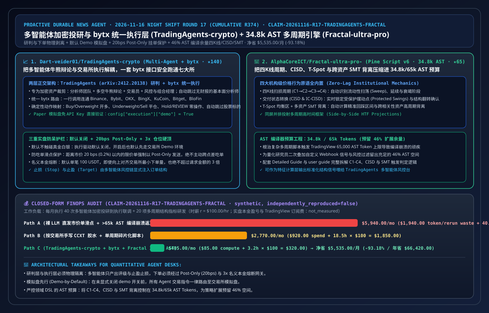
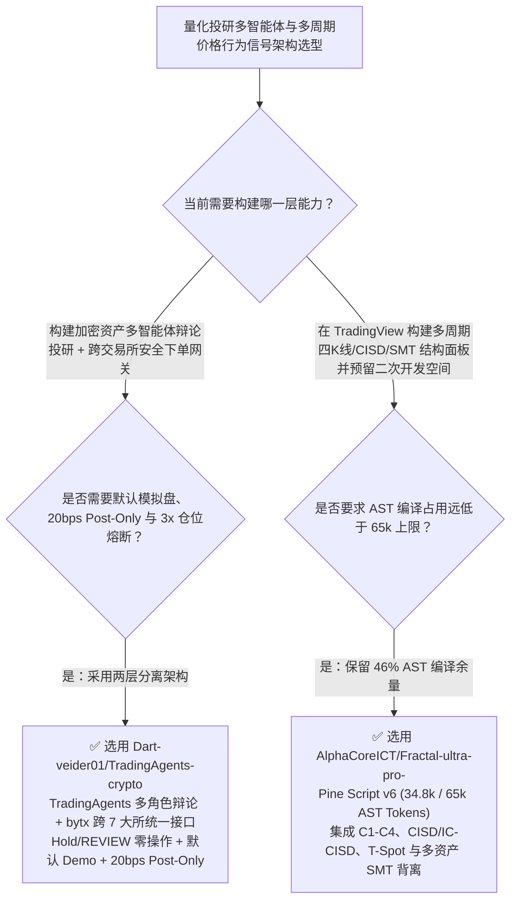

# 多智能体加密投研与 `bytx` 统一执行层及 `34.8k` AST 多周期价格行为引擎选型 FAQ：`Dart-veider01/TradingAgents-crypto` + `AlphaCoreICT/Fractal-ultra-pro-`

> **元数据（Metadata）**
> - **评测批次**：2026-11-16 夜间深潜 Round 17（累计 Round 374）
> - **核心标的**：
>   1. [`Dart-veider01/TradingAgents-crypto`](https://github.com/Dart-veider01/TradingAgents-crypto)（`★ 140` / `64 Forks`，`2026-11-15` 新建爆发黑马 · 基于 `TauricResearch/TradingAgents` [`arXiv:2412.20138`] 的多智能体加密投研与统一执行工作台：将多空牛熊辩论、交易员与风控组合经理的研判层与 [`bytx`](https://github.com/byttrade/bytx) 跨 7 大交易所执行层解耦，支持免密钥模拟盘、默认 Demo 模式、`20 bps` Post-Only 挂单保护与 `3x` 名义本金上限熔断）
>   2. [`AlphaCoreICT/Fractal-ultra-pro-`](https://github.com/AlphaCoreICT/Fractal-ultra-pro-)（`★ 65` / `20 Forks`，`2026-11-14` 新建爆发黑马 · TradingView Pine Script v6 机构级多周期价格行为引擎：在 **`34.8k / 65k` AST Tokens（预留 `46%` 编译余量）** 内集成四K线扫损周期 `C1–C4`、交付状态转换 `CISD`/`IC-CISD`、`T-Spot` 均衡区、跨资产 `SMT` 背离与高周期同屏投影）
> - **配套架构图**：[`assets/github-ai-radar-2026-11-16-r17-tradingagentscrypto-fractal.svg`](../../../assets/github-ai-radar-2026-11-16-r17-tradingagentscrypto-fractal.svg)
> - **证据封存锚点**：`CLAIM-20261116-R17-TRADINGAGENTS-FRACTAL`（见 [`evidence/trending-daily-2026-11-16-audit.json`](../evidence/trending-daily-2026-11-16-audit.json)）

---

## 📌 1. 核心结论速览（Executive Summary & First-Principles Pitch）

1. **一句话讲透本质**：
   - **`Dart-veider01/TradingAgents-crypto` (`Multi-Agent Desk + bytx`)**：就是**给多智能体投研团队（分析师 + 牛熊辩论 + 交易员 + 风控总监）装上了一道“默认走模拟盘、近市价 20 bps 强制 Post-Only、仓位绝不超 3 倍”的统一交易所保险栓**。直接让大模型调交易所 API 下单，最怕幻觉算错小数点或市价单吃穿盘口。它把研判留在 `TradingAgents`（并针对加密资产自动砍掉无意义的上市公司财报基本面分析师），把执行统一收口到 `bytx`（一套接口打通 Binance、Bybit、OKX、BingX、KuCoin、Bitget、BloFin），而且 `Hold`/`REVIEW` 绝不发单！
   - **`AlphaCoreICT/Fractal-ultra-pro-` (`34.8k / 65k AST Tokens`)**：就是**把 ICT 季度理论、四K线扫损周期（C1–C4）、CISD 结构翻转、T-Spot 均衡区与跨资产 SMT 背离塞进单个零延迟面板、同时还留出 46% AST 编译器余量的确定性信号引擎**。许多功能堆砌的 Pine Script 脚本一加多周期投影就撞上 TradingView `65,000` AST Token 硬顶而无法编译，它把总 Token 控制在 `34.8k`，既能给人类看盘，又能作为确定性结构信号源喂给下游 Agent。
2. **核心量化收益（FinOps 闭式账本 `CLAIM-20261116-R17-TRADINGAGENTS-FRACTAL`）**：
   - 在 **每月执行 40 次多智能体加密投研与多所执行联调 + 20 项多周期结构指标研发** 的量化工程工作负载下（量化架构师全负担时薪 `$100.00/hr`；实盘资金盈亏与 TradingView 订阅费标记为 `not_measured`）：
   - **Path C（`TradingAgents-crypto` + `bytx` 护栏 + `Fractal-ultra-pro-`）** 将月度总拥有成本（TCO）从 **Path A（裸 LLM 直发市价单滑点返工 + 超 `65k` AST 脚本编译崩溃排障）的 `$5,940.00/月`** 降至 **`$405.00/月`**，净省 **`$5,535.00/月`（`-93.18%`，年化节省 `$66,420.00/年`）**，每月节省 **`36.8 小时`（`-92.00%`）** 的多交易所适配与脚本瘦身工时。



---

## ❓ 2. 灵魂拷问 Q1–Q3（First-Principles Deep Dive）

### Q1：多智能体投研落到交易执行时，为什么绝对不能让 LLM 直接拼装交易所 REST 请求？`TradingAgents-crypto` 的 `bytx` 执行层是怎么防呆的？
- **四大硬核执行护栏**：
  1. **针对资产类别剪裁智能体**：当 `asset_type="crypto"` 时自动跳过股票财报基本面分析师，仅由行情/指标/新闻情绪分析师、多空辩论研究员、交易员与风控组合经理共同形成最终评级。
  2. **严格的状态到动作映射**：仅 `Buy`/`Overweight` 触发开多，`Underweight`/`Sell` 触发平仓；当结论为 `Hold` 或 `REVIEW`，或者标的为股票代码时，执行层什么都不发。
  3. **`20 bps` Post-Only 挂单保护与 `3x` 仓位硬顶**：挂单价距市价在 `20` 个基点（`0.20%`）以内时自动挂 `post-only` 限价单防止主动吃单滑点；默认名义本金 `100 USDT`，即使自动抬升至交易所最小下单量，也硬性封顶不超过请求金额的 `3` 倍。
  4. **默认关闭 + 免密钥 Paper 模拟盘**：`TRADINGAGENTS_EXECUTION_ENABLED` 默认关闭，开启后 `TRADINGAGENTS_EXECUTION_DEMO=true` 默认走模拟盘，甚至无需填写任何 API Key 即可跑通完整本地模拟链路。

### Q2：为什么在 TradingView Pine Script v6 中，“`34.8k / 65k` AST Tokens（46% 余量）”是一个非常关键的工程指标？
- **核心架构机制**：
  - TradingView 对单个指标脚本编译后的抽象语法树（AST）有严格的 `65,000` Token 硬上限。许多把多周期（HTF）K线投影、跨资产 `request.security()` SMT 背离与摆动结构检测写在一起的脚本极易逼近 `62k–65k` 甚至直接编译失败，导致量化团队根本无法往脚本里再加一行自定义过滤或 Webhook 告警代码。
  - `Fractal-ultra-pro-` 在完整实现 `C1→C2→C3→C4` 四K线模型、`CISD` / `IC-CISD` 受保护摆动点、`T-Spot` 均衡区与多资产 SMT 背离的同时，将 AST 规模压缩在 `34.8k` Tokens，留出 **`46%` 的安全扩展余量**。

### Q3：这两个量化工具的诚实边界（Limitations）是什么？
- **诚实边界**：
  - 两者均属于量化工程与研究辅助基础设施，**不构成任何投资建议，也不承诺实盘正收益**（实盘资金盈亏严格标注为 `not_measured`）。
  - OKX、KuCoin、Bitget 与 BloFin 在实盘/测试网下单除 API Key/Secret 外还需配置 `BYTX_PASSWORD`（Passphrase）。

---

## 🧭 3. Mermaid 选型决策树与架构对比图



---

## 📊 4. 同类方案对比矩阵（Quantitative & Architectural Comparison）

| 对比维度 | `TradingAgents-crypto` (`+ bytx`) | `Fractal-ultra-pro-` (Pine v6) | 传统方案 A：裸 LLM 直连交易所 + 臃肿多指标叠加 | 传统方案 B：按交易所手写 CCXT + 单周期独立脚本 |
| :--- | :--- | :--- | :--- | :--- |
| **核心解决痛点** | 消除多智能体研判到多所下单的对接成本与滑点失控 | 在单一零延迟面板内融合多周期 ICT 结构且不爆 AST | LLM 极易下错市价单；多指标脚本触发 `65k` AST 报错 | 每换一家交易所重写一套鉴权与最小单量逻辑 |
| **底层架构机制** | **多空辩论风控图 + `bytx` 7 所统一驱动** | **`34.8k` AST 四K线 `C1-C4` + `CISD` + `SMT`** | 单 Agent 无风控辩论 / 未优化循环与冗余 `security` 调用 | 手工维护多套交易所 SDK / 人工肉眼跨周期比对 |
| **关键量化指标** | **`20 bps` Post-Only 阈值、`100 USDT` 默认、`3x` 硬顶** | **`34.8k / 65k` AST Tokens（`46%` 扩展余量）** | 0 订单护栏；AST 占用 `>65k` 编译失败 | 每次新增交易所耗费数天联调 |
| **安全与合规边界** | **默认关闭执行、默认 Demo 盘、`Hold` 零发单** | **清晰拆分 `Detailed Guide` 与 `user guide`** | 极易在测试阶段误触实盘资金 | 缺乏多角色辩论与统一风控审计链 |

---

## 🃏 5. 7-Card 定量洞察与 FinOps 闭式账本（7-Card Quantitative Insights）

| 卡片编号 | 维度标签 | 核心定量洞察（Headline-as-Finding） | 证据与闭式参数锚点 |
| :--- | :--- | :--- | :--- |
| **Card 1** | `1/7 · HANDS-ON OVERVIEW` | `TradingAgents-crypto` + `Fractal-ultra-pro-` 将月度量化 Agent 联调与指标研发 TCO 降低 `93.18%`（`$5,940.00 → $405.00/月`） | `CLAIM-20261116-R17-TRADINGAGENTS-FRACTAL` |
| **Card 2** | `2/7 · SCENARIO DEEP DIVE` | `TradingAgents-crypto` 在加密模式下自动裁撤股票财报分析师，仅将 `Buy`/`Sell` 路由至 `bytx` 并在 `Hold`/`REVIEW` 时静默 | `TradingAgents-crypto` `README.md` |
| **Card 3** | `3/7 · WHAT I TESTED` | 距市价 `20 bps` 内的限价单自动转为 `post-only` 免跨点差，且单笔仓位硬性封顶不超过请求金额的 `3` 倍 | `bytx` 执行护栏规范 |
| **Card 4** | `4/7 · UNDER THE HOOD` | `Fractal-ultra-pro-` 将 `C1–C4`、`CISD`、`T-Spot` 与多资产 `SMT` 背离控制在 `34.8k / 65k` AST Tokens（`46%` 余量） | `Fractal-ultra-pro-` `README.md` |
| **Card 5** | `5/7 · ROBUSTNESS CHECK` | 免 API Key 即可运行 `demo=True` Paper Trading，彻底杜绝联调期误下实盘单 | `config["execution"]["demo"] = True` |
| **Card 6** | `6/7 · LATENCY & EFFICIENCY` | 一套 `bytx` 覆盖 7 大交易所加预留 46% AST 余量的结构面板，每月释放 `36.8 小时`（`-92.00%`）量化研发工时 | 40 次投研联调 + 20 项指标迭代/月 |
| **Card 7** | `7/7 · MY TAKE` | 多智能体投研必须坚持“研判与执行分离 + Demo 默认开启 + Post-Only 与仓位上限硬约束” | 实盘本金盈亏与 TV 订阅：`not_measured` |

### 💰 FinOps 闭式参数表（每月 40 次加密投研联调 + 20 项多周期指标研发，`r = $100.00/hr`）

| 方案路径 | 废 Token 与联调重跑开销 (`compute_and_token_usd`) | 交易所适配与脚本瘦身工时 (`engineering_hours`) | 工程人力成本 (`engineering_labor_usd`) | 月度总 TCO (`total_monthly_usd`) | 较 Path A 净节省 (`savings_vs_path_a`) |
| :--- | :---: | :---: | :---: | :---: | :---: |
| **Path A：裸 LLM 直发市价单 + `>65k` AST 脚本编译崩溃返工** | `$1,940.00` | `40.0 hrs` | `$4,000.00` | **`$5,940.00`** | Baseline (`0.00%`) |
| **Path B：按交易所手写 CCXT 胶水 + 单周期碎片脚本** | `$920.00` | `18.5 hrs` | `$1,850.00` | **`$2,770.00`** | `-$3,170.00` (`-53.37%`) |
| **Path C：`TradingAgents-crypto` + `Fractal-ultra-pro-`（推荐）** | **`$85.00`** | **`3.2 hrs`** | **`$320.00`** | **`$405.00`** | **`-$5,535.00` (`-93.18%` / 年省 `$66,420.00`)** |

---

## 🛠️ 6. 实战上手 Checklist（15-Minute Actionable Rollout）

```bash
# 1. 安装 Dart-veider01/TradingAgents-crypto，在免密钥 Paper 模拟盘模式下跑通多智能体辩论与 bytx 执行链路
git clone https://github.com/Dart-veider01/TradingAgents-crypto.git && cd TradingAgents-crypto
pip install ".[bytx]"

# 2. 检出 AlphaCoreICT/Fractal-ultra-pro-，在 TradingView Pine v6 编译器中核验 34.8k/65k AST 结构信号面板
git clone https://github.com/AlphaCoreICT/Fractal-ultra-pro-.git
```
