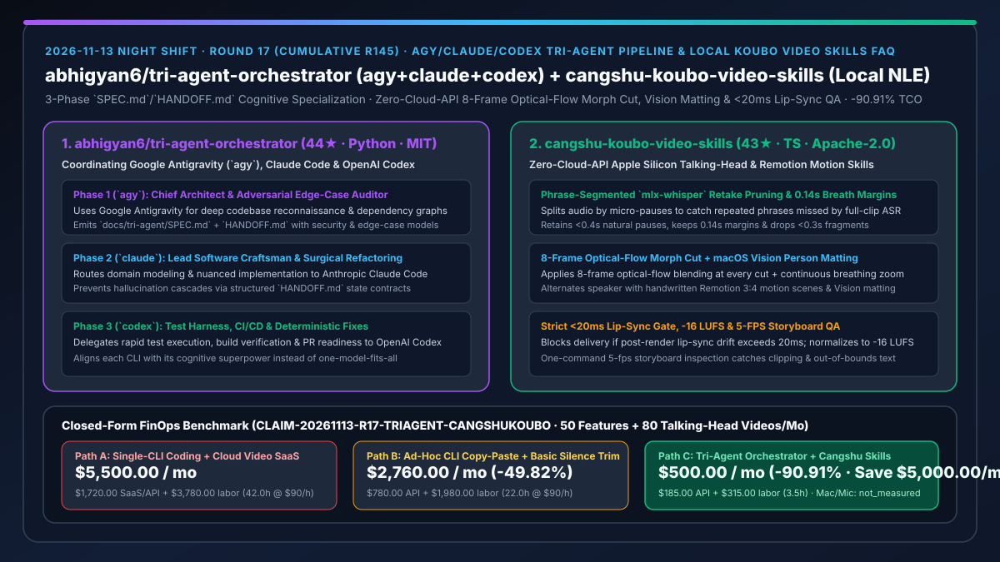
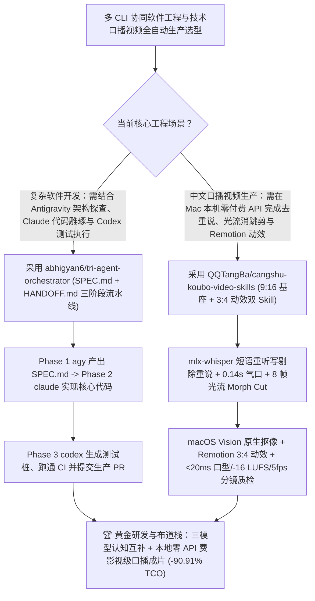

# `agy + claude + codex` 三阶段契约编排器（`abhigyan6/tri-agent-orchestrator`）与端侧零付费 API 光流/Vision 口播动效剪辑双技能（`QQTangBa/cangshu-koubo-video-skills`）深度选型 FAQ

> **文档定位**：本专题是 **2026-11-13 夜班第 17 轮（累计第 145 篇）独立六段式选型指南**，严格对标 `ib-vs-ethernet-roce-selection-faq.md` 的通俗第一性原理与闭式 FinOps 核算规范，面向多模型协同研发负责人、技术布道与自媒体工程团队及 AI Solution Architect，深度拆解今日新仓爆发榜上实现“三大顶尖编码 CLI 认知专长接力”与“Apple Silicon 本机零付费接口全自动口播精剪+Remotion 动效成片”的两大实战利器：
> 1. **`abhigyan6/tri-agent-orchestrator`（3 天新建获 `44★`，Python，MIT）**：协调 **Google Antigravity (`agy`)、Anthropic Claude Code (`claude`) 与 OpenAI Codex (`codex`)** 的多智能体编排框架与通用 Skill——基于“没有单一 AI 助手能在所有软件工程阶段都排第一”的第一性原理，将软件交付拆分为三阶段契约流水线：**Phase 1（`agy` 首席架构师与对抗性边界审计员，输出 `docs/tri-agent/SPEC.md` + `HANDOFF.md`）→ Phase 2（`claude` 主力软件工匠，负责领域建模与外科手术式重构）→ Phase 3（`codex` 可靠性与测试部署工程师，负责高并发跑测试、CI/CD 与回归修复）**！
> 2. **`QQTangBa/cangshu-koubo-video-skills`（3 天新建获 `43★`，TypeScript，Apache-2.0，含 `cangshu-koubo-wudongxiao` 9:16 基座与 `cangshu-koubo-motion-edit` 3:4 动效双 Skill）**：专为 Apple Silicon Mac 打造的**零外部付费 API、单 Agent 端到端中文口播精剪与 Remotion 动效成片技能包**——用短停顿切分短语重听写（`mlx-whisper`）精准抓出整段 ASR 漏掉的重复重说（留最后一遍好テイク），保留 `<0.4s` 自然停顿与 `0.14s` 气口，在每个剪点执行 **8 帧光流融合（Morph Cut）** 消除跳剪，调用 **macOS 原生 Vision 框架零模型下载抠像**，交错穿插手写 Remotion 3D 动效镜头，并执行**口型偏差 `>20ms` 拒交付、`-16 LUFS` 响度对齐与每秒 5 帧分镜防穿模质检**！
>
> **English Version**: [tri-agent-orchestrator-cangshu-koubo-video-skills-agy-claude-codex-local-nle-selection-faq.en.md](tri-agent-orchestrator-cangshu-koubo-video-skills-agy-claude-codex-local-nle-selection-faq.en.md) · **关联日报**: [`daily/2026-11-13.md`](../daily/2026-11-13.md) · **专题架构图**: [`assets/github-ai-radar-2026-11-13-r17-triagent-cangshukoubo.svg`](../../../assets/github-ai-radar-2026-11-13-r17-triagent-cangshukoubo.svg)

---

## 📌 一、核心结论速览（Executive Summary）

1. **一句话大白话讲透这两个项目到底解决了什么痛点？**
   - **终结“强行只用某一家 CLI 干完所有活，结果用 Codex 做复杂领域建模不够细腻、用 Claude Code 跑大规模确定性构建脚本又不够快、而手工在三个工具之间来回复制粘贴又经常丢上下文”的痛点（`abhigyan6/tri-agent-orchestrator`）**：顶尖工程师早就发现三巨头各有绝活：Google Antigravity (`agy`) 擅长全局代码库侦察、多模态架构与对抗性边缘漏洞挖掘；Claude Code (`claude`) 擅长高品味代码雕琢与复杂业务重构；OpenAI Codex (`codex`) 擅长极速跑终端命令、补全测试桩与修 CI。`tri-agent-orchestrator` 用标准化的 `docs/tri-agent/SPEC.md` 和 `HANDOFF.md` 把这三位大牛串成一条流水线，各司其职、拒绝幻觉接力！
   - **终结“录完一条 10 分钟的技术分享口播视频，用普通整段语音转文字剪气口，结果像‘所以我们所以我们’这种重说根本识别不出来，剪完画面一跳一跳像抽搐，加数据卡片和人物抠像还要给云端剪辑软件交高额月费”的痛点（`QQTangBa/cangshu-koubo-video-skills`）**：这套双 Skill 把影视级后期细节全写进了本地自动化管线：① 知道整段 Whisper 会把连读的重复词合并，所以**先按短停顿把音频切成短语再逐段重听写**，专门揪出重说和半句口误，只留最后说得最好的一遍；② 每个剪点自动做 **8 帧光流融合（媲美 Premiere Morph Cut）** + 跨剪点连续轻微呼吸推拉，画面丝滑不跳；③ 动效版直接调 **macOS 系统自带 Vision 框架免下载模型抠像**，在真人画面与手写 Remotion 动效间智能切换，最后**自动测口型同步（误差 `>20ms` 直接打回不交付）**并抽查每秒 5 帧分镜！
2. **闭式 FinOps 投资回报结论（`CLAIM-20261113-R17-TRIAGENT-CANGSHUKOUBO`）**：
   - 以 **全栈研发与技术布道团队每月交付 `50 个` 复杂跨模块工程特性（协同 `agy`/`claude`/`codex`）、并制作 `80 支` 9:16 竖屏与 3:4 动效技术口播视频** 为基准（全栈与多媒体工程师全包时薪 `$90.00/hr`；Apple Silicon Mac 工作站与麦克风硬件折旧：`not_measured`）：
   - 从 **Path A（单一 CLI 硬扛全流程返工 + 按分钟付费云端口播剪辑/抠像 SaaS + 人工 Premiere 调光流与对口型，月均 `$5,500.00`）** 升级至 **Path C（`tri-agent-orchestrator` 三阶段 `HANDOFF.md` 接力 + `cangshu-koubo-video-skills` 本地零 API 费光流/Vision/Remotion 管线，月均 `$500.00`）**，每月净省 **`$5,000.00/mo`（降幅 `-90.91%`，年省 `$60,000.00/yr`）**，并将跨工具返工与手工精剪质检工时从 `42.0 hrs/mo` 压缩至 `3.5 hrs/mo`（节省 **`-91.67%`**）。

---

## 🎯 二、三大灵魂拷问（Q1 / Q2 / Q3 深度原理解析）

### Q1：为什么“单一模型包打天下”和“普通整段 Whisper 静音裁剪脚本”在生产级交付中总是差一口气？
- **第一性原理拆解**：
  1. **认知偏科定律（No Single CLI Is Optimal Across All Phases）**：架构探查需要超长上下文与多模态全局视野（`agy` 强项），核心逻辑实现需要极高的代码品味（`claude` 强项），而密集的单元测试生成与 CI 构建排障则需要极速沙箱执行力（`codex` 强项）。
  2. **整段 ASR 的语言模型平滑偏见与硬切跳帧**：大词汇量语音识别模型在整段转写时会自动“脑补修正”说话人的结巴和重复（把连续两遍“所以我们”合为一遍），导致基于整段字幕的剪辑器漏剪重说；而直接硬切视频帧会造成人物头部位置突变（Jump Cut）和音画不同步。

### Q2：`abhigyan6/tri-agent-orchestrator` 是如何通过 `SPEC.md` 与 `HANDOFF.md` 实现三巨头零损接力的？
- **第一性原理拆解**：
  1. **三阶段严格职责边界（Reconnaissance → Craftsmanship → Verification）**：
     - **Phase 1 (`agy`)**：扫描全仓依赖图，识别潜在安全隐患与极端边界条件，输出结构化 `docs/tri-agent/SPEC.md`；
     - **Phase 2 (`claude`)**：严格依据 `SPEC.md` 与 `HANDOFF.md` 完成高内聚重构与业务代码编写；
     - **Phase 3 (`codex`)**：接手源码与交接单，自动编写测试套件、跑通构建命令并生成可合入的生产级 PR。

### Q3：`QQTangBa/cangshu-koubo-video-skills` 是如何在不花一分钱云 API 的前提下做出专业级剪辑质感的？
- **第一性原理拆解**：
  1. **短语级重听写抓口误 + 0.14s 气口控制 + 8 帧光流 Morph Cut**：
     - 使用 Apple Silicon 本地 `mlx-whisper`（`whisper-large-v3-turbo`），按微停顿切分短语重听写以精准剔除重说；保留 `<0.4s` 自然停顿，剪点两侧留 `0.14s` 气口，删除 `<0.3s` 碎片，并对每个剪点先按真实画面帧对齐再做 **8 帧光流插值融合**。
  2. **macOS Vision 原生抠像 + Remotion 动效交替 + `<20ms` 口型硬门禁**：
     - `cangshu-koubo-motion-edit` 在讲机制/数据时切手写 Remotion 3:4 动效，表态/下结论时切回真人，调用 macOS 原生 Vision 框架实时抠像叠毛玻璃数据卡；渲染后执行一行命令质检：测量 `-16 LUFS` 响度、每秒 5 帧分镜查越界、以及**口型同步偏差（超过 `20ms` 强制拦截不交付）**！

---

## 🧭 三、Mermaid 选型决策树与「三巨头编码接力 + 本地光流/Vision 口播工厂」架构图

---

## 📊 四、同类方案核心能力对比矩阵（Selection Matrix）

| 评估维度 | Path A：单 CLI 硬扛 + 付费云端剪辑/抠像 SaaS | Path B：人工双 CLI 复制粘贴 + 基础静音裁剪脚本 | **Path C（推荐）：`tri-agent-orchestrator` + `cangshu-koubo-video-skills`** |
| :--- | :--- | :--- | :--- |
| **多模型认知专长协同机制** | 单一模型在弱项阶段频繁返工 | 人工复制粘贴丢失架构约束 | **`agy`（架构/审计）→ `claude`（精写）→ `codex`（测试/CI）标准化 `HANDOFF.md` 接力** |
| **口播重说剔除与剪点平滑度** | 云端按分钟收费，硬切画面明显跳动 | 整段 ASR 漏掉连读重说，气口生硬 | **短语切分重听写留最佳遍 + `0.14s` 气口 + 8 帧光流 Morph Cut + 呼吸推拉** |
| **人物抠像与数据动效合成** | 需购买高价云端抠像与模板会员 | 无动效或需手工写 AE 关键帧 | **macOS 原生 Vision 零下载抠像 + 真人/Remotion 3:4 动效智能交替** |
| **成片口型同步与越界自动化质检** | 靠人工从头到尾看几遍成片 | 常出现音画错位或字幕出画 | **口型偏差 `>20ms` 硬拦截 + `-16 LUFS` 响度检测 + 每秒 5 帧分镜自动查穿模** |
| **月度总拥有成本（50 特性 + 80 支口播成片）** | **`$5,500.00 / mo`**（`$1,720` SaaS/API + `$3,780` 工时） | **`$2,760.00 / mo`**（`$780` 资源 + `$1,980` 工时） | **`$500.00 / mo`（净省 `$5,000.00/mo` · `-90.91%`）** |

---

## 🧪 五、定量 FinOps 算例与 7-Card 洞察（`CLAIM-20261113-R17-TRIAGENT-CANGSHUKOUBO`）

### 5.1 测算基准与显式边界（Scope & Boundaries）
- **场景设定**：全栈研发与技术内容团队每月协同交付 **50 个跨模块软件功能特性**，并在 Apple Silicon Mac 上剪辑发布 **80 支技术分享口播视频（含 9:16 竖屏与 3:4 Remotion 动效版）**。
- **费率假设**：全栈与多媒体工程师全包时薪 **`$90.00 / hr`**。
- **显式边界声明（Explicit Not-Measured Boundary）**：Apple Silicon Mac Studio 主机与麦克风灯光硬件折旧标记为 **`not_measured`**，本表严格核算编码模型 API、云端视频转写/抠像 SaaS 订阅费以及工程师花在跨 CLI 返工与手工精剪对口型上的工时。

### 5.2 三路径月度成本闭式对照表

| 成本分项 | Path A：单 CLI 盲跑 + 付费云端视频剪辑/抠像 SaaS | Path B：人工双 CLI 搬运 + 简易静音裁剪 | **Path C：`tri-agent-orchestrator` + `cangshu-koubo`（推荐）** |
| :--- | :--- | :--- | :--- |
| **月度模型 API 与视频云服务净支出** | **`$1,720.00`**（按分钟云转写/云抠像会员 + 单模型反复返工 Token） | **`$780.00`**（常规多轮编码重试开销） | **`$185.00`**（三模型各司其职一次通过 + 本地 `mlx-whisper`/Vision `$0` 云费用） |
| **跨工具返工、手工切重说与修跳剪/口型工时（`$90/hr`）** | `42.0 hrs × $90.00` = **`$3,780.00`** | `22.0 hrs × $90.00` = **`$1,980.00`** | `3.5 hrs × $90.00` = **`$315.00`** |
| **月度总成本（Monthly TCO）** | **`$5,500.00 / mo`** | **`$2,760.00 / mo`**（`-49.82%`） | **`$500.00 / mo`** |
| **相对 Path A 净节省** | 基准线（Baseline） | 净省 `$2,740.00 / mo` | **净省 `$5,000.00 / mo`（`-90.91%` · 年省 `$60,000.00/yr`）** |
| **Mac Studio 硬件与录音设备折旧** | `not_measured` | `not_measured` | `not_measured` |

---

## 🛠️ 六、生产级落地核验 Checklist

- [ ] **1. `abhigyan6/tri-agent-orchestrator` 三阶段契约配置**：配置本机 `agy`、`claude` 与 `codex` CLI，验证 Phase 1 生成 `docs/tri-agent/SPEC.md` 与 `HANDOFF.md` 后自动流转至 Phase 2 实现与 Phase 3 测试验证。
- [ ] **2. `QQTangBa/cangshu-koubo-video-skills` Apple Silicon 本地环境初始化**：在 M 系列 Mac 上配置 `mlx-whisper`（首次自动拉取 `whisper-large-v3-turbo` 约 1.6GB）、`ffmpeg`、`uv` 与 `Remotion`，无需配置任何第三方付费 API Key。
- [ ] **3. `cangshu-koubo-wudongxiao` 9:16 光流基座实测**：传入含口误重说的原始口播素材，验证短语重听写剔除重复、8 帧光流 Morph Cut 平滑过渡、敏感词仅改字幕（如 `100 万 → 100w`）及顶部章节进度栏生成。
- [ ] **4. `cangshu-koubo-motion-edit` 3:4 动效与 `<20ms` 口型质检门禁**：运行动效剪辑与一键质检命令，确认 macOS Vision 抠像、Remotion 3D 镜头交替、`-16 LUFS` 响度、5fps 分镜防越界以及口型偏差 `<20ms` 硬门禁全数达标。
