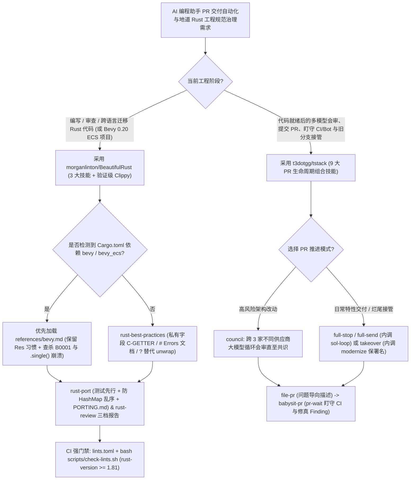

# PR 全生命周期自治技能栈（`t3dotgg/tstack` 三模型议会与 CI 盯梢）与地道 Rust 五典蒸馏技能集（`morganlinton/BeautifulRust`）选型 FAQ

> **文档定位**：本文是 **2026-11-11 夜班多轮深潜 Round 34（累计第 79 篇独立选型专题）**，严格对标 `ib-vs-ethernet-roce-selection-faq.md` 的「通俗大白话 + 第一性原理 + 可核算定量算例」标杆文风，为 AI 原生研发流程（PR 自治闭环）与 Rust 系统级工程架构师深度拆解今日两款高星（合计超 `5,200★`）Agent Skills 标杆：
> 1. **`t3dotgg/tstack`（`3,479★`，Python，MIT，Theo / T3 出品）**：覆盖 PR 全生命周期的 9 大组合式 Agent 技能——通过 `full-send` / `full-stop` 串联 **`sol-loop`（与 GPT Sol 循环互审至达成共识）**、**`council`（跨三家不同供应商模型循环会审）**、**`file-pr`（问题导向精简 PR）**、**`babysit-pr`（`pr-wait` 盯守 CI 与评论 Bot 并自动修真问题）**，以及保留原作者署名的 **`takeover` + `modernize`**；
> 2. **`morganlinton/BeautifulRust`（`1,792★`，Python/Rust，MIT）**：蒸馏自 **Google、Rust 官方 API Guidelines、Effective Rust、Rust Design Patterns 与微软 Pragmatic Rust 五大权威指南**的三位一体技能包（`rust-best-practices`、`rust-review`、`rust-port`）与经故意违规 Crate 实测验证的 **`lints/` Clippy 强门禁**——在评测中将地道性得分从 `24/30` 提升至 **`29/30`**，并内置针对 **Bevy 0.20 ECS** 的专项反模式防护（`B0001` 双可变查询崩溃与 `.single().unwrap()`）。
>
> **English Companion**: [tstack-beautifulrust-pr-lifecycle-idiomatic-rust-skills-selection-faq.en.md](tstack-beautifulrust-pr-lifecycle-idiomatic-rust-skills-selection-faq.en.md) · **架构总结图**: [`assets/github-ai-radar-2026-11-11-r34-tstack-beautifulrust.svg`](../../../assets/github-ai-radar-2026-11-11-r34-tstack-beautifulrust.svg)

---

## 📌 一、核心结论速览（Executive Summary）

1. **先用大白话讲透这两个项目到底解决了什么痛点？**
   - **程序员提完代码后“盯着 CI 等半小时、被 Review Bot 刷屏、接手同事烂尾分支丢掉对方署名、单模型自审漏掉隐蔽 Bug”的痛点（`t3dotgg/tstack` 解决的问题）**：写完代码只是研发工作的一半——接下来要写 PR 描述（大模型默认常写出像流水账一样的修改文件清单，而不是先讲清楚“解决了什么问题”）、等 GitHub Actions 跑完、看 Code Review Bot 报了什么错、甄别哪些是真 Bug 哪些是噪音。`tstack` 把 Theo 日常高频使用的 9 个技能模块化：说一句 `"full stop"`（或完全无人值守自动合并的 `"full send"`），Agent 就会先调 **`sol-loop`（拉起 GPT Sol 循环复核直到双方一致）** 或 **`council`（拉起三个不同厂商的大模型组成三方议会循环会审）**，再用 `file-pr` 提交直击痛点的精炼 PR，接着由 **`babysit-pr`（内置 Python `pr-wait` 脚本）持续盯守 CI 与 Review Bot 并自动修复真实问题**；接手陈旧分支时，用 `takeover` + `modernize` 自动 Rebase、评估该 PR 是否还有存在价值，并**完整保留原作者的 Git 贡献署名**！
   - **Coding Agent 写 Rust 或从 C/Python 迁移 Rust 时“满地 `pub` 裸字段、文档示例里乱写 `.unwrap()`、把有序字典转成无序 `HashMap`、套用死板规则把 Bevy 游戏引擎代码改崩”的痛点（`morganlinton/BeautifulRust` 解决的问题）**：普通大模型写出来的 Rust 虽然能编译过，但往往带着浓重的 C/Python 坏习惯：结构体字段全标 `pub`（违反 `C-GETTER`，锁死未来演进）、缺少 `# Errors` 文档块、跨语言迁移时不先迁测试且把 Python 保持插入顺序的 `dict` 直接转成打乱顺序的 `HashMap`。`BeautifulRust` 将五大行业经典浓缩为 500 行高密度 `rust-best-practices`、带规则出处引用的三档 `rust-review`（Must fix / Should fix / Consider）以及**测试先行（Test-First）的 `rust-port`（强制生成 `PORTING.md` 映射表）**，还会自动识别 `bevy` 依赖加载 `references/bevy.md`（保护 `Res<Time>` 值传递习惯，精准抓出编译能过但首帧必崩的 `B0001` 双可变查询冲突），最后用经过 `lints/check` 故意违规验证的 `clippy.toml` + `lints.toml` 在 CI 焊死防线！
2. **闭式 FinOps 核算结论（`CLAIM-20261111-R34-TSTACK-BEAUTIFULRUST`）**：
   - 在 **16 人系统与全栈工程团队每月交付 300 个 Pull Requests + 迁移/重构 40 个 Rust 核心模块/Crate** 基准下（高级系统工程师全包时薪 `$90.00/hr`；企业 GitHub 席位费与自建编译机硬件：`not_measured`）：
   - 从 **Path A（人工盯守 CI/Bot + 单模型自审 + 裸模型写出 C 味 Rust 导致返工，`$5,970.00/月`）** 升级至 **Path C（`tstack` `full-stop`/`council`/`babysit-pr` 自治流 + `BeautifulRust` 三大技能与 `check-lints.sh` 强门禁，`$850.00/月`）**，每月净省 **`$5,120.00/月`（降幅 `-85.76%`，年化节省 `$61,440.00/年`）**，高级工程师盯 CI 与重构非地道 Rust 代码的工时从 `48.0 小时/月` 降至 `6.0 小时/月`（**节省 `87.50%`**）。

---

## 🎯 二、三大灵魂拷问（Q1 / Q2 / Q3 Deep-Dive）

### Q1：`t3dotgg/tstack` 的 9 个技能是如何通过组合调用实现“从本地改动到绿灯 PR”全闭环的？`council` 与 `sol-loop` 有什么本质区别？
- **第一性原理拆解**：
  1. **技能组合依赖图（Skill Composition Graph）**：
     - `full-send` 是顶层编排器，内部自动串起：`sol-loop`（验证与双模型达成一致）→ `file-pr`（使用 `leaving-pr-comments` 规范撰写以问题为先导的 PR，拒绝罗列文件名清单）→ `babysit-pr`（通过 `pr-wait` 阻塞等待 CI 与各类自动化 Review Bot 完成，仅修复真正有价值的缺陷并忽略误报）→ 自动 Merge；
     - `full-stop` 完整复用 `full-send` 的全部验证与盯梢动作，但**在 PR 达到 Ready-to-Merge 状态时精准停手**，将最终合并按钮留给人类；
     - `takeover` 则组合了 `modernize`（先 Rebase 陈旧分支并冷静判断该 PR 在当前主干下是否仍需存在）、`file-pr`、`babysit-pr` 与 `leaving-pr-comments`，在完结他人半途工作时严格保留原作者 Credit。
  2. **`sol-loop`（双边快速收敛）vs. `council`（三方异构模型会审）**：
     - 日常中等复杂度改动用 `sol-loop`：主 Coding Agent（如 Claude Code）与 GPT Sol 循环互审直至双方无异议；
     - 涉及核心架构或高风险变更时喊一句 `"council"`：通过 T3 Code 的 `delegate_task` 或多模型子智能体同时拉起**三家不同供应商的大模型**独立评审，循环迭代直到三方全部达成共识！

### Q2：`morganlinton/BeautifulRust` 是如何把五大 Rust 权威规范融合进 500 行上下文，并解决 Bevy ECS 特例与“Clippy 规则静默失效”痛点的？
- **第一性原理拆解**：
  1. **五大权威冲突裁决与测试先行的 `rust-port`**：
     - 当 Google Rust 风格指南、Rust 官方 API Guidelines、Effective Rust、Rust Design Patterns 与微软 Pragmatic Rust 意见相左时，技能不留模棱两可的废话，而是直接选定一方并给出工程理由（实测在库开发、CLI 与脏模块重构三大评测任务上从无技能的 `24/30` 跃升至 **`29/30`**）；
     - 在跨语言迁移（`rust-port`：C/C++/Python/Go/JS → Rust）时，强制**先把原语言的单元测试迁移为 `cargo test`**，并将原语言习惯映射为地道 Rust（如 `NULL`/`None` → `Option`、错误码/异常 → 类型化 Error Enum、出参 → 返回值、保持插入顺序的 Python `dict` → 有序集合而非会静默打乱顺序的 `HashMap`），最后生成 `PORTING.md` 逐项记录 API 映射与有意差异。
  2. **框架感知的 `references/bevy.md`（Bevy 0.20）**：
     - 如果把通用 Rust 规则生搬硬套到 Bevy 游戏/仿真引擎上，Agent 会错误地把按值传递的系统参数 `Res<Time>` 改成引用、删掉 `use bevy::prelude::*`、或把数据组件字段全改成私有。`BeautifulRust` 检测到 `bevy` / `bevy_ecs` 依赖时自动加载 `references/bevy.md`：保护 Bevy 特有惯例，同时专门查杀**能通过编译器但运行时必崩的四大 ECS 陷阱**（如两个 Query 同时可变借用同一组件触发首帧 `B0001` Panic、`Commands` 延迟生效导致的跨系统读脏数据、以及玩家死亡后 `.single().unwrap()` 直接炸服）。
  3. **用故意违规 Crate 验证 Clippy 规则（`lints/check` + `scripts/check-lints.sh`）**：
     - 配套的 `lints/clippy.toml` 与 `lints/lints.toml`（要求 `rust-version = "1.81"+` 以启用 `#[expect]` 与 `allow_attributes_without_reason`）严禁测试外 `unwrap()`、无 `// SAFETY:` 注释的 `unsafe`、布尔型函数参数、有损 `as` 强转、缺失 `# Errors`/`# Panics` 文档及未加 `#[non_exhaustive]` 的公开枚举；且仓库专门建了一个每条规则各犯一次错的 `lints/check` Crate，通过 `bash scripts/check-lints.sh` 确保每一条配置的 Lint 在当前版本 Clippy 下 100% 真实触发！

### Q3：架构师如何在团队研发规范中将 `tstack` 与 `BeautifulRust` 结合落地？
- **组合落地打法**：
  1. 将个人或团队的 `council` 模型席位配置写入项目根目录的 `CLAUDE.md` 或 `AGENTS.md`（这样升级 `~/.claude/skills/` 下的 `tstack` 技能时不会覆盖团队自定义配置）；
  2. 在所有 Rust 仓库植入 `BeautifulRust` 的三大技能与 `lints/lints.toml`，让开发者日常编码触发 `rust-best-practices`，提 PR 时喊一句 `"full stop"` 自动跑完 `rust-review` + `sol-loop` + `babysit-pr` + `cargo clippy --all-targets --all-features -- -D warnings`！

---

## 🧭 三、Mermaid 选型决策树与 PR 自治 + 地道 Rust 门禁流水线

---

## 📊 四、同类方案核心能力对比矩阵（Comparison Matrix）

| 评估维度 | Path A：人工盯 CI + 裸模型写 C 味 Rust | Path B：简单 PR 模板 + 默认无配置 `cargo clippy` | **Path C（推荐标杆）：`tstack` + `BeautifulRust`** |
| :--- | :--- | :--- | :--- |
| **PR 评审深度与 CI 盯梢** | 单一模型自写自夸；人类得守着网页等 CI 和 Review Bot | 有固定 PR 格式，但无跨模型循环会审与 `pr-wait` 自动修护 | **`council` 三厂商议会 / `sol-loop` + `babysit-pr` 全自动盯梢修复** |
| **陈旧/他人分支接管体验** | 手工 Rebase 解冲突，Agent 重提 PR 常把原作者署名洗掉 | 无专门技能判断旧 PR 是否仍需存在 | **`takeover` + `modernize` 自动评估去留并严格保留原作者 Credit** |
| **Rust 代码地道性与跨语言迁移** | 满屏 `pub` 字段与 `.unwrap()`；Python `dict` 迁成乱序 `HashMap` | 默认 Clippy 管不到 API 封装与迁移测试先行（评测仅 `24/30`） | **五大权威指南蒸馏（评测 `29/30`）+ 测试先行 `rust-port` (`PORTING.md`)** |
| **Bevy ECS 兼容与 Lint 自检** | 通用规则改坏 Bevy 系统签名，且漏掉 `B0001` 首帧崩溃 | 升级 Rust 工具链后部分 Lint 静默失效无人察觉 | **内置 `references/bevy.md` + `lints/check` 故意违规 Crate 自动化验证** |
| **月度总拥有成本（300 PR+40 模块）** | **`$5,970.00 / 月`**（重试/Token `$1,650` + 人工 `$4,320`） | **`$3,160.00 / 月`**（算力 `$820` + 人工 `$2,340`） | **`$850.00 / 月`（净省 `$5,120.00/月`，降幅 `-85.76%`）** |

---

## 🧪 五、闭式定量 FinOps 算例与 7-Card 评测洞察（`CLAIM-20261111-R34-TSTACK-BEAUTIFULRUST`）

### 5.1 基准假设与边界声明
- **评测负载**：16 人系统与全栈研发团队每月交付 **300 个 Pull Requests**，并完成 **40 个 Rust 模块/Crate 的跨语言迁移与深度代码审查**。
- **单价基准**：高级系统工程师全包时薪 **`$90.00 / hr`**。
- **显式边界声明（Scope Boundary）**：企业 GitHub Enterprise 基础账号订阅费及自建 Rust 编译服务器硬件折旧标记为 **`not_measured`**。

### 5.2 三路径闭式成本核算表

| 成本构成项 | Path A：人工盯守 CI + 裸模型非地道 Rust 返工 | Path B：普通 PR 提示词 + 默认 Clippy | **Path C：`tstack` + `BeautifulRust`（推荐）** |
| :--- | :--- | :--- | :--- |
| **CI 重跑与多模型评审 Token 开销** | **`$1,650.00`** | **`$820.00`** | **`$310.00`**（`sol-loop`/`council` 前置拦截缺陷） |
| **盯守 CI、接管旧分支与 Rust 重构工时（`$90/hr`）** | `48.0 hrs × $90.00` = **`$4,320.00`** | `26.0 hrs × $90.00` = **`$2,340.00`** | `6.0 hrs × $90.00` = **`$540.00`** |
| **月度总成本（Monthly Total）** | **`$5,970.00 / 月`** | **`$3,160.00 / 月`**（`-47.07%`） | **`$850.00 / 月`** |
| **相对 Path A 净节省（Savings）** | 基准线（Baseline） | 节省 `$2,810.00 / 月` | **净省 `$5,120.00 / 月`（`-85.76%` · 年省 `$61,440.00`）** |
| **GitHub 席位费与编译服务器硬件** | `not_measured` | `not_measured` | `not_measured` |

---

## 🛠️ 六、生产级落地核验 Checklist（SA Actionable Verification）

- [ ] **1. `tstack` 全套依赖技能同步安装**：将 `tstack/skills/*` 完整拷入 `~/.claude/skills/` 与 `~/.codex/skills/`（确保 `full-send`/`full-stop`/`takeover` 依赖的 `sol-loop`、`file-pr`、`babysit-pr`、`modernize` 与 `leaving-pr-comments` 全部在位），并确认本机 `gh auth status` 与 `python3` 可用。
- [ ] **2. 个性化 `council` 配置外置**：将团队指定的三方评审模型列表写在项目自身的 `CLAUDE.md` 或 `AGENTS.md` 中，避免直接修改技能目录导致拉取上游更新时冲突。
- [ ] **3. `BeautifulRust` 插件安装与 `.agents/skills` 路径核对**：在 Claude Code 中使用 `/plugin install beautiful-rust@beautiful-rust`（因 Claude Code 不读取 `.agents/skills/`），在 Codex / Copilot / Cursor / Gemini CLI 中通过 `npx skills add morganlinton/BeautifulRust` 或对应插件命令安装全部三个技能。
- [ ] **4. `Cargo.toml` (`rust-version >= 1.81`) 与 `check-lints.sh` 门禁验证**：将 `lints/clippy.toml` 放入项目根目录并将 `lints/lints.toml` 中的 `[lints]` 段落合入 `Cargo.toml`（若为 Bevy 0.20 项目则按 `references/bevy.md` 添加 4 项专属 Allow），在 CI 中跑通 `cargo clippy --all-targets --all-features -- -D warnings` 与 `bash scripts/check-lints.sh`。
- [ ] **5. 跨语言迁移 `PORTING.md` 必交门禁**：使用 `rust-port` 迁移 C/C++/Python/Go/JS 模块时，强制核验原语言测试已优先迁入 `cargo test`，且提交物中包含记录有序集合映射与 API 差异的 `PORTING.md`。
