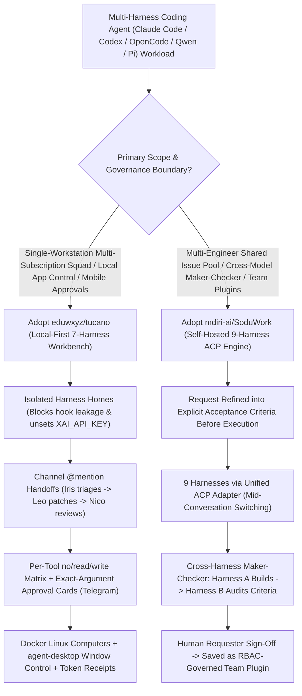

# Local Multi-Harness Channel Squads (`eduwxyz/tucano`) & ACP Cross-Model Maker-Checker Engineering Hub (`mdiri-ai/SoduWork`) Selection FAQ

> **Positioning**: This standalone guide is **Round 18 of the 2026-11-11 Night Shift (Cumulative Guide #63)**, written in the plain-language, first-principles, closed-form FinOps style of `ib-vs-ethernet-roce-selection-faq.md` for AI Platform and Developer Productivity Solution Architects evaluating two breakout multi-harness orchestration repositories:
> 1. **`eduwxyz/tucano` (`373★`, TypeScript, Apache-2.0)**: A local-first multi-agent channel workbench (open-source Grok Bot alternative) that runs 7 existing CLI harnesses (`Claude Code`, `Codex`, `Cursor CLI`, `Grok`, `Cline`, `OpenCode`, `Pi`) inside **isolated per-harness homes**, featuring `@mention` channel handoffs, per-tool access controls (`no access` / `read` / `read and write`), exact-argument write approval cards (desktop + Telegram), and native desktop app automation via Vercel Labs' `agent-desktop`;
> 2. **`mdiri-ai/SoduWork` (`309★`, JavaScript/Python, MIT)**: A self-hosted (Hub + Admin Console + PostgreSQL) AI-native engineering engine connecting 9 harnesses (`Pi`, `OpenCode`, `DeepSeek Harness`, `Qwen Code`, `Kimi Code`, `Codex`, `Claude Code`, `Google Harness²`) via the **Agent Client Protocol (ACP)**, enforcing **"Request as Spec + Cross-Harness Maker-Checker Review + Requester Sign-Off + Governed Team Plugins"**.
>
> **中文版 FAQ**: [tucano-soduwork-multi-harness-team-governance-selection-faq.md](tucano-soduwork-multi-harness-team-governance-selection-faq.md) · **Architecture Summary SVG**: [`assets/github-ai-radar-2026-11-11-r18-tucano-soduwork.svg`](../../../assets/github-ai-radar-2026-11-11-r18-tucano-soduwork.svg)

---

## 📌 1. Executive Summary

1. **In plain English, what problems do these two repositories actually solve?**
   - **Ending Multi-Terminal Copy-Paste Chaos, Hook Leakage & Accidental API Billing (`eduwxyz/tucano`)**: Power developers often have `Claude Code`, `Codex`, `Cursor CLI`, and `Grok` installed on the same workstation, yet coordinating them requires copy-pasting stack traces across four terminal windows, battling cross-loaded `~/.claude` / `~/.cursor/mcp.json` hooks, and accidentally triggering per-token API bills when an `XAI_API_KEY` environment variable overrides a paid subscription login. `Tucano` places all 7 harnesses into Slack-style channels with isolated home directories: `@Iris` investigates Datadog errors -> `@Leo` patches the code and opens an MR -> `@Nico` reviews it, while every real-world write action (merge, delete, email, payment) pauses on an exact-argument approval card on your screen or Telegram phone.
   - **Solving "Fast Output, Slow Trust" & Ephemeral Prompt Knowledge in Engineering Teams (`mdiri-ai/SoduWork`)**: Across engineering teams, the minutes saved by an agent writing code are often lost manually verifying its output, while a specialist's best debugging workflow dies buried in a private chat thread. `SoduWork` establishes that **"a chat ends with an answer; a SoduWork request ends when the person who asked signs off."** Every request automatically generates explicit **acceptance criteria**, runs execution on **Harness A (`Pi` or `Claude Code`)**, forces an independent **cross-harness review on a different model (`OpenCode` or `Qwen Code`) against those exact criteria**, awaits human requester sign-off, and packages successful runs into RBAC-governed **team plugins**.
2. **Closed-Form FinOps Verdict (`CLAIM-20261111-R18-TUCANO-SODUWORK`)**:
   - For a 15-engineer platform and product team executing **1,200 multi-step agent engineering tasks per month** (alert triage -> code fix -> cross-model review -> merge approval; senior engineer loaded rate `$85.00/hr`; developer workstation hardware and existing enterprise IdP licenses: `not_measured`):
   - Upgrading from **Path A (Ad-hoc multi-terminal copy-pasting + same-model self-review + unisolated API key billing leakage, `$6,160.00/mo`)** to **Path C (`Tucano` isolated-home subscription routing & write-approval cards + `SoduWork` ACP cross-harness Maker-Checker & governed team plugins, `$1,040.00/mo`)** saves **`$5,120.00/mo` (`-83.12%`, `$61,440.00/yr`)** and cuts senior engineering orchestration and review labor from `52.0 hrs/mo` to `8.0 hrs/mo` (**`-84.62%`**).

---

## 🎯 2. Three Core Architectural Questions (Q1 / Q2 / Q3 Deep-Dive)

### Q1: How does `eduwxyz/tucano` reuse a developer's existing CLI subscriptions while preventing cross-harness hook contamination and accidental API billing?
- **First-Principles Breakdown**:
  1. **Strict Per-Harness Home Directory Isolation**:
     - For `Claude Code`, Tucano reads only the `env` block and `apiKeyHelper` from `~/.claude/settings.json` (preserving corporate AI gateway routing) while stripping hooks, plugins, and ambient permissions;
     - For `Codex`, `Cursor CLI`, `Cline CLI`, and `Grok`, each invocation runs inside an isolated home directory with built-in shell/file tools disabled in favor of Tucano's governed gateway. Crucially, when `grok.com` is signed in, Tucano automatically unsets `XAI_API_KEY` in the child environment so subscription usage is never billed as pay-as-you-go API traffic (while explicitly surfacing that `Cursor CLI` adds `~10k tokens` of system prompt per reply).
  2. **Per-Tool Access Matrix, Exact-Argument Approval Cards & `agent-desktop`**:
     - Every agent is assigned `no access`, `read`, or `read and write` per MCP connector (`Jira`, `GitLab`, `Datadog`, `mcp.yourcompany.internal`) and per native OS desktop app (controlled without stealing the mouse cursor via Vercel Labs' `agent-desktop` assistive window tree). Any write action blocks on a desktop/Telegram approval card backed by monthly token ceilings and a global **Pause everything** button.

### Q2: Why are `mdiri-ai/SoduWork`'s Cross-Harness Maker-Checker Verification and Deterministic Plugin Routing essential for multi-engineer governance?
- **First-Principles Breakdown**:
  1. **Unified 9-Harness Adapter Layer via Agent Client Protocol (ACP)**:
     - Connects `Pi`, `OpenCode`, `DeepSeek Harness`, `Qwen Code`, `Kimi Code`, `Codex Harness`, `Codex`, `Claude Code`, and `Google Harness²` through one adapter interface, allowing engineers to switch harnesses mid-conversation while retaining full history and the working folder.
  2. **Heterogeneous Maker-Checker Review Against Explicit Acceptance Criteria**:
     - Having the same model review its own code suffers from severe confirmation bias. In `SoduWork`, AI refines each request into explicit acceptance criteria before work starts; a fast/cost-effective harness (`Pi`) executes routine steps, and a separate harness on an independent model family (`OpenCode` or `Qwen Code`) verifies every criterion before the human requester signs off.
  3. **Zero Unsupervised Agent-to-Agent Handoffs**:
     - Unlike autonomous agent chat loops that can spiral out of control, `SoduWork` enforces that **agents never hand work to other agents on their own**—transitions between steps and people are governed strictly by reviewed **SoduWork Plugins** and the human assignee.

### Q3: When should an engineering organization deploy `Tucano` vs. `SoduWork`—or combine both?
- **Selection Rule**:
  - Deploy **`eduwxyz/tucano`** on individual developer workstations to unify existing personal/corporate CLI subscriptions (`Claude Pro/Max`, `ChatGPT Plus/Pro`, `Cursor`, `Grok`) into a local `@mention` squad with Docker Linux sandboxes, calendar `Routines`, and mobile Telegram write approvals.
  - Deploy self-hosted **`mdiri-ai/SoduWork`** (`python3 ops/self-host/deploy.py up`) as the shared team issue pool where multi-person requests, cross-harness Maker-Checker audits, requester sign-offs, and reusable team plugins are centrally governed.

---

## 🧭 3. Mermaid Decision Tree & Multi-Harness Governance Pipeline

---

## 📊 4. Architectural Comparison Matrix

| Evaluation Dimension | Path A: Ad-Hoc Multi-Terminal Copy-Paste + Same-Model QA | Path B: Single-Vendor Cloud Coding Bot | **Path C (Recommended): `eduwxyz/tucano` + `mdiri-ai/SoduWork`** |
| :--- | :--- | :--- | :--- |
| **Multi-Harness & Subscription Reuse** | Isolated terminals; manual copy-paste between CLIs | Locked into one vendor's API/model catalog | **Tucano runs 7 local CLIs; SoduWork connects 9 harnesses via ACP** |
| **Environment & Billing Isolation** | `~/.claude` & `~/.cursor` hooks collide; stray API keys trigger bills | Cloud sandbox cannot access local apps or existing CLI logins | **Isolated per-harness homes; auto-unsets `XAI_API_KEY` on subscription login** |
| **Verification & Maker-Checker Gate** | Same model reviews itself; humans must manually inspect every line | Single pass without up-front acceptance criteria | **Request-as-Spec: Harness A executes, heterogeneous Harness B audits criteria** |
| **Write-Action Safety & Team Reuse** | Unchecked shell/git side-effects; prompts die in private chat logs | Coarse repo permissions; no cross-harness plugin packaging | **Exact-argument approval cards (Telegram) + RBAC-governed SoduWork Plugins** |
| **Monthly TCO (1,200 Tasks/Mo)** | **`$6,160.00 / mo`** (`$1,740` API + `$4,420` labor) | **`$3,500.00 / mo`** (`$1,120` bot/tokens + `$2,380` labor) | **`$1,040.00 / mo` (Saves `$5,120.00/mo` · `-83.12%`)** |

---

## 🧪 5. Closed-Form FinOps Example & 7-Card Insights (`CLAIM-20261111-R18-TUCANO-SODUWORK`)

### 5.1 Workload & Scope Boundary
- **Workload**: A 15-engineer platform and product team completing **1,200 multi-step agent engineering tasks per month** (incident triage, bug fix, cross-model review, and merge sign-off).
- **Rates**: Senior engineer loaded rate at **`$85.00 / hr`**.
- **Explicit Scope Boundary**: Developer workstation hardware depreciation and baseline enterprise IdP licenses are marked **`not_measured`**.

### 5.2 Closed-Form Monthly Cost Breakdown

| Cost Component | Path A: Ad-Hoc Terminals + API Leakage + Manual QA | Path B: Single-Vendor Cloud Bot (No Maker-Checker) | **Path C: `Tucano` + `SoduWork` Governance (Recommended)** |
| :--- | :--- | :--- | :--- |
| **Model Token / Subscription & Hub Spend** | `1,200 × $1.45` = **`$1,740.00`** | **`$1,120.00`** | **`$360.00`** (Subscription reuse + self-hosted Hub) |
| **Senior Engineering Orchestration & QA (`$85/hr`)** | `52.0 hrs × $85.00` = **`$4,420.00`** | `28.0 hrs × $85.00` = **`$2,380.00`** | `8.0 hrs × $85.00` = **`$680.00`** |
| **Total Monthly TCO** | **`$6,160.00 / mo`** | **`$3,500.00 / mo`** (`-43.18%`) | **`$1,040.00 / mo`** |
| **Net Savings vs. Path A** | Baseline | Saves `$2,660.00 / mo` | **Saves `$5,120.00 / mo` (`-83.12%` · `$61,440.00/yr`)** |
| **Workstation Hardware & Base IdP** | `not_measured` | `not_measured` | `not_measured` |

---

## 🛠️ 6. Production Verification Checklist

- [ ] **1. `Tucano` Isolated Home & Corporate AI Gateway Verification**: Confirm each harness executes inside its isolated home directory, verify `XAI_API_KEY` is unset when `grok.com` is authenticated, and restrict **Settings → Models** to gateway-backed harnesses when operating behind a corporate AI proxy.
- [ ] **2. Per-Tool Permission Matrix & Telegram Kill-Switch**: Default external MCP servers (`GitLab`, `Jira`, `Datadog`) to `read`, require explicit approval cards for all write/merge/delete actions, link Telegram mobile approvals, and test the global **Pause everything** control.
- [ ] **3. `SoduWork` Self-Hosted Docker Deployment**: Run `python3 ops/self-host/deploy.py up` and `python3 ops/self-host/deploy.py credentials` behind an HTTPS reverse proxy, set a 12–128 character `admin` password, and register model providers in the Admin Console.
- [ ] **4. Cross-Harness Maker-Checker Policy Enforcement**: Configure SoduWork workflows so execution runs on Harness A (`Pi` / `Claude Code`) while acceptance-criteria verification runs on an independent model family (`OpenCode` / `Qwen Code`) prior to human requester sign-off.
- [ ] **5. Governed Plugin Lifecycle Audit**: Convert a verified troubleshooting thread into a SoduWork Plugin, complete admin review, grant team-scoped RBAC access, and verify revocation and cost audit logging.
