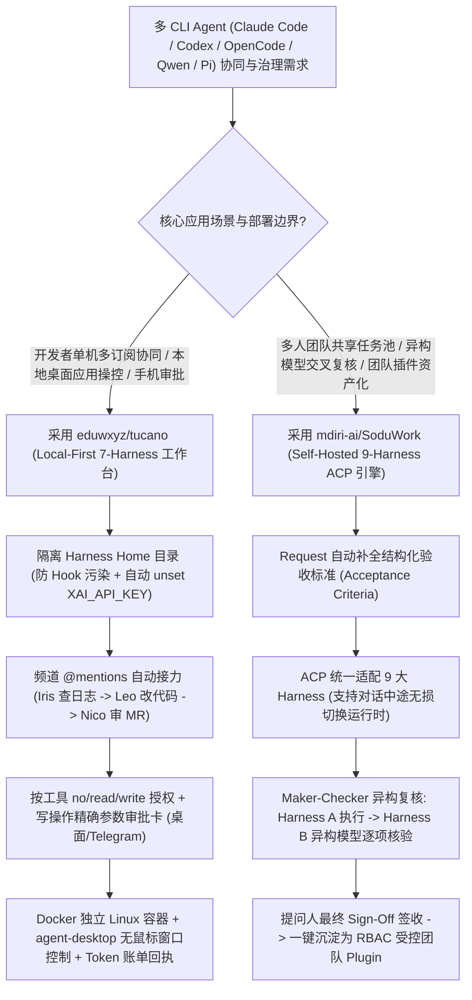

# 本地多 Harness 频道协同工作台（`eduwxyz/tucano`）与 ACP 跨模型双人复核研发引擎（`mdiri-ai/SoduWork`）选型 FAQ

> **文档定位**：本文是 **2026-11-11 夜班多轮深潜 Round 18（累计第 63 篇独立选型专题）**，严格对标 `ib-vs-ethernet-roce-selection-faq.md` 的「通俗大白话 + 第一性原理 + 可核算定量算例」标杆文风，为研发效能与企业级 Agent 平台架构师深度拆解今日两款多 Harness（Multi-Harness）多智能体协同新星：
> 1. **`eduwxyz/tucano`（`373★`，TypeScript，Apache-2.0）**：运行在开发者本机的多 Agent 频道协同工作台（开源 Grok Bot 替代方案），在**独立隔离 Home 目录**中复用本机已登录的 7 大 CLI Harness（`Claude Code`、`Codex`、`Cursor CLI`、`Grok`、`Cline`、`OpenCode`、`Pi`），支持 `@mentions` 自动接力、按工具级读写权限矩阵、带完整参数的写操作手机/桌面审批卡以及基于 Vercel Labs `agent-desktop` 的无鼠标桌面应用操控；
> 2. **`mdiri-ai/SoduWork`（`309★`，JavaScript/Python，MIT）**：面向团队与 Agent 的自托管（Hub + Admin + PostgreSQL）研发交付引擎，基于统一 **ACP（Agent Client Protocol）适配器**接入 9 大 Harness（`Pi`、`OpenCode`、`DeepSeek`、`Qwen Code`、`Kimi Code`、`Codex`、`Claude Code`、`Google Harness²`），首创 **「Request 即验收标准 + 异构 Harness 交叉复核（Maker-Checker）+ 提问人最终签收 + 对话沉淀受控团队插件」** 闭环。
>
> **English Companion**: [tucano-soduwork-multi-harness-team-governance-selection-faq.en.md](tucano-soduwork-multi-harness-team-governance-selection-faq.en.md) · **架构总结图**: [`assets/github-ai-radar-2026-11-11-r18-tucano-soduwork.svg`](../../../assets/github-ai-radar-2026-11-11-r18-tucano-soduwork.svg)

---

## 📌 一、核心结论速览（Executive Summary）

1. **先用大白话讲透这两个项目到底解决了什么痛点？**
   - **单机多 CLI Agent 的“终端复制粘贴地狱、配置污染与误扣 API 账单痛点”（`eduwxyz/tucano` 解决的问题）**：现在很多高阶工程师电脑上同时装着 `Claude Code`、`Codex`、`Cursor CLI` 和 `Grok`，但让它们配合查一个线上 Bug 时，得开四个终端来回复制报错日志；更糟的是，不同 CLI 会互相读取 `~/.claude` 或 `~/.cursor/mcp.json` 里的钩子和插件造成幽灵冲突，或者因为环境变量里残留了 `XAI_API_KEY` 把原本包月免费的订阅会话按高价 API 计费。`Tucano` 把本机 7 大 Harness 放进带独立 Home 沙盒的群聊频道（Channels）：`@Iris` 查 Datadog 报错 → `@Leo` 改代码提 MR → `@Nico` 做 Code Review，任何涉及现实世界写操作（合并 MR、发邮件、删库）必须弹出包含精确调用参数的审批卡（支持 Telegram 手机远程审批）等你点头！
   - **团队级 AI 交付的“产出快但核验慢、优秀方法死在个人聊天记录里”（`mdiri-ai/SoduWork` 解决的问题）**：在多人研发团队里，AI 写代码省下的半小时，往往又被人工逐行核对吃掉了；而且某位专家调教出一套极好用的排查流，别人根本没法复用。`SoduWork` 提出了 **“聊天以回答结束，而 SoduWork 请求以提问者签收（Sign-off）结束”** 的工程哲学：每个请求先由 AI 生成明确的**验收标准（Acceptance Criteria）**，接着由 **Harness A（如 `Pi` 或 `Claude Code`）干活，再强制交由运行在不同大模型上的 Harness B（如 `OpenCode` 或 `Qwen Code`）对照验收标准逐项独立审查**，通过后才交给人类签收，并能一键把跑通的对话保存为经 RBAC 审批的**团队级复用插件（Team Plugin）**。
2. **闭式 FinOps 核算结论（`CLAIM-20261111-R18-TUCANO-SODUWORK`）**：
   - 在 **15 人平台与产品研发团队每月执行 1,200 次多步 Agent 研发任务（告警排查 → 代码修复 → 跨模型审查 → 合并上线审批）** 基准下（高级工程师全包时薪 `$85.00/hr`；开发者本地工作站硬件与企业现有 IdP 许可：`not_measured`）：
   - 从 **Path A（多终端手工复制粘贴 + 同模型自审 + 环境变量 API Key 误计费泄漏，`$6,160.00/月`）** 升级至 **Path C（`Tucano` 本地隔离 Home 订阅路由与写操作审批 + `SoduWork` ACP 异构双人复核与受控团队插件，`$1,040.00/月`）**，每月净省 **`$5,120.00/月`（降幅 `-83.12%`，年化节省 `$61,440.00/年`）**，工程师手工搬运上下文与复核返工工时从 `52.0 小时/月` 降至 `8.0 小时/月`（**节省 `84.62%`**）。

---

## 🎯 二、三大灵魂拷问（Q1 / Q2 / Q3 Deep-Dive）

### Q1：`eduwxyz/tucano` 是如何在复用本机已有 CLI 订阅的同时，彻底斩断不同 Harness 之间的钩子污染与 API 误扣费的？
- **第一性原理拆解**：
  1. **按 Harness 严格隔离运行时 Home 目录（Isolated Harness Homes）**：
     - 对 `Claude Code`：仅读取 `~/.claude/settings.json` 中的 `env` 块与 `apiKeyHelper`（完美透传公司内部 AI Gateway 代理），将外部复杂 Hooks、Plugins 和松散权限拒之门外；
     - 对 `Codex`、`Cursor CLI`、`Cline CLI` 与 `Grok`：每次调用均分配独立的专属 Home 目录，关闭它们自带的内置 Shell/文件读写/子智能体工具，统一收敛至 **Tucano 安全网关**；特别是当检测到 `grok.com` 已登录订阅时，自动在子进程环境中 `unset XAI_API_KEY`，彻底杜绝包月用户被静默扣取按量 API 费用（同时显式标注 `Cursor CLI` 每次回复自带约 `10k tokens` 系统提示词开销）。
  2. **三档工具权限矩阵 + 写操作精确参数审批卡 + `agent-desktop` 辅助树操控**：
     - 每个 Agent 对每个 MCP 连接器（Jira、GitLab、Datadog、内部 `mcp.yourcompany.internal`）及本地桌面应用均可独立设置为 `no access`、`read` 或 `read and write`；
     - 借助 Vercel Labs 开源的 `agent-desktop`，Agent 通过操作系统无障碍辅助技术树（Assistive Tree）直接读取和点击后台窗口（如 Notes、Calendar），不抢占人类鼠标指针；一切发送、支付、发布、合并、删除动作强制挂起，向桌面端或手机 Telegram 推送带完整调用参数的审批卡。

### Q2：`mdiri-ai/SoduWork` 的「异构 Harness 交叉复核（Maker-Checker）」与「严禁 Agent 私自转交任务」为什么是企业级落地的核心护城河？
- **第一性原理拆解**：
  1. **统一 ACP（Agent Client Protocol）适配器与会话中无缝切流**：
     - 传统平台把工作流绑死在单一 SDK 上。`SoduWork` 将 `Pi`、`OpenCode`、`DeepSeek Harness`、`Qwen Code`、`Kimi Code`、`Codex`、`Claude Code`、`Google Harness²` 等 9 大运行时统一抽象为标准 Adapter（支持中途切换 Harness 而保留完整对话历史与工作目录）。
  2. **独立模型对照验收标准审查（Maker-Checker against Acceptance Criteria）**：
     - 同一个大模型看自己刚写的代码极易产生“确认偏误（Confirmation Bias）”。在 `SoduWork` 的共享 Issue Pool 中，任务启动前先生成结构化验收标准；执行插件可指定廉价/高速模型（如 `Pi`）完成常规编码，再强制调度异构强模型（如 `OpenCode` / `Qwen Code`）对照验收标准逐条核验并附上证据，不达标直接打回重做，最后才唤醒需求提出者（Requester）签字确认。
  3. **禁止无监管 Agent 自由甩锅（Deterministic Plugin Routing）**：
     - 在复杂企业流程里，允许 Agent 自己决定把任务转给谁会导致无限循环与责任黑洞。`SoduWork` 明确规定 **“Agent 绝不私自向其他 Agent 转交工作”**——步骤间与人与人之间的流转 100% 由受版本与权限管控的 **SoduWork Plugin** 和人类责任人（Assignee）决定。

### Q3：个人技术负责人（Tech Lead）与 10～50 人研发团队该如何选型或组合使用 `Tucano` 与 `SoduWork`？
- **选型建议**：
  - **Tech Lead / 架构师个人多订阅协同主机**：首选 **`eduwxyz/tucano`**，把你本机已付费的 Claude Pro/Max、ChatGPT Plus/Pro、Cursor、Grok 账号组合成一个随叫随到的本地虚拟小队（还能自动从重复操作中提炼 `Skill` 并按日历跑 `Routines`）；
  - **多人研发团队共享任务池与 SOP 资产沉淀**：部署自托管 **`mdiri-ai/SoduWork`**（`python3 ops/self-host/deploy.py up` 一键拉起 Hub + Admin Console + PostgreSQL），把资深专家验证成功的排障与开发流固化为团队插件，实现跨同事、跨云端 Runner 的可审计交付。

---

## 🧭 三、Mermaid 选型决策树与双层多 Harness 治理架构

---

## 📊 四、同类方案核心能力对比矩阵（Comparison Matrix）

| 评估维度 | Path A：多终端手工复制粘贴 + 同模型自审 | Path B：单一云端 Coding Bot（无隔离与交叉复核） | **Path C（推荐标杆）：`eduwxyz/tucano` + `mdiri-ai/SoduWork`** |
| :--- | :--- | :--- | :--- |
| **多 Harness 与多订阅复用** | 多个终端各自为战，上下文靠手工复制粘贴 | 绑定单一供应商 API，无法复用个人/企业多平台 CLI | **Tucano 支持 7 大本地 CLI；SoduWork 通过 ACP 统一接入 9 大 Harness** |
| **环境隔离与防误扣费保护** | 全局 `~/.claude` / `~/.cursor` 钩子互串，残留 API Key 导致高额账单 | 云端黑盒环境，无法挂载本机私有工具或桌面应用 | **独立 Home 沙盒隔离钩子/插件，自动屏蔽 `XAI_API_KEY` 误计费** |
| **质量门禁与双人复核机制** | 同一模型自写自查，极易漏掉边界 Bug，全靠人工兜底 | 单一模型输出即结束，缺乏前置验收标准核验 | **Request 即 Spec：Harness A 执行 + 异构 Harness B 独立审查 + 提问人签收** |
| **写操作安全与组织级沉淀** | 高危 Shell/Git 操作极易误触发；好用的提示词留在个人记录里 | 粗粒度仓库权限，对话无法转化为跨模型标准插件 | **精确参数写操作审批卡（含 Telegram）+ 经验一键转受控团队 Plugin** |
| **月度总拥有成本（1,200 任务/月）** | **`$6,160.00 / 月`**（API `$1,740` + 人工 `$4,420`） | **`$3,500.00 / 月`**（订阅/Token `$1,120` + 人工 `$2,380`） | **`$1,040.00 / 月`（净省 `$5,120.00/月`，降幅 `-83.12%`）** |

---

## 🧪 五、闭式定量 FinOps 算例与 7-Card 评测洞察（`CLAIM-20261111-R18-TUCANO-SODUWORK`）

### 5.1 基准假设与边界声明
- **评测负载**：15 人研发与平台工程团队每月处理 **1,200 个多步研发任务**（涵盖监控排障、代码修复、跨模型 Code Review 与合并上线）。
- **单价基准**：高级工程师全包时薪 **`$85.00 / hr`**。
- **显式边界声明（Scope Boundary）**：开发者现有办公笔记本硬件折旧及企业既有统一身份认证（IdP）基础底座许可标记为 **`not_measured`**。

### 5.2 三路径闭式成本核算表

| 成本构成项 | Path A：多终端手工搬运 + API 误计费 + 人工全量复核 | Path B：单一云端 Bot（无异构复核与订阅复用） | **Path C：`Tucano` + `SoduWork` 协同治理（推荐）** |
| :--- | :--- | :--- | :--- |
| **模型 Token / 订阅路由与自托管算力** | `1,200 × $1.45` = **`$1,740.00`** | **`$1,120.00`** | **`$360.00`**（订阅复用 + 轻量自托管 Hub） |
| **高级工程师协调与复核工时（`$85/hr`）** | `52.0 hrs × $85.00` = **`$4,420.00`** | `28.0 hrs × $85.00` = **`$2,380.00`** | `8.0 hrs × $85.00` = **`$680.00`** |
| **月度总成本（Monthly Total）** | **`$6,160.00 / 月`** | **`$3,500.00 / 月`**（`-43.18%`） | **`$1,040.00 / 月`** |
| **相对 Path A 净节省（Savings）** | 基准线（Baseline） | 节省 `$2,660.00 / 月` | **净省 `$5,120.00 / 月`（`-83.12%` · 年省 `$61,440.00`）** |
| **办公终端硬件与企业 IdP 底座** | `not_measured` | `not_measured` | `not_measured` |

---

## 🛠️ 六、生产级落地核验 Checklist（SA Actionable Verification）

- [ ] **1. `Tucano` 独立 Home 与企业 AI Gateway 核验**：在 **Settings → Models** 中核验各 Harness 运行在独立 Home 目录；若处于企业内网代理后，仅勾选走公司 AI Gateway 的 Harness 并确认遥测上报已关闭。
- [ ] **2. 工具读写分级与 Telegram 紧急制动配置**：对所有外部 MCP 连接器（GitLab、Jira、生产库）默认设为 `read`，将合并、发布、删除设为强制弹出审批卡，并绑定手机 Telegram 与测试 **Pause everything** 全局急停按钮。
- [ ] **3. `SoduWork` Docker 自托管与强密码初始化**：在团队服务器执行 `python3 ops/self-host/deploy.py up` 与 `deploy.py credentials`，配置前置 HTTPS 反向代理，设置 12～128 位高强度 `admin` 密码并录入 Model Catalog。
- [ ] **4. 异构 Harness Maker-Checker 策略强制绑定**：在 SoduWork 插件工作流中配置不同模型分别担任执行者（如 `Pi` / `Claude Code`）与独立审查者（如 `OpenCode` / `Qwen Code`），验证审查未通过时自动打回并附带具体原因。
- [ ] **5. 团队 Plugin 审计与权限回收演练**：将一次验证通过的高频排障对话保存为 SoduWork Plugin，走完管理员审核、按角色授权（Grant）与一键吊销（Revoke）全流程，核验审计日志完整性。
