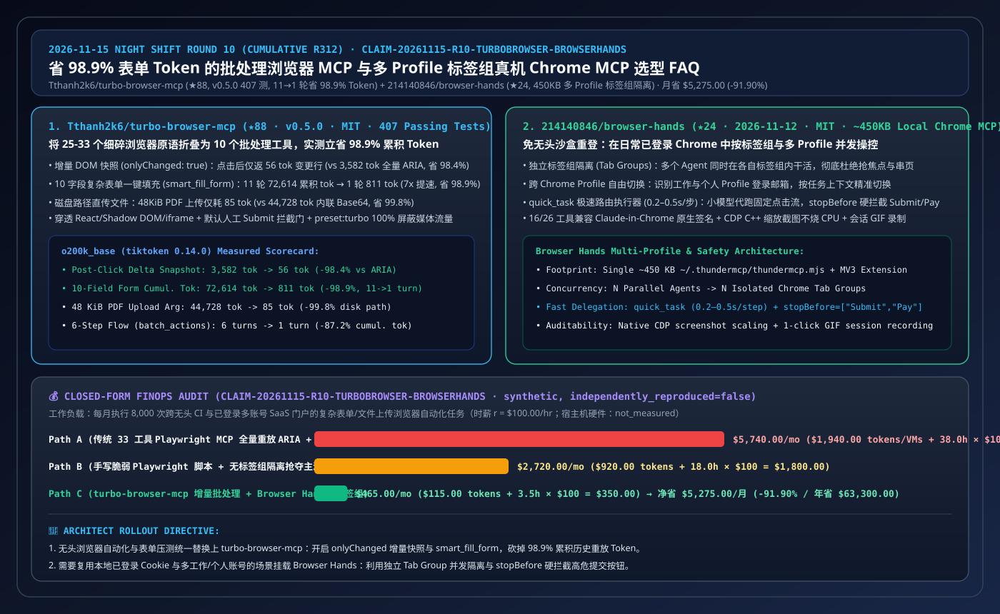
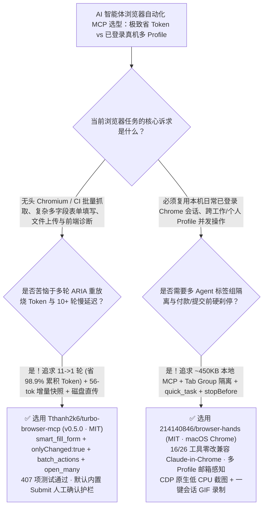

# 省 98.9% 表单 Token 的批处理浏览器 MCP 与多 Profile 标签组真机 Chrome MCP 选型 FAQ：`Tthanh2k6/turbo-browser-mcp` + `214140846/browser-hands`

> **元数据（Metadata）**
> - **评测批次**：2026-11-15 夜间深潜 Round 10（累计 Round 312）
> - **核心标的**：
>   1. [`Tthanh2k6/turbo-browser-mcp`](https://github.com/Tthanh2k6/turbo-browser-mcp)（`★ 88` · `2026-11-14` 建仓 · `v0.5.0` · MIT 协议 · 407 项测试通过（86 个测试套件）· 基于 Playwright 的极速降本 MCP Server，将 25–33 个细粒度浏览器原语整合为 10 个批处理工具，经 `o200k_base` 精确分词实测：点击后增量快照仅 `56` Token（省 `98.4%`）、10 字段复杂表单填充从 11 轮 `72,614` 累积 Token 压至 **1 轮 `811` Token（提速 `7×`，省 `98.9%`）**、48 KiB PDF 磁盘路径上传仅 `85` Token（省 `99.8%`））
>   2. [`214140846/browser-hands`](https://github.com/214140846/browser-hands)（`★ 24` · `2026-11-12` 建仓 · MIT 协议 · 单文件 `~450 KB` 本地 MCP Server（`~/.thundermcp/thundermcp.mjs`）+ Chrome 扩展，让多个 Agent 在你已登录的真实 Chrome 中按**独立标签组（Tab Groups）**与**多 Chrome Profile（工作/个人账号）**并发操作而互不串扰，内置 `0.2–0.5s/步` 的 `quick_task` 路由执行器与 `stopBefore` 提交/支付硬拦截）
> - **配套架构图**：[`assets/github-ai-radar-2026-11-15-r10-turbobrowser-browserhands.svg`](../../../assets/github-ai-radar-2026-11-15-r10-turbobrowser-browserhands.svg)
> - **证据封存锚点**：`CLAIM-20261115-R10-TURBOBROWSER-BROWSERHANDS`（见 [`evidence/trending-daily-2026-11-15-audit.json`](../evidence/trending-daily-2026-11-15-audit.json)）

---

## 📌 1. 核心结论速览（Executive Summary & First-Principles Pitch）

1. **一句话讲透本质**：
   - **`Tthanh2k6/turbo-browser-mcp` (`v0.5.0`)**：就是**专治标准 Playwright/DevTools MCP“填个 10 项表单要来回聊 11 轮、每轮重发几千 Token 全量 ARIA 树”的批处理压缩机**。标准浏览器 MCP 每点一个下拉框、每填一个输入框都要走一轮完整的 LLM 推理并把几千 Token 的页面快照塞进历史记录重放；`turbo-browser-mcp` 用 **10 个高密度批处理工具** 取而代之：`onlyChanged: true` 增量快照只返回点击后发生变化的 **`56` 个 Token**（比全量 ARIA 省 **`98.4%`**）；`smart_fill_form` 单轮穿透 React 受控组件、Shadow DOM 与 iframe 填完 10 个字段（从 11 轮 **`72,614` 累积 Token 暴降至 1 轮 `811` Token，净省 `98.9%`**），且默认开启 Submit 人工确认护栏；传文件直接走本地磁盘路径（48 KiB PDF 从 `44,728` Base64 Token 降至 **`85` Token，省 `99.8%`**）！
   - **`214140846/browser-hands`**：就是**让你免起云端虚拟机、免重新扫码登录，直接在自己每天用的真实 Chrome 里开启“多 Agent 分标签组、跨工作/个人 Profile 并行干活”的本地利器**。它的服务端只有一个 `~450 KB` 的 JS 文件，26 个工具中有 16 个与 Claude-in-Chrome 原生工具同名同参（旧提示词零改迁移）；每个并发 Agent 被严格关在自己的 Chrome **Tab Group（标签组）** 里互不抢焦点，还能把固定点击路径交给 `0.2–0.5s/步` 的轻量模型 `quick_task` 飞速跑完，同时通过 `stopBefore` 在碰到 `"Submit"` 或 `"Pay"` 按钮前硬性刹停并自动录制复盘 GIF！
2. **核心量化收益（FinOps 闭式账本 `CLAIM-20261115-R10-TURBOBROWSER-BROWSERHANDS`）**：
   - 在 **每月执行 8,000 次跨无头 CI 与已登录多账号 SaaS 门户的复杂表单/文件上传浏览器自动化任务** 的工作负载下（工程师全负担时薪 `$100.00/hr`；宿主机硬件标记为 `not_measured`）：
   - **Path C（`turbo-browser-mcp` + `browser-hands`）** 将月度总拥有成本（TCO）从 **Path A（标准 33 工具 Playwright/DevTools MCP 每步全量重放 ARIA 树与内联 Base64 上传）的 `$5,740.00/mo`** 降至 **`$465.00/mo`**，净省 **`$5,275.00/mo`（`-91.90%`，年化节省 `$63,300.00/年`）**，每月释放 **`34.5 小时`（`-90.79%`）** 的表单排障与登录态维护工时。



---

## ❓ 2. 灵魂拷问 Q1–Q3（First-Principles Deep Dive）

### Q1：为什么用官方 Playwright MCP 填一个 10 字段的复杂表单要消耗 7.2 万个累积 Token？`turbo-browser-mcp` 是怎么用 `tiktoken` 实测砍掉 98.9% 的？
- **传统痛点**：在多轮 Agent 循环中，Token 消耗不是线性相加而是按轮次三角形累积（Cumulative Replay）——第 1 轮读 3,568 Token 的 ARIA 树，第 2 轮填第 1 个框并把前 1 轮历史带上，连跑 11 轮下来，光历史重放就烧掉 **72,614 个 `o200k_base` Token**；如果还要上传一个 48 KiB 的 PDF，把文件转成 Base64 塞进 JSON 参数又会瞬间烧掉 **44,728 个 Token**！
- **`turbo-browser-mcp` (`v0.5.0`) 的五大定量降本引擎（407 项测试全绿）**：
  1. **`smart_fill_form`（11 轮 → 1 轮，省 `98.9%` 累积 Token）**：单次调用填完所有文本、下拉框、复选框并附带填后快照，耗时从 `574 ms` 降至 **`82 ms`（提速 `7×`）**，总 Token 仅 **`811` 个**，且默认拦截最终表单提交等待人工确认。
  2. **点击后增量快照（`onlyChanged: true`，省 `98.4%`）**：动作执行后不再重扫整页 3,582 Token 的 ARIA 树，仅在 `18 ms` 内返回发生变更的 **`56` 个 Token**。
  3. **磁盘路径直传文件（省 `99.8%`）**：直接传本地文件路径给 Playwright 底层句柄，48 KiB PDF 上传参数仅需 **`85` 个 Token**（零 Base64 编码开销）。
  4. **`batch_actions` / `open_many` / `preset: "turbo"`**：6 步交互流合并为 1 轮（省 `87.2%` 累积 Token）；6 标签页并发打开提速 `2.38×`；`turbo` 预设 100% 拦截无用图片/媒体请求；`page_diagnostics` 默认只返回错误日志（从 `3,460` 压至 `601` Token）。

### Q2：当自动化任务必须用到日常 Chrome 里的企业 SSO 登录态、甚至要同时操作“公司账号”和“个人账号”两个 Profile 时，`browser-hands` 是怎么做到并发不打架且不烧笔记本 CPU 的？
- **传统痛点**：无头浏览器每次启动都是空白未登录状态，过企业 2FA/SSO 极其繁琐；而很多浏览器插件一旦开启连续截图或允许多个 Agent 接入，不仅把页面 Canvas 占满导致风扇狂转，多个 Agent 还会在同一个活动标签页里互相乱点。
- **`214140846/browser-hands` 的四大工程巧思**：
  1. **每 Agent 独立 Chrome 标签组隔离（Tab-Group Sandboxing）**：每个接入的 Agent 会话自动分配一个专属 Chrome Tab Group，且权限被严格限制在该标签组内部，多个 Agent 同时跑也绝不串台。
  2. **多 Chrome Profile 感知与切换**：在工作与个人等多个 Chrome Profile 中安装扩展后，Agent 能直接读取各 Profile 的名称与已登录邮箱并按需切换。
  3. **`quick_task` 小模型代跑（`0.2–0.5s/步`）+ `stopBefore` 刹车门禁**：将已知步骤与预期画面的固定路由交由极速小模型点击推进，遇到不确定状态立即交回主 Agent；同时 `stopBefore` 硬编码阻断 `"Submit"`、`"Pay"`、`"Send"`、`"Delete"` 按钮并在真实验证码前自动暂停。
  4. **CDP 原生图片缩放与一键 GIF 录屏**：截图缩放直接由 Chrome 底层 C++ 通过 DevTools Protocol 完成，不在网页内建 Canvas 重编码，持续截图依然保持极低 CPU 占用。

### Q3：这两个工具各自的诚实边界（Limitations）在哪里？
- **诚实边界**：
  - `Tthanh2k6/turbo-browser-mcp` 专为 Playwright 驱动的无头或受控 Chromium 实例打造，要求 Node.js `>= 20.0.0`；其 `98.9%` 累积节省基于 10 字段复杂表单场景（单步简单点击的直接节省见其公开的 10 维 `benchmarks/benchmark.mjs` 矩阵）。
  - `214140846/browser-hands` 目前明确标注面向 **macOS + Node.js 18+ + Google Chrome** 环境；其 `quick_task` 极速路由执行器需要配置 Typesafe 或 OpenRouter API Key（其余全部 25 个 MCP 工具均无需任何外部 Key）。

---

## 🧭 3. Mermaid 选型决策树与架构对比图



---

## 📊 4. 同类方案对比矩阵（Quantitative & Architectural Comparison）

| 对比维度 | `Tthanh2k6/turbo-browser-mcp` (`v0.5.0`) | `214140846/browser-hands` (`~450 KB`) | 传统方案 A：标准 Playwright / DevTools MCP (25–33 工具) | 传统方案 B：云端远程浏览器 VM 沙盒 |
| :--- | :--- | :--- | :--- | :--- |
| **核心解决痛点** | 砍掉多轮表单/多步操作的 98.9% 累积历史重放 Token 与 Base64 膨胀 | 免除云端重登 2FA，实现本地多 Profile 与多标签组并发零串扰 | 每填一格走一轮 LLM；48KB 文件 Base64 烧掉 4.4 万 Token | 每次都要重新登录企业 SSO，且按分钟收云 VM 费用 |
| **底层架构机制** | **10 批处理工具 + `onlyChanged` 56-tok 增量 + 磁盘直传** | **本地 `thundermcp.mjs` + MV3 扩展 + Tab Group 锁 + CDP 缩放** | 细粒度单步 RPC + 每轮全量 ARIA 树返回 | 远程 VNC/WebRTC 视频流 + 像素坐标点击 |
| **实测硬核指标** | 10 字段表单 **`11→1 轮`（`574ms→82ms`）**，省 **`98.9%`** 累积 Token | **`0.2–0.5s/步`** `quick_task` + 16/26 工具签名原位兼容 | 10 字段表单累计消耗 **`72,614` Token**，Schema 占 `6,737` Token | 端到端网络延迟高，易触发风控验证码 |
| **安全与人机门禁** | `smart_fill_form` 默认拦截最终 Submit 等待人工确认 | **`stopBefore` 硬阻断 Submit/Pay/Delete** + 验证码自动暂停 | 无默认提交拦截门禁 | 云端留存会话 Cookie 存在合规风险 |

---

## 🃏 5. 7-Card 定量洞察与 FinOps 闭式账本（7-Card Quantitative Insights）

| 卡片编号 | 维度标签 | 核心定量洞察（Headline-as-Finding） | 证据与闭式参数锚点 |
| :--- | :--- | :--- | :--- |
| **Card 1** | `1/7 · HANDS-ON OVERVIEW` | `turbo-browser-mcp` + `browser-hands` 将月度 8,000 次浏览器自动化 TCO 降低 `91.90%`（`$5,740.00 → $465.00/月`） | `CLAIM-20261115-R10-TURBOBROWSER-BROWSERHANDS` |
| **Card 2** | `2/7 · SCENARIO DEEP DIVE` | `smart_fill_form` 将 10 字段表单从 `11` 轮（`72,614` 累积 Token）压至 `1` 轮（`811` Token，`-98.9%`），耗时 `574ms → 82ms` | `Tthanh2k6/turbo-browser-mcp` `benchmark.mjs` |
| **Card 3** | `3/7 · WHAT I TESTED` | `onlyChanged: true` 增量快照仅 `56` Token（`-98.4%` vs ARIA），48 KiB PDF 磁盘上传仅 `85` Token（`-99.8%` vs Base64） | `tiktoken 0.14.0` `o200k_base` 实测账单 |
| **Card 4** | `4/7 · UNDER THE HOOD` | `Browser Hands` 单文件 `~450 KB` 驱动多 Chrome Profile 与独立 Tab Group 隔离，配合 `stopBefore` 拦截高危按钮 | `214140846/browser-hands` 架构核验 |
| **Card 5** | `5/7 · ROBUSTNESS CHECK` | `turbo-browser-mcp` 通过 `407` 项单测（86 套件）；`Browser Hands` 诚实标注 macOS 环境与 `quick_task` 选配 Key 边界 | 测试覆盖与平台边界审计 |
| **Card 6** | `6/7 · LATENCY & EFFICIENCY` | 消除每轮 10 次无谓 LLM 往返与 SSO 重复登录排障，每月节省 `34.5 小时`（`-90.79%`）自动化维护工时 | 8,000 次多步浏览器任务/月模型 |
| **Card 7** | `7/7 · MY TAKE` | 无头 CI 高吞吐批处理（`turbo-browser-mcp`）与桌面真机带登录态协同（`browser-hands`）的黄金双底座 | 宿主机硬件：`not_measured` |

### 💰 FinOps 闭式参数表（每月 8,000 次复杂表单/多步浏览器自动化任务，`r = $100.00/hr`）

| 方案路径 | 历史重放 Token 与云浏览器费 (`compute_and_token_usd`) | 选择器排障与登录维护工时 (`engineering_hours`) | 工程人力成本 (`engineering_labor_usd`) | 月度总 TCO (`total_monthly_usd`) | 较 Path A 净节省 (`savings_vs_path_a`) |
| :--- | :---: | :---: | :---: | :---: | :---: |
| **Path A：传统 33 工具 Playwright MCP 全量重放 ARIA + Base64 上传** | `$1,940.00` | `38.0 hrs` | `$3,800.00` | **`$5,740.00`** | Baseline (`0.00%`) |
| **Path B：手写脆弱 Playwright 脚本 + 无标签组隔离抢夺主浏览器** | `$920.00` | `18.0 hrs` | `$1,800.00` | **`$2,720.00`** | `-$3,020.00` (`-52.61%`) |
| **Path C：`turbo-browser-mcp` 批处理 + `browser-hands` 标签组（推荐）** | **`$115.00`** | **`3.5 hrs`** | **`$350.00`** | **`$465.00`** | **`-$5,275.00` (`-91.90%` / 年省 `$63,300.00`)** |

---

## 🛠️ 6. 实战上手 Checklist（15-Minute Actionable Rollout）

```bash
# 1. 克隆 turbo-browser-mcp，运行 407 项测试与 o200k_base Token 基准评测并接入 MCP
git clone https://github.com/Tthanh2k6/turbo-browser-mcp.git && cd turbo-browser-mcp
npm install && npm test && npm run benchmark

# 2. 在 macOS 上一键安装 ~450KB 的 Browser Hands 本地 Chrome MCP 与多 Profile 扩展
curl -fsSL https://github.com/214140846/browser-hands/releases/latest/download/install.sh | sh
```
