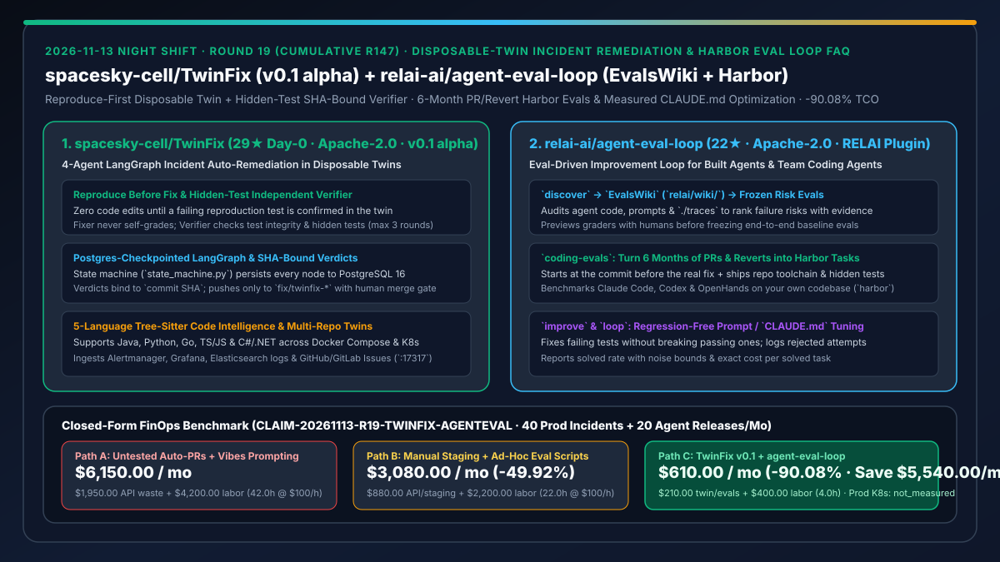
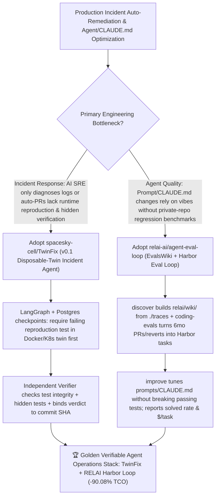

# Disposable-Twin Incident Auto-Remediation (`spacesky-cell/TwinFix`) & Harbor Eval-Driven Agent Improvement Loop (`relai-ai/agent-eval-loop`) Selection FAQ

> **Document Scope**: This is the **2026-11-13 Night Shift Round 19 (Cumulative #147) standalone 6-part selection guide**, modeled strictly after `ib-vs-ethernet-roce-selection-faq.md` with first-principles explanations and closed-form FinOps math. It is written for AI Solution Architects, SRE Platform Leads, and Agent Quality Engineers evaluating two verification-first engineering harnesses:
> 1. **`spacesky-cell/TwinFix` (`29★` on Day 0, Python 3.12 / Node.js 22 / PostgreSQL 16 / LangGraph / Docker Compose & K8s, Apache-2.0, `v0.1 alpha`)**: An end-to-end production incident auto-remediation agent that executes inside a **disposable twin environment** (`Signal -> Triage -> Diagnose -> Reproduce -> Fix -> Independent Verify -> Human Approval -> Merge`) using **4 LLM Agents + 1 deterministic Reporter** orchestrated by a PostgreSQL-checkpointed LangGraph state machine (`server/twinfix/domain/state_machine.py`). Enforces 4 hard rules: ① **Reproduce Before Fix** (no code edits without an orchestrator-confirmed failing reproduction test); ② **Independent Hidden-Test Verification** (the Fixer Agent never self-grades; the Verifier scans test integrity and scores against **hidden tests invisible to the Fixer**); ③ **Commit-SHA-Bound Verdicts**; and ④ **Human Final Merge Gate** (`fix/twinfix-*` branches only, reviewed at `:17317`).
> 2. **`relai-ai/agent-eval-loop` (`22★` in 2 days, Python, Apache-2.0, RELAI plugin for Claude Code, Codex, and Agent Skills with `harbor-framework/harbor`)**: An eval-driven improvement loop for both custom AI agents (`discover -> eval -> improve -> loop`) and team coding agents (`coding-evals`) — generating an evidence-backed **`EvalsWiki` (`relai/wiki/`)** from code/prompts/`./traces`, turning the **last 6 months of merged PRs and reverts** into executable **Harbor** tasks graded by hidden tests, and tuning prompts/`CLAUDE.md`/skills on a branch with frozen before/after solved rates and cost per solved task!
>
> **中文版本**: [twinfix-agent-eval-loop-disposable-twin-incident-remediation-harbor-eval-driven-agents-selection-faq.md](twinfix-agent-eval-loop-disposable-twin-incident-remediation-harbor-eval-driven-agents-selection-faq.md) · **Daily Digest**: [`daily/2026-11-13.en.md`](../daily/2026-11-13.en.md) · **Topic SVG**: [`assets/github-ai-radar-2026-11-13-r19-twinfix-agenteval.svg`](../../../assets/github-ai-radar-2026-11-13-r19-twinfix-agenteval.svg)

---

## 📌 1. Executive Summary

1. **In plain English, what core pain points do these two repositories solve?**
   - **Ending "AI SRE tools (like HolmesGPT/K8sGPT) that only diagnose logs without fixing code, or auto-PR bots (like Sentry Seer) that open untested PRs without ever reproducing the failure in a live environment" (`spacesky-cell/TwinFix`)**: `TwinFix` spins up a disposable Docker Compose or Kubernetes **twin environment** from the target branch and enforces four non-negotiable invariants: **(1) Reproduce before fix** (zero code edits until a failing test is independently confirmed in the twin); **(2) Independent verification** (the Fixer Agent cannot grade itself — an independent Verifier scans test integrity and runs **hidden tests invisible to the Fixer** across up to 3 iterations); **(3) Verdicts bound to `commit SHA`**; and **(4) Human final approval** (`fix/twinfix-*` branches only)!
   - **Ending "vibes-based `CLAUDE.md` and prompt edits that fix one trace while silently breaking five others" (`relai-ai/agent-eval-loop`)**: Built by RELAI for Claude Code, Codex, and Agent Skills, `agent-eval-loop` uses `discover` to audit code, prompts, and `./traces` into an **`EvalsWiki` (`relai/wiki/`)**, or uses `coding-evals` to convert **the last 6 months of merged PRs and reverts in your own repository** into executable **Harbor (`harbor-framework/harbor`)** benchmarks (starting at the commit before the real fix and graded by hidden tests), then runs `improve` to optimize prompts/skills without breaking passing tests!
2. **Closed-Form FinOps Conclusion (`CLAIM-20261113-R19-TWINFIX-AGENTEVAL`)**:
   - Modeled for a **platform and AI engineering team handling `40 production incidents / month` and `20 internal agent / CLAUDE.md releases / month`** (fully loaded SRE & AI engineer rate `$100.00/hr`; production Kubernetes node leases and PagerDuty enterprise seats: `not_measured`):
   - Switching from **Path A (diagnostic-only AI SRE + untested auto-PRs + vibes-based prompt tweaks, `$6,150.00/mo`)** to **Path C (`TwinFix v0.1` disposable-twin hidden-test remediation + `agent-eval-loop` Harbor PR-history evals, `$610.00/mo`)** saves **`$5,540.00/mo` (`-90.08%`, or `$66,480.00/yr`)** and cuts manual incident reproduction, bad-hotfix rollback, and prompt-regression triage from `42.0 hrs/mo` to `4.0 hrs/mo` (**`-90.48%`**).

---

## 🎯 2. Three First-Principles Deep-Dive Questions (Q1 / Q2 / Q3)

### Q1: Why is letting the same coding agent both write a hotfix and grade its own unit tests dangerous in incident response?
- **First-Principles Breakdown**:
  1. **Unreproduced Fixes Are Blind Guesses**: Without first proving a deterministic failing test in an isolated runtime twin, passing existing tests proves nothing about the production incident.
  2. **Self-Grading Reward Hacking**: An agent with write access to the test suite it is graded on can weaken assertions or delete failing checks to report a green build.

### Q2: How does `spacesky-cell/TwinFix` guarantee verifiable incident fixes across 5 languages and multi-repo services?
- **First-Principles Breakdown**:
  1. **PostgreSQL-Checkpointed LangGraph State Machine (`state_machine.py`)**:
     - Persists every transition (`Signal -> Triage -> Diagnose -> Reproduce -> Fix -> Verify -> Review -> Merge -> Observe`) in PostgreSQL 16 so worker crashes resume from the exact checkpoint, while using tree-sitter symbol indexing across Java, Python, Go, TS/JS, and C#/.NET.
  2. **Independent Hidden-Test Verifier & SHA-Bound Human Gate**:
     - Runs reproduction and verification independently in the twin, scans test integrity, evaluates against hidden tests invisible to the Fixer (up to 3 rounds), binds results to `commit SHA`, and restricts pushes to `fix/twinfix-*` for human approval at `:17317`.

### Q3: How does `relai-ai/agent-eval-loop` turn production traces and Git PR history into regression-free Harbor loops?
- **First-Principles Breakdown**:
  1. **`discover → EvalsWiki → Frozen Graders → improve`**:
     - Maps agent behavior and `./traces` into ranked failure risks in `relai/wiki/`, previews graders before freezing baseline tests, and modifies prompts/tools on a branch while logging rejected attempts and guaranteeing zero regressions on passing tests.
  2. **`coding-evals` on Real Repository History (`Harbor` Format)**:
     - Extracts 20+ Harbor tasks from the last 6 months of merged PRs and reverts (pinned to the pre-fix commit with hidden verification tests) to measure solved rate (with noise bounds) and cost per solved task on your actual codebase.

---

## 🧭 3. Mermaid Decision Tree & TwinFix + RELAI Harbor Eval Architecture

---

## 📊 4. Head-to-Head Selection Matrix

| Dimension | Path A: Diagnostic SRE + Untested Auto-PRs + Vibes | Path B: Manual Staging Repro + Ad-Hoc Eval Scripts | **Path C (Recommended): `TwinFix v0.1` + `relai-ai/agent-eval-loop`** |
| :--- | :--- | :--- | :--- |
| **Incident Reproduction & Patch Verification** | No runtime twin or Fixer grades its own tests | Manual branch checkout & container setup | **Disposable Docker/K8s twin fail-first repro + independent hidden-test Verifier + `commit SHA` binding** |
| **Production & Branch Safety Boundaries** | Risks unverified PR merges or test tampering | Relies on manual human discipline | **Zero prod access + read-only protected paths + `fix/twinfix-*` only + human merge approval** |
| **Agent / `CLAUDE.md` Eval Source** | 2–3 manual spot checks or generic public benchmarks | Hand-written static tests that quickly go stale | **`discover` builds `EvalsWiki` from `./traces` + `coding-evals` builds Harbor tasks from 6mo PRs/reverts** |
| **Regression Protection & Cost Metrics** | Fixing risk A breaks behavior B; unmeasured cost | Aggregate pass rate only | **Strict non-regression on passing tests + logged rejected attempts + solved rate & cost/solved task** |
| **Monthly TCO (40 Incidents + 20 Releases)** | **`$6,150.00 / mo`** (`$1,950` API + `$4,200` labor) | **`$3,080.00 / mo`** (`$880` API + `$2,200` labor) | **`$610.00 / mo` (Saves `$5,540.00/mo` · `-90.08%`)** |

---

## 🧪 5. Closed-Form FinOps Worked Example & 7-Card Insights (`CLAIM-20261113-R19-TWINFIX-AGENTEVAL`)

### 5.1 Baseline Parameters & Explicit Scope Boundaries
- **Scenario**: A platform and AI engineering team handling **40 production application incidents per month** and validating **20 internal agent / `CLAUDE.md` / skill iterations per month**.
- **Labor Rate**: Fully loaded SRE and AI engineer rate of **`$100.00 / hr`**.
- **Explicit Not-Measured Boundary**: Production Kubernetes cluster node leases and commercial PagerDuty/Datadog seat subscriptions are marked **`not_measured`**. This model strictly accounts for twin sandbox / eval API spend and engineering hours spent on manual reproduction, bad-hotfix rollbacks, and prompt-regression triage.

### 5.2 Three-Path Monthly Cost Comparison

| Cost Component | Path A: Untested Auto-PRs + Vibes Prompting | Path B: Manual Staging + Ad-Hoc Eval Scripts | **Path C: `TwinFix v0.1` + `agent-eval-loop` (Recommended)** |
| :--- | :--- | :--- | :--- |
| **Monthly Twin Sandbox, Eval & LLM API Spend** | **`$1,950.00`** (unbounded retries + regression rework tokens) | **`$880.00`** (always-on staging + manual eval runs) | **`$210.00`** (ephemeral twin containers + max 3-round bounded Fixer + Harbor evals) |
| **Incident Repro, Rollback & Regression Triage Labor (`$100/hr`)** | `42.0 hrs × $100.00` = **`$4,200.00`** | `22.0 hrs × $100.00` = **`$2,200.00`** | `4.0 hrs × $100.00` = **`$400.00`** |
| **Total Monthly TCO** | **`$6,150.00 / mo`** | **`$3,080.00 / mo`** (`-49.92%`) | **`$610.00 / mo`** |
| **Net Savings vs. Path A** | Baseline | Saves `$3,070.00 / mo` | **Saves `$5,540.00 / mo` (`-90.08%` · `$66,480.00/yr`)** |
| **Production K8s Node Leases & PagerDuty Seats** | `not_measured` | `not_measured` | `not_measured` |

---

## 🛠️ 6. Production Adoption Checklist

- [ ] **1. `spacesky-cell/TwinFix` Demo-Mode Smoke Test**: Run `docker compose -f deploy/compose.dev.yml up -d --build` and open `http://localhost:17317` to step through a built-in incident from diagnosis and twin reproduction to independent verification and human merge approval.
- [ ] **2. Hidden-Test Integrity & `commit SHA` Binding Verification**: Verify that Fixer cannot modify code before a failing reproduction test is confirmed and that any post-verification commit invalidates the approval state.
- [ ] **3. `relai-ai/agent-eval-loop` `discover` & `EvalsWiki` Generation**: Run RELAI's `discover` skill on your agent repo and `./traces` to generate ranked failure risks in `relai/wiki/`.
- [ ] **4. `coding-evals` Harbor Benchmark & `improve` Branch Audit**: Generate 20 Harbor tasks from the last 6 months of merged PRs and reverts, run `improve` on `CLAUDE.md`/skills, and review the before/after solved rate and cost-per-solved-task diff.
