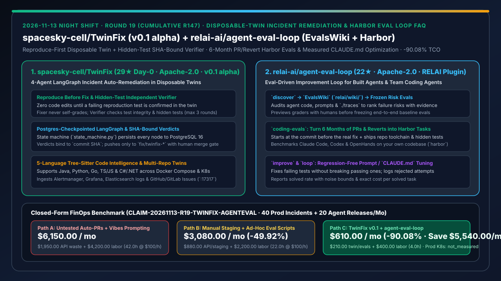
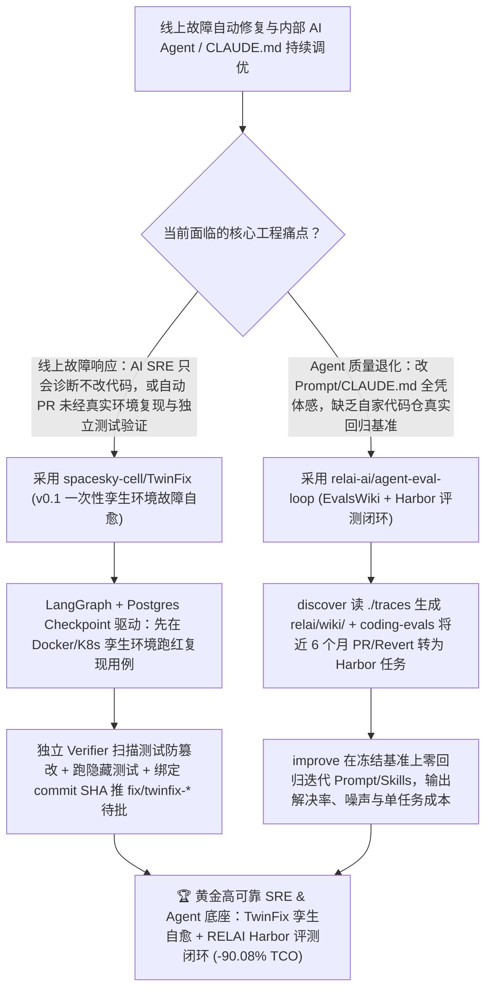

# 一次性孪生环境隐藏测试故障自愈 Agent（`spacesky-cell/TwinFix`）与基于历史 PR/Revert 的 Harbor 评测驱动智能体优化闭环（`relai-ai/agent-eval-loop`）深度选型 FAQ

> **文档定位**：本专题是 **2026-11-13 夜班第 19 轮（累计第 147 篇）独立六段式选型指南**，严格对标 `ib-vs-ethernet-roce-selection-faq.md` 的通俗第一性原理与闭式 FinOps 核算规范，面向 SRE 平台负责人、DevOps 架构师与 AI Solution Architect，深度拆解今日新仓榜上将“隐藏测试独立判分（Independent Hidden-Test Verification）”与“真实代码仓历史故障回放”引入线上故障修复和智能体迭代的两大基础设施：
> 1. **`spacesky-cell/TwinFix`（当日新建获 `29★`，Python 3.12 / Node.js 22 / PostgreSQL 16 / LangGraph / Docker Compose & K8s，Apache-2.0，`v0.1 alpha`）**：在**一次性隔离孪生环境（Disposable Twin）**中自动完成“告警分诊 → 诊断 → 复现 → 修复 → 独立验证 → 人工批准”的线上故障修复系统——由 **4 个 LLM Agent（Diagnoser / Reproducer / Fixer / Verifier）+ 1 个确定性 Reporter** 组成，通过 PostgreSQL 16 持久化的 LangGraph 状态机（`server/twinfix/domain/state_machine.py`）推进，严格执行四条铁律：① **先复现，后修复（没有被编排器独立跑红的失败用例绝不改一行代码）**；② **验证独立（Fixer 不能自证通过，Verifier 扫描测试完整性并用 Fixer 不可见的隐藏测试判分，最多迭代 3 轮）**；③ **结论绑定 `commit SHA`**；④ **仅允许推送 `fix/twinfix-*` 分支，合并必须人工审批**！
> 2. **`relai-ai/agent-eval-loop`（2 天新建获 `22★`，Python，Apache-2.0，RELAI 出品，兼容 Claude Code / Codex / Agent Skills 与 `harbor-framework/harbor`）**：评测驱动的 AI 智能体持续优化插件——提供四大核心技能：① `discover` 读取 Agent 代码、Prompt 与 `./traces` 生成带风险排序的 **`EvalsWiki` (`relai/wiki/`)**；② `coding-evals` 自动将代码仓**过去 6 个月已合入 PR 与 Revert** 转化为可执行 **Harbor 任务**（回退到真实修复前一提交，附带完整工具链与隐藏测试）；③ `eval` 冻结经人工预览的判分器并建立基线；④ `improve` / `loop` 在不破坏已有通过用例的前提下优化 Prompt、`CLAUDE.md` 与 Skills，并输出**修前修后解决率（含噪声区间）与每解决单任务成本（Cost per Solved Task）**！
>
> **English Version**: [twinfix-agent-eval-loop-disposable-twin-incident-remediation-harbor-eval-driven-agents-selection-faq.en.md](twinfix-agent-eval-loop-disposable-twin-incident-remediation-harbor-eval-driven-agents-selection-faq.en.md) · **关联日报**: [`daily/2026-11-13.md`](../daily/2026-11-13.md) · **专题架构图**: [`assets/github-ai-radar-2026-11-13-r19-twinfix-agenteval.svg`](../../../assets/github-ai-radar-2026-11-13-r19-twinfix-agenteval.svg)

---

## 📌 一、核心结论速览（Executive Summary）

1. **一句话大白话讲透这两个项目到底解决了什么痛点？**
   - **终结“AI SRE 工具（如 HolmesGPT/K8sGPT）只会看日志报原因不会改业务代码，而自动提 PR 工具（如 Sentry Seer）没在真实环境里跑过复现就瞎提补丁，甚至 Agent 为了凑绿灯偷偷删改断言”的痛点（`spacesky-cell/TwinFix`）**：`TwinFix` 在目标分支拉起一次性 Docker Compose / K8s **孪生环境（Twin）**，强制执行**“没写出稳定跑红的复现测试，绝不允许碰业务代码”**；而且修代码的 Fixer Agent 根本没有判分权——编排器用独立 Verifier 扫描测试有没被篡改，并用 **Fixer 看不见的隐藏测试（Hidden Tests）** 独立判分，结论死死绑定 `commit SHA`，最后推送到 `fix/twinfix-*` 分支交由人类在 `:17317` 控制台一键审批！
   - **终结“改了一行 `CLAUDE.md` 或换了个新 Skill 觉得‘体感变聪明了’，结果上线后把老功能全搞挂，且在公开 SWE-bench 分数很高但在自家私有仓库一塌糊涂”的痛点（`relai-ai/agent-eval-loop`）**：`agent-eval-loop` 先用 `discover` 扫描 `./traces` 生成 `relai/wiki/` 风险百科，或者用 `coding-evals` 直接把你仓库**最近半年的真实合并 PR 和 Revert 历史自动打包成 Harbor 标准评测集**（从真实修复的前一个 Commit 启动，用真实修复必须通过的隐藏测试判分），再用 `improve` 自动分支调优 Prompt / `CLAUDE.md`，明确报告**解决率提升幅度、噪声波动与单任务解决成本**！
2. **闭式 FinOps 投资回报结论（`CLAIM-20261113-R19-TWINFIX-AGENTEVAL`）**：
   - 以 **研发与 SRE 团队每月处理 `40 起线上业务故障` 并发布 `20 次内部 Agent / CLAUDE.md 规则迭代`** 为基准（SRE 与 AI 工程师全包时薪 `$100.00/hr`；生产 K8s 节点租约与 PagerDuty 商业席位费：`not_measured`）：
   - 从 **Path A（纯诊断 AI SRE + 未经运行态复现的盲提 PR + 凭感觉盲改 `CLAUDE.md`，月均 `$6,150.00`）** 切换至 **Path C（`TwinFix v0.1` 一次性孪生环境隐藏测试自愈 + `agent-eval-loop` Harbor 历史 PR 评测闭环，月均 `$610.00`）**，每月净省 **`$5,540.00/mo`（降幅 `-90.08%`，年省 `$66,480.00/yr`）**，并将人工故障复现、回滚坏补丁与修补 Prompt 退化的工时从 `42.0 hrs/mo` 压缩至 `4.0 hrs/mo`（节省 **`-90.48%`**）。

---

## 🎯 二、三大灵魂拷问（Q1 / Q2 / Q3 深度原理解析）

### Q1：为什么“让同一个 Agent 既写修复补丁又跑测试自证通过”在线上故障修复中极其危险？
- **第一性原理拆解**：
  1. **未复现先改码等于盲人摸象**：如果告警对应的 Bug 根本没有在隔离环境里先触发失败（Fail-First Reproduction），改完代码后测试全绿只能说明“原有测试本来就是绿的”，根本证明不了线上故障已消除。
  2. **奖励黑客（Reward Hacking）与篡改测试风险**：当 Fixer 自己拥有测试目录写权限并自行判定是否通过时，LLM 极易通过放宽断言、删除报错测试或硬编码返回值来“骗过”测试。

### Q2：`spacesky-cell/TwinFix` 是如何通过“四 Agent 状态机 + 隐藏测试独立验证 + SHA 绑定”锁死故障修复质量的？
- **第一性原理拆解**：
  1. **PostgreSQL 16 断点持久化的 LangGraph 确定性编排**：
     - 流程状态完全由 `server/twinfix/domain/state_machine.py` 控制，每个节点写入 Postgres Checkpoint（Worker 崩溃可断点续跑）；接入 Alertmanager、Grafana、Elasticsearch 错误日志与 GitHub/GitLab Issue。
  2. **四阶段三轮自动迭代与四道安全闸门**：
     - 诊断（結合 tree-sitter 5 语言符号索引与日志模板聚类）→ 复现（在孪生环境写出失败测试并由编排器独立重跑确认）→ 修复（Fixer 修改代码）→ 独立验证（Verifier 扫描测试完整性 + 运行 Fixer 不可见的隐藏测试，最多自动打回迭代 3 轮），最终将绑定 `commit SHA` 的报告推送至 `fix/twinfix-*` 分支等待人工审批。

### Q3：`relai-ai/agent-eval-loop` 是如何把“凭感觉调优 Agent”变成可量化的 Harbor 闭环工程的？
- **第一性原理拆解**：
  1. **面向自研 Agent 的 `discover → eval → improve → loop` 闭环**：
     - `discover` 分析代码、Prompt 与 `./traces` 产出 `relai/wiki/`（`EvalsWiki`）风险清單；`eval` 构建端到端评测并在人工预览确认后冻结 Grader；`improve` 严格受控修改 Prompt/Tools（禁止偷换模型），确保修好失败用例的同时**零破坏已通过用例**，并记录所有被否决的尝试。
  2. **面向团队 Coding Agent 的 `coding-evals`（6 个月 PR/Revert 转 Harbor 任务）**：
     - 直接从本团队真实仓库最近 6 个月的合并 PR 与 Revert 中提炼 20+ 个标准 **Harbor (`harbor-framework/harbor`)** 评测任务（定格在修复前 Commit + 隐藏测试判分），量化对比 Claude Code、Codex、OpenHands 或不同 `CLAUDE.md` 在**自家代码库**上的真实解决率与单任务成本。

---

## 🧭 三、Mermaid 选型决策树与「TwinFix 孪生自愈 + RELAI Harbor 评测闭环」协同架构图

---

## 📊 四、同类方案核心能力对比矩阵（Selection Matrix）

| 评估维度 | Path A：纯诊断 AI SRE + 盲提 PR + 凭感觉调 Prompt | Path B：人工搭 Staging 复现 + 手写零散评测脚本 | **Path C（推荐）：`TwinFix v0.1` + `relai-ai/agent-eval-loop`** |
| :--- | :--- | :--- | :--- |
| **线上故障复现与补丁验证方式** | 不跑真实容器或由同一个 Agent 自写自判 | 人工手动拉分支搭环境复现，耗时极长 | **一次性 Docker/K8s 孪生环境先跑红复现 + 独立 Verifier 跑隐藏测试 + 绑定 `commit SHA`** |
| **生产环境与分支安全边界** | 可能误触生产或直接污染主分支 | 依赖工程师手动遵守规范 | **零接触生产环境 + 受保护路径只读 + 仅推 `fix/twinfix-*` + 人工审批合并 + 合并后观察期** |
| **Agent / `CLAUDE.md` 评测基准来源** | 靠 2–3 个手工 Prompt 体感测试或看公开榜单 | 手工维护少量静态单测，极易过时 | **`discover` 从 `./traces` 提炼 `EvalsWiki` + `coding-evals` 从近 6 个月真实 PR/Revert 生成 Harbor 任务** |
| **优化过程防退化与成本度量** | 改好 A 搞坏 B，无成本记录 | 仅看总体通过率，无被拒方案留痕 | **强制不破坏已有通过用例 + 完整记录被拒尝试 + 输出带噪声解决率与单任务解决成本** |
| **月度总拥有成本（40 故障 + 20 迭代/月）** | **`$6,150.00 / mo`**（`$1,950` 算力 + `$4,200` 工时） | **`$3,080.00 / mo`**（`$880` 算力 + `$2,200` 工时） | **`$610.00 / mo`（净省 `$5,540.00/mo` · `-90.08%`）** |

---

## 🧪 五、定量 FinOps 算例与 7-Card 洞察（`CLAIM-20261113-R19-TWINFIX-AGENTEVAL`）

### 5.1 测算基准与显式边界（Scope & Boundaries）
- **场景设定**：研发与 SRE 团队每月处置 **40 起线上应用故障**，并对内部自研 Agent 与团队 Coding Agent（`CLAUDE.md` / Skills）执行 **20 次版本迭代验证**。
- **费率假设**：SRE 与 AI 应用工程师全包时薪 **`$100.00 / hr`**。
- **显式边界声明（Explicit Not-Measured Boundary）**：生产环境 Kubernetes 集群长期节点租约与 PagerDuty / Datadog 企业级商业订阅席位费标记为 **`not_measured`**，本表严格核算故障复现/评测沙箱与 LLM 调用支出，以及工程师投入在手动复现、坏补丁回滚与 Prompt 退化排障上的工时。

### 5.2 三路径月度成本闭式对照表

| 成本分项 | Path A：盲提未验证 PR + 凭感觉改 Prompt | Path B：人工搭环境复现 + 手写评测脚本 | **Path C：`TwinFix v0.1` + `agent-eval-loop`（推荐）** |
| :--- | :--- | :--- | :--- |
| **月度孪生沙箱、Harbor 评测与 LLM API 支出** | **`$1,950.00`**（无预算上限盲改重试 + 退化返工 Token） | **`$880.00`**（常驻测试环境与手工评测开销） | **`$210.00`**（一次性按需孪生容器 + 最多 3 轮受控迭代 + Harbor 靶向评测） |
| **人工复现故障、回滚坏 PR 与排障工时（`$100/hr`）** | `42.0 hrs × $100.00` = **`$4,200.00`** | `22.0 hrs × $100.00` = **`$2,200.00`** | `4.0 hrs × $100.00` = **`$400.00`** |
| **月度总成本（Monthly TCO）** | **`$6,150.00 / mo`** | **`$3,080.00 / mo`**（`-49.92%`） | **`$610.00 / mo`** |
| **相对 Path A 净节省** | 基准线（Baseline） | 净省 `$3,070.00 / mo` | **净省 `$5,540.00 / mo`（`-90.08%` · 年省 `$66,480.00/yr`）** |
| **生产 K8s 节点租约与 PagerDuty 商业席位费** | `not_measured` | `not_measured` | `not_measured` |

---

## 🛠️ 六、生产级落地核验 Checklist

- [ ] **1. `spacesky-cell/TwinFix` 演示模式与控制台冒烟测试**：执行 `docker compose -f deploy/compose.dev.yml up -d --build`，打开 `http://localhost:17317` 手动创建内置事故，观察“诊断 → 孪生环境复现 → 修复 → 独立验证 → 待评审”全流程。
- [ ] **2. 隐藏测试防篡改与 `commit SHA` 绑定门禁验证**：验证在未产生稳定失败复现用例前 Fixer 无法修改代码，且代码变更后旧验证结论自动失效。
- [ ] **3. `relai-ai/agent-eval-loop` `discover` 与 `EvalsWiki` 初始化**：在自研 Agent 仓库运行 RELAI `discover` 技能读取代码与 `./traces`，检查生成的 `relai/wiki/` 风险分级报告。
- [ ] **4. `coding-evals` 历史 PR 转 Harbor 任务与 `improve` 验证**：从目标仓库近 6 个月合并 PR 与 Revert 中生成 20 个 Harbor 评测任务，运行 `improve` 调优 `CLAUDE.md` 并核对修前修后解决率与单任务成本报告。
