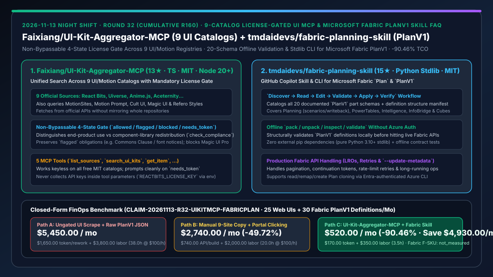
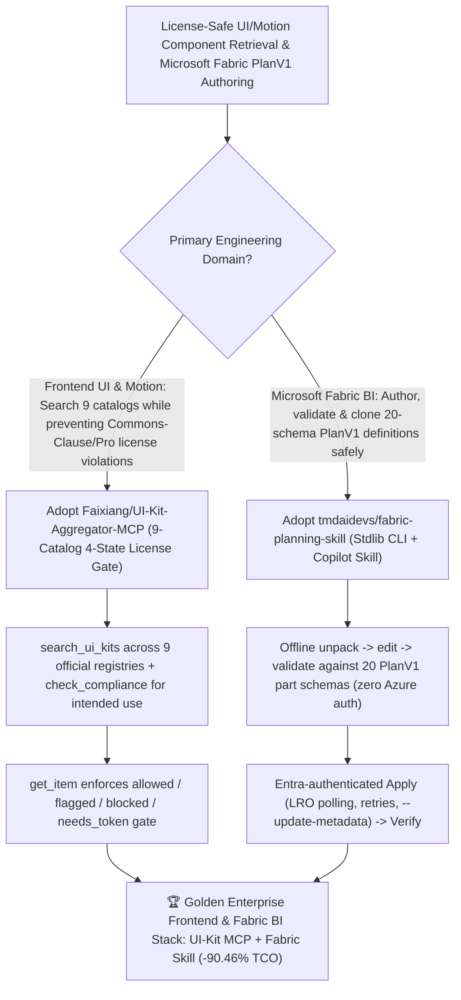

# 9-Catalog License-Gated UI MCP (`Faixiang/UI-Kit-Aggregator-MCP`) & Microsoft Fabric `PlanV1` 20-Schema Skill (`tmdaidevs/fabric-planning-skill`) Selection FAQ

> **Document Scope**: This is the **2026-11-13 Night Shift Round 32 (Cumulative #160) standalone 6-part selection guide**, modeled strictly after `ib-vs-ethernet-roce-selection-faq.md` with first-principles explanations and closed-form FinOps math. It is written for AI Solution Architects, Full-Stack Frontend Leads, and Microsoft Fabric BI Architects evaluating two compliance- and schema-gated agent tools:
> 1. **`Faixiang/UI-Kit-Aggregator-MCP` (`13★` in 1 day, TypeScript, MIT, Node.js 20+)**: An MCP server that searches across **9 official UI and animation catalogs** (**MotionSites, React Bits, Uiverse, Anime.js, Aceternity UI, Motion Prompt, Cult UI, Magic UI, and Refero Styles**) via 5 tools (`list_sources`, `search_ui_kits`, `get_item`, `get_license`, `check_compliance`) — enforcing a **non-bypassable 4-state license gate (`allowed / flagged / blocked / needs_token`)** before any component source code is returned to the coding agent!
> 2. **`tmdaidevs/fabric-planning-skill` (`15★` in 3 days, Python 3.10+ zero-dependency standard-library CLI + GitHub Copilot skill, MIT)**: A GitHub Copilot skill and CLI for managing **Microsoft Fabric `Plan` items and authoring public `PlanV1` definitions** (`Discover -> Read -> Edit -> Validate -> Apply -> Verify`) — cataloging **all 20 documented `PlanV1` part schemas + the definition structure manifest** across Planning (scenarios/writeback), PowerTables, Intelligence, Connected Planning (`InfoBridge`), and Cubes, with **offline `pack / unpack / inspect / validate` checks requiring zero Azure authentication**!
>
> **中文版本**: [ui-kit-aggregator-mcp-fabric-planning-skill-9catalog-license-gate-fabric-planv1-selection-faq.md](ui-kit-aggregator-mcp-fabric-planning-skill-9catalog-license-gate-fabric-planv1-selection-faq.md) · **Daily Digest**: [`daily/2026-11-13.en.md`](../daily/2026-11-13.en.md) · **Topic SVG**: [`assets/github-ai-radar-2026-11-13-r32-uikitmcp-fabricplan.svg`](../../../assets/github-ai-radar-2026-11-13-r32-uikitmcp-fabricplan.svg)

---

## 📌 1. Executive Summary

1. **In plain English, what core pain points do these two repositories solve?**
   - **Ending "coding agents scraping UI/animation snippets without checking whether they carry a Commons Clause restriction, require third-party font attribution, or belong to a locked paid Pro tier" (`Faixiang/UI-Kit-Aggregator-MCP`)**: This MCP server queries **9 official UI and motion registries** (React Bits, Uiverse, Anime.js, Aceternity UI, Cult UI, Magic UI, Refero Styles, MotionSites, Motion Prompt) and wires search and license verification into a single non-bypassable pipeline. Every item passes through a **4-state gate (`allowed`, `flagged`, `blocked`, `needs_token`)** and `check_compliance` (which distinguishes end-product usage from component-library redistribution) before source code ever reaches your agent!
   - **Ending "GitHub Copilot hallucinating invalid JSON when editing complex Microsoft Fabric `PlanV1` definitions across PowerTables, InfoBridge queries, writeback settings, and Cube partitions" (`tmdaidevs/fabric-planning-skill`)**: Built using only the Python 3.10+ standard library (zero external packages), this skill catalogs **all 20 documented `PlanV1` part schemas and the structure manifest** behind a strict `Discover -> Read -> Edit -> Validate -> Apply -> Verify` workflow — letting agents `pack`, `unpack`, `inspect`, and structurally `validate` definitions **offline without Azure CLI login** before applying changes with full LRO, pagination, and rate-limit retry handling!
2. **Closed-Form FinOps Conclusion (`CLAIM-20261113-R32-UIKITMCP-FABRICPLAN`)**:
   - Modeled for an **enterprise full-stack and BI team shipping `25 animated web UIs / month` and authoring `30 Microsoft Fabric PlanV1 definitions / month`** (fully loaded full-stack & BI architect rate `$100.00/hr`; Microsoft Fabric F-SKU capacity and commercial UI Pro licenses: `not_measured`):
   - Switching from **Path A (ungated UI scraping with license rework + raw `PlanV1` JSON trial-and-error against live APIs, `$5,450.00/mo`)** to **Path C (`UI-Kit-Aggregator-MCP` 4-state license gate + `fabric-planning-skill` offline 20-schema validation CLI, `$520.00/mo`)** saves **`$4,930.00/mo` (`-90.46%`, or `$59,160.00/yr`)** and cuts IP-compliance remediation and `PlanV1` debugging labor from `38.0 hrs/mo` to `3.5 hrs/mo` (**`-90.79%`**).

---

## 🎯 2. Three First-Principles Deep-Dive Questions (Q1 / Q2 / Q3)

### Q1: Why is letting an AI coding agent pull UI components from public registries without an inline license gate a legal liability?
- **First-Principles Breakdown**:
  1. **Mixed License Regimes Across UI Catalogs**: While Uiverse, Anime.js, and Cult UI use MIT, React Bits' free tier uses MIT + Commons Clause (permitting client apps but forbidding commercial component-library redistribution), Refero Styles permits design reference (`DESIGN.md`) rather than paid payload scraping, and Magic UI Pro is proprietary.
  2. **Stripped Attribution Notices**: Raw web scraping drops third-party font and copyright notices (`flagged` obligations).

### Q2: How does `Faixiang/UI-Kit-Aggregator-MCP` enforce non-bypassable compliance across 9 sources?
- **First-Principles Breakdown**:
  1. **Mandatory 4-State Gate (`allowed / flagged / blocked / needs_token`)**:
     - Has zero flag to skip license validation; blocks out-of-scope paid sources (`blocked`), retains mandatory attribution headers (`flagged`), and reads commercial keys (`REACTBITS_LICENSE_KEY`, `ACETERNITY_PRO_TOKEN`) strictly from environment variables rather than tool arguments.
  2. **Intended-Use Verification (`check_compliance`)**:
     - Evaluates whether the component is permitted for the user's specific target (e.g., client marketing site vs. redistributable UI kit).

### Q3: How does `tmdaidevs/fabric-planning-skill` make Microsoft Fabric `PlanV1` authoring deterministic?
- **First-Principles Breakdown**:
  1. **20-Part Schema Catalog & Offline `pack/unpack/validate`**:
     - Validates all 20 `PlanV1` part schemas (Planning, PowerTables, Intelligence, InfoBridge Connected Planning, Cubes) and the structure manifest locally without requiring Azure CLI authentication.
  2. **6-Step Workflow & Explicit Metadata Isolation (`--update-metadata`)**:
     - Enforces `Discover -> Read -> Edit -> Validate -> Apply -> Verify`, models cloning as `read -> remap -> create`, requires explicit `--update-metadata` for Core Items platform metadata, and handles LROs and rate limits in pure Python stdlib.

---

## 🧭 3. Mermaid Decision Tree & UI-Kit-Aggregator-MCP + Fabric Planning Architecture

---

## 📊 4. Head-to-Head Selection Matrix

| Dimension | Path A: Ungated UI Scraping + Raw `PlanV1` JSON | Path B: Manual 9-Site Browsing + Portal Clicking | **Path C (Recommended): `UI-Kit-Aggregator-MCP` + `fabric-planning-skill`** |
| :--- | :--- | :--- | :--- |
| **UI & Motion Catalog Coverage** | Hallucinated outdated CSS/Tailwind snippets | Manual tab-switching across 9 websites | **Single `search_ui_kits` across 9 official UI, motion & `DESIGN.md` catalogs** |
| **License & Redistribution Compliance** | Mixes Commons Clause & proprietary Pro code silently | Manual reading of per-repo LICENSE files | **Non-bypassable 4-state gate (`allowed/flagged/blocked/needs_token`) + `check_compliance`** |
| **Microsoft Fabric `PlanV1` Validation** | Trial-and-error against live Fabric REST APIs | Portal-only clicks; no Git version control | **All 20 `PlanV1` part schemas + offline `pack / unpack / inspect / validate` CLI** |
| **Runtime Footprint & Secret Hygiene** | Heavy scrapers; keys leaked in chat prompts | Manual copy-paste | **Node 20+ MCP (env-only keys) + zero-dependency Python 3.10+ stdlib CLI** |
| **Monthly TCO (25 UIs + 30 Fabric Plans)** | **`$5,450.00 / mo`** (`$1,650` token + `$3,800` labor) | **`$2,740.00 / mo`** (`$740` API + `$2,000` labor) | **`$520.00 / mo` (Saves `$4,930.00/mo` · `-90.46%`)** |

---

## 🧪 5. Closed-Form FinOps Worked Example & 7-Card Insights (`CLAIM-20261113-R32-UIKITMCP-FABRICPLAN`)

### 5.1 Baseline Parameters & Explicit Scope Boundaries
- **Scenario**: An enterprise full-stack and BI team building **25 animated web UIs per month** and authoring **30 Microsoft Fabric `PlanV1` planning/forecasting definitions per month**.
- **Labor Rate**: Fully loaded full-stack and BI data architect rate of **`$100.00 / hr`**.
- **Explicit Not-Measured Boundary**: Microsoft Fabric F-SKU capacity reservations and commercial Aceternity/ReactBits Pro seat keys are marked **`not_measured`**. This model strictly accounts for LLM token waste from schema/license rewrites and engineering hours spent remediating license violations and debugging invalid `PlanV1` definitions.

### 5.2 Three-Path Monthly Cost Comparison

| Cost Component | Path A: Ungated UI Scrape + Raw `PlanV1` JSON | Path B: Manual 9-Site Copy + Portal Clicking | **Path C: `UI-Kit-Aggregator-MCP` + `Fabric Skill` (Recommended)** |
| :--- | :--- | :--- | :--- |
| **Monthly Component Rewrite & `PlanV1` Token Spend** | **`$1,650.00`** (rewriting license-tainted UI + failed `PlanV1` retries) | **`$740.00`** (moderate prompt & build spend) | **`$170.00`** (license-gated UI hits + offline-validated `PlanV1` payloads) |
| **IP Remediation & Fabric `PlanV1` Debugging Labor (`$100/hr`)** | `38.0 hrs × $100.00` = **`$3,800.00`** | `20.0 hrs × $100.00` = **`$2,000.00`** | `3.5 hrs × $100.00` = **`$350.00`** |
| **Total Monthly TCO** | **`$5,450.00 / mo`** | **`$2,740.00 / mo`** (`-49.72%`) | **`$520.00 / mo`** |
| **Net Savings vs. Path A** | Baseline | Saves `$2,710.00 / mo` | **Saves `$4,930.00 / mo` (`-90.46%` · `$59,160.00/yr`)** |
| **Fabric F-SKU Capacity & Commercial UI Pro Keys** | `not_measured` | `not_measured` | `not_measured` |

---

## 🛠️ 6. Production Adoption Checklist

- [ ] **1. `Faixiang/UI-Kit-Aggregator-MCP` Registration**: Connect the MCP server on Node.js 20+ and test `list_sources` and `search_ui_kits` across free MIT sources (Uiverse, Anime.js, Cult UI, Motion Prompt).
- [ ] **2. 4-State Gate & `check_compliance` Audit**: Verify that `check_compliance` flags Commons Clause restrictions on component-library redistribution and blocks unauthorized Magic UI Pro requests.
- [ ] **3. `tmdaidevs/fabric-planning-skill` Offline Validation**: Clone into `$HOME\.copilot\skills\fabric-planning-skill` and run offline `pack`, `unpack`, `inspect`, `validate`, and contract tests without Azure CLI sign-in.
- [ ] **4. End-to-End `Discover -> Verify` Fabric Plan Deployment**: Execute a full `Discover -> Read -> Edit -> Validate -> Apply -> Verify` cycle against a test Fabric workspace using Entra-authenticated Azure CLI.
