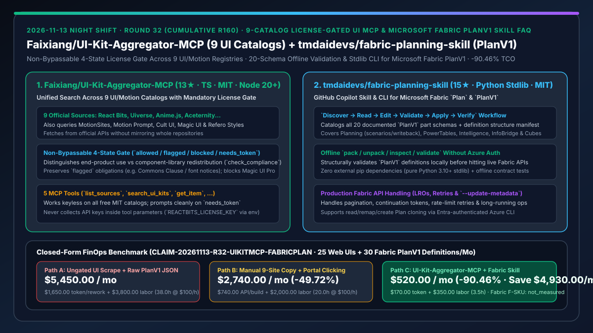
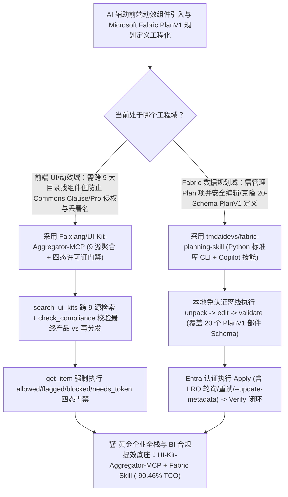

# 九源许可证强制门禁 UI/动效聚合 MCP（`Faixiang/UI-Kit-Aggregator-MCP`）与 Microsoft Fabric `PlanV1` 20-Schema 离线校验技能（`tmdaidevs/fabric-planning-skill`）深度选型 FAQ

> **文档定位**：本专题是 **2026-11-13 夜班第 32 轮（累计第 160 篇）独立六段式选型指南**，严格对标 `ib-vs-ethernet-roce-selection-faq.md` 的通俗第一性原理与闭式 FinOps 核算规范，面向企业全栈前端架构师、Microsoft Fabric 数据规划负责人与 AI Solution Architect，深度拆解今日新仓榜上将“不可绕过的开源许可证合规门禁”与“离线 20-Schema 结构校验”分别引入 UI 组件检索与 Microsoft Fabric `PlanV1` 编排的两大工具：
> 1. **`Faixiang/UI-Kit-Aggregator-MCP`（1 天新建获 `13★`，TypeScript，MIT，Node.js 20+）**：一次检索 **9 个官方 UI 与动效目录**（**MotionSites、React Bits、Uiverse、Anime.js、Aceternity UI、Motion Prompt、Cult UI、Magic UI、Refero Styles**）的聚合 MCP 服务——提供 5 个工具（`list_sources`、`search_ui_kits`、`get_item`、`get_license`、`check_compliance`），**没有任何跳过检查的参数，强制每一条内容先经过四态许可证门禁（`allowed` / `flagged` / `blocked` / `needs_token`）才允许把源码交给 AI 助手**；严格区分“用于最终产品（End-Product）”与“二次分发为组件库（Redistribution）”（如识别 React Bits 的 MIT + Commons Clause、拦截 Magic UI Pro、绝不在工具参数里收集付费 Token）！
> 2. **`tmdaidevs/fabric-planning-skill`（3 天新建获 `15★`，Python 3.10+ 纯标准库零外部依赖 CLI + GitHub Copilot 技能，MIT）**：面向 Microsoft Fabric **Plan** 项与公开 **`PlanV1`** 定义的端到端工程技能——遵循 **`Discover -> Read -> Edit -> Validate -> Apply -> Verify`** 六步闭环，完整收录 **20 个文档化部件 Schema（Part Schemas）与定义结构清单（Manifest）**，覆盖 Planning（输入、原生度量、公式、预测、场景、写回 Writeback）、PowerTables、Intelligence、Connected Planning（`InfoBridge`）与 Cubes/分区，支持**无需 Azure 登录即可在本地离线执行 `pack / unpack / inspect / validate` 结构校验**，并内置分页、限流重试与长耗时操作（LRO）轮询！
>
> **English Version**: [ui-kit-aggregator-mcp-fabric-planning-skill-9catalog-license-gate-fabric-planv1-selection-faq.en.md](ui-kit-aggregator-mcp-fabric-planning-skill-9catalog-license-gate-fabric-planv1-selection-faq.en.md) · **关联日报**: [`daily/2026-11-13.md`](../daily/2026-11-13.md) · **专题架构图**: [`assets/github-ai-radar-2026-11-13-r32-uikitmcp-fabricplan.svg`](../../../assets/github-ai-radar-2026-11-13-r32-uikitmcp-fabricplan.svg)

---

## 📌 一、核心结论速览（Executive Summary）

1. **一句话大白话讲透这两个项目到底解决了什么痛点？**
   - **终结“让 Coding Agent 去网上找炫酷 React 动画组件时，AI 管它三七二十一直接把带 Commons Clause（禁止商业转售）的组件、带字体版权限制的代码甚至未授权的付费 Pro 组件直接塞进客户商业项目里，上线前被法务查出侵权全部推倒重写”的痛点（`Faixiang/UI-Kit-Aggregator-MCP`）**：把 **9 大主流 UI/动效库**（React Bits、Uiverse、Anime.js、Aceternity UI、Cult UI、Magic UI、Refero Styles 等）收进一个 MCP 入口，并把**“搜组件”和“查许可证”焊死成同一条必经之路（零绕过参数）**！每一条源码在离开 `get_item` 工具前必须过四态门禁：免费 MIT 直接放行（`allowed`），有字体/署名义务的附带原声明（`flagged`），禁止抓取的付费源直接拦截（`blocked`），缺商业 Key 的礼貌询问（`needs_token`）！
   - **终结“用 GitHub Copilot 编写或修改 Microsoft Fabric `PlanV1` 复杂规划定义（含 PowerTables、InfoBridge、Cube 分区与写回配置）时，因为模型不认识 20 个子部件 Schema 直接往线上 API 盲推残缺 JSON 导致远端报错”的痛点（`tmdaidevs/fabric-planning-skill`）**：仅用 Python 3.10+ 标准库（0 第三方依赖）把 **20 个 `PlanV1` 部件 Schema 与结构清单**封装成离线可测的 CLI 与 Copilot Skill，强制走 `Discover → Read → Edit → Validate → Apply → Verify`：**在连上 Azure CLI 调线上 API 之前，先在本地零凭证离线跑通 `unpack / inspect / validate` 与契约测试**，并自动处理线上 LRO 轮询、分页与限流重试！
2. **闭式 FinOps 投资回报结论（`CLAIM-20261113-R32-UIKITMCP-FABRICPLAN`）**：
   - 以 **企业全栈与商业智能（BI）团队每月交付 `25 个前端营销/产品动效界面` 并维护 `30 份 Microsoft Fabric PlanV1 财务/业务预测规划定义`** 为基准（全栈与数据架构师全包时薪 `$100.00/hr`；Microsoft Fabric F-SKU 容量费与商业 UI 库 Pro 授权费：`not_measured`）：
   - 从 **Path A（无门禁抓取 UI 组件引发合规返工 + 裸写 `PlanV1` JSON 直推线上失败重跑，月均 `$5,450.00`）** 升级至 **Path C（`UI-Kit-Aggregator-MCP` 9 源四态许可证门禁 + `fabric-planning-skill` 20-Schema 离线校验 CLI，月均 `$520.00`）**，每月净省 **`$4,930.00/mo`（降幅 `-90.46%`，年省 `$59,160.00/yr`）**，并将清理侵权组件与排查 Fabric `PlanV1` 结构错误的工时从 `38.0 hrs/mo` 压缩至 `3.5 hrs/mo`（节省 **`-90.79%`**）。

---

## 🎯 二、三大灵魂拷问（Q1 / Q2 / Q3 深度原理解析）

### Q1：为什么看似免费的公开 UI 组件库（如 React Bits、Aceternity、Refero）在 AI 自动生成代码时暗藏合规雷区？
- **第一性原理拆解**：
  1. **MIT 与 MIT + Commons Clause / 专有条款混杂**：例如 React Bits 免费目录采用 MIT + Commons Clause（允许做进最终产品，但禁止包装成组件库再分发），Refero Styles 仅允许作为设计参考（`DESIGN.md`）而禁止抓取付费 MCP 正文，Magic UI 则区分 MIT 免费版与闭源 Pro 版。
  2. **AI 助手默认忽略署名与使用场景边界**：如果没有前置的 `check_compliance` 与 `get_item` 硬门禁，Agent 会剥离文件头部的许可证与字体声明直接输出裸代码。

### Q2：`Faixiang/UI-Kit-Aggregator-MCP` 是如何通过四态门禁与五工具闭环兼顾“即搜即用”与“零侵权”的？
- **第一性原理拆解**：
  1. **无跳过参数的四态门禁（`allowed / flagged / blocked / needs_token`）**：
     - `allowed` 直接返回源码与官方安装命令；`flagged` 返回源码但强制保留附加义务声明；`blocked`（如 Magic UI Pro 或锁定的 MotionSites 提示词正文）直接拦截并仅返回官方链接与原因；`needs_token` 提示用户在环境变量配置 `REACTBITS_LICENSE_KEY` 或 `ACETERNITY_PRO_TOKEN`，绝不在对话工具参数中明文收集密钥。
  2. **按需直连官方接口（零全库镜像）**：
     - 尊重上游版权，不打包镜像 9 个目录，即便未配置任何付费 Key 也可顺畅检索全部免费 MIT 资产。

### Q3：`tmdaidevs/fabric-planning-skill` 是如何驯服 Microsoft Fabric `PlanV1` 复杂多部件定义的？
- **第一性原理拆解**：
  1. **20 部件 Schema 目录 + 本地离线 `pack/unpack/validate`**：
     - 将复杂的 `PlanV1` 拆解为 Planning、PowerTables、Intelligence、Connected Planning（`InfoBridge`）与 Cubes 五大域共 20 个精确 Schema，无需 Azure 登录即可在本地完成解包、检查与结构验证。
  2. **六步确定性工作流与完整 API 韧性**：
     - 严格执行 `Discover -> Read -> Edit -> Validate -> Apply -> Verify`；克隆（Clone）被规范化为 `read -> remap -> create` 组合流；显式隔离 Core Items 元数据更新（`--update-metadata`），并由纯 Python 标准库处理 LRO、分页与退避重试。

---

## 🧭 三、Mermaid 选型决策树与「9 源合规 UI MCP + Fabric PlanV1 离线校验技能」架构图

---

## 📊 四、同类方案核心能力对比矩阵（Selection Matrix）

| 评估维度 | Path A：Agent 裸爬 UI 站 + 手写 `PlanV1` JSON | Path B：人工翻 9 个网站 + Fabric 网页手点 | **Path C（推荐）：`UI-Kit-Aggregator-MCP` + `fabric-planning-skill`** |
| :--- | :--- | :--- | :--- |
| **UI/动效目录覆盖广度** | 仅靠模型过时训练记忆瞎编样式 | 人工逐个打开 Uiverse/React Bits/Anime.js 搜索 | **一次 `search_ui_kits` 横跨 9 大官方 UI、动效与 `DESIGN.md` 目录** |
| **开源与商业许可证合规控制** | 无检查，常混入 Commons Clause 或未授权 Pro 代码 | 靠程序员自觉看 LICENSE 页面 | **不可绕过的四态门禁（`allowed/flagged/blocked/needs_token`）+ `check_compliance`** |
| **Microsoft Fabric `PlanV1` 结构校验** | 直接调线上 API 试错，频繁因 Schema 不符失败 | 仅在网页 UI 操作，无法纳入 Git 版本控制与代码评审 | **完整 20 部件 Schema + 本地免登录离线 `pack / unpack / inspect / validate`** |
| **外部运行态依赖与密钥安全** | 依赖重型爬虫与杂乱 npm/pip 包 | 手工复制粘贴 | **Node 20+ 轻量 MCP（不在参数收 Key）+ Python 3.10+ 零第三方依赖标准库 CLI** |
| **月度总拥有成本（25 界面 + 30 规划/月）** | **`$5,450.00 / mo`**（`$1,650` 重跑 + `$3,800` 工时） | **`$2,740.00 / mo`**（`$740` API + `$2,000` 工时） | **`$520.00 / mo`（净省 `$4,930.00/mo` · `-90.46%`）** |

---

## 🧪 五、定量 FinOps 算例与 7-Card 洞察（`CLAIM-20261113-R32-UIKITMCP-FABRICPLAN`）

### 5.1 测算基准与显式边界（Scope & Boundaries）
- **场景设定**：企业数字化与 BI 研发团队每月构建 **25 个带高级动效的前端营销/产品页面**，并编写与演进 **30 份 Microsoft Fabric `PlanV1` 预算/预测模型定义**。
- **费率假设**：全栈前端与 BI 数据架构师全包时薪 **`$100.00 / hr`**。
- **显式边界声明（Explicit Not-Measured Boundary）**：Microsoft Fabric F-SKU 云容量账单与 Aceternity / React Bits 商业 Pro 许可证采购费标记为 **`not_measured`**，本表严格核算组件检索与 `PlanV1` 生成的 LLM Token 支出，以及工程师排查侵权组件返工与调试 `PlanV1` 20-Schema 结构错误的工时。

### 5.2 三路径月度成本闭式对照表

| 成本分项 | Path A：无门禁抓 UI + 裸推 `PlanV1` JSON | Path B：人工翻 9 站 + 网页手点配置 | **Path C：`UI-Kit-Aggregator-MCP` + `Fabric Skill`（推荐）** |
| :--- | :--- | :--- | :--- |
| **月度组件重写与 `PlanV1` 试错 Token 支出** | **`$1,650.00`**（侵权组件推倒重写 + `PlanV1` 报错重试） | **`$740.00`**（中等上下文查询开销） | **`$170.00`**（合规组件一次命中 + 本地离线校验零废请求） |
| **法务合规整改與 Fabric 定义排障工时（`$100/hr`）** | `38.0 hrs × $100.00` = **`$3,800.00`** | `20.0 hrs × $100.00` = **`$2,000.00`** | `3.5 hrs × $100.00` = **`$350.00`** |
| **月度总成本（Monthly TCO）** | **`$5,450.00 / mo`** | **`$2,740.00 / mo`**（`-49.72%`） | **`$520.00 / mo`** |
| **相对 Path A 净节省** | 基准线（Baseline） | 净省 `$2,710.00 / mo` | **净省 `$4,930.00 / mo`（`-90.46%` · 年省 `$59,160.00/yr`）** |
| **Fabric F-SKU 容量与商业 UI Pro 授权费** | `not_measured` | `not_measured` | `not_measured` |

---

## 🛠️ 六、生产级落地核验 Checklist

- [ ] **1. `Faixiang/UI-Kit-Aggregator-MCP` 挂载与无 Key 免费源测试**：在 Node.js 20+ 环境下接入该 MCP，调用 `list_sources` 与 `search_ui_kits` 核验 Uiverse、Anime.js、Cult UI 等免费 MIT 目录正常返回 `allowed`。
- [ ] **2. 四态许可证门禁与 `check_compliance` 验证**：针对 React Bits（Commons Clause）测试“用于客户网站”与“再发布为组件库”的不同合规裁决，并验证 Magic UI Pro 被准确标记为 `blocked`。
- [ ] **3. `tmdaidevs/fabric-planning-skill` 安装与离线契约测试**：克隆至 `$HOME\.copilot\skills\fabric-planning-skill`，在不登录 Azure CLI 的状态下运行离线 `pack / unpack / inspect / validate` 与单元测试。
- [ ] **4. 六步闭环（`Discover -> Verify`）真机演练**：在测试 Fabric Workspace 中走通一次 `PlanV1` 定义读取、离线修改校验、线上 Apply（含 LRO 等待）与最终 Verify。
