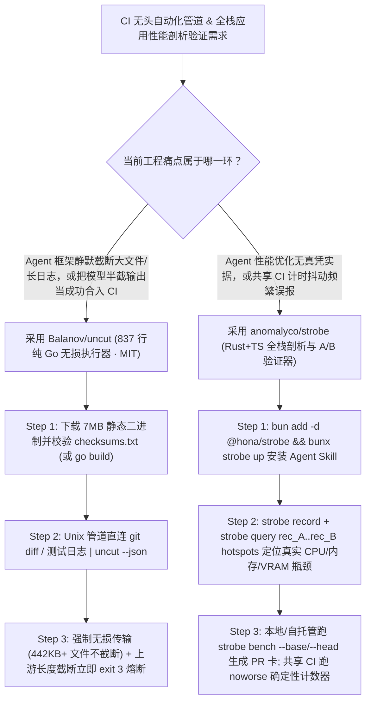

# 零静默截断无头 Go 极简执行器（`Balanov/uncut` 837 行）与 Agent 原生全栈性能剖析验证器（`anomalyco/strobe`）深度选型 FAQ

> **文档定位**：本专题是 **2026-11-11 夜班第 45 轮（累计第 90 篇）独立六段式选型指南**，严格对标 `ib-vs-ethernet-roce-selection-faq.md` 的通俗第一性原理与闭式 FinOps 核算规范，面向 CI/CD 自动化流水线架构师与客户端/全栈性能工程负责人，深度拆解今日在无损（Lossless）无头 Agent 执行器与不可伪造性能回归验证赛道爆发的两大新锐开源仓：
> 1. **`Balanov/uncut`（`265★`，Go 1.26+，仅 `837` 行核心实现，零第三方依赖，`~7 MB` 静态二进制，MIT）**：专为 Unix 管道（`git diff | uncut "..."`）、CI 任务与严谨 Agent 实验打造的**100% 无损无头（Lossless, Headless）Coding Agent 执行器**——彻底剔除 TUI、自动摘要压缩、滑动窗口与文件/命令输出静默截断，经 6 项确定性传输证明核验（`442,400` 字节文件/提示词与 `213,018` 字节命令输出分毫不差），且当大模型因输出 Token 触顶截断时**强制以 `exit 3` 报错退出（绝不向 `stdout` 输出半截残缺结果冒充成功）**！
> 2. **`anomalyco/strobe`（`150★`，Rust + TypeScript `@hona/strobe`，CLI + MCP + GitHub Action）**：面向 Web、Electron、Bun/Node 与原生桌面应用的 **Agent 原生全栈性能剖析与 A/B 验证器**——让 Agent 用 `strobe record` 与 `strobe query rec_A..rec_B hotspots` 一路下钻到代码行、原生调用栈、线程唤醒、内存分配、掉帧与 GPU/VRAM 字节，用 `strobe bench --base origin/main --head .` 在临时隔离目录跑成对 A/B 实验并自动更新 PR 性能卡片，更在共享 CI Runner 上智能切换为**精确计数器门禁（`noworse: net.requests=0,dom.nodes=0`）**彻底消除云端时钟抖动误报！
>
> **English Version**: [uncut-strobe-lossless-headless-harness-agent-profiler-selection-faq.en.md](uncut-strobe-lossless-harness-agent-profiler-selection-faq.en.md) · **架构总结图**: [`assets/github-ai-radar-2026-11-11-r45-uncut-strobe.svg`](../../../assets/github-ai-radar-2026-11-11-r45-uncut-strobe.svg)

---

## 📌 一、核心结论速览（Executive Summary）

1. **一句话大白话讲透这两个项目到底解决了什么痛点？**
   - **终结“Agent 执行器偷偷截断长文件/长报错日志、甚至把模型写了一半被截断的补丁当成成功返回给 CI”的隐患（`Balanov/uncut`）**：主流交互式 Agent 框架为了省 Token 或防报错，会在读大文件时静默砍掉后半截、在跑测试时只取最后几百行日志、甚至当上游 API 因为 `max_tokens` 限制返回半截代码（`finish_reason: "length"`）时依然以 `exit 0` 正常结束，导致 CI 脚本把残缺产物合入主干。`UNCUT` 用 **837 行纯 Go 标准库**立下铁律：无损输入、无损工具回传、非法 UTF-8 直接拒绝、上游一旦发生输出截断立即 **`exit 3` 且清空部分标准输出**！
   - **终结“Agent 嘴上吹嘘把页面优化快了 40%，实则只跑了一次充满噪声的计时、或者在共享 CI 上天天误报性能回退”的痛点（`anomalyco/strobe`）**：让 Coding Agent 做性能优化时，它缺乏看穿浏览器主线程、原生 C++/Rust 栈、线程唤醒与显存分配的统一显微镜，更没法给出统计显著的证据。`strobe` 提供从 `strobe init`、`strobe record/query`（支持 `rec_3f9a..rec_7c1d` 双录制差分定位到底哪一行代码变慢了）到 `strobe bench --base origin/main --head .` 的完整闭环；在多租户共享 GitHub Actions Runner 上，它拒绝根据抖动的毫秒数瞎判，而是死锁 **`noworse: net.requests=0,dom.nodes=0` 等精确确定性计数器**，只在自托管独占机器上开启 `mode: compare` 输出成对 A/B 耗时结论！
2. **闭式 FinOps 投资回报结论（`CLAIM-20261111-R45-UNCUT-STROBE`）**：
   - 以 10 人系统性能工程与 CI 自动化团队每月运行 **600 次 CI 管道自动化排障/Diff 审查任务** 与交付 **40 个 Web/Electron/Native 性能优化 PR** 为基准（高级性能与系统工程师含税费率 `$90.00/hr`；自托管物理压测机硬件折旧与商业 APM 平台年费：`not_measured`）：
   - 从 **Path A（有损截断框架导致大文件漏改重跑 + 人工导 Perfetto 火焰图核验 Agent 性能 PR 与排查共享 CI 误报，月均 `$5,540.00`）** 升级至 **Path C（`Balanov/uncut` 837 行无损管道执行器 + `anomalyco/strobe` 成对 A/B 剖析与 `noworse` 计数器门禁，月均 `$680.00`）**，每月净省 **`$4,860.00/mo`（降幅 `-87.73%`，年省 `$58,320.00/yr`）**，并将截断故障排查与手工性能归因工时从 `44.0 hrs/mo` 压缩至 `5.0 hrs/mo`（节省 **`-88.64%`**）。

---

## 🎯 二、三大灵魂拷问（Q1 / Q2 / Q3 深度原理解析）

### Q1：`Balanov/uncut` 是如何用 837 行 Go 代码兑现“6 项无损传输证明（Lossless Proof）”与 `exit 3` 熔断契约的？
- **第一性原理拆解**：
  1. **三不妥协的无损契约（Full Context In, Complete Results Out）**：
     - **不裁剪文件与命令输出**：验证集 `bench/results/windows-amd64-proof.json` 实测证明，`442,400` 字节的文件与提示词原封不动送达模型，`213,018` 字节的组合命令输出一字不漏回传；
     - **不静默吞掉上游截断（Exit Code 3）**：一旦上游 OpenAI 兼容端点因输出上限截断响应，`UNCUT` 绝不把半截文本写到 `stdout`，而是直接以退出码 `3` 终止管道；
     - **不静默替换损坏字节**：管道输入（如 `cat failing-test.log | uncut "..."`）强制校验合法 UTF-8，遇到乱码损坏字节立即显式报错而非静默替换为 `U+FFFD`。
  2. **极致可分叉（837 行 Go + 4 工具 + NDJSON 事件流）**：
     - 整个实现仅 837 行 Go 标准库代码、4 个原子工具、单文件约 `7 MB` 静态二进制；支持 `--json` 输出结构化 NDJSON 事件流与只追加（Append-only）JSONL 会话断点恢复。

### Q2：`anomalyco/strobe` 是如何打通“发现慢在哪（`query A..B`）→ 隔离验证优化（`bench`）→ 共享 CI 零误报门禁（`noworse`）”的？
- **第一性原理拆解**：
  1. **全栈跨层探针与双录制差分查询（`strobe query rec_A..rec_B hotspots`）**：
     - 通过 `strobe record app:desktop --for 10s`（或 `--probes memory --for 60s` 查内存泄漏），同时采集代码行、原生调用栈、线程唤醒、内存分配、帧率与 GPU/VRAM；优化前后各录一次，直接用 `strobe query rec_3f9a..rec_7c1d hotspots` 对比两次录制的热点增量，也可用 `strobe open rec_3f9a` 一键在 Perfetto 中打开完整时间轴。
  2. **一次性沙盒目录（Throwaway Home）与成对 A/B 检验**：
     - `strobe.json` 定义构建与启动方式，每次 `strobe bench perf/scroll.bench.ts --base origin/main --head .` 都在干净的临时 HOME 目录中成对交替运行基准分支与当前分支（如 *“8 对样本中 8 对更优，CPU 降低 44%，内存降低 78%”*），并通过 `strobe report experiment <id> --format pr --update-pr 42` 将可视化证据卡直接贴进 GitHub PR。
  3. **区分共享 Runner 与自托管 Runner 的物理诚实性（SPEC §26）**：
     - 共享云端 CI Runner 受邻座任务争抢 CPU 影响，计时噪声极大。`anomalyco/strobe@v0.29` 在共享 Runner 上**绝不给出虚假的耗时胜负判决**，而是严格校验确定性计数器（`noworse: net.requests=0,dom.nodes=0,count.*`）；仅在自托管独占 Runner 上启用 `mode: compare` 执行耗时 A/B 门禁！

### Q3：AI 架构师如何将 `Balanov/uncut` 与 `anomalyco/strobe` 组合进自动化研发流水线？
- **黄金组合落地范式**：
  - 在 **CI 脚本、Git Hook 与自动化修复管道**中，用 **`Balanov/uncut`** 替代带 TUI 和静默截断的笨重框架，确保长 Diff、完整编译日志和性能 JSON 报告 100% 无损喂给模型，且截断必报错（`exit 3`）；
  - 在**前端 Web、Electron 桌面端与 Rust/Node 服务端性能优化循环**中，执行 `bunx strobe up` 安装 `strobe` Skill，让 Agent 先用 `strobe query` 找准真瓶颈，再用 `strobe bench --base origin/main --head .` 拿出铁证后才准提交 PR！

---

## 🧭 三、Mermaid 选型决策树与无损性能工程流水线

---

## 📊 四、同类方案核心能力对比矩阵（Selection Matrix）

| 评估维度 | Path A：常规 TUI Agent 框架 + 共享 CI 简单计时 | Path B：自写 Python 包装脚本 + 人工看火焰图 | **Path C（推荐）：`Balanov/uncut` + `anomalyco/strobe`** |
| :--- | :--- | :--- | :--- |
| **大文件与长命令输出完整性** | 超过阈值静默截断头尾，模型基于残缺日志瞎猜 | 需手工维护分块逻辑，易破坏 UTF-8 边界 | **100% 无损传输（实测 442KB 提示词 / 213KB 输出零删减）** |
| **上游 `max_tokens` 截断安全性** | 常把半截代码当正常回复写盘并返回 `exit 0` | 需自己解析 `finish_reason` 状态码 | **触顶截断强制返回 `exit 3` 且清空部分 `stdout`，绝不污染管道** |
| **跨栈性能瓶颈归因深度** | 靠 Agent 读源码盲猜哪里慢 | 人工手动采集 Chrome Trace / Perfetto 耗时费力 | **一行命令下钻代码行、原生栈、线程唤醒、内存分配、帧与 VRAM** |
| **CI 性能门禁抗噪能力** | 在共享 GitHub Runner 上测耗时，每天随机红绿闪烁 | 被迫关闭 CI 性能检查，回归漏网 | **共享 CI 锁死 `noworse` 确定性计数器，自托管跑成对 A/B 检验** |
| **月度总拥有成本（600 CI + 40 PR）** | **`$5,540.00 / mo`**（`$1,580` 重跑 + `$3,960` 人工） | **`$2,750.00 / mo`**（`$770` 算力 + `$1,980` 人工） | **`$680.00 / mo`（净省 `$4,860.00/mo` · `-87.73%`）** |

---

## 🧪 五、定量 FinOps 算例与 7-Card 洞察（`CLAIM-20261111-R45-UNCUT-STROBE`）

### 5.1 测算基准与显式边界（Scope & Boundaries）
- **场景设定**：10 人系统性能与 CI 自动化工程团队，每月运行 **600 次无头 CI 自动修复/审查管道**，并交付 **40 个全栈 Web/Electron/Native 性能优化 PR**。
- **费率假设**：高级性能与系统工程师全包时薪 **`$90.00 / hr`**。
- **显式边界声明（Explicit Not-Measured Boundary）**：自托管裸金属压测服务器硬件采购折旧与生产环境商业 APM 监控年费标记为 **`not_measured`**，本表核算截断重试 Token、CI 误报重跑算力与工程师排障/火焰图分析工时。

### 5.2 三路径月度成本闭式对照表

| 成本分项 | Path A：有损截断框架 + 共享 CI 抖动计时 | Path B：自写脚本 + 人工火焰图核验 | **Path C：`Balanov/uncut` + `anomalyco/strobe`（推荐）** |
| :--- | :--- | :--- | :--- |
| **截断漏改重试 Token 与 CI 误报重跑算力** | **`$1,580.00`** | **`$770.00`** | **`$230.00`**（无损单次命中 + `noworse` 零抖动门禁） |
| **残缺补丁排障、手工抓 Perfetto 与性能复核工时（`$90/hr`）** | `44.0 hrs × $90.00` = **`$3,960.00`** | `22.0 hrs × $90.00` = **`$1,980.00`** | `5.0 hrs × $90.00` = **`$450.00`** |
| **月度总成本（Monthly TCO）** | **`$5,540.00 / mo`** | **`$2,750.00 / mo`**（`-50.36%`） | **`$680.00 / mo`** |
| **相对 Path A 净节省** | 基准线（Baseline） | 净省 `$2,790.00 / mo` | **净省 `$4,860.00 / mo`（`-87.73%` · 年省 `$58,320.00/yr`）** |
| **自托管裸金属压测机硬件与商业 APM 订阅费** | `not_measured` | `not_measured` | `not_measured` |

---

## 🛠️ 六、生产级落地核验 Checklist

- [ ] **1. `UNCUT` 二进制 SHA-256 校验与无损传输自测**：下载 `uncut` 静态二进制后对照 `checksums.txt` 校验 SHA-256（或用 Go 1.26+ 执行 `go build -trimpath -ldflags="-s -w"`），运行 `bench/` 下的 6 项确定性传输测试确认 `exit 3` 截断拦截生效。
- [ ] **2. Unix 管道与 `--json` NDJSON 审计日志接入**：在 CI 脚本中使用 `git diff | uncut --json "..."` 处理代码审查或日志诊断，并将只追加（Append-only）JSONL 会话文件归档为构建产物。
- [ ] **3. `strobe` 技能安装与 `strobe status` 权限核查**：在项目中运行 `bun add -d @hona/strobe && bunx strobe up` 安装 Agent Skill，执行 `strobe status` 检查当前机器可采集的内核/GPU 探针与缺失权限。
- [ ] **4. 优化前后双录制差分（`rec_A..rec_B`）与成对 `bench`**：要求 Agent 在修改性能敏感代码前后执行 `strobe query rec_A..rec_B hotspots` 与 `strobe bench <file> --base origin/main --head .`，并用 `strobe report experiment <id> --format pr` 将结果贴入 PR。
- [ ] **5. GitHub Action `noworse` 确定性计数器门禁配置**：在共享 GitHub Runner 的 workflow 中接入 `anomalyco/strobe@v0.29`，配置 `noworse: net.requests=0,dom.nodes=0`（及自定义 `count.*`），仅在自托管独占 Runner 上开启 `mode: compare`。
