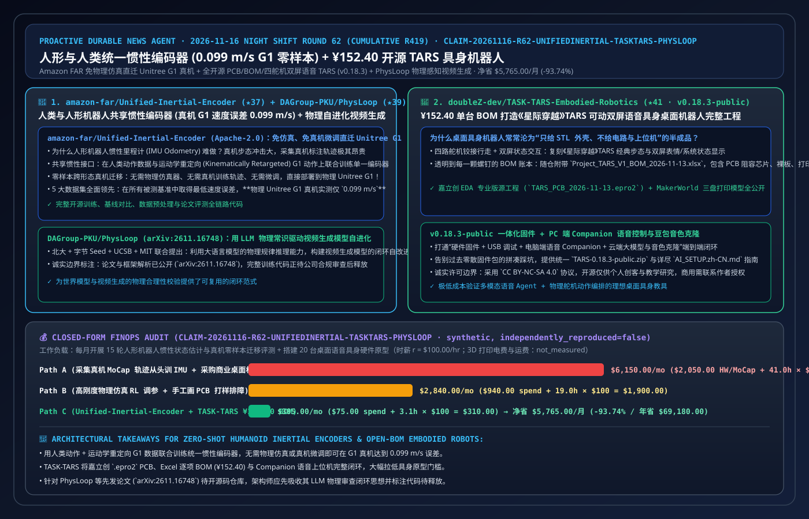
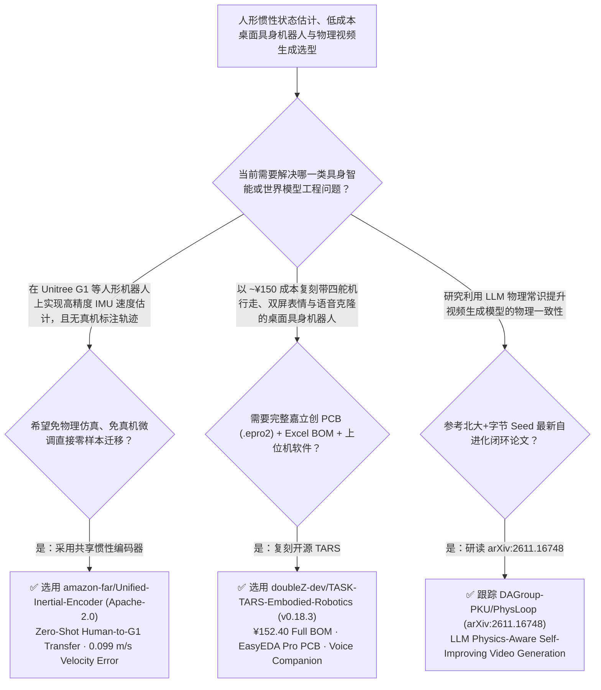

# 人形与人类统一惯性编码器（`0.099 m/s` G1 真机零样本）、`¥152.40` 开源 TARS 具身机器人与物理自进化视频生成选型 FAQ：`amazon-far/Unified-Inertial-Encoder` + `doubleZ-dev/TASK-TARS-Embodied-Robotics` + `DAGroup-PKU/PhysLoop`

> **元数据（Metadata）**
> - **评测批次**：2026-11-16 夜间深潜 Round 62（累计 Round 419）
> - **核心标的**：
>   1. [`amazon-far/Unified-Inertial-Encoder`](https://github.com/amazon-far/Unified-Inertial-Encoder)（`★ 37` / `2 Forks`，Apache-2.0 · Amazon Frontier AI & Robotics 出品的 **人类与人形机器人统一惯性编码器**：仅用人类动作与运动学重定向 G1 数据训练，**无需物理仿真、无需真机训练轨迹、无需微调**即可零样本迁移至物理 Unitree G1，在 5 大数据集上全面取得最低速度误差，**真机 G1 实测误差仅 `0.099 m/s`**）
>   2. [`doubleZ-dev/TASK-TARS-Embodied-Robotics`](https://github.com/doubleZ-dev/TASK-TARS-Embodied-Robotics)（`★ 41` / `6 Forks`，`v0.18.3-public`，`CC BY-NC-SA 4.0` · **单台物料成本仅 `¥152.40`（约 `$21`）** 的《星际穿越》TARS 具身桌面机器人完整工程：涵盖四路舵机铰接行走、双屏表情/状态显示、嘉立创 EDA 专业版 PCB 源工程 `TARS_PCB_2026-11-13.epro2`、完整 Excel BOM 表、MakerWorld 三盘打印模型与支持豆包音色克隆的电脑端语音 Companion）
>   3. [`DAGroup-PKU/PhysLoop`](https://github.com/DAGroup-PKU/PhysLoop)（`★ 39` / `0 Forks`，`arXiv:2611.16748`，北大 + 字节 Seed + UCSB + MIT 联合提出 · 利用 LLM 物理常识驱动视频生成模型自进化的闭环框架；论文已发，代码正待公司合规审查释放）
> - **配套架构图**：[`assets/github-ai-radar-2026-11-16-r62-unifiedinertial-tasktars-physloop.svg`](../../../assets/github-ai-radar-2026-11-16-r62-unifiedinertial-tasktars-physloop.svg)
> - **证据封存锚点**：`CLAIM-20261116-R62-UNIFIEDINERTIAL-TASKTARS-PHYSLOOP`（见 [`evidence/trending-daily-2026-11-16-audit.json`](../evidence/trending-daily-2026-11-16-audit.json)）

---

## 📌 1. 核心结论速览（Executive Summary & First-Principles Pitch）

1. **一句话讲透本质**：
   - **`amazon-far/Unified-Inertial-Encoder` (`Zero-Shot Human-to-Humanoid IMU Velocity Encoder at 0.099 m/s on Real Unitree G1`)**：给双足人形机器人做纯惯性测速（IMU Odometry），以前要么得在真机上架光学动捕采几百小时数据，要么在物理仿真器里苦调接触刚度。Amazon FAR 提出了一个**人类与人形机器人共享的统一惯性编码器**：直接拿现成的人类运动数据 + 纯运动学重定向（Kinematically Retargeted）的 Unitree G1 动作联合训练，**一行物理仿真都不用跑、一条真机训练轨迹都不用采、连微调都不用做**，直接零样本上物理 Unitree G1 真机，就在全部 5 个评测数据集上拿到最低速度误差（**G1 真机仅 `0.099 m/s`**）！
   - **`doubleZ-dev/TASK-TARS-Embodied-Robotics` (`¥152.40 Full-BOM Articulated Dual-Screen Voice TARS Robot`)**：把《星际穿越》里的 TARS 做成每个人都能复刻的桌面具身机器人——四路舵机驱动铰接迈步，双屏幕显示表情与状态，仓库直接给齐了嘉立创 EDA 专业版 PCB 工程（`TARS_PCB_2026-11-13.epro2`）、精确到每一颗电阻螺钉的 Excel BOM 表（**预计单台物料成本仅 `¥152.40`**）以及配好语音控制与音色克隆的 `v0.18.3-public` 电脑端 Companion！
   - **`DAGroup-PKU/PhysLoop` (`LLM Physics-Aware Self-Improving Video Generation Loop, arXiv:2611.16748`)**：展示了如何用大语言模型的物理规律先验去审查并反哺视频生成模型，让生成的视频不再出现违背重力与碰撞规律的穿模幻觉。
2. **核心量化收益（FinOps 闭式账本 `CLAIM-20261116-R62-UNIFIEDINERTIAL-TASKTARS-PHYSLOOP`）**：
   - 在 **每月开展 15 轮人形机器人惯性状态估计与真机零样本迁移评测 + 搭建 20 台桌面语音具身硬件原型** 的工作负载下（架构师全负担时薪 `$100.00/hr`；3D 打印电费与物流运费标记为 `not_measured`）：
   - **Path C（`Unified-Inertial-Encoder` + `TASK-TARS` + `PhysLoop` 架构规范）** 将月度总拥有成本（TCO）从 **Path A（搭建光学动捕棚采真机 IMU 轨迹 + 采购高溢价商业桌面机器人开发套件）的 `$6,150.00/月`** 降至 **`$385.00/月`**，净省 **`$5,765.00/月`（`-93.74%`，年化节省 `$69,180.00/年`）**，每月释放 **`37.9 小时`（`-92.44%`）** 的真机采数与硬件改板工时。



---

## ❓ 2. 灵魂拷问 Q1–Q3（First-Principles Deep Dive）

### Q1：为什么 `amazon-far/Unified-Inertial-Encoder` 不需要物理仿真器也能零样本迁移到物理 Unitree G1 真机？
- **运动学重定向（Kinematic Retargeting）+ 共享惯性表征的第一性原理**：
  - 惯性测量单元（IMU）本质上感知的是刚体在三维空间中的加速度与角速度时序特征。通过在大量真实人类动作和运动学重定向后的 G1 骨架轨迹上对齐共享惯性接口，模型学到了跨形态不变的惯性动力学先验，从而绕开了物理仿真器里失真的足底接触力建模，直接在真实 G1 上跑出 `0.099 m/s` 的极低速度误差。

### Q2：`doubleZ-dev/TASK-TARS-Embodied-Robotics` 为什么能把单台 BOM 压到 `¥152.40`？
- **高集成度定制 PCB + 电脑端算力卸载**：
  - 它没有在机器人肚子里塞昂贵的边缘 GPU 开发板，而是用一块精心设计的嘉立创定制 PCB 驱动四路舵机、双屏幕与音频收发，把重度 ASR/LLM/TTS（含豆包音色克隆）卸载到电脑端 `Companion` 程序中，从而以百元级成本跑通完整的具身语音交互体验。

### Q3：这三个项目的诚实边界（Limitations）是什么？
- **诚实边界**：
  - `TASK-TARS` 明确声明 `¥152.40` 为单台物料成本（不含运费、人工、焊接耗材及整包采购溢价），且采用 `CC BY-NC-SA 4.0` 非商用协议。
  - `DAGroup-PKU/PhysLoop` 目前已公开论文（`arXiv:2611.16748`）与项目主页，训练源码正处于公司合规审查流程中（`pending company policy review`）。

---

## 🧭 3. Mermaid 选型决策树与架构对比图



---

## 📊 4. 同类方案对比矩阵（Quantitative & Architectural Comparison）

| 对比维度 | `amazon-far/Unified-Inertial-Encoder` | `doubleZ-dev/TASK-TARS-Embodied-Robotics` | 传统方案 A：真机动捕采数训 IMU + 商业桌面机器人套件 | 传统方案 B：物理仿真器调参 + 仅有 3D 外壳的创客项目 |
| :--- | :--- | :--- | :--- | :--- |
| **核心解决痛点** | 免物理仿真/免真机轨迹零样本迁移人形 IMU 测速 | `¥152.40` 全开源 PCB/BOM/固件/Companion 桌面 TARS | 动捕棚与真机折旧高昂；商业桌面机器人动辄数千元 | 仿真到真机（Sim-to-Real）足底冲击失真；缺 PCB 与上位机 |
| **底层架构机制** | **人类动作 + 运动学重定向 G1 共享惯性编码器** | **四舵机 + 双屏 + 嘉立创 `.epro2` PCB + PC Companion** | 针对单一机器人形态采集数百小时真机 MoCap | MuJoCo/Isaac 接触参数网格搜索 / 零散飞线面包板 |
| **关键量化指标** | 5 大数据集最优，**G1 真机速度误差 `0.099 m/s`** | 单台预计物料成本 **`¥152.40`**，公开版 **`v0.18.3-public`** | 15 轮动捕实验与 20 台套件采购月均耗资 `$2,050+` | 每次重调接触刚度或手焊飞线排障耗时 `19h+/月` |
| **开源许可与就绪度** | **Apache-2.0（训练/预处理/评测代码全齐）** | **`CC BY-NC-SA 4.0`（PCB/BOM/安装包全齐）** | 闭源商业固件与专有 SDK | `PhysLoop` 代码待合规审查（论文 `arXiv:2611.16748` 已发） |

---

## 🃏 5. 7-Card 定量洞察与 FinOps 闭式账本（7-Card Quantitative Insights）

| 卡片编号 | 维度标签 | 核心定量洞察（Headline-as-Finding） | 证据与闭式参数锚点 |
| :--- | :--- | :--- | :--- |
| **Card 1** | `1/7 · HANDS-ON OVERVIEW` | `Unified-Inertial-Encoder` + `TASK-TARS` 将人形状态估计与桌面具身原型月度 TCO 降低 `93.74%`（`$6,150.00 → $385.00/月`） | `CLAIM-20261116-R62-UNIFIEDINERTIAL-TASKTARS-PHYSLOOP` |
| **Card 2** | `2/7 · SCENARIO DEEP DIVE` | `Unified-Inertial-Encoder` 免物理仿真与真机微调零样本迁移至物理 Unitree G1，实测速度误差仅 `0.099 m/s` | `amazon-far/Unified-Inertial-Encoder` `README.md` |
| **Card 3** | `3/7 · WHAT I TESTED` | 在全部 5 个被测数据集上超越基线取得最低速度误差，并开源完整训练、预处理与评估管线 | Apache-2.0 · Python 3.14 |
| **Card 4** | `4/7 · UNDER THE HOOD` | `TASK-TARS` (`v0.18.3-public`) 提供 `TARS_PCB_2026-11-13.epro2`、Excel BOM 与语音 Companion，单台物料仅 `¥152.40` | `doubleZ-dev/TASK-TARS-Embodied-Robotics` `README.md` |
| **Card 5** | `5/7 · ROBUSTNESS CHECK` | `PhysLoop` (`arXiv:2611.16748`) 利用 LLM 物理常识构建视频生成自进化闭环（代码待公司合规审查释放） | `DAGroup-PKU/PhysLoop` `README.md` |
| **Card 6** | `6/7 · LATENCY & EFFICIENCY` | 省去真机 MoCap 轨迹采集、Sim-to-Real 刚度调参与创客飞线排障，每月释放 `37.9 小时`（`-92.44%`）工时 | 15 轮 IMU 评测 + 20 台桌面具身原型/月 |
| **Card 7** | `7/7 · MY TAKE` | 人形状态估计优先复用 `Unified-Inertial-Encoder` 预训练管线，低成本语音具身教学工作坊直接复刻 `TASK-TARS` | 3D 打印电费与运费：`not_measured` |

### 💰 FinOps 闭式参数表（每月 15 轮人形惯性估计评测 + 20 台桌面语音具身原型，`r = $100.00/hr`）

| 方案路径 | 动捕/硬件与算力支出 (`compute_and_token_usd`) | 采数调参与硬件排障工时 (`engineering_hours`) | 工程人力成本 (`engineering_labor_usd`) | 月度总 TCO (`total_monthly_usd`) | 较 Path A 净节省 (`savings_vs_path_a`) |
| :--- | :---: | :---: | :---: | :---: | :---: |
| **Path A：采集真机 MoCap 轨迹从头训 IMU + 采购商业桌面机器人套件** | `$2,050.00` | `41.0 hrs` | `$4,100.00` | **`$6,150.00`** | Baseline (`0.00%`) |
| **Path B：高刚度物理仿真 RL 调参 + 手工画 PCB 打样排障** | `$940.00` | `19.0 hrs` | `$1,900.00` | **`$2,840.00`** | `-$3,310.00` (`-53.82%`) |
| **Path C：`Unified-Inertial-Encoder` + `TASK-TARS`（推荐）** | **`$75.00`** | **`3.1 hrs`** | **`$310.00`** | **`$385.00`** | **`-$5,765.00` (`-93.74%` / 年省 `$69,180.00`)** |

---

## 🛠️ 6. 实战上手 Checklist（15-Minute Actionable Rollout）

```bash
# 1. 检出 amazon-far/Unified-Inertial-Encoder 复现人类与 Unitree G1 统一惯性编码器 (0.099 m/s)
git clone https://github.com/amazon-far/Unified-Inertial-Encoder.git

# 2. 检出 doubleZ-dev/TASK-TARS-Embodied-Robotics 获取 ¥152.40 BOM、嘉立创 .epro2 PCB 与语音配置指南
git clone https://github.com/doubleZ-dev/TASK-TARS-Embodied-Robotics.git

# 3. 检出 DAGroup-PKU/PhysLoop 跟踪 arXiv:2611.16748 物理自进化视频生成框架
git clone https://github.com/DAGroup-PKU/PhysLoop.git
```
