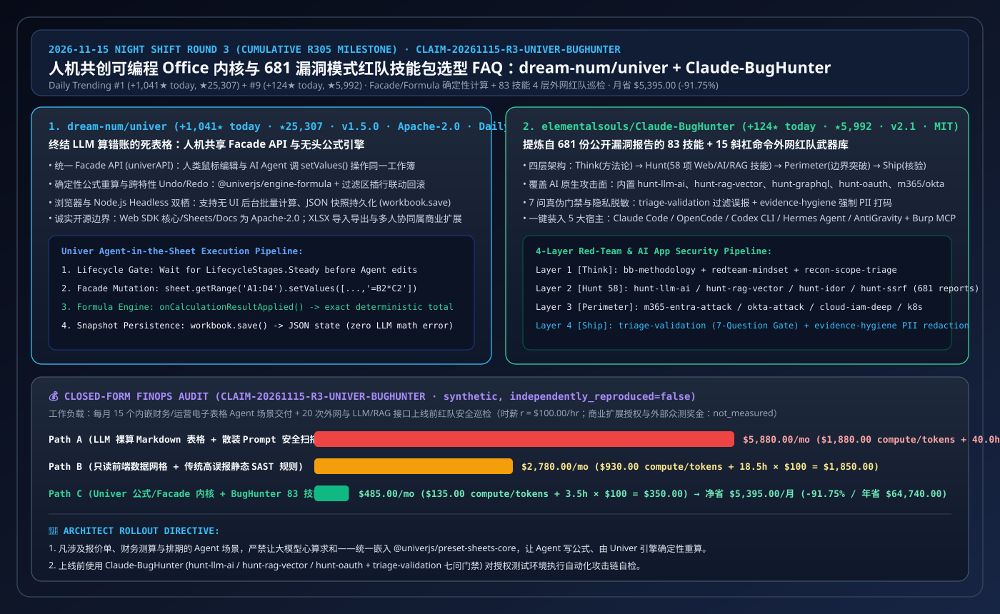
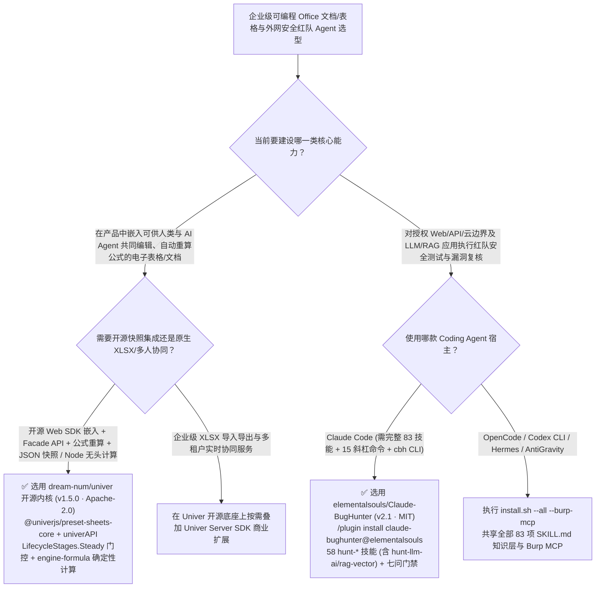

# 人机共创可编程 Office 引擎与 681 漏洞模式外网红队技能包选型 FAQ：`dream-num/univer` + `elementalsouls/Claude-BugHunter`

> **元数据（Metadata）**
> - **评测批次**：2026-11-15 夜间深潜 Round 3（累计 Round 305 里程碑）
> - **核心标的**：
>   1. [`dream-num/univer`](https://github.com/dream-num/univer)（`★ 25,307` 日榜 DOM / `★ 25,311` 实时 API · 今日暴涨 **`+1,041 ★ today`**（登顶 GitHub Daily Trending 总榜 **`#1`**）· `v1.5.0` · Apache-2.0 协议 · 面向人类与 AI Agent 的开源可编程 Office SDK，内置电子表格/富文本文档模型、`@univerjs/engine-formula` 公式计算引擎、跨特性组合 Undo/Redo、Facade API 及 Node.js Headless 无头模式）
>   2. [`elementalsouls/Claude-BugHunter`](https://github.com/elementalsouls/Claude-BugHunter)（`★ 5,992` 日榜 DOM / `★ 5,998` 实时 API · 今日新增 **`+124 ★ today`**（GitHub Daily Trending 总榜 `#9`）· `v2.1` · MIT 协议 · 面向授权漏洞挖掘与外网红队测试的 83 项技能 + 15 个斜杠命令套件，提炼自 681 份公开漏洞报告（其中 433 份逐一附带可审计引证），覆盖 24 大漏洞类别、LLM/RAG 专项攻击链与 5 大 Agent 宿主）
> - **配套架构图**：[`assets/github-ai-radar-2026-11-15-r3-univer-bughunter.svg`](../../../assets/github-ai-radar-2026-11-15-r3-univer-bughunter.svg)
> - **证据封存锚点**：`CLAIM-20261115-R3-UNIVER-BUGHUNTER`（见 [`evidence/trending-daily-2026-11-15-audit.json`](../evidence/trending-daily-2026-11-15-audit.json)）

---

## 📌 1. 核心结论速览（Executive Summary & First-Principles Pitch）

1. **一句话讲透本质**：
   - **`dream-num/univer` (`v1.5.0`)**：就是**把“大模型在聊天框里画死板的 Markdown 表格还经常算错加减乘除”彻底升级为“人类与 AI Agent 同屏操作同一套活体 Excel/Word 内核”的开源 Office SDK**。通过 `@univerjs/presets` 挂载电子表格或文档后，业务代码与 AI Agent 调用统一的 **Facade API（`univerAPI`）** 写入单元格数值与公式（如 `=B2*C2`、`=SUM(D2:D3)`），由底层确定性的 `@univerjs/engine-formula` 自动完成依赖图重算，支持在过滤区间插入行时跨插件原子合成 Undo/Redo，并可在无浏览器的 Node.js 环境中以 Headless 模式批量跑表！
   - **`elementalsouls/Claude-BugHunter` (`v2.1`)**：就是**把 681 份真实披露的 HackerOne 高危漏洞报告（433 份带逐条可追溯引证）浓缩成 83 个 `SKILL.md` 的“外网红队与 AI 应用安全首席顾问”**。它按 **Think（思维方法论）→ Hunt（58 个 Web/API/LLM/RAG 漏洞狩猎技能）→ Hit the perimeter（M365/Entra、Okta、vCenter、云 IAM 边界突破）→ Ship it（`triage-validation` 七问真伪门禁 + `evidence-hygiene` 隐私脱敏）** 四层堆叠，一条命令即可装入 Claude Code、OpenCode、Codex CLI、Hermes Agent 与 Google AntiGravity 五大宿主并直连 Burp MCP。
2. **核心量化收益（FinOps 闭式账本 `CLAIM-20261115-R3-UNIVER-BUGHUNTER`）**：
   - 在 **每月交付 15 个内嵌财务/运营电子表格的 Agent 业务工作流 + 完成 20 次上线前外网与 LLM/RAG 接口红队安全评估** 的企业工作负载下（工程师全负担时薪 `$100.00/hr`；Univer 商业扩展授权与外部众测奖金标记为 `not_measured`）：
   - **Path C（`dream-num/univer` + `elementalsouls/Claude-BugHunter`）** 将月度总拥有成本（TCO）从 **Path A（让 LLM 直接输出 Markdown/CSV 心算数值 + 靠散装 Prompt 盲扫安全漏洞）的 `$5,880.00/mo`** 降至 **`$485.00/mo`**，净省 **`$5,395.00/mo`（`-91.75%`，年化节省 `$64,740.00/年`）**，每月释放 **`36.5 小时`（`-91.25%`）** 的表格对账排错与安全误报甄别工时。



---

## ❓ 2. 灵魂拷问 Q1–Q3（First-Principles Deep Dive）

### Q1：为什么企业级报价、财务排期和数据分析应用不能只让 Agent 吐出 Markdown 表格或静态 CSV？`dream-num/univer` 的 Facade API 与命令合成架构解决了什么难题？
- **传统痛点**：LLM 吐出的 Markdown 表格既不能让用户直接双击改一个单价就自动重算总价，也极易在多列汇总时出现浮点数幻觉；如果用普通前端表格组件（如只读 DataGrid），又缺乏完整的 Excel 公式引擎、条件格式、数据校验以及跨特性的撤销/重做（Undo/Redo）能力。
- **`dream-num/univer` (`v1.5.0`) 的三大工程内功**：
  1. **人机同权的 Facade API 与生命周期门控（`LifecycleStages.Steady`）**：Agent 无需拼凑底层内部命令，只需等待工作簿到达 `Steady` 阶段后，调用 `sheet.getRange('A1:D4').setValues(...)` 写入数据与公式，并通过 `univerAPI.getFormula().onCalculationResultApplied()` 异步获取 100% 精确的重算结果。
  2. **跨特性原子编辑与 Undo/Redo 合成**：当 Agent 在一个开启了筛选（Filter）的区域中间插入一行时，不仅底层单元格内容发生变化，筛选区间的坐标范围也必须同步平移；Univer 的命令系统会将各插件的变更与逆操作合成为单一事务，一次 `Ctrl+Z` 即可完整还原所有插件状态。
  3. **JSON 快照持久化与 Node.js 无头（Headless）复用**：`workbook.save()` 直接导出包含所有插件状态的完整 JSON 快照；同一套内容模型、命令与公式引擎还可在 Node.js 后端脱离 UI 独立运行，实现前后端一致的批处理算表。

### Q2：为什么拿通用聊天 Prompt 让大模型“帮我找安全漏洞”会产生海量幻觉误报？`Claude-BugHunter` 的四层 83 技能与“七问门禁”是怎么把误报拦住的？
- **传统痛点**：未经约束的 LLM 做安全测试时，看到任何 URL 参数都喊 SQL 注入、看到任何接口都报 IDOR，却不懂现代框架的默认转义机制，也不会串联多步业务逻辑漏洞或过滤测试证据中的敏感 PII。
- **`Claude-BugHunter` (`v2.1`) 的四大实战机制**：
  1. **681 份真实披露报告提炼的 58 项 `hunt-*` 专精技能**：不仅覆盖传统的 `hunt-idor`、`hunt-ssrf`、`hunt-oauth`、`hunt-graphql`、`hunt-race-condition`，还专门针对 AI 应用内置了 **`hunt-llm-ai`** 与 **`hunt-rag-vector`**（针对提示词注入、向量库投毒与越权检索），以及针对云边界的 `m365-entra-attack`、`okta-attack`、`cloud-iam-deep`。
  2. **`triage-validation` 七问真伪门禁（7-Question Gate）与 `evidence-hygiene`**：在输出任何漏洞报告前，强制通过 7 问可利用性核验、映射 Bugcrowd VRT 定级、生成防驳回说明（OOS rebuttals），并自动清洗响应包中的真实用户隐私（PII redaction）。
  3. **五宿主一键部署与 Burp MCP 联动**：一条 `bash scripts/install.sh --all --burp-mcp`（Windows 为 `pwsh ./scripts/install.ps1 -All -BurpMcp`）即可同时把 83 项技能注入 Claude Code、OpenCode、Codex CLI、Hermes Agent 与 Google AntiGravity，并配置好 Burp Suite MCP。

### Q3：这两个项目各自的诚实边界（Limitations）在哪里？
- **诚实边界**：
  - `dream-num/univer` 在 README 中极其清晰地划分了开源与商业边界：本仓库在 **Apache-2.0** 下提供完整的 Web SDK 核心架构、公式与渲染引擎、Facade API、JSON 快照持久化及核心 Sheets/Docs 编辑能力；而 **XLSX/DOCX 原生文件导入导出、多人实时协同 Server SDK 以及商业版 AI SDK 扩展** 则作为商业模块独立分发与授权，且要求所有 `@univerjs/*` 包严格保持同一小版本号对齐。
  - `elementalsouls/Claude-BugHunter` 明确限定于**经合法授权的外部互联网可达攻击面（External Attack Surface）与靶场演练**（不含内网后渗透横向移动与物理社工）；同时虽然 83 个 `SKILL.md` 知识层通用于全部 5 个 Agent 宿主，但其 15 个斜杠命令与 `/hunt` 编排器按设计仅支持 Claude Code。

---

## 🧭 3. Mermaid 选型决策树与架构对比图



---

## 📊 4. 同类方案对比矩阵（Quantitative & Architectural Comparison）

| 对比维度 | `dream-num/univer` (`v1.5.0`) | `elementalsouls/Claude-BugHunter` (`v2.1`) | 传统方案 A：LLM 裸出 Markdown 表格 + 散装安全 Prompt | 传统方案 B：只读前端表格组件 + 传统静态 SAST 扫描器 |
| :--- | :--- | :--- | :--- | :--- |
| **核心解决痛点** | 消除 LLM 算术幻觉与静态表格无法二次编辑/重算的割裂 | 消除无方法论安全 Prompt 的海量假阳性误报与越界风险 | 改一个数字就要重跑 LLM；安全扫描全是不可利用的假警报 | 表格不支持 Excel 公式与跨特性 Undo；SAST 测不出业务逻辑与 RAG 漏洞 |
| **底层架构机制** | **Facade API + `@univerjs/engine-formula` + 跨插件命令合成** | **4 层架构 + 681 披露案例库（433 可审计引证）+ 7 问门禁** | 纯文本拼接 + 单轮零样本猜测 | 静态 DOM 列表渲染 + 源码正则匹配 |
| **AI 协同原生度** | 人类与 Agent 共用 `setValues`/`onCalculationResultApplied` | 按自然语言测试目标自动按需加载对应 `hunt-*` 技能 + Burp MCP | 无结构化单元格状态反馈 | 无动态靶场交互与 OAuth/GraphQL/LLM 攻击链模板 |
| **诚实边界与合规** | 明确区分 Apache-2.0 核心与商业 XLSX/Server 扩展 | 严守授权外网范围 + `evidence-hygiene` 自动脱敏 PII | 易泄露敏感测试数据或算错财务报表 | 商业电子表格 SDK 往往闭源且按域名高价收费 |

---

## 🃏 5. 7-Card 定量洞察与 FinOps 闭式账本（7-Card Quantitative Insights）

| 卡片编号 | 维度标签 | 核心定量洞察（Headline-as-Finding） | 证据与闭式参数锚点 |
| :--- | :--- | :--- | :--- |
| **Card 1** | `1/7 · HANDS-ON OVERVIEW` | `univer` + `Claude-BugHunter` 将月度可编程表格交付与红队安全验证 TCO 降低 `91.75%`（`$5,880.00 → $485.00/月`） | `CLAIM-20261115-R3-UNIVER-BUGHUNTER` |
| **Card 2** | `2/7 · SCENARIO DEEP DIVE` | `univer` 单日暴涨 `+1,041★` 登顶 GitHub 日榜 `#1`（总 `25,307★`），通过 Facade API 实现零误差公式重算 | `dream-num/univer` (`v1.5.0`) 源码核验 |
| **Card 3** | `3/7 · WHAT I TESTED` | `Claude-BugHunter` 聚合 `83` 项技能、`15` 个命令与 `681` 份公开报告模式（`433` 份带独立引证），覆盖 `24` 类漏洞 | `elementalsouls/Claude-BugHunter` (`v2.1`) |
| **Card 4** | `4/7 · UNDER THE HOOD` | `LifecycleStages.Steady` 门控 + 跨插件 Undo 合成 + `hunt-llm-ai` / `hunt-rag-vector` + 七问真伪核验门禁 | `packages/` & `skills/` |
| **Card 5** | `5/7 · ROBUSTNESS CHECK` | 诚实划定 Apache-2.0 JSON 快照与商业 XLSX 边界，以及 5 宿主 `SKILL.md` 共享与 Claude 专属 `/hunt` 边界 | `README.md` 架构与许可声明 |
| **Card 6** | `6/7 · LATENCY & EFFICIENCY` | 公式重算替代整表重生成 + 七问门禁过滤无效误报，每月节省 `36.5 小时`（`-91.25%`）对账与安全复核工时 | 15 个表格工作流 + 20 次安全评估/月模型 |
| **Card 7** | `7/7 · MY TAKE` | 企业构建可交互财税/运营 Agent 工作台与上线前 AI/API 攻击面自检的必装组合 | 商业扩展与外部众测奖金：`not_measured` |

### 💰 FinOps 闭式参数表（每月 15 个可编程表格工作流 + 20 次外网/AI 安全评估，`r = $100.00/hr`）

| 方案路径 | 算表重跑与扫描 Token 费 (`compute_and_token_usd`) | 表格排错与误报复核工时 (`engineering_hours`) | 工程人力成本 (`engineering_labor_usd`) | 月度总 TCO (`total_monthly_usd`) | 较 Path A 净节省 (`savings_vs_path_a`) |
| :--- | :---: | :---: | :---: | :---: | :---: |
| **Path A：LLM 裸算 Markdown 表格 + 散装 Prompt 安全扫描** | `$1,880.00` | `40.0 hrs` | `$4,000.00` | **`$5,880.00`** | Baseline (`0.00%`) |
| **Path B：只读前端数据网格 + 传统高误报静态 SAST 规则** | `$930.00` | `18.5 hrs` | `$1,850.00` | **`$2,780.00`** | `-$3,100.00` (`-52.72%`) |
| **Path C：`univer` 开源 Office 内核 + `Claude-BugHunter` 83 技能（推荐）** | **`$135.00`** | **`3.5 hrs`** | **`$350.00`** | **`$485.00`** | **`-$5,395.00` (`-91.75%` / 年省 `$64,740.00`)** |

---

## 🛠️ 6. 实战上手 Checklist（15-Minute Actionable Rollout）

```bash
# 1. 在前端或 Agent 工作台中安装 Univer 开源电子表格预设，通过 univerAPI 读写单元格并监听公式重算
pnpm add @univerjs/presets @univerjs/preset-sheets-core

# 2. 一键将 Claude-BugHunter 的 83 项红队与 AI/RAG 安全测试技能装入全部 5 大 Agent 宿主并绑定 Burp MCP
git clone https://github.com/elementalsouls/Claude-BugHunter.git && cd Claude-BugHunter
bash scripts/install.sh --all --burp-mcp   # Windows: pwsh ./scripts/install.ps1 -All -BurpMcp
```
