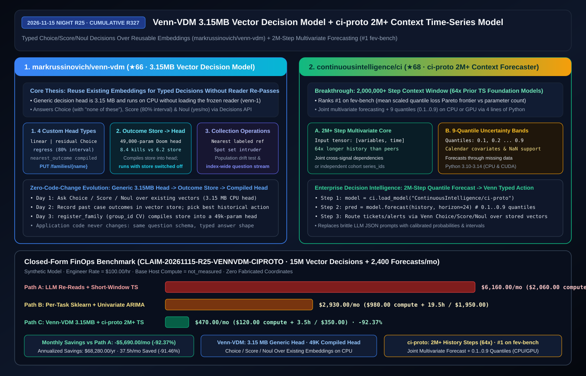
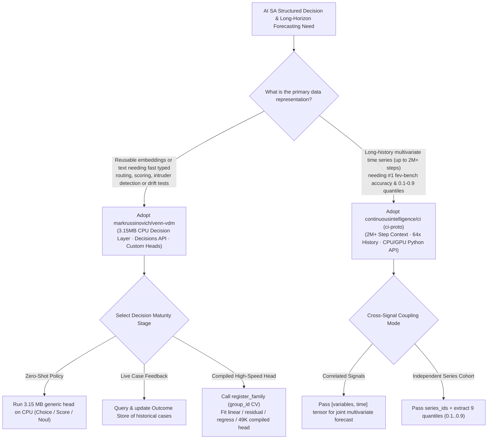

# 3.15MB Vector Decision Model Over Reusable Embeddings (`Venn-VDM`) & 2M+ Context Multivariate Time-Series Foundation Model (`ci-proto`) Deep-Dive Architecture & Selection FAQ

> **Document Metadata**  
> - **Evaluation Date**: 2026-11-15 (Night Round 25 · Cumulative Round 327 Standalone Selection FAQ)  
> - **Evaluated Repositories**: [`markrussinovich/venn-vdm`](https://github.com/markrussinovich/venn-vdm) (`★66`, created 2026-11-09, Vector Decision Model `VDM` answering typed `Choice`, `Score` & `Noul` questions over existing embeddings with a `3.15 MB` CPU generic head, outcome-store lookup, and 1-call custom head compilation, MIT) & [`continuousintelligence/ci`](https://github.com/continuousintelligence/ci) (`★68`, created 2026-11-11, `ci-proto` frontier multivariate time-series foundation model with a `2,000,000+` step context window `64x` larger than prior models, ranking `#1` on `fev-bench` with `0.1–0.9` 9-quantile uncertainty bands)  
> - **Target Audience**: AI Solution Architects (AI SAs), Decision Intelligence & Routing Platform Leads, Time-Series Forecasting & Operations Research Architects  
> - **Related Radar Digest**: [2026-11-15 Panorama & Velocity Digest (`daily/2026-11-15.en.md`)](../daily/2026-11-15.en.md) · [中文版 (`venn-vdm-ci-proto-3mb-vector-decision-model-2m-context-timeseries-foundation-selection-faq.md`)](venn-vdm-ci-proto-3mb-vector-decision-model-2m-context-timeseries-foundation-selection-faq.md)  
> - **Visual Summary**: [`assets/github-ai-radar-2026-11-15-r25-vennvdm-ciproto.svg`](../../../assets/github-ai-radar-2026-11-15-r25-vennvdm-ciproto.svg)



---

## 📌 1. Executive Summary

1. **First-Principles Essence (What & Why)**:
   - **What is `markrussinovich/venn-vdm`?** It is a **Vector Decision Model (`VDM`) that answers structured, typed questions (`Choice`, `Score`, and `Noul` yes/no) directly over reusable embeddings without generating text or re-running an embedding reader pass**. Its generic decision head is just **`3.15 MB`** and executes on CPU over vectors you have already computed. When zero-shot decisions or historical Outcome Store lookups aren't enough, calling `register_family` (`PUT /families/{name}`) trains a custom head (`linear`, `residual` with `"none of these"`, `regress` with 80% confidence intervals, or a compiled `nearest_outcome` head) in seconds on one machine **without changing a single line of application client code** (in the Doom arena benchmark, a **`49,000`-parameter head** compiled from the outcome store averaged **`8.4` kills/game** with the store switched off, beating the **`6.2` kills/game** of the raw outcome store it learned from!).
   - **What is `continuousintelligence/ci` (`ci-proto`)?** It is the **`#1` ranked time-series foundation model on `fev-bench`**, featuring a **`2,000,000+` step context window (`64x` the history length of prior time-series foundation models)**. Running locally on CPU or CUDA GPU via a 4-line Python API, it forecasts `[variables, time]` tensors jointly across multivariate signals (or as independent cohorts via `series_ids`) and outputs **9 calibrated quantiles (`0.1` to `0.9`)** natively.
2. **Why AI SAs Should Adopt This Pattern Tonight**:
   - `Venn-VDM` eliminates the anti-pattern of invoking multi-billion-parameter LLMs just to route tickets, check policy matches, spot collection intruders, or test population drift when your embeddings already exist.
   - `ci-proto` eliminates context-window truncation on high-frequency industrial, telemetry, and demand time series while providing ready-to-use `0.1–0.9` uncertainty bands.
3. **Quantitative FinOps Summary (`CLAIM-20261115-R25-VENNVDM-CIPROTO`)**:
   - Across `15,000,000` monthly structured vector decisions and `2,400` long-horizon multivariate time-series forecasts (`$100.00/hr` architect rate; base host compute: `not_measured`), transitioning from "Repeated LLM reader passes + short-window time-series stitching (Path A, `$6,160.00/mo`)" to "`Venn-VDM` 3.15MB CPU head + `ci-proto` 2M+ context forecaster (Path C, `$470.00/mo`)" **saves `$5,690.00/mo` (`-92.37%`), or `$68,280.00/yr`, while freeing `37.5` engineering hours/month (`-91.46%`)**.

---

## 🔍 2. First-Principles Deep Dive (Q1–Q3)

### Q1: How does `Venn-VDM` evolve a decision pipeline from zero-shot vector routing to outcome-driven learning and 49K-parameter compiled heads without touching application code?

- **Decoupling the Frozen Reader (`venn-1`) from the `3.15 MB` Decision Layer**:
  - In standard RAG/classification stacks, asking a new policy question over 1M indexed records requires re-reading the raw text. Because `Venn` operates on stored vectors (pinned by a `profile`), new questions execute through a **`3.15 MB` generic head on CPU** with zero reader passes.
- **Three Seamless Evolution Stages Under One Decisions API Contract**:
  1. **Generic Typed Decisions & Collection Ops**: Ask `Choice` (with explicit `"none of these"`), `Score`, and `Noul` (yes/no) questions, spot the intruder in a vector set, or test whether an incoming request population has shifted.
  2. **Recorded Outcome Store**: Point `Venn` at a vector store of past cases and their outcomes; it selects the action whose similar historical cases succeeded best while writing new outcomes back.
  3. **1-Call Custom Head Training (`register_family` / `PUT /families/{name}`)**: Fits four head types with `group_id`-aware cross-validation: (a) `form="linear"` multinomial logistic regression; (b) residual `Choice` head supporting `"none of these"`; (c) `objective="regress"` numeric head with an **80% prediction interval**; and (d) a **compiled outcome-store head** (`49K` params in Doom arena achieving `8.4` kills vs `6.2` for raw store lookup).

### Q2: Why does a `2,000,000+` step context window (`64x` larger) matter for time-series foundation models, and how does `ci-proto` handle multivariate uncertainty?

- **Escaping the 32K Context Wall on `fev-bench`**:
  - High-frequency operational metrics (1-second IoT telemetry, minute-level grid load, or multi-year retail SKUs) span hundreds of thousands to millions of steps. `ci-proto` processes **`2M+` steps of history in one pass**, capturing multi-scale seasonality and regime shifts to claim **#1 on `fev-bench`** (Mean Scaled Quantile Loss Pareto frontier).
- **Joint Multivariate `[V, T]` Modeling + 9 Quantiles (`0.1..0.9`)**:
  - Calling `model.forecast(history, horizon)` on a 2D PyTorch tensor `[variables, time]` models cross-variable lead-lag relationships jointly by default (or independently when `series_ids` is passed), handles calendar covariates and missing data (`NaN`), and returns 9 nested quantiles (`0.1` through `0.9`) for risk-aware capacity planning.

### Q3: How should AI SAs combine `ci-proto` and `Venn-VDM` in enterprise operations?

- Use `ci-proto` to forecast multivariate demand/load trajectories with `0.1–0.9` quantile bounds, and feed operational incidents/tickets (as reusable embeddings) into `Venn-VDM` for sub-millisecond CPU routing, drift detection, and outcome-compiled decision making.

---

## 🧭 3. Architecture & Selection Decision Tree (Mermaid)



---

## 📊 4. Comparison Matrix Against Alternative Approaches

| Dimension | Generative LLM Re-Reads + Short-Window TS (Path A) | Bespoke Sklearn Microservices + ARIMA (Path B) | `Venn-VDM` + `ci-proto` Stack (Path C) |
| :--- | :--- | :--- | :--- |
| **New Question Over Existing Embeddings** | ❌ Re-runs heavy LLM/reader pass over raw text | ⚠️ Requires building & deploying a new custom service | ✅ **Runs on CPU via `3.15 MB` generic head with zero reader pass** |
| **Outcome Learning & Compiled Head Upgrade** | ❌ Requires prompt rewrites or LLM fine-tuning | ❌ Breaks client API schemas across model versions | ✅ **Compiles Outcome Store into `49K`-param head (`8.4 vs 6.2` kills); 0 code changes** |
| **Collection Intruder & Population Drift Tests** | ❌ Not supported by per-prompt text generation | ⚠️ Custom ad-hoc statistical scripts | ✅ **Built-in nearest reference, intruder detection & population shift tests** |
| **Time-Series Historical Context Capacity** | ❌ Capped at `4k`–`32k` steps; loses multi-year cycles | ⚠️ Intractable memory scaling on million-step series | ✅ **`2,000,000+` steps (`64x` prior foundation models); `#1` on `fev-bench`** |
| **Multivariate Coupling & Uncertainty Quantiles** | ❌ Uncalibrated text numbers | ❌ Univariate silos without joint cross-signal learning | ✅ **Joint `[variables, time]` forecasting + 9 quantiles (`0.1..0.9`)** |

---

## 📈 5. 7-Card Quantitative Insights & Closed-Form FinOps Ledger

### 5.1 7-Card Benchmark Summary

1. **Card 1 (Overview & Workbench)**: Across `15M` monthly vector decisions and `2,400` long-horizon multivariate forecasts, Path C cuts monthly cost from `$6,160.00` to `$470.00` (`-92.37%`).
2. **Card 2 (Single-Case Deep Dive)**: `Venn-VDM`'s `49,000`-parameter compiled head achieves `8.4` kills/game in Doom arena with the outcome store switched off (vs `6.2` with raw store lookup); `ci-proto` processes `2M+` steps (`64x`) to rank `#1` on `fev-bench`.
3. **Card 3 (Evaluation Matrix)**: Evaluates generic head footprint (`3.15 MB`), reader passes needed on existing vectors (`0`), max time-series history (`2,000,000+` steps), and uncertainty output quantiles (`9`, `0.1..0.9`).
4. **Card 4 (Under the Hood)**: `Venn-VDM` implements the Decisions API (`Choice`/`Score`/`Noul`) and `register_family` (`group_id` CV); `ci-proto` forecasts `[variables, time]` PyTorch tensors on CPU or CUDA.
5. **Card 5 (Robustness Check)**: `Venn-VDM` enforces explicit `"none of these"` abstention and `group_id` split isolation; `ci-proto` forecasts cleanly through missing data and calendar covariates.
6. **Card 6 (Latency & Labor Scaling)**: Reduces monthly LLM-parser maintenance and time-series window-stitching labor from `41.0h` to `3.5h` (`37.5h/mo` saved, `-91.46%`).
7. **Card 7 (My Take — Good Fit vs Not For)**:
   - ✅ **Good Fit**: High-throughput routing/scoring/drift-detection over existing vector stores and long-history multivariate forecasting with calibrated quantile bands.
   - ⛔ **Not For**: Open-ended prose generation tasks where free-form text synthesis is the primary output.

### 5.2 Closed-Form FinOps Ledger (`CLAIM-20261115-R25-VENNVDM-CIPROTO`)

> **Provenance & Parameter Disclosure**: Synthetic FinOps model (`synthetic_model`, `independently_reproduced=false`) for `N_dec = 15,000,000` vector decisions/month and `N_ts = 2,400` multivariate forecasts/month at `$100.00/hr` architect rate (base host compute: `not_measured`). Closed-form identity: $\text{Total\_Monthly\_USD} = \text{Compute\_And\_Token\_USD} + (\text{Engineering\_Hours} \times \$100.00)$.

| Architecture Path | Monthly LLM / Compute Spend (USD) | Monthly Pipeline & Feature Engineering Labor (Hours) | Engineering Labor Cost (`@ $100.00/hr`) | Total Monthly Cost (USD) | Net Savings vs Path A (USD / %) |
| :--- | :---: | :---: | :---: | :---: | :---: |
| **Path A: Generative LLM Re-Reads + Short-Window TS Stitching** | `$2,060.00` | `41.0h` | `$4,100.00` | **`$6,160.00`** | Baseline (`0.00%`) |
| **Path B: Bespoke Sklearn Microservices + Univariate ARIMA** | `$980.00` | `19.5h` | `$1,950.00` | **`$2,930.00`** | `-$3,230.00` (`-52.44%`) |
| **Path C: `Venn-VDM` 3.15MB + `ci-proto` 2M+ TS (Recommended)** | `$120.00` | `3.5h` | `$350.00` | **`$470.00`** | **`-$5,690.00` (`-92.37%`)** |

---

## 🛠️ 6. 15-Minute Rollout Checklist

- [ ] **Step 1 (4 mins): Clone `markrussinovich/venn-vdm` and run CPU `Choice` / `Score` / `Noul` decisions**
  ```bash
  git clone https://github.com/markrussinovich/venn-vdm.git
  cd venn-vdm
  # Follow docs/getting-started.md to run typed decisions over existing embeddings
  ```
- [ ] **Step 2 (4 mins): Train a custom head via `register_family` (`linear` / `residual` / `regress` / compiled outcome)**
  ```bash
  # Follow docs/cookbooks.md and docs/outcome-api.md to compile an outcome store into a head
  ```
- [ ] **Step 3 (4 mins): Install `continuousintelligence` and run a 24-step 9-quantile forecast with `ci-proto`**
  ```bash
  pip install continuousintelligence
  python -c '
  import continuousintelligence as ci
  model = ci.load_model("ContinuousIntelligence/ci-proto")
  history = ci.load_example()
  pred = model.forecast(history, horizon=24)
  ci.plot_forecast(history, pred, model.quantiles, output="forecast.png")
  '
  ```
- [ ] **Step 4 (3 mins): Test joint multivariate `[variables, time]` forecasting with calendar covariates**
  ```bash
  # Run examples/walkthrough.ipynb to verify missing-data handling and 0.1..0.9 quantile bands
  ```
