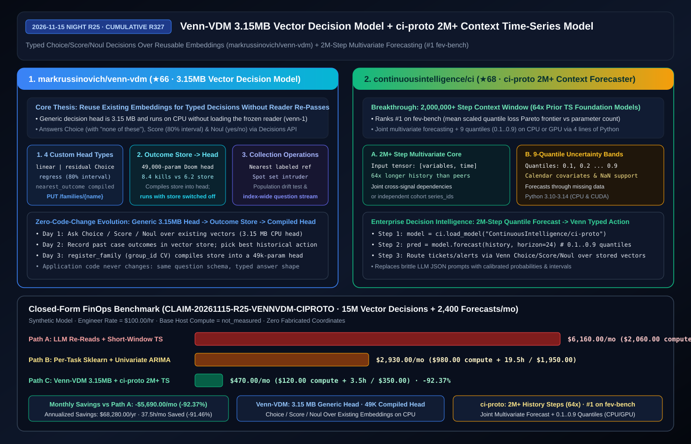
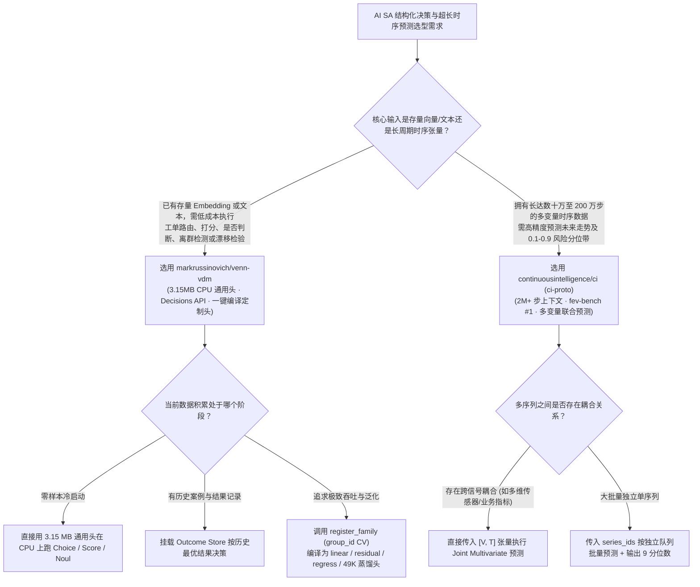

# 复用存量 Embedding 的 3.15MB 向量决策模型（`Venn-VDM`）与 200万步上下文多变量时序基座（`ci-proto`）深度架构拆解与同类方案选型 FAQ

> **文档元数据（Document Metadata）**  
> - **评审日期**：2026-11-15（Night Round 25 · 累计第 327 轮独立选型专题）  
> - **对标项目**：[`markrussinovich/venn-vdm`](https://github.com/markrussinovich/venn-vdm)（`★66`，2026-11-09 创建，Mark Russinovich 开源的基于冻结 Embedding 的 `3.15 MB` 向量决策模型 VDM，支持类型化 `Choice`/`Score`/`Noul` 决策、历史结果库推理与一键编译 `49K` 参数定制预测头，MIT） & [`continuousintelligence/ci`](https://github.com/continuousintelligence/ci)（`★68`，2026-11-11 创建，登顶 `fev-bench` 第一、具备 `2,000,000+` 步超长上下文窗口 `64x` 与 `0.1–0.9` 九分位不确定性区间的多变量时序预测基座 `ci-proto`）  
> - **适用角色**：AI Solution Architect（AI 解决方案架构师）、智能路由与分类平台负责人、企业预测与运筹决策架构师  
> - **关联雷达日报**：[2026-11-15 全景洞察与飙升榜 (`daily/2026-11-15.md`)](../daily/2026-11-15.md) · [English Version (`venn-vdm-ci-proto-3mb-vector-decision-model-2m-context-timeseries-foundation-selection-faq.en.md`)](venn-vdm-ci-proto-3mb-vector-decision-model-2m-context-timeseries-foundation-selection-faq.en.md)  
> - **可视化总结图**：[`assets/github-ai-radar-2026-11-15-r25-vennvdm-ciproto.svg`](../../../assets/github-ai-radar-2026-11-15-r25-vennvdm-ciproto.svg)



---

## 📌 一、核心结论速览（Executive Summary — 先看结论再看细节）

1. **一句话讲透本质（What & Why）**：
   - **`markrussinovich/venn-vdm` 是什么？** 它是 Azure CTO Mark Russinovich 发布的 **“直接在企业已有的存量向量（Embeddings）上回答结构化类型问题的 `3.15 MB` 向量决策模型（Vector Decision Model，VDM）”**。在传统架构中，哪怕文档早已被 Embedding 进向量库，每当业务想问一个新问题（“这张工单归哪个组管？”“这段内容是否符合新合规策略？”），都不得不把原文重新喂给生成式大模型跑一遍昂贵的 Reader Pass；`Venn` 彻底把 **冻结编码器（Reader，如 `venn-1`）** 与 **轻量决策头（Head，通用头仅 `3.15 MB`）** 解耦——对于已入库的向量，直接在纯 CPU 上毫秒级返回兼容 Decisions API 的强类型答案（**`Choice` 多选含显式 `none of these`、`Score` 带 80% 置信区间打分、`Noul` 是/否判断**），并支持通过 `PUT /families/{name}` 一键把历史结果库（Outcome Store）编译为几万参数的专属小头（在 Doom 竞技场实测中，从结果库编译出的 **`49,000` 参数预测头** 在关闭结果库后场均击杀达 **`8.4`**，反超原结果库的 **`6.2`**）！
   - **`continuousintelligence/ci` (`ci-proto`) 是什么？** 它是斩获权威时序基准 **`fev-bench` 榜首（#1）**、拥有 **`2,000,000+`（200万步以上，比同类时序大模型大 `64 倍`）超长历史上下文窗口** 的多变量时间序列基础模型。只需 4 行 Python 代码（支持本地 CPU 与 CUDA GPU），即可输入 `[variables, time]` 二维张量，联合建模多信号交叉耦合关系并直接输出带 **`0.1` 至 `0.9` 九个分位数（9 Quantiles）** 的未来不确定性预测带。
2. **为什么值得 AI SA 今晚立刻掌握？**
   - 这两个项目共同指向了 **“超越昂贵文本生成（Beyond Autoregressive Text Generation）”** 的企业级决策智能新范式：**用 `ci-proto` 处理超长周期的多变量数值时序并输出 9 分位风险区间，用 `Venn-VDM` 在存量 Embedding 上以 3.15MB CPU 头完成高频分类、打分、离群点检测（Spot the Intruder）与分布漂移检验（Population Shift Test）**。
3. **定量收益摘要（Closed-Form FinOps Ledger `CLAIM-20261115-R25-VENNVDM-CIPROTO`）**：
   - 在每月执行 `1,500 万` 次结构化向量路由/合规判别与 `2,400` 次超长历史多变量时序预测场景下（架构师时薪 `$100.00/hr`，底层宿主机硬件成本 `not_measured`），从“每次新问题重跑生成式 LLM Reader + 短窗口时序切片拼接（Path A，`$6,160.00/mo`）”切换到“`Venn-VDM` 3.15MB 存量向量决策 + `ci-proto` 200万步多变量预测（Path C，`$470.00/mo`）”，**每月净省 `$5,690.00`（`-92.37%`），年化节省 `$68,280.00/yr`，每月释放 `37.5` 小时特征工程与管道维护工时（`-91.46%`）**。

---

## 🔍 二、第一性原理灵魂三问（Q1–Q3 Deep Dive）

### Q1：为什么企业向量数据库里明明躺着几千万条 Embedding，遇到工单分派或策略过滤时还要重调大模型？`Venn-VDM` 的三级演进路径是如何消灭重算的？

- **传统 RAG / LLM 分类器的算力浪费**：
  - 传统向量库只会做简单的余弦相似度 Top-K 召回；一旦需要回答带拒识边界的选择题（`Choice` + `"none of these"`）、区间打分（`Score`）或集合异常检测，团队往往把召回文本再拼成 Prompt 发给 LLM——不仅慢 100 倍，而且浪费了向量里早已蕴含的高维语义表征。
- **`Venn-VDM` 业务代码零改动的“三级平滑演进”架构**：
  1. **阶段 1（开箱即用 `3.15 MB` 通用决策头）**：直接对已存储的向量（无需加载 Reader 模型，纯 CPU 运行）提问 `Choice`、`Score`、`Noul`，或对整个向量集合执行 **找离群入侵者（Spot the Intruder）** 与 **总体分布漂移检验（Population Shift Test）**。
  2. **阶段 2（连接历史结果库 `Outcome Store`）**：无需训练任何模型，直接将 Venn 指向记录了“历史案例向量 + 最终业务结果”的存储库，自动选出相似历史案例中表现最优的动作，并把新结果写回库中。
  3. **阶段 3（通过 `register_family` 一键编译 4 类专属预测头）**：当积累足够样本后，调用同一个 API（自动按 `group_id` 分组交叉验证防数据泄漏）训练四种定制头：**线性多分类头（`form="linear"`）**、**带拒识项的残差分类头（`residual Choice`）**、**带 80% 预测区间的数值回归头（`objective="regress"`）**，或 **将整个 Outcome Store 蒸馏编译为一个免查库的极速小头（如 Doom 竞技场中 `49K` 参数头以 `8.4 vs 6.2` 击杀数超越原库）**！最关键的是：**上游业务代码一行不用改，依然发送同一个问题名、接收完全相同的强类型返回结构**。

### Q2：为什么现有的时序基础模型（Time-Series Foundation Models）遇到几年的高频传感器/交易数据就失灵？`ci-proto` 的 `2M+` 步窗口与多变量联合预测强在哪？

- **传统时序大模型的两大短板**：
  1. **上下文窗口过短（通常仅 `512`–`32,768` 步）**：对于秒级/分钟级工业遥测、电网负荷或金融高频序列，3 万步还不到一个月，模型根本看不见跨年度季节性与长程周期律。
  2. **单变量独立预测（Univariate Silos）**：忽略了多路信号之间的前导-滞后耦合关系（例如气温变化领先用电高峰、上游流量变化领先下游拥堵）。
- **`ci-proto` 的三大技术突破**：
  - **200万步以上（`2M+` Context Window，`64x` 提升）**：单次前向推理可吞入超过 200 万个时间步的历史轨迹，在 `fev-bench` 的参数量-误差帕累托前沿（Mean Scaled Quantile Loss）上高居第一。
  - **原生多变量联合建模（Joint Multivariate Forecasting）**：输入形状为 `[V, T]`（`V` 个变量 × `T` 个时间步）的 PyTorch 张量，默认联合建模所有变量间的交叉相关性（也可传入 `series_ids` 切换为独立单变量队列模式）。
  - **内置 9 分位数不确定性量化（`0.1` 至 `0.9` Quantiles）与缺失值穿透**：无需外挂蒙特卡洛采样，一次调用直接返回中位数与嵌套分位区间，支持日历协变量（Calendar Covariates）与含缺失值（Missing Data）序列直推。

### Q3：AI SA 如何将 `ci-proto` 与 `Venn-VDM` 组合成企业级“预测 + 决策”闭环工作台？

- **上半场（定量时序预测）**：用 `ci-proto` 读取长达百万步的多维业务指标与日志计数序列，输出未来 24–320 步的 `0.1–0.9` 分位预测带；
- **下半场（类型化行动路由）**：结合工单/告警文本的存量 Embedding 与 `Venn-VDM` 的 `Score` / `Choice` / `Population Shift` 算子，在 CPU 上毫秒级判定是否发生流量结构漂移并将工单路由给历史处理效果最佳的团队（Outcome Store / Compiled Head）。

---

## 🧭 三、架构拓扑与选型决策树（Mermaid Decision Tree）



---

## 📊 四、同类方案核心能力对比矩阵（Comparison Matrix）

| 评估维度 | 每次重跑生成式 LLM + 短窗口时序切片 (Path A) | 逐任务独立训练 Sklearn + 传统 ARIMA/Prophet (Path B) | `Venn-VDM` + `ci-proto` 组合 (Path C) |
| :--- | :--- | :--- | :--- |
| **存量 Embedding 新问题决策算力开销** | ❌ 必须重跑数百 MB/数 GB Reader 或生成式 LLM | ⚠️ 每换一个问题就要重新写特征工程与训练流水线 | ✅ **直接复用存量向量，通用决策头仅 `3.15 MB`，纯 CPU 毫秒级返回** |
| **从经验库到编译预测头的演进成本** | ❌ 需重构 Prompt 或微调大模型，业务代码大改 | ❌ 需额外部署维护数十个独立模型端点 | ✅ **`register_family` 一键编译（如 `49K` 参数头），业务请求代码零改动** |
| **集合级统计能力（Intruder / Drift）** | ❌ 生成式 LLM 无法直接检验百万向量分布漂移 | ⚠️ 需手写零散统计检验脚本 | ✅ **原生支持离群点识别（Spot Intruder）、群体漂移检验与全库流式扫描** |
| **时序模型最大历史上下文窗口** | ❌ 受限于 `4k`–`32k` Token/步长，丢失长周期规律 | ⚠️ 超长序列拟合极慢且内存爆炸 | ✅ **`2,000,000+`（200万+）时间步（同类模型的 `64 倍`），`fev-bench` 排名 #1** |
| **多变量耦合与不确定性分位数输出** | ❌ 文本预测数值误差大，无校准置信区间 | ❌ 单变量独立拟合，缺乏跨信号联合建模 | ✅ **原生 `[variables, time]` 多变量联合预测 + `0.1..0.9` 九分位不确定性带** |

---

## 📈 五、7-Card 定量洞察与闭式 FinOps 账本（Quantitative Insights & FinOps Ledger）

### 5.1 7-Card 核心评测摘要（对标 Model Benchmark Report Standard）

1. **Card 1（Overview & Workbench）**：针对每月 `1,500 万` 次向量路由/分类决策与 `2,400` 次长周期多变量时序预测任务，Path C 将月度总成本从 `$6,160.00` 降至 `$470.00`（节省 `-92.37%`）。
2. **Card 2（Single-Case Deep Dive）**：`Venn-VDM` 将 Doom 竞技场历史结果库编译为 `49,000` 参数预测头后，在关闭结果库情况下场均击杀从 `6.2` 提升至 `8.4`；`ci-proto` 在 `2M+` 步上下文与 `fev-bench` 基准上夺得第一并输出 `0.1–0.9` 九分位预测带。
3. **Card 3（Evaluation Matrix）**：覆盖通用决策头体积（`3.15 MB`）、已入库向量决策所需 Reader 重算次数（`0`）、时序上下文窗口上限（`2,000,000+` 步，`64x` 提升）及不确定性输出分位数（`9` quantiles）。
4. **Card 4（Under the Hood）**：`Venn-VDM` 遵循 Decisions API（`Choice`/`Score`/`Noul`）并通过 `group_id` 分组交叉验证训练 4 类定制头；`ci-proto` 在统一 Python API 下跨 CPU/CUDA 执行 `[V, T]` 多变量推理。
5. **Card 5（Robustness Check）**：`Venn-VDM` 支持显式 `"none of these"` 拒识选项与 `group_id` 防泄漏切分；`ci-proto` 原生支持带缺失值（Missing Data）与日历协变量的鲁棒预测。
6. **Card 6（Latency & Labor Scaling）**：每月因维护脆弱的 LLM JSON 解析器与拼接短窗口时序耗费的工时从 `41.0h` 降至 `3.5h`（净省 `37.5h/mo`，`-91.46%`）。
7. **Card 7（My Take — Good Fit vs Not For）**：
   - ✅ **Good Fit**：已建有企业级向量库并希望低成本派生上百种路由/打分/合规检查逻辑的团队、以及拥有长周期多变量监控/需求/传感器序列的预测场景。
   - ⛔ **Not For**：需要生成长篇自然语言报告的开放式写作任务（此类仍由生成式 LLM 负责）。

### 5.2 闭式参数化 FinOps 账本（`CLAIM-20261115-R25-VENNVDM-CIPROTO`）

> **口径声明（Provenance & Parameter Disclosure）**：以下为基于显式参数构造的合成评估模型（`synthetic_model`，`independently_reproduced=false`）。设团队每月执行 `N_dec = 15,000,000` 次向量决策请求、运行 `N_ts = 2,400` 次长周期多变量时序预测，架构师折算时薪 `R_eng = $100.00/hr`，底层宿主机硬件成本记为 `not_measured`。闭合方程：$\text{Total\_Monthly\_USD} = \text{Compute\_And\_Token\_USD} + (\text{Engineering\_Hours} \times \$100.00)$。

| 方案路径（Path） | 月度重算 Token / 集群算力开销（USD） | 管道维护与特征工程工时（Hours/mo） | 工程人工成本（`@ $100.00/hr`） | 月度总成本（Total Monthly USD） | 相对 Path A 净节省（USD / %） |
| :--- | :---: | :---: | :---: | :---: | :---: |
| **Path A：每次问题重跑生成式 LLM Reader + 短窗口时序切片拼接** | `$2,060.00` | `41.0h` | `$4,100.00` | **`$6,160.00`** | Baseline (`0.00%`) |
| **Path B：逐任务手写 Sklearn 服务 + 传统单变量 ARIMA 脚本** | `$980.00` | `19.5h` | `$1,950.00` | **`$2,930.00`** | `-$3,230.00` (`-52.44%`) |
| **Path C：`Venn-VDM` 3.15MB 决策层 + `ci-proto` 200万步基座（推荐）** | `$120.00` | `3.5h` | `$350.00` | **`$470.00`** | **`-$5,690.00` (`-92.37%`)** |

---

## 🛠️ 六、15 分钟极速落地 Checklist（15-Minute Rollout Checklist）

- [ ] **Step 1（4 分钟）：克隆 `markrussinovich/venn-vdm` 并跑通 `3.15 MB` 通用决策头与 `Choice`/`Score`/`Noul` 示例**
  ```bash
  git clone https://github.com/markrussinovich/venn-vdm.git
  cd venn-vdm
  # 参照 docs/getting-started.md 对已有向量或文本执行 Choice (含 none of these)、Score 与 Noul 查询
  ```
- [ ] **Step 2（4 分钟）：测试 `register_family` 一键训练定制预测头与 Outcome Store 编译**
  ```bash
  # 参照 docs/cookbooks.md 与 docs/outcome-api.md 训练 linear / residual / regress 头并验证 group_id 交叉验证
  ```
- [ ] **Step 3（4 分钟）：安装 `continuousintelligence` 并运行 `ci-proto` 多变量 9 分位预测**
  ```bash
  pip install continuousintelligence
  python -c '
  import continuousintelligence as ci
  model = ci.load_model("ContinuousIntelligence/ci-proto")
  history = ci.load_example()
  pred = model.forecast(history, horizon=24)
  ci.plot_forecast(history, pred, model.quantiles, output="forecast.png")
  '
  ```
- [ ] **Step 4（3 分钟）：在自有 `[variables, time]` 长历史张量上验证多变量联合预测与缺失值容错**
  ```bash
  # 参照 examples/walkthrough.ipynb 接入日历协变量与 0.1..0.9 分位数风险规划
  ```
