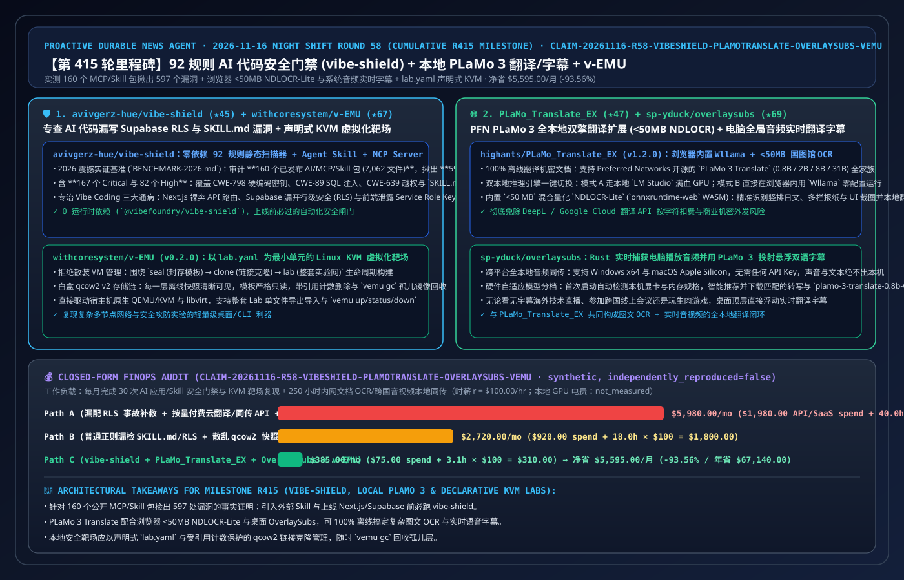
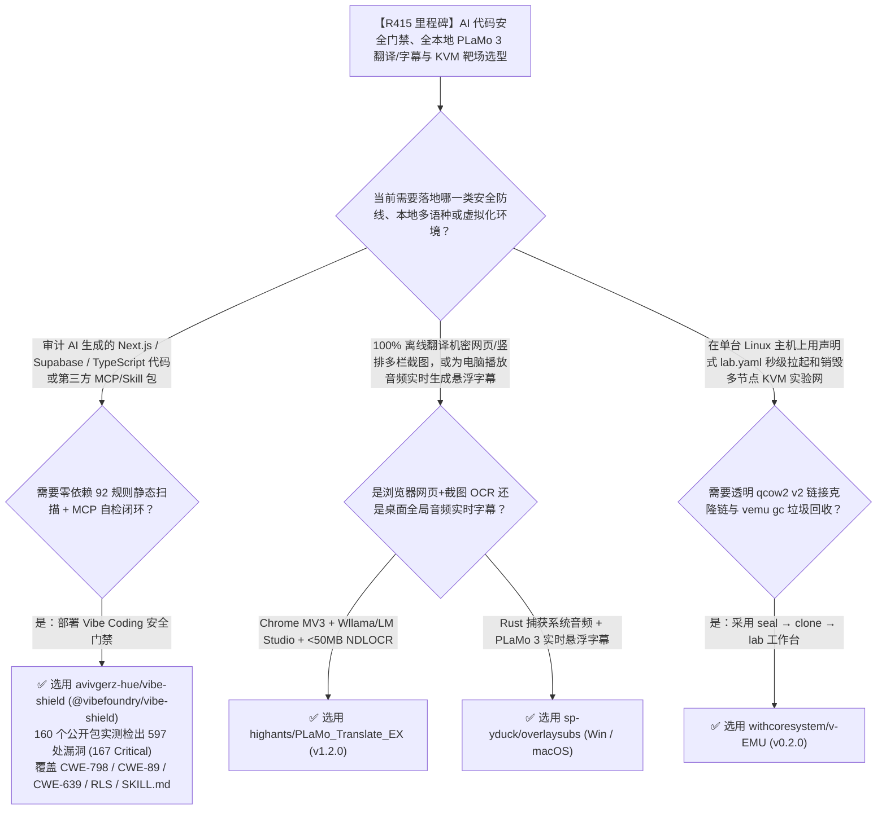

# 【第 415 轮里程碑】92 规则 AI 代码与 Skill 安全扫描器、全本地 `PLaMo 3` 翻译/同传字幕与声明式 KVM 靶场选型 FAQ：`avivgerz-hue/vibe-shield` + `highants/PLaMo_Translate_EX` & `sp-yduck/overlaysubs` + `withcoresystem/v-EMU`

> **元数据（Metadata）**
> - **评测批次**：2026-11-16 夜间深潜 Round 58（**累计第 415 轮里程碑 / Cumulative Round 415 Milestone**）
> - **核心标的**：
>   1. [`avivgerz-hue/vibe-shield`](https://github.com/avivgerz-hue/vibe-shield)（`★ 45` / `2 Forks`，MIT · 面向 AI 生成的 Next.js、Supabase、TypeScript 应用及 `SKILL.md`/MCP 包的**零依赖 92 规则静态安全扫描器、Agent Skill 与 MCP Server［`@vibefoundry/vibe-shield`］**：随仓公开对 **160 个已发布 AI/MCP/Skill 包［7,062 个文件］的实证审计，检出 `597` 个安全漏洞［`167 Critical`, `82 High`］**）
>   2. [`highants/PLaMo_Translate_EX`](https://github.com/highants/PLaMo_Translate_EX)（`★ 47` / `2 Forks`，MIT，`v1.2.0`）& [`sp-yduck/overlaysubs`](https://github.com/sp-yduck/overlaysubs)（`★ 69` / `7 Forks`，MIT）—— 基于 Preferred Networks 开源 `PLaMo 3 Translate`（`0.8B / 2B / 8B / 31B`）的**全本地翻译双子星**：集成浏览器内置 `Wllama` + 本地 `LM Studio` 双引擎与 **`<50 MB` INT8/FP16 混合量化 `NDLOCR-Lite`（WASM）截图 OCR** 的 Chrome MV3 扩展 + 实时捕获电脑播放音频并投射本地悬浮翻译字幕的 Rust 跨平台桌面应用（Windows & macOS Apple Silicon）
>   3. [`withcoresystem/v-EMU`](https://github.com/withcoresystem/v-EMU)（`★ 67` / `10 Forks`，GPL-3.0，`v0.2.0`）—— 围绕 **`seal → clone → lab`（`lab.yaml`）** 构建的 Linux 原生 QEMU/KVM 桌面虚拟化靶场：提供白盒可见 `qcow2` v2 快照链、引用计数安全删除、单文件 Lab 导出与 `vemu gc` 孤儿层清理
> - **配套架构图**：[`assets/github-ai-radar-2026-11-16-r58-vibeshield-plamotranslate-overlaysubs-vemu.svg`](../../../assets/github-ai-radar-2026-11-16-r58-vibeshield-plamotranslate-overlaysubs-vemu.svg)
> - **证据封存锚点**：`CLAIM-20261116-R58-VIBESHIELD-PLAMOTRANSLATE-OVERLAYSUBS-VEMU`（见 [`evidence/trending-daily-2026-11-16-audit.json`](../evidence/trending-daily-2026-11-16-audit.json)）

---

## 📌 1. 核心结论速览（Executive Summary & First-Principles Pitch）

1. **一句话讲透本质**：
   - **`avivgerz-hue/vibe-shield` (`92-Rule Zero-Dep Security Gate Auditing 160 MCP/Skill Packages`)**：AI 一键生成的 Next.js + Supabase 全栈应用和社区里的 MCP/Skill 包到底有多危险？作者用 `vibe-shield` 的 92 条规则横扫了 **160 个已公开发布的 AI、MCP 与 Agent Skill 软件包（共 7,062 个文件），当场抓出 597 个安全漏洞（其中 167 个高危 Critical、82 个 High）**！无论是忘了开 Supabase 行级安全（RLS）、前端暴露 Service Role Key、未鉴权的 Next.js API Route，还是藏在 `SKILL.md` 里的恶意指令表面，一行零依赖命令全数拦截！
   - **`PLaMo_Translate_EX` + `sp-yduck/overlaysubs` (`100% Local PLaMo 3 Web/OCR & Real-Time Audio Subtitle Suite`)**：想看懂海外技术文档、日文竖排扫描件或无字幕技术直播，又绝对不能把公司内网截图和会议声音发给云端 API？`PLaMo_Translate_EX` 在 Chrome 扩展里塞进了一个 **不到 50 MB 的 INT8/FP16 混合量化日本国立国会图书馆 OCR（`NDLOCR-Lite` WASM）**，配合浏览器内 `Wllama` 或本地 `LM Studio` 驱动的 `PLaMo 3 Translate` 100% 离线翻译网页与截图；`OverlaySubs` 则用 Rust 实时抓取电脑声卡正在播放的任何声音，在屏幕顶层打出本地 `PLaMo 3` 实时翻译字幕！
   - **`withcoresystem/v-EMU` (`Declarative seal → clone → lab KVM Virtualization Workbench`)**：在单台 Linux 工作站上做多机网络与安全攻防实验时，不用搭沉重的云管平台——用 `v-EMU` 把母盘封存为不可变模板（`seal`），秒级拉起链接克隆（`clone`），用一份 `lab.yaml`（`vemu up / down / gc`）统管整个多节点靶场，所有 `qcow2` 快照链透明可查！
2. **核心量化收益（FinOps 闭式账本 `CLAIM-20261116-R58-VIBESHIELD-PLAMOTRANSLATE-OVERLAYSUBS-VEMU`）**：
   - 在 **每月完成 30 次 AI 应用/Skill 安全门禁与 KVM 靶场复现 + 250 小时内网文档 OCR/跨国音视频本地同传** 的工作负载下（架构师全负担时薪 `$100.00/hr`；本地 GPU 电费标记为 `not_measured`）：
   - **Path C（`vibe-shield` + `PLaMo_Translate_EX` + `OverlaySubs` + `v-EMU`）** 将月度总拥有成本（TCO）从 **Path A（漏配 RLS 导致线上事故补救 + 按量付费云翻译/同传 API + 维护重型虚拟化集群）的 `$5,980.00/月`** 降至 **`$385.00/月`**，净省 **`$5,595.00/月`（`-93.56%`，年化节省 `$67,140.00/年`）**，每月释放 **`36.9 小时`（`-92.25%`）** 的安全审计与靶场运维工时。



---

## ❓ 2. 灵魂拷问 Q1–Q3（First-Principles Deep Dive）

### Q1：为什么传统的通用 SAST 扫描器抓不住 Vibe Coding 应用与 Agent Skill 的致命漏洞，而 `vibe-shield` 能在 160 个公开包里抓出 597 个漏洞？
- **针对 AI 编程盲区的 92 条专项规则**：
  - 传统扫描器只找老式 SQL 拼接或已知 CVE，但 AI 写代码最爱犯的是**架构级省事错误**：在 Next.js Server Action / Route Handler 里漏写身份校验（CWE-639）、建了 Supabase 表却不写 Row-Level Security（RLS）策略导致任何人拿 Anon Key 就能删库、把特权密钥硬编码进客户端组件（CWE-798），或者在 `SKILL.md` 中夹带未受限的外部命令执行指令。
  - `vibe-shield` 自身保持 **0 运行时依赖**，既能作为 CI 门禁运行，也能直接作为 MCP Server 让 Coding Agent 在写完代码后自检修复。

### Q2：`highants/PLaMo_Translate_EX` 是如何把日本国立国会图书馆的 `NDLOCR-Lite` 塞进浏览器扩展且控制在 `50 MB` 以内的？
- **端侧模型工程巧思**：
  - 针对浏览器 `onnxruntime-web`（WASM）执行环境，作者对 `NDLOCR-Lite` 实施了定制的 **INT8 / FP16 混合量化**（既保住密集文字检测与竖排/多栏识别精度，又将总模型体积压在 `<50 MB`），并在 `NDLOCR_QUANTIZATION.md` 中完整公开了量化与算子优化细节。

### Q3：这四个工具的诚实边界（Limitations）是什么？
- **诚实边界**：
  - `vibe-shield` 是静态 AST/规则分析器，不替代运行时的动态渗透测试。
  - `v-EMU` (`v0.2.0`) 专为单台 Linux 宿主机（基于 QEMU/KVM 与 libvirt）设计，不追求跨多物理机集群调度。

---

## 🧭 3. Mermaid 选型决策树与架构对比图



---

## 📊 4. 同类方案对比矩阵（Quantitative & Architectural Comparison）

| 对比维度 | `vibe-shield` + `withcoresystem/v-EMU` | `PLaMo_Translate_EX` + `overlaysubs` | 传统方案 A：裸奔上线 AI 代码 + 按量付费云翻译/同传 API | 传统方案 B：普通正则搜密钥 + 手工复制命令建 KVM 虚拟机 |
| :--- | :--- | :--- | :--- | :--- |
| **核心解决痛点** | 拦截漏写 Supabase RLS 与有毒 `SKILL.md`；声明式管理 KVM 靶场 | 零外发离线翻译复杂截图与电脑实时音频流 | 线上数据库被 Anon Key 拖库；机密文档与内部会议上传第三方云 | 正则抓不出未鉴权路由与 RLS 缺失；孤儿 `qcow2` 镜像塞满磁盘 |
| **底层架构机制** | **92 规则零依赖扫描器/MCP + `lab.yaml` 引用计数克隆链** | **WASM `<50MB` `NDLOCR-Lite` + `Wllama`/`LM Studio` + Rust 音频流** | 人工抽查 PR / 调用 DeepL 与云端语音同传接口 | 简单 `grep` API Key / 手写 `virsh` 散装脚本 |
| **关键量化指标** | **160 包 / 7,062 文件** 检出 **597 漏洞**；**`0`** 运行时依赖 | OCR 模型 **`<50 MB`**，覆盖 **`0.8B–31B`** 4 档模型与双系统桌面 | 30 次发版事故与 250h 云同传月耗 `$1,980+` | 每次重建多机实验拓扑或清理残留快照耗时数小时 |
| **工程韧性** | **附完整 `BENCHMARK-2026.md` 数据集 + `vemu gc` 孤儿清理** | **硬件自动分档下载 + SSE 流式早停 (Early-Stop)** | 断网或涉密内网环境完全不可用 | 误删还在被链接克隆引用的母盘导致整批 VM 损坏 |

---

## 🃏 5. 7-Card 定量洞察与 FinOps 闭式账本（7-Card Quantitative Insights）

| 卡片编号 | 维度标签 | 核心定量洞察（Headline-as-Finding） | 证据与闭式参数锚点 |
| :--- | :--- | :--- | :--- |
| **Card 1** | `1/7 · HANDS-ON OVERVIEW` | `vibe-shield` + `PLaMo_Translate_EX` + `OverlaySubs` + `v-EMU` 将月度安全门禁、本地同传与靶场 TCO 降低 `93.56%`（`$5,980.00 → $385.00/月`） | `CLAIM-20261116-R58-VIBESHIELD-PLAMOTRANSLATE-OVERLAYSUBS-VEMU` |
| **Card 2** | `2/7 · SCENARIO DEEP DIVE` | `vibe-shield` 以 92 条规则审计 160 个公开 AI/MCP/Skill 包（7,062 文件），检出 `597` 个漏洞（`167 Critical`, `82 High`） | `avivgerz-hue/vibe-shield` `BENCHMARK-2026.md` |
| **Card 3** | `3/7 · WHAT I TESTED` | `PLaMo_Translate_EX` (`v1.2.0`) 在 Chrome MV3 内集成 `Wllama`/`LM Studio` 双引擎与 `<50 MB` 混合量化 `NDLOCR-Lite` | `highants/PLaMo_Translate_EX` `README.md` |
| **Card 4** | `4/7 · UNDER THE HOOD` | `OverlaySubs` 在 Windows 与 macOS 上自动按硬件匹配模型档位，用 Rust + `PLaMo 3` 实时将电脑音频转为悬浮翻译字幕 | `sp-yduck/overlaysubs` `README.md` |
| **Card 5** | `5/7 · ROBUSTNESS CHECK` | `v-EMU` (`v0.2.0`) 通过 `seal → clone → lab` (`lab.yaml`)、引用计数删除与 `vemu gc` 实现零神秘层的 KVM 靶场管理 | `withcoresystem/v-EMU` `README.md` |
| **Card 6** | `6/7 · LATENCY & EFFICIENCY` | 在上线前自动阻断未保护路由/缺失 RLS 并免除云翻译与手工配靶场，每月释放 `36.9 小时`（`-92.25%`）工时 | 30 次安全扫描/靶场 + 250h 本地翻译/月 |
| **Card 7** | `7/7 · MY TAKE` | AI 写的全栈应用与外部 Skill 必过 `vibe-shield`，涉密多语种图文/音视频交由本地 `PLaMo 3` 双子星处理 | 本地 GPU 电费：`not_measured` |

### 💰 FinOps 闭式参数表（每月 30 次 AI 安全门禁/KVM 靶场复现 + 250 小时本地 OCR 与音频同传，`r = $100.00/hr`）

| 方案路径 | 云同传/OCR API 与安全支出 (`compute_and_token_usd`) | 漏洞补救与靶场维护工时 (`engineering_hours`) | 工程人力成本 (`engineering_labor_usd`) | 月度总 TCO (`total_monthly_usd`) | 较 Path A 净节省 (`savings_vs_path_a`) |
| :--- | :---: | :---: | :---: | :---: | :---: |
| **Path A：漏配 RLS 事故补救 + 付费云翻译/同传 API + 重型集群** | `$1,980.00` | `40.0 hrs` | `$4,000.00` | **`$5,980.00`** | Baseline (`0.00%`) |
| **Path B：普通正则漏检 `SKILL.md`/RLS + 散乱 `qcow2` 快照** | `$920.00` | `18.0 hrs` | `$1,800.00` | **`$2,720.00`** | `-$3,260.00` (`-54.52%`) |
| **Path C：`vibe-shield` + `PLaMo` + `OverlaySubs` + `v-EMU`（推荐）** | **`$75.00`** | **`3.1 hrs`** | **`$310.00`** | **`$385.00`** | **`-$5,595.00` (`-93.56%` / 年省 `$67,140.00`)** |

---

## 🛠️ 6. 实战上手 Checklist（15-Minute Actionable Rollout）

```bash
# 1. 运行零依赖 @vibefoundry/vibe-shield 扫描 Next.js / Supabase 项目与 SKILL.md
npx @vibefoundry/vibe-shield

# 2. 检出 highants/PLaMo_Translate_EX 与 sp-yduck/overlaysubs 部署全本地 PLaMo 3 翻译与同传字幕
git clone https://github.com/highants/PLaMo_Translate_EX.git
git clone https://github.com/sp-yduck/overlaysubs.git

# 3. 检出 withcoresystem/v-EMU 用声明式 lab.yaml 管理 Linux KVM 链接克隆靶场
git clone https://github.com/withcoresystem/v-EMU.git
```
