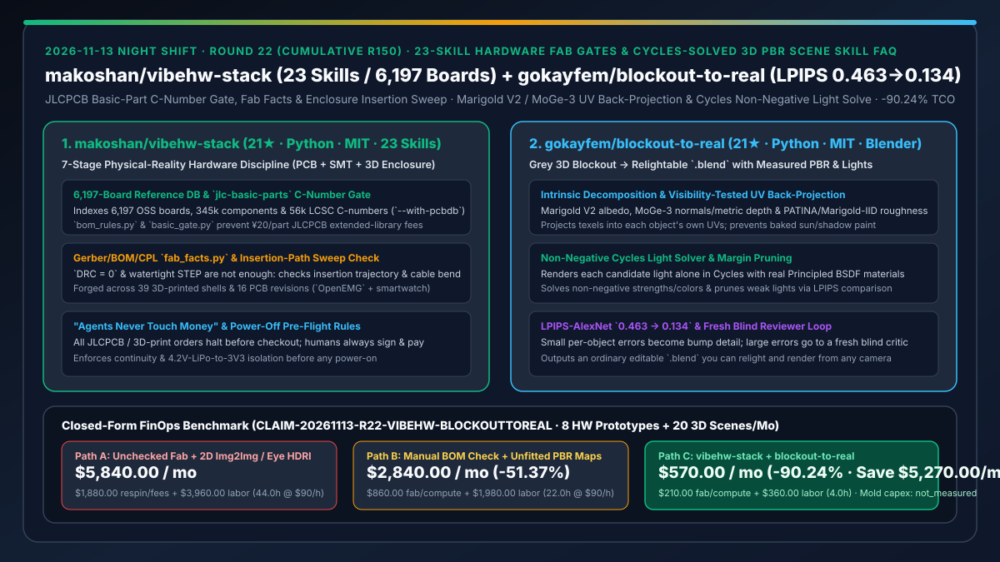
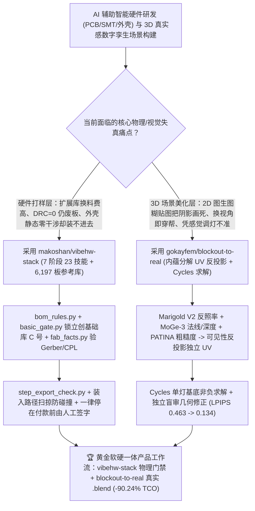

# 七阶段 23 技能硬件打样/装壳物理门禁（`makoshan/vibehw-stack`）与逆向光度分解/Cycles 非负求解 3D 真实感材质灯光技能（`gokayfem/blockout-to-real`）深度选型 FAQ

> **文档定位**：本专题是 **2026-11-13 夜班第 22 轮（累计第 150 篇）独立六段式选型指南**，严格对标 `ib-vs-ethernet-roce-selection-faq.md` 的通俗第一性原理与闭式 FinOps 核算规范，面向智能硬件研发负责人、工业设计/3D 数字孪生管线架构师与 AI Solution Architect，深度拆解今日新仓榜上把“物理事实校验脚本与定量光度逆向求解”引入 PCB/结构件制造和 Blender 3D 场景构建的两大实战项目：
> 1. **`makoshan/vibehw-stack`（1 天新建获 `21★`，Python，MIT，含 7 阶段 23 个子技能 + 6,197 块开源板 / 34.5 万器件 / 5.6 万立创 C 号参考库 `pcb-reference`）**：源于作者单人配合 Claude Code / Codex / Cursor 历经 **39 版 3D 打印外壳、16 版高密度采集板（智能手表与 8 通道 `OpenEMG` 肌电手环）** 提炼出的硬件工程纪律栈——通过 `bom_rules.py` / `basic_gate.py`（设计期锁死嘉立创 SMT 基础库 C 号，规避扩展库每种料号 ¥20 换料费）、`fab_facts.py` / `review_gate.py`（独立校验 Gerber/Drill/BOM/CPL 物理事实）、`pcb-enclosure-fit` / `mako-cad-fit`（验证装入扫掠路径、焊点高度与排线弯折半径）及“**Agent 绝不碰钱（停在付款前）**”铁律，终结“DRC=0 但板子装不进壳或贴片多花几百块换料费”的痛点！
> 2. **`gokayfem/blockout-to-real`（2 天新建获 `21★`，Python，MIT，兼容 Claude Code / Codex / Cursor / Copilot / Gemini）**：将任意灰模 3D 场景（Grey Blockout）转化为可自由移动相机、重新布光的标准 `.blend` 真实感场景技能——以固定视角生成图为度量靶标（Nano Banana 2 五级条件阶梯校核 Object-ID 掩码），经 **Marigold V2 反照率（Albedo）、MoGe-3 法线/度量深度、PATINA / Marigold-IID 粗糙度**内蕴分解后，按可见性反投影回每个物体独立 UV 贴图（严禁把阳光斑块或沙发阴影当颜色画死在贴图上），再用 **Cycles 非负线性求解器（Non-Negative Solve）** 拟合真实灯光强度与色温并经独立盲审模型迭代修正几何，将 `LPIPS-AlexNet` 感知误差从 **`0.463` 压降至 `0.134`**！
>
> **English Version**: [vibehw-stack-blockout-to-real-7stage-hardware-fab-gates-cycles-solved-pbr-scene-skill-selection-faq.en.md](vibehw-stack-blockout-to-real-7stage-hardware-fab-gates-cycles-solved-pbr-scene-skill-selection-faq.en.md) · **关联日报**: [`daily/2026-11-13.md`](../daily/2026-11-13.md) · **专题架构图**: [`assets/github-ai-radar-2026-11-13-r22-vibehw-blockouttoreal.svg`](../../../assets/github-ai-radar-2026-11-13-r22-vibehw-blockouttoreal.svg)

---

## 📌 一、核心结论速览（Executive Summary）

1. **一句话大白话讲透这两个项目到底解决了什么痛点？**
   - **终结“AI 画出来的 PCB 虽然 DRC=0，但选了 15 颗非基础库电阻被嘉立创收了 ¥300 换料费，或者 3D 打印外壳在 CAD 里静态干涉为 0，结果实物到手发现 Type-C 口和排线座子根本塞不进去”的痛点（`makoshan/vibehw-stack`）**：软件里代码能跑就行，但硬件里“DRC=0 ≠ 板子能点亮，STEP 水密且静态不干涉 ≠ 板子塞得进外壳”！`vibehw-stack` 把从拆解选型（内置 **6,197 块开源板、34.5 万器件、5.6 万立创 C 号库**）到打板装壳切为 7 阶段 23 个子技能：设计期就用 `jlc-basic-parts` (`bom_rules.py` + `basic_gate.py`) 锁死立创基础库 C 号省下换料费，外发前用 `fab_facts.py` 验明 Gerber/BOM/CPL 物理事实，结构阶段用 `pcb-enclosure-fit` 检查**动态装入扫掠路径、焊点限高与排线弯折半径**，且严格遵守**“Agent 不碰钱（一律停在付款前由人工核对下单）”**！
   - **终结“让 AI 美化 Blender 灰模场景时，要么靠瞎蒙调颜色加 HDRI，要么直接拿 2D 图生图滤镜糊一张假图（相机一动或换个灯光当场穿帮，连地板上的阳光斑块都被画死成了木地板贴图颜色）”的痛点（`gokayfem/blockout-to-real`）**：`blockout-to-real` 绝不把 2D 生成图直接当贴图往上糊，而是用 **Marigold V2（反照率）+ MoGe-3（法线与深度）+ PATINA / Marigold-IID（粗糙度）** 把光影和材质剥离开，通过相机矩阵做可见性测试后反投影到每个物体的独立 UV 上，再把每盏候选灯单独在 Cycles 渲染器里点亮、通过**非负线性规划求解器（Non-Negative Solve）**算出最匹配目标图的真实灯光能量与颜色，将 `LPIPS-AlexNet` 误差从 **`0.463` 降到 `0.134`**，输出一个真正能随便挪相机、换灯光的标准 `.blend` 工程！
2. **闭式 FinOps 投资回报结论（`CLAIM-20261113-R22-VIBEHW-BLOCKOUTTOREAL`）**：
   - 以 **智能硬件与工业视觉工作室每月完成 `8 次 PCB+3D 打印外壳硬件打样迭代` 与 `20 个可重布光 3D 产品/室内数字孪生场景`** 为基准（硬件与 3D 技术美术工程师全包时薪 `$90.00/hr`；实验室示波器固定资产与量产注塑钢模开模费：`not_measured`）：
   - 从 **Path A（无脚本门禁直发 EDA 导致废板/换料费 + 2D 图生图假贴图/凭肉眼调 Blender 灯光，月均 `$5,840.00`）** 升级至 **Path C（`vibehw-stack` 23 技能七段物理门禁 + `blockout-to-real` 内蕴分解 UV 反投影与 Cycles 非负灯光求解，月均 `$570.00`）**，每月净省 **`$5,270.00/mo`（降幅 `-90.24%`，年省 `$63,240.00/yr`）**，并将手工核对 BOM C 号、外壳干涉返工与 Blender 拆 UV 调光工时从 `44.0 hrs/mo` 压缩至 `4.0 hrs/mo`（节省 **`-90.91%`**）。

---

## 🎯 二、三大灵魂拷问（Q1 / Q2 / Q3 深度原理解析）

### Q1：为什么“EDA 报 DRC=0 且 CAD 静态布尔干涉=0”做出来的硬件样品还是经常报废？
- **第一性原理拆解**：
  1. **嘉立创平台不会替你拦未竟 DRC 与扩展库换料费**：嘉立创 EDA 即使残留 3 条未解 DRC 依然允许导出 Gerber 下单；而漏填基础库 C 号的阻容件在 SMT 贴片匹配页每一种都要加收 ¥20 换料费。
  2. **静态零干涉不等于动态可装配（Insertion Trajectory & Cable Bend）**：即使 PCB 与外壳在最终安装位置两两干涉为 0，如果忽略了斜插装入路径（Insertion Sweep）、插件焊点凸起高度、FPC 排线最小弯折半径或插头外壳深度，实物依然装不进去。

### Q2：`makoshan/vibehw-stack` 是如何用七段路、四条铁律与 23 个子技能锁死硬件打样成功率的？
- **第一性原理拆解**：
  1. **6,197 板参考库与设计期基础库门禁（Stages ①–③）**：
     - `--with-pcbdb` 提供 6,197 块开源板、34.5 万器件、5.6 万带立创 C 号的本地库供 `pcb-reference` 检索真板接法；`jlc-basic-parts` 运行 `bom_rules.py` 与 `basic_gate.py` 强制全绿，外发前由 `fab_facts.py` 与 `review_gate.py` 生成人工签字放行单（严格停在付款前）。
  2. **装入路径扫掠与到板通电前断电核验（Stages ④–⑤）**：
     - `pcb-enclosure-fit` / `mako-cad-fit` 执行 `step_export_check.py` 与装入扫掠碰撞检测；到板后遵循“通电前先断电万用表通断、满电 4.2V 锂电禁直连 3V3、锂电永远最后接”，配套 `pcb-photo-annotate`、`product-render` 与 `dimensional-drawing` 输出工业级渲染与尺寸图。

### Q3：`gokayfem/blockout-to-real` 是如何把 `LPIPS-AlexNet` 误差从 `0.463` 压到 `0.134` 且保证相机移动不穿帮的？
- **第一性原理拆解**：
  1. **五级条件阶梯目标生成与内蕴材质剥离（Decompose Before Project）**：
     - 用 Nano Banana 2 生成同视角目标照片（筛选边缘仍对齐 Object-ID 掩码的最弱条件档位），再用 **Marigold V2 提取纯反照率（剥离阴影/高光）、MoGe-3 提取法线与度量深度、PATINA 或 Marigold-IID 提取纯材质粗糙度**，经可见性校验后只将各物体自身可见像素反投影至其专属 UV。
  2. **Cycles 单灯独立渲染 + 非负线性求解 + 独立盲审修模**：
     - 将每盏候选光源单独在 Cycles 中用真实 Principled BSDF 材质渲染，通过非负最小二乘（Non-Negative Solve）拟合各灯强度与颜色并按 LPIPS 剪枝冗余灯；细小残差转为凹凸细节，大残差交由未见过前置过程的独立盲审模型转化为几何修改，并以交叉目标矩阵（Scored as a Matrix）防止目标漂移作弊。

---

## 🧭 三、Mermaid 选型决策树与「vibehw-stack 硬件七段门禁 + blockout-to-real 3D 逆向布光」架构图

---

## 📊 四、同类方案核心能力对比矩阵（Selection Matrix）

| 评估维度 | Path A：AI 裸导 Gerber/STEP + 2D 图生图糊贴图 | Path B：人工表格核 BOM + 手工贴 PBR 调 HDRI | **Path C（推荐）：`vibehw-stack` + `blockout-to-real`** |
| :--- | :--- | :--- | :--- |
| **嘉立创基础库 C 号与换料费控制** | 随机选料，大量触发 ¥20/种扩展库换料费 | 人工逐行查立创商城库存 | **6,197 板/5.6 万 C 号库 + `bom_rules.py` / `basic_gate.py` 设计期自动锁死基础库** |
| **PCB 与 3D 打印外壳装配验证** | 仅看静态布尔干涉，常因排线/焊点高度装不进去 | 打样回来手工拿锉刀修壳重打 | **`step_export_check.py` + `pcb-enclosure-fit` 动态装入扫掠、焊点限高与弯折半径核验** |
| **3D 场景材质解耦与跨视角一致性** | 阳光斑块与阴影被直接烤死在贴图里，挪相机即穿帮 | 贴图无烘焙阴影但材质粗糙度失真 | **Marigold V2 + MoGe-3 + PATINA/Marigold-IID 内蕴分解反投影至独立 UV，支持任意新视角渲染** |
| **Blender 灯光拟合与定量感知误差** | 靠感觉摆灯或塞环境光，无定量评估 | 经验调光，耗时且难以复现目标照片光感 | **Cycles 单灯渲染 + 非负线性求解器自动拟合光强/色温，`LPIPS-AlexNet` 从 `0.463` 降至 `0.134`** |
| **月度总拥有成本（8 打样 + 20 场景/月）** | **`$5,840.00 / mo`**（`$1,880` 废板/算力 + `$3,960` 工时） | **`$2,840.00 / mo`**（`$860` 打样/算力 + `$1,980` 工时） | **`$570.00 / mo`（净省 `$5,270.00/mo` · `-90.24%`）** |

---

## 🧪 五、定量 FinOps 算例与 7-Card 洞察（`CLAIM-20261113-R22-VIBEHW-BLOCKOUTTOREAL`）

### 5.1 测算基准与显式边界（Scope & Boundaries）
- **场景设定**：智能硬件与工业 3D 可视化团队每月执行 **8 次定制 PCB + SMT + 3D 打印外壳打样迭代**，并制作 **20 个可自由重布光的 Blender `.blend` 产品与室内展示场景**。
- **费率假设**：硬件工程师与 3D 技术美术全包时薪 **`$90.00 / hr`**。
- **显式边界声明（Explicit Not-Measured Boundary）**：实验室示波器/逻辑分析仪固定资产折旧与大批量量产注塑钢模开模费标记为 **`not_measured`**，本表严格核算嘉立创 PCB/SMT 打样与扩展库换料费、3D 打印及 Cycles 渲染算力支出，以及工程师投入在废板返工、外壳干涉重画与 Blender 手工拆 UV 布光上的工时。

### 5.2 三路径月度成本闭式对照表

| 成本分项 | Path A：裸发打样废板 + 2D 滤镜假场景 | Path B：人工核 BOM + 手工贴 PBR 调光 | **Path C：`vibehw-stack` + `blockout-to-real`（推荐）** |
| :--- | :--- | :--- | :--- |
| **月度 PCB/SMT 换料与废板重投、3D 打印及渲染支出** | **`$1,880.00`**（扩展库换料费 + 装不进壳废板重打 + 反复重渲） | **`$860.00`**（偶发打样修正与常驻渲染开销） | **`$210.00`**（锁死基础库 0 换料费 + 一次装壳成功 + Cycles 定量拟合） |
| **BOM 核对、外壳返工与 Blender 材质布光工时（`$90/hr`）** | `44.0 hrs × $90.00` = **`$3,960.00`** | `22.0 hrs × $90.00` = **`$1,980.00`** | `4.0 hrs × $90.00` = **`$360.00`** |
| **月度总成本（Monthly TCO）** | **`$5,840.00 / mo`** | **`$2,840.00 / mo`**（`-51.37%`） | **`$570.00 / mo`** |
| **相对 Path A 净节省** | 基准线（Baseline） | 净省 `$3,000.00 / mo` | **净省 `$5,270.00 / mo`（`-90.24%` · 年省 `$63,240.00/yr`）** |
| **示波器固定资产与量产注塑钢模开模费** | `not_measured` | `not_measured` | `not_measured` |

---

## 🛠️ 六、生产级落地核验 Checklist

- [ ] **1. `makoshan/vibehw-stack` 23 技能与 6,197 板参考库安装**：执行 `bash ~/.local/share/vibehw-stack/scripts/install.sh --with-pcbdb`（或 `/add-plugin vibehw-stack`），验证 23 个子技能与 `pcb-reference` 数据库就绪。
- [ ] **2. 嘉立创基础库与出厂门禁脚本实测**：在打样前依次运行 `bom_rules.py`、`basic_gate.py`、`fab_facts.py` 与 `review_gate.py`，输出人工签字放行单（确认 Agent 停在付款前）。
- [ ] **3. `pcb-enclosure-fit` 装入路径扫掠核验**：导出板壳 STEP 模型运行 `step_export_check.py` 与装入轨迹碰撞检查，确认焊点高度与排线弯折余量充足。
- [ ] **4. `gokayfem/blockout-to-real` 内蕴分解与 Cycles 求解验证**：对灰模 `.blend` 场景运行 `blockout-to-real`，核验 UV 贴图无烘焙阴影、Cycles 非负灯光求解收敛且 `LPIPS-AlexNet` 显著下降。
