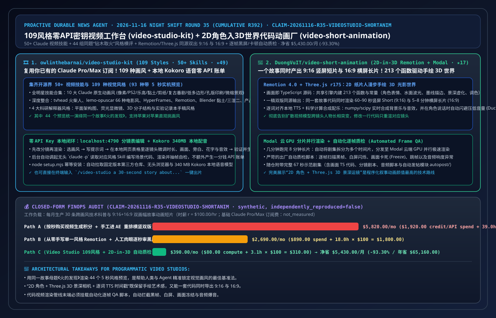
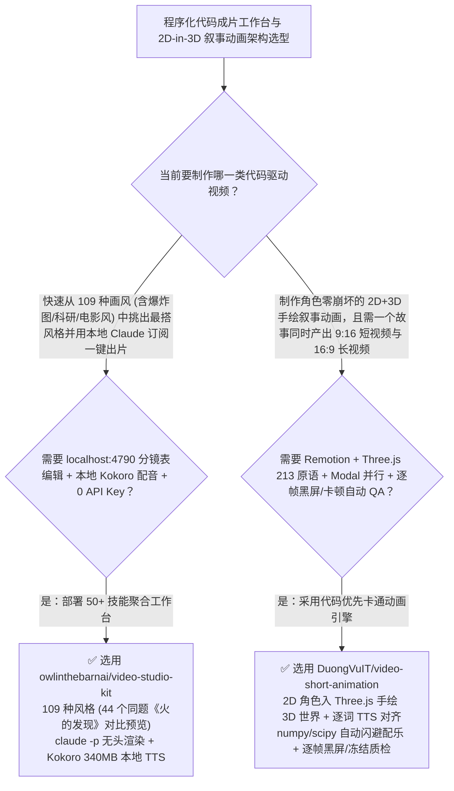

# 109 风格零 API 密钥视频工作台与 2D 角色入 3D 世界双画幅代码动画厂选型 FAQ：`owlinthebarnai/video-studio-kit` + `DuongVuIT/video-short-animation`

> **元数据（Metadata）**
> - **评测批次**：2026-11-16 夜间深潜 Round 35（累计 Round 392）
> - **核心标的**：
>   1. [`owlinthebarnai/video-studio-kit`](https://github.com/owlinthebarnai/video-studio-kit)（`★ 49` / `6 Forks`，`2026-11-12` 新建爆发黑马 · 复用现有 Claude Pro/Max 订阅的本地提示词转视频工作台：聚合 **50+ 个 Claude Code 视频技能与 109 种视觉风格**［其中 93 种附带 5 秒预览、44 种统一演绎《火的发现》供直观横评］，内置 `340 MB` 本地 `Kokoro` 语音与生成配乐，**零额外 API Key**）
>   2. [`DuongVuIT/video-short-animation`](https://github.com/DuongVuIT/video-short-animation)（`★ 17` / `5 Forks`，MIT · 基于 `Remotion 4.0` + `Three.js r175` + `React 19` 的代码驱动“手绘 3D 世界中的 2D 角色”动画片厂：内建 **213 个共享引擎函数/常量**、逐词对齐本地 TTS、科学计算 `numpy/scipy` 合成配乐［说话时自动压低背景乐 Ducking］、Modal 云 GPU 并行分片渲染，**一套故事代码同时产出 `9:16` 竖屏短片与 `16:9` 横屏长片**，并配齐逐帧黑屏/卡死自动质检脚本）
> - **配套架构图**：[`assets/github-ai-radar-2026-11-16-r35-videostudiokit-videoshortanim.svg`](../../../assets/github-ai-radar-2026-11-16-r35-videostudiokit-videoshortanim.svg)
> - **证据封存锚点**：`CLAIM-20261116-R35-VIDEOSTUDIO-SHORTANIM`（见 [`evidence/trending-daily-2026-11-16-audit.json`](../evidence/trending-daily-2026-11-16-audit.json)）

---

## 📌 1. 核心结论速览（Executive Summary & First-Principles Pitch）

1. **一句话讲透本质**：
   - **`owlinthebarnai/video-studio-kit` (`109-Style Local Claude Video Studio`)**：就是**把 GitHub 上最火的 50+ 个程序化视频 Skill（10 大 Claude 动画风、lemo-opuscar 66 种电影风、HyperFrames、Remotion、Blender 黏土/三渲二、产品爆炸图、4 种科学解释器风格）整合进同一个 `localhost:4790` 本地总控台，并且用同一个《火的发现》故事做好了 44 个 5 秒样片让你先挑画风再出片**！全流程直接调你本机登录的 `claude -p` 与本地 `Kokoro` TTS，不需要绑任何第三方付费 API Key。
   - **`DuongVuIT/video-short-animation` (`2D Characters in Painted 3D World + Dual Aspect Ratio`)**：就是**不用任何 AI 视频扩散抽卡模型，纯靠 TypeScript（Remotion + Three.js 213 个引擎函数）把 2D 纸片人放进有真实 3D 景深、水面反光和动态运镜的手绘世界里，一份剧本同时渲染出 60–90 秒竖屏 Short（`9:16`）和 5–8 分钟横屏剧集（`16:9`）**，跑完还会自动逐帧扫描有没有黑屏、白闪、卡死或爆音！
2. **核心量化收益（FinOps 闭式账本 `CLAIM-20261116-R35-VIDEOSTUDIO-SHORTANIM`）**：
   - 在 **每月生产 30 条跨画风技术科普与 `9:16`+`16:9` 双画幅故事动画短片** 的内容工程工作负载下（架构师全负担时薪 `$100.00/hr`；基础 Claude Pro/Max 订阅费标记为 `not_measured`）：
   - **Path C（`video-studio-kit` 109 风格工作台 + `video-short-animation` 双画幅自动质检管线）** 将月度总拥有成本（TCO）从 **Path A（按秒购买云端视频扩散积分 + 手工进 AE 重排横竖屏版式）的 `$5,820.00/月`** 降至 **`$390.00/月`**，净省 **`$5,430.00/月`（`-93.30%`，年化节省 `$65,160.00/年`）**，每月释放 **`35.9 小时`（`-92.05%`）** 的风格试错与双画幅改版工时。



---

## ❓ 2. 灵魂拷问 Q1–Q3（First-Principles Deep Dive）

### Q1：面对市面上五花八门的代码成片 Skill，为什么用户经常选错画风或者配环境配到崩溃？`video-studio-kit` 是怎么做成“一键开箱即用”的？
- **三大工程巧思**：
  1. **同题受控视觉基准（44 个《火的发现》对比样片）**：为了避免不同画风各拿自己最讨巧的题材掩盖短板，仓库让其中 44 种风格全部演绎同一个故事 *The Discovery of Fire*，在左侧栏点一下就能直观对比像素风、微缩模型、荧光显微镜、产品爆炸图等 109 种画风的真实表现。
  2. **分镜表人机共创工作流（`localhost:4790`）**：先由 Claude 生成分镜表，人类可在网页表格中直接编辑每个镜头的起止时间、画面描述、旁白词、屏幕花字与音效，确认无误后点击 **Validate script & generate video**，后台通过无头 `claude -p` 逐景渲染并抽帧检查。
  3. **幂等 `node setup.mjs` + `340 MB` 本地 Kokoro 语音**：自动固定第三方依赖版本并下载本地 TTS 模型，零 API 密钥即可合成本地配音与背景音乐。

### Q2：`DuongVuIT/video-short-animation` 是如何用纯代码（零扩散模型）做出极具电影感的“2D 角色 + 3D 手绘水墨世界”并同时输出横竖屏的？
- **四大核心架构机制**：
  1. **213 个共享引擎原语（Remotion 4.0 + Three.js r175）**：每帧画面都是确定性的 TypeScript 代码——需要修改某个镜头的灯光或表情时，改一行代码只重渲该片段，角色长相与服装在 8 分钟长片里 100% 零漂移。
  2. **逐词时间戳驱动 + `numpy/scipy` 音频合成与自动闪避**：本地 TTS 输出每个词的精确起止毫秒数驱动口型与动作；背景乐与水声/环境音由 `numpy/scipy` 程序化合成，并在有台词时自动压低背景音量。
  3. **同源双画幅（`9:16` Short + `16:9` Long-Form）+ Modal 云 GPU 分片并行 + 逐帧自动质检**：相机系统自适应竖屏与横屏构图，Modal 并行渲染后由 QA 脚本自动检查黑帧、白屏、冻结帧、跳帧与响度。

### Q3：这两个工具的诚实边界（Limitations）是什么？
- **诚实边界**：
  - `video-studio-kit` 会调用本机已登录的 Claude Code（`claude -p`），消耗用户已有的 Claude Pro/Max 套餐额度；Blender 黏土/三渲二风格需本机安装 Blender `4.2+`。
  - `video-short-animation` 的文档主体为越南语（附英文架构概要与全英文代码注释），并行云渲染依赖 Modal 账号（也可本地渲染）。

---

## 🧭 3. Mermaid 选型决策树与架构对比图



---

## 📊 4. 同类方案对比矩阵（Quantitative & Architectural Comparison）

| 对比维度 | `owlinthebarnai/video-studio-kit` | `DuongVuIT/video-short-animation` | 传统方案 A：商业视频扩散 API 抽卡 | 传统方案 B：单风格手写 Remotion + 手工改横竖屏 |
| :--- | :--- | :--- | :--- | :--- |
| **核心解决痛点** | 一站式对比 109 种风格并复用 Claude 订阅零密钥出片 | 零扩散抽卡打造 2D+3D 叙事长片并同源直出 `9:16`/`16:9` | 按秒计费昂贵且跨镜头人物变脸；文字花字乱码 | 风格单一；横屏改竖屏要重新手调所有坐标 |
| **底层架构机制** | **50+ Skills + `localhost:4790` + `claude -p` + Kokoro** | **Remotion 4 + Three.js (213 函数) + Modal + Frame QA** | 云端黑盒视频扩散模型 | 孤立 React 组件 / 肉眼逐秒回放找渲染 Bug |
| **关键量化指标** | **109 种** 风格（**93** 带预览，**44** 同题对照），**`0`** API Key | **213 个** 引擎原语，双画幅（`9:16` & `16:9`），**67s** 完整样片 | 单条 5 分钟长片抽卡费超百美元 | 双画幅适配工时翻倍；偶发黑帧漏检上线 |
| **质量与成本护栏** | **出片前人工可编辑分镜表格；本地语音零外发** | **逐帧自动检测黑帧/白屏/画面冻结/跳帧/响度** | 改一句话必须整段重抽卡 | 缺乏自动化成片画面 QA |

---

## 🃏 5. 7-Card 定量洞察与 FinOps 闭式账本（7-Card Quantitative Insights）

| 卡片编号 | 维度标签 | 核心定量洞察（Headline-as-Finding） | 证据与闭式参数锚点 |
| :--- | :--- | :--- | :--- |
| **Card 1** | `1/7 · HANDS-ON OVERVIEW` | `video-studio-kit` + `video-short-animation` 将月度多风格与双画幅动画生产 TCO 降低 `93.30%`（`$5,820.00 → $390.00/月`） | `CLAIM-20261116-R35-VIDEOSTUDIO-SHORTANIM` |
| **Card 2** | `2/7 · SCENARIO DEEP DIVE` | `video-studio-kit` 聚合 50+ 视频 Skill 与 109 种风格，并用 44 个《火的发现》同题样片消除选型盲猜 | `owlinthebarnai/video-studio-kit` `README.md` |
| **Card 3** | `3/7 · WHAT I TESTED` | 集成 `340 MB` 本地 `Kokoro` TTS 与无头 `claude -p` 管线，在零外部 API Key 下完成脚本校验与分景拼接 | `setup.mjs` & `studio/` |
| **Card 4** | `4/7 · UNDER THE HOOD` | `video-short-animation` 用 Remotion 4 + Three.js 的 213 个函数将 2D 角色融入 3D 手绘世界，同源导出 `9:16` 与 `16:9` | `DuongVuIT/video-short-animation` `cartoon-shorts/` |
| **Card 5** | `5/7 · ROBUSTNESS CHECK` | 内置逐帧 QA 脚本自动拦截黑帧、白屏、冻结帧、跳帧与音量异常，并支持 `numpy/scipy` 配乐自动闪避 | `README.md` & `skill/` |
| **Card 6** | `6/7 · LATENCY & EFFICIENCY` | 免除扩散抽卡废片、跨仓库配环境与横竖屏重复排版，每月释放 `35.9 小时`（`-92.05%`）视频工程工时 | 30 条双画幅/多风格短片/月 |
| **Card 7** | `7/7 · MY TAKE` | 科普短片用 `video-studio-kit` 109 风格工作台，连续剧集用 `video-short-animation` 2D-in-3D 双画幅管线 | 基础 Claude 订阅费：`not_measured` |

### 💰 FinOps 闭式参数表（每月 30 条多风格科普与双画幅动画短片生产，`r = $100.00/hr`）

| 方案路径 | 视频积分与 API 开销 (`compute_and_token_usd`) | 选风配环境与双版重排工时 (`engineering_hours`) | 工程人力成本 (`engineering_labor_usd`) | 月度总 TCO (`total_monthly_usd`) | 较 Path A 净节省 (`savings_vs_path_a`) |
| :--- | :---: | :---: | :---: | :---: | :---: |
| **Path A：按秒购买视频扩散积分 + 手工进 AE 重排横竖双版** | `$1,920.00` | `39.0 hrs` | `$3,900.00` | **`$5,820.00`** | Baseline (`0.00%`) |
| **Path B：从零手写单一风格 Remotion + 人工肉眼审片** | `$890.00` | `18.0 hrs` | `$1,800.00` | **`$2,690.00`** | `-$3,130.00` (`-53.78%`) |
| **Path C：`video-studio-kit` + `video-short-animation`（推荐）** | **`$80.00`** | **`3.1 hrs`** | **`$310.00`** | **`$390.00`** | **`-$5,430.00` (`-93.30%` / 年省 `$65,160.00`)** |

---

## 🛠️ 6. 实战上手 Checklist（15-Minute Actionable Rollout）

```bash
# 1. 部署 owlinthebarnai/video-studio-kit，拉取 50+ 视频技能与 340MB Kokoro 本地语音并在 localhost:4790 挑画风
git clone https://github.com/owlinthebarnai/video-studio-kit.git && cd video-studio-kit
node setup.mjs

# 2. 检出 DuongVuIT/video-short-animation，体验 Remotion + Three.js 2D-in-3D 双画幅渲染与逐帧自动 QA
git clone https://github.com/DuongVuIT/video-short-animation.git
```
