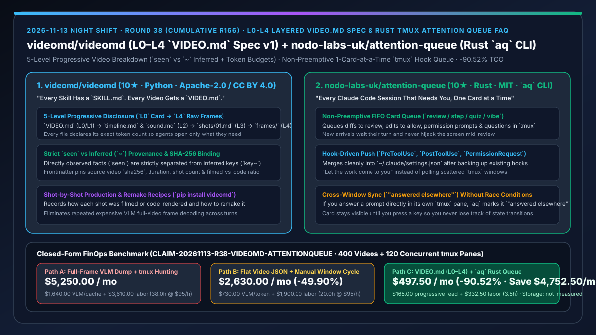
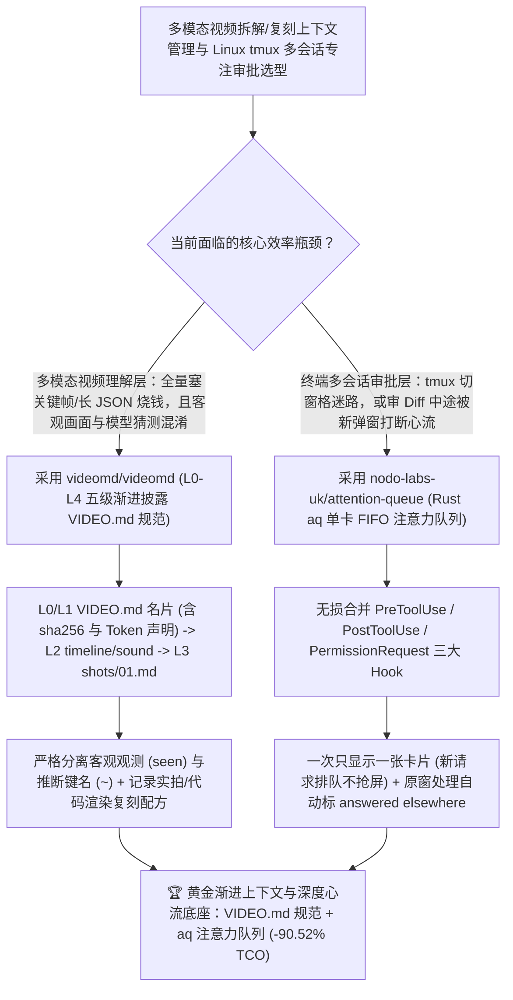

# 五级渐进披露视频结构化规范（`videomd/videomd` `VIDEO.md`）与单卡不抢屏 `tmux` 终端注意力队列（`nodo-labs-uk/attention-queue` `aq`）深度选型 FAQ

> **文档定位**：本专题是 **2026-11-13 夜班第 38 轮（累计第 166 篇）独立六段式选型指南**，严格对标 `ib-vs-ethernet-roce-selection-faq.md` 的通俗第一性原理与闭式 FinOps 核算规范，面向多模态内容理解架构师、Linux/`tmux` 高并发智能体工程师与 AI Solution Architect，深度拆解今日新仓榜上将“渐进披露（Progressive Disclosure）与事实/推断显式分离”引入视频解析、以及将“单卡 FIFO 零抢屏队列”引入 `tmux` 多会话审批的两大基础设施：
> 1. **`videomd/videomd`（1 天新建获 `10★`，Python，Apache-2.0 + CC BY 4.0，PyPI `videomd`，Spec v1）**：“每个技能都有一份 `SKILL.md`，每条视频都该有一份 `VIDEO.md`”的**五级分层视频拆解开放规范（`L0` 摘要卡 → `L1` 全局概览图 → `L2` `timeline.md` / `sound.md` → `L3` 单镜头 `shots/01.md` → `L4` 原始帧 `frames/`）**——每个文件头部显式标注所含 Token 数量，让 Agent 先看百字小卡片决定是否逐层下钻；同时**强制将肉眼直接观测到的事实（`seen`）与模型推断出的属性（以 `~` 结尾的键名）严格分离**，并支持记录实拍与代码渲染占比（如 `Filmed 70% + code-rendered 30%`）及逐镜头复刻配方！
> 2. **`nodo-labs-uk/attention-queue`（3 天新建获 `10★`，Rust，MIT，命令名 `aq`，面向 Linux + `tmux`）**：“让待审批的工作主动排队来找你，每次只专注一张卡片”的 **`tmux` 多会话 Claude Code 终端注意力队列**——通过向 `~/.claude/settings.json` 无损合并 `PreToolUse`、`PostToolUse` 与 `PermissionRequest` 三个 Hook，将所有会话的“待审 Diff、待批文件修改、权限请求与提问”统一收进一个终端单卡队列（支持 `review / step / quiz / vibe` 四模式）；**正在审当前卡片时新来的请求静默排在队尾绝不抢占屏幕**，若你在原 `tmux` 窗格直接回答了问题，卡片会自动标记为 `"answered elsewhere"` 等你按键翻页！
>
> **English Version**: [videomd-attention-queue-5level-progressive-video-spec-rust-tmux-attention-queue-selection-faq.en.md](videomd-attention-queue-5level-progressive-video-spec-rust-tmux-attention-queue-selection-faq.en.md) · **关联日报**: [`daily/2026-11-13.md`](../daily/2026-11-13.md) · **专题架构图**: [`assets/github-ai-radar-2026-11-13-r38-videomd-attentionqueue.svg`](../../../assets/github-ai-radar-2026-11-13-r38-videomd-attentionqueue.svg)

---

## 📌 一、核心结论速览（Executive Summary）

1. **一句话大白话讲透这两个项目到底解决了什么痛点？**
   - **终结“每次让 Agent 回答关于一条视频的问题或复刻某个镜头时，都要把整条视频几十张关键帧或几万字杂乱 VLM 描述全塞进上下文，且模型自己脑补的运镜猜测和画面真实看到的事实混作一团”的痛点（`videomd/videomd`）**：就像 `SKILL.md` 用渐进披露拯救了技能上下文一样，`VIDEO.md` 把一条视频拆成 **`L0`（几十 Token 的 YAML 名片，含源文件 `sha256` 与实拍/代码比例）→ `L1`（总览）→ `L2`（单行时间轴 `timeline.md` 与独立音频专题 `sound.md`）→ `L3`（单镜头深潜 `shots/01.md`）→ `L4`（原始抽帧 `frames/`）** 五层！每个文件都标明了 Token 数，Agent 查哪个镜头只开哪个文件；而且严格规定：**画面真看到的写 `seen`，模型猜的必须加波浪号 `~`**，绝不指鹿为马！
   - **终结“在 Linux `tmux` 里开 8 个 Claude Code 会话时，要么频繁切窗格找谁停下来了，要么正看一半 A 会话的 Diff 时 B 会话突然弹窗把屏幕抢走打断思路”的痛点（`nodo-labs-uk/attention-queue`）**：纯 Rust 编写的 `aq` 利用 Claude Code 的三道原生 Hook（`PreToolUse / PostToolUse / PermissionRequest`），把所有会话需要人工介入的动作变成**终端里一次只展示一张的卡片队列**——你审完一张按一下键才翻下一张，后来者老老实实排队绝不抢屏；如果你顺手切去原窗格批了，卡片还会聪明地标上 `"answered elsewhere"`！
2. **闭式 FinOps 投资回报结论（`CLAIM-20261113-R38-VIDEOMD-ATTENTIONQUEUE`）**：
   - 以 **12 人多模态与系统研发团队每月深度分析/复刻 `400 条多镜头视频` 并在 `tmux` 中并行维护 `120 个 Claude Code 终端窗格`** 为基准（多模态与系统工程师全包时薪 `$95.00/hr`；本地 GPU 主机与对象存储桶基础费用：`not_measured`）：
   - 从 **Path A（每次全量塞视频关键帧烧 VLM Token + `tmux` 手动翻找窗格与审码被打断，月均 `$5,250.00`）** 升级至 **Path C（`VIDEO.md` `L0→L4` 渐进按需读取 + `aq` 单卡不抢屏 `tmux` 注意力队列，月均 `$497.50`）**，每月净省 **`$4,752.50/mo`（降幅 `-90.52%`，年省 `$57,030.00/yr`）**，并将重复核实视频幻觉与 `tmux` 上下文切换损耗工时从 `38.0 hrs/mo` 压缩至 `3.5 hrs/mo`（节省 **`-90.79%`**）。

---

## 🎯 二、三大灵魂拷问（Q1 / Q2 / Q3 深度原理解析）

### Q1：为什么传统的“把视频抽帧直接喂给 VLM 或转成单一超长 JSON”既昂贵又容易引发多轮复刻失真？
- **第一性原理拆解**：
  1. **缺少渐进披露导致 90% 无关镜头白烧 Token**：当 Agent 只需要检查第 1 个镜头的字体排版或只关心背景音乐节奏时，扁平全量日志强迫它把整部视频所有镜头的描述全部读进上下文。
  2. **观测事实与模型猜测混同（Provenance Collapse）**：普通 VLM 摘要把“画面里有一只手在倒咖啡（客观事实）”与“采用 35mm 镜头拍摄（模型猜测）”混写在一起，下游复刻 Agent 一旦把错误猜测当成硬约束就会跑偏。

### Q2：`videomd/videomd` 是如何通过 `L0–L4` 五层结构、Token 显式声明与 `~` 推断标记重构视频知识包的？
- **第一性原理拆解**：
  1. **五级按需展开 + 每文件 Token 预算标签**：
     - `L0/L1`（`VIDEO.md`）提供源视频 `sha256`、时长、镜头数与制作构成（如 `Filmed (70%) + code-rendered (30%)`）；`L2` 按时间轴（`video/timeline.md`）与专题（`video/sound.md`）分离；`L3`（`video/shots/01.md`）聚焦单镜头细节；`L4`（`frames/`）存放原始媒体供图像模型调用。
  2. **`seen` 与 `~` 铁律分离**：
     - 在时间轴与镜头文件中，凡属推断出的键值均强制以波浪号 `~` 结尾，让下游 Agent 一眼区分铁证与假设。

### Q3：`nodo-labs-uk/attention-queue` (`aq`) 与其他多会话看板工具相比，在注意力心理学与 Hook 工程上有何独到之处？
- **第一性原理拆解**：
  1. **非抢占式单卡注意力流（One Card at a Time, Never Preempts）**：
     - 全景网格看板容易造成视觉过载；`aq` 认定“人类的注意力才是唯一瓶颈”，每次只呈现一张待办卡片（Diff 审查、编辑放行、权限请求或提问），新到达的事件静默入队，绝不打断正在进行的深度代码审查。
  2. **三 Hook 无损合并与跨窗格状态对齐（`"answered elsewhere"`）**：
     - 自动备份 `~/.claude/settings.json` 并无损合并 `PreToolUse`、`PostToolUse` 与 `PermissionRequest` 数组；同时实时感知原 `tmux` 窗口状态，若用户在原窗口已处理该请求，当前卡片自动标注 `"answered elsewhere"`，杜绝重复操作。

---

## 🧭 三、Mermaid 选型决策树与「VIDEO.md 五级视频包 + aq 单卡注意力队列」架构图

---

## 📊 四、同类方案核心能力对比矩阵（Selection Matrix）

| 评估维度 | Path A：全量关键帧重喂 VLM + 手动切 `tmux` 窗格 | Path B：扁平单文件视频 JSON + 多格闪烁监控屏 | **Path C（推荐）：`videomd/videomd` + `attention-queue` (`aq`)** |
| :--- | :--- | :--- | :--- |
| **视频拆解 Token 效率与按需读取** | 每次提问重发全量帧或整篇长文，Token 消耗极高 | 单一大 JSON 无法只读单个镜头或音频轨 | **`L0→L4` 五级渐进披露 + 每文件显式标注 Token 数，按需点读单镜头** |
| **客观画面事实与模型推断区分** | 混为一谈，模型脑补的镜头参数常误导复刻 | 无溯源哈希与置信区分 | **绑定源视频 `sha256` + 强制分离 `seen` 与 `~` 推断键名** |
| **`tmux` 多会话人工审批心流保护** | 人工挨个切窗格找，漏看导致缓存过期 | 满屏数字跳动或新弹窗直接抢走当前正在审的 Diff | **一次只显示一张卡片，新到卡片静默排队绝不抢屏（支持 `review/step/quiz/vibe`）** |
| **跨窗口操作防冲突同步** | 切错窗口容易误敲指令 | 看板状态滞后 | **在原 `tmux` 窗格回答后卡片自动显示 `"answered elsewhere"`** |
| **月度总拥有成本（400 视频 + 120 窗格）** | **`$5,250.00 / mo`**（`$1,640` VLM/缓存 + `$3,610` 工时） | **`$2,630.00 / mo`**（`$730` Token + `$1,900` 工时） | **`$497.50 / mo`（净省 `$4,752.50/mo` · `-90.52%`）** |

---

## 🧪 五、定量 FinOps 算例与 7-Card 洞察（`CLAIM-20261113-R38-VIDEOMD-ATTENTIONQUEUE`）

### 5.1 测算基准与显式边界（Scope & Boundaries）
- **场景设定**：12 人规模的多模态与系统工程团队，每月拆解与复刻 **400 条多镜头广告/产品视频**，并在 Linux `tmux` 中并行运行 **120 个 Claude Code 终端会话（每人 10 个窗格）**。
- **费率假设**：多模态与系统研发工程师全包时薪 **`$95.00 / hr`**。
- **显式边界声明（Explicit Not-Measured Boundary）**：本地 GPU 工作站折旧与云对象存储桶基础费用标记为 **`not_measured`**，本表严格核算多模态视频重复读取 Token 与 `tmux` 超时缓存重建支出，以及工程师核查视频幻觉与跨窗格切换恢复心流的工时。

### 5.2 三路径月度成本闭式对照表

| 成本分项 | Path A：全量喂帧 + 手动巡检 `tmux` | Path B：扁平视频 JSON + 普通监控屏 | **Path C：`VIDEO.md` (`L0–L4`) + `aq` 队列（推荐）** |
| :--- | :--- | :--- | :--- |
| **月度多模态视频读取与会话缓存 Token 支出** | **`$1,640.00`**（全量重复读帧 + 漏看窗格缓存过期） | **`$730.00`**（读取整包扁平 JSON 开销） | **`$165.00`**（`L0→L3` 渐进按需读取 + `aq` 及时响应保住热缓存） |
| **视频幻觉复核与 `tmux` 切窗心流恢复工时（`$95/hr`）** | `38.0 hrs × $95.00` = **`$3,610.00`** | `20.0 hrs × $95.00` = **`$1,900.00`** | `3.5 hrs × $95.00` = **`$332.50`** |
| **月度总成本（Monthly TCO）** | **`$5,250.00 / mo`** | **`$2,630.00 / mo`**（`-49.90%`） | **`$497.50 / mo`** |
| **相对 Path A 净节省** | 基准线（Baseline） | 净省 `$2,620.00 / mo` | **净省 `$4,752.50 / mo`（`-90.52%` · 年省 `$57,030.00/yr`）** |
| **本地 GPU 工作站与对象存储基础费** | `not_measured` | `not_measured` | `not_measured` |

---

## 🛠️ 六、生产级落地核验 Checklist

- [ ] **1. `videomd/videomd` 安装与五级包生成**：运行 `pip install videomd`，将目标视频拆解为含 `VIDEO.md`（`L0/L1`）、`video/timeline.md`（`L2`）、`video/shots/*.md`（`L3`）与 `frames/`（`L4`）的标准目录。
- [ ] **2. Token 声明与 `seen` vs `~` 门禁核验**：确认每个 Markdown 文件均带有精确 Token 计数，`VIDEO.md` 记录了源视频 `sha256`，且所有推断属性均以 `~` 结尾。
- [ ] **3. `nodo-labs-uk/attention-queue` (`aq`) 编译与 Hook 挂载**：在 Linux + `tmux` 环境安装 `aq`（`cargo install --path .`），先备份 `~/.claude/settings.json` 再无损合并 `PreToolUse`、`PostToolUse` 与 `PermissionRequest` Hook。
- [ ] **4. 单卡零抢屏与 `"answered elsewhere"` 演练**：同时触发两个 `tmux` 会话的权限请求，验证第 2 张卡片静默排队不抢屏，并在原窗格直接批准后核验 `aq` 卡片自动显示 `"answered elsewhere"`。
