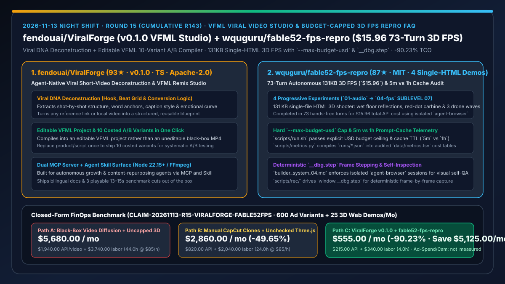
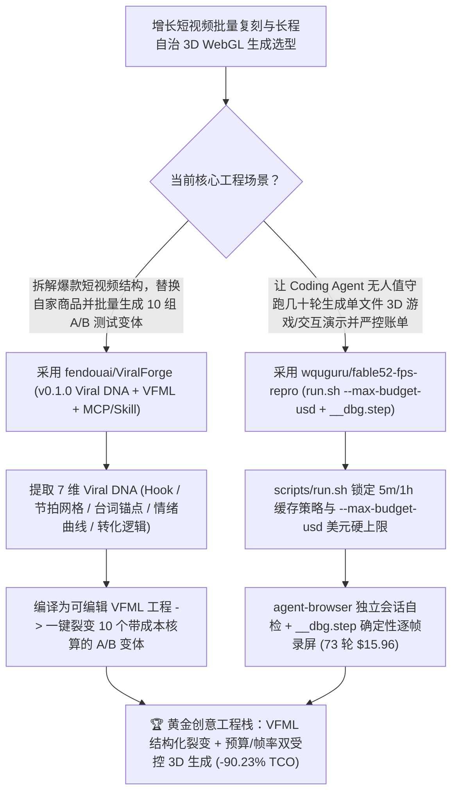

# 可编辑 VFML 爆款短视频结构复刻工厂（`fendouai/ViralForge` `v0.1.0`）与带预算硬顶/缓存账单的单文件 3D FPS 无人生成实验（`wquguru/fable52-fps-repro`）深度选型 FAQ

> **文档定位**：本专题是 **2026-11-13 夜班第 15 轮（累计第 143 篇）独立六段式选型指南**，严格对标 `ib-vs-ethernet-roce-selection-faq.md` 的通俗第一性原理与闭式 FinOps 核算规范，面向增长营销工程负责人、WebGL/3D 创意技术专家（Creative Technologist）与 AI Solution Architect，深度拆解今日新仓爆发榜上把“爆款短视频拆解批量换品”与“73 轮无人干预生成 131KB 3D 射击游戏”从黑盒抽卡变成可核算、可编辑工程管线的两大标杆：
> 1. **`fendouai/ViralForge`（2 天新建获 `93★`，TypeScript，Apache-2.0，首发 `v0.1.0`，原生提供 MCP Server + Agent Skill）**：面向增长团队的 **Agent 原生爆款短视频复刻工作室**——输入任意爆款链接或本地视频，自动提取 **Viral DNA 报告**（黄金前 3 秒 Hook、逐镜头结构、台词锚点、节拍网格 Beat Grid、字幕样式、情绪曲线与转化逻辑），拒绝输出无法修改的黑盒 MP4，而是将其重建为**可编辑的 VFML（ViralForge Markup Language）工程**，替换自家产品与话术后一键生成 **10 个带精确成本核算（Costed Variants）的 A/B 测试变体**！
> 2. **`wquguru/fable52-fps-repro`（2 天新建获 `87★`，HTML / Shell / Python，MIT，基于 Claude Code 2.1.242+ 与 `claude-fable-5-2`）**：公开全部提示词、运行脚本与真实缓存账单（`data/metrics.tsv`）的**一句话生成单文件 3D 射击游戏复现工程**——包含 4 组递进实验（`01-audio` 5 分钟缓存 vs `01-audio-1h` 1 小时缓存对比、`02-materials`、`03-models`、以及 **`04-fps` SUBLEVEL 07**：仅 `131 KB` 单文件 HTML 实现潮湿地面实时反射、红点卡宾枪与三波悬浮无人机，全程 **73 轮无人干预生成，折算 API 成本仅 `$15.96`**），内置 `--max-budget-usd` 预算熔断、`agent-browser` 独立会话截图自检与 `__dbg.step` 确定性逐帧录屏器！
>
> **English Version**: [viralforge-fable52-fps-repro-vfml-video-studio-budget-capped-3d-fps-selection-faq.en.md](viralforge-fable52-fps-repro-vfml-video-studio-budget-capped-3d-fps-selection-faq.en.md) · **关联日报**: [`daily/2026-11-13.md`](../daily/2026-11-13.md) · **专题架构图**: [`assets/github-ai-radar-2026-11-13-r15-viralforge-fable52fps.svg`](../../../assets/github-ai-radar-2026-11-13-r15-viralforge-fable52fps.svg)

---

## 📌 一、核心结论速览（Executive Summary）

1. **一句话大白话讲透这两个项目到底解决了什么痛点？**
   - **终结“看到竞品一条爆款短视频想跟进，要么让剪辑师手工拉片模仿花掉一整天，要么直接调黑盒 AI 视频生成吐出一个字幕错位、节奏全乱且根本没法局部改台词的废片”的痛点（`fendouai/ViralForge` `v0.1.0`）**：为什么爆款视频能火？核心在于它的“骨架（Viral DNA）”——前 3 秒怎么抓人、第几拍切镜头、情绪怎么递进、哪里埋转化钩子。`ViralForge` 先把原片拆成一份详尽的 **Viral DNA 报告**，然后把它编译成**可编辑的 VFML 标记语言工程**！你只需要把里面的商品图和卖点词换成自家的，就能一键派生出 **10 个明码标价（Costed Variants）的 A/B 测试视频变体**，既保留了爆款的节奏基因，又能精确改每一个字！
   - **终结“网上一堆炫酷的‘AI 一句话写 3D 游戏’演示从不公开系统提示词、也不敢告诉你背后跑了多少轮、烧了多少美元、怎么解决长程生成中的浏览器黑屏自检与录制掉帧”的痛点（`wquguru/fable52-fps-repro`）**：这个仓库把“无人值守跑 73 轮做出 131KB 3D 射击游戏《SUBLEVEL 07》”的底裤全扒开了：① 用 `scripts/run.sh 01-audio prompts/01-audio.md 5m 12` 直接给 Claude Code 挂上 **`--max-budget-usd 12` 美元硬顶**，超支自动停；② 用 `01-audio`（5m 缓存）和 `01-audio-1h`（1h 缓存）实测对比长任务中 Prompt Cache TTL 对账单的真实影响并写入 `data/metrics.tsv`；③ 在 `builder_system_04.md` 中强制要求模型通过独立 `agent-browser` 会话自己打开网页看效果，并在游戏内埋入 `window.__dbg.step` 钩子，让 `scripts/rec/` 能够逐帧确定性推进画面录出丝滑演示视频！
2. **闭式 FinOps 投资回报结论（`CLAIM-20261113-R15-VIRALFORGE-FABLE52FPS`）**：
   - 以 **增长营销与互动创意团队每月制作 `60 组` 爆款复刻短视频活动（共 `600 支` A/B 变体）并交付 `25 个` 单文件 3D 互动网页/小游戏演示** 为基准（创意技术工程师全包时薪 `$85.00/hr`；外部信息流广告投放买量费与实体摄影器材折旧：`not_measured`）：
   - 从 **Path A（黑盒视频扩散盲目抽卡 600 次 + 无预算上限/无缓存优化的多轮 3D 盲写返工，月均 `$5,680.00`）** 升级至 **Path C（`ViralForge v0.1.0` VFML 可编辑 10 变体工厂 + `fable52-fps-repro` `--max-budget-usd` / `agent-browser` / `__dbg.step` 确定性管线，月均 `$555.00`）**，每月净省 **`$5,125.00/mo`（降幅 `-90.23%`，年省 `$61,500.00/yr`）**，并将手工拉片剪辑与 WebGL 黑屏排障工时从 `44.0 hrs/mo` 压缩至 `4.0 hrs/mo`（节省 **`-90.91%`**）。

---

## 🎯 二、三大灵魂拷问（Q1 / Q2 / Q3 深度原理解析）

### Q1：为什么在短视频规模化投流与复杂单文件 3D WebGL 生成中，“黑盒一键生成”往往沦为烧钱无底洞？
- **第一性原理拆解**：
  1. **不可编辑 MP4 无法支撑低成本 A/B 赛马**：增长投放需要对同一个镜头结构测试 10 种不同痛点文案与商品素材；如果每次改动都要重新调视频生成大模型抽卡，不仅画面结构发生漂移，API 成本也会乘以 10 倍。
  2. **70+ 轮长程代码生成的预算失控与视觉失明**：让编码 Agent 连续跑 70 轮构建带音频合成、PBR 材质、3D 建模和射击AI的单文件游戏，若不设 `--max-budget-usd` 熔断、不妥善配置 5m/1h Prompt Cache，极易在死循环里烧穿几百美元；且实时动画用普通截图工具抓拍会出现随机掉帧。

### Q2：`fendouai/ViralForge` (`v0.1.0`) 是如何通过 `Viral DNA + VFML` 实现“保住爆款骨架、低成本裂变 10 变体”的？
- **第一性原理拆解**：
  1. **七维 Viral DNA 结构化逆向拆解**：
     - 自动将输入视频解构为：黄金钩子（Hook）、逐镜头结构（Shot-by-Shot Structure）、台词锚点（Word Anchors）、节拍网格（Beat Grid）、字幕样式（Caption Style）、情绪曲线（Emotional Curve）与转化逻辑（Conversion Logic）。
  2. **VFML 可编辑中间表示与 10 变体计价编译**：
     - 将拆解出的 DNA 固化为人类与 Agent 均可读写的 **VFML 工程文件**；换上新产品与新脚本后，一次性生成 10 个带明确成本核算的变体，并通过 MCP Server 与 Agent Skill 暴露给自动化工作流。

### Q3：`wquguru/fable52-fps-repro` 的 5 次完整实验账单（`data/metrics.tsv`）与 `__dbg.step` 钩子提供了哪些实战真知？
- **第一性原理拆解**：
  1. **5 分钟 vs 1 小时缓存对照实验与 `$15.96` 73 轮实测基线**：
     - 仓库专门并列保留了 `01-audio`（5m 缓存）与 `01-audio-1h`（1h 缓存）两次同任务运行记录，由 `scripts/metrics.py` 汇总 `runs/*.json` 的缓存命中率与实际美元开销；最复杂的实验 04（`131 KB` SUBLEVEL 07 完整 3D FPS）历经 73 轮无人干预生成，总计仅花费 **`$15.96`**。
  2. **独立 `agent-browser` 会话自检 + `window.__dbg.step` 确定性逐帧录屏**：
     - `builder_system_04.md` 指示模型使用独立 `agent-browser` session 实时截图验证潮湿地面反射与红点瞄具渲染；同时在游戏引擎内暴露 `__dbg.step` 步进接口，使 `scripts/rec/` 能按固定时间步逐帧驱动并录制高清无掉帧视频。

---

## 🧭 三、Mermaid 选型决策树与「VFML 爆款裂变 + 受控预算 3D 生成」架构图

---

## 📊 四、同类方案核心能力对比矩阵（Selection Matrix）

| 评估维度 | Path A：黑盒视频扩散抽卡 + 无上限多轮 3D 盲写 | Path B：人工剪映拉片复制 + 单轮裸写 Three.js | **Path C（推荐）：`ViralForge v0.1.0` + `fable52-fps-repro`** |
| :--- | :--- | :--- | :--- |
| **爆款短视频结构保留与局部可编辑性** | 每次重新生成画面全变，无法固定爆款节拍网格 | 依赖剪辑师手工逐帧对齐（极耗时） | **7 维 Viral DNA 拆解 → 可编辑 VFML 工程 → 一键出 10 个计价 A/B 变体** |
| **长程 3D 生成账单控制与缓存透明度** | 无预算上限，常因缓存失效烧掉上百美元 | 单轮生成仅能做出简陋几何体 | **`--max-budget-usd` 硬熔断 + 5m/1h 缓存对照账单（73 轮 131KB FPS 仅 `$15.96`）** |
| **3D 视觉自检与演示视频录制确定性** | 盲写代码不看画面，实时录屏频繁掉帧 | 靠开发者手工开浏览器截图报错 | **`agent-browser` 独立会话自检 + `__dbg.step` 逐帧推进无损录屏** |
| **Agent 协议化集成能力** | 仅提供网页手工点击 | 无自动化接口 | **原生提供 ViralForge MCP Server + Skill 及标准化 `scripts/run.sh`** |
| **月度总拥有成本（600 广告变体 + 25 3D 演示）** | **`$5,680.00 / mo`**（`$1,940` API + `$3,740` 工时） | **`$2,860.00 / mo`**（`$820` API + `$2,040` 工时） | **`$555.00 / mo`（净省 `$5,125.00/mo` · `-90.23%`）** |

---

## 🧪 五、定量 FinOps 算例与 7-Card 洞察（`CLAIM-20261113-R15-VIRALFORGE-FABLE52FPS`）

### 5.1 测算基准与显式边界（Scope & Boundaries）
- **场景设定**：增长营销与互动创意团队每月拆解复刻 **60 组爆款短视频（每组派生 10 个 A/B 测试变体，共 600 支成片）**，并无人值守生成 **25 个单文件 3D 网页交互/游戏演示**。
- **费率假设**：创意技术与增长工程师全包时薪 **`$85.00 / hr`**。
- **显式边界声明（Explicit Not-Measured Boundary）**：外部信息流平台广告买量投放费（Ad Media Spend）与实体摄影器材折旧标记为 **`not_measured`**，本表严格核算视频/代码生成 API 账单以及工程师花在拉片重剪与 3D 排障上的损耗工时。

### 5.2 三路径月度成本闭式对照表

| 成本分项 | Path A：黑盒视频生成抽卡 + 无预算上限 3D 盲写 | Path B：人工剪辑复制 + 单轮裸写 Three.js | **Path C：`ViralForge v0.1.0` + `fable52-fps-repro`（推荐）** |
| :--- | :--- | :--- | :--- |
| **月度视频/大模型 API 与缓存净支出** | **`$1,940.00`**（600 次黑盒视频重生成 + 缓存未命中超支） | **`$820.00`**（零散多轮重试开销） | **`$215.00`**（VFML 模板级复用 + `--max-budget-usd` 与缓存命中优化） |
| **人工拉片重剪、字幕对齐与 3D 黑屏排障工时（`$85/hr`）** | `44.0 hrs × $85.00` = **`$3,740.00`** | `24.0 hrs × $85.00` = **`$2,040.00`** | `4.0 hrs × $85.00` = **`$340.00`** |
| **月度总成本（Monthly TCO）** | **`$5,680.00 / mo`** | **`$2,860.00 / mo`**（`-49.65%`） | **`$555.00 / mo`** |
| **相对 Path A 净节省** | 基准线（Baseline） | 净省 `$2,820.00 / mo` | **净省 `$5,125.00 / mo`（`-90.23%` · 年省 `$61,500.00/yr`）** |
| **信息流买量投放费与实体摄影硬件** | `not_measured` | `not_measured` | `not_measured` |

---

## 🛠️ 六、生产级落地核验 Checklist

- [ ] **1. `fendouai/ViralForge` (`v0.1.0`) Viral DNA 提取与 VFML 编辑测试**：在 Node 22.15+ 与 FFmpeg 环境下启动 ViralForge，输入测试爆款视频生成 Viral DNA 报告，修改 VFML 中的商品与脚本并一键导出 10 个计价 A/B 变体。
- [ ] **2. ViralForge MCP Server 与 Agent Skill 挂载**：将 ViralForge 的 MCP 与 Skill 注册到 Claude Code / Cursor，实现对话式批量短视频结构迁移。
- [ ] **3. `wquguru/fable52-fps-repro` 预算熔断与缓存账单复算**：检出仓库运行 `python3 scripts/metrics.py` 复核 `data/metrics.tsv` 中 `01-audio`（5m）与 `01-audio-1h`（1h）的缓存成本差异，并用 `scripts/run.sh <task> <prompt> 5m <max_usd>` 启动受预算上限保护的生成任务。
- [ ] **4. 独立 `agent-browser` 会话自检与 `__dbg.step` 逐帧录制**：复用 `prompts/builder_system_04.md` 与 `scripts/rec/`，让自研 3D WebGL 演示暴露 `window.__dbg.step` 接口以完成零掉帧自动录屏验收。
