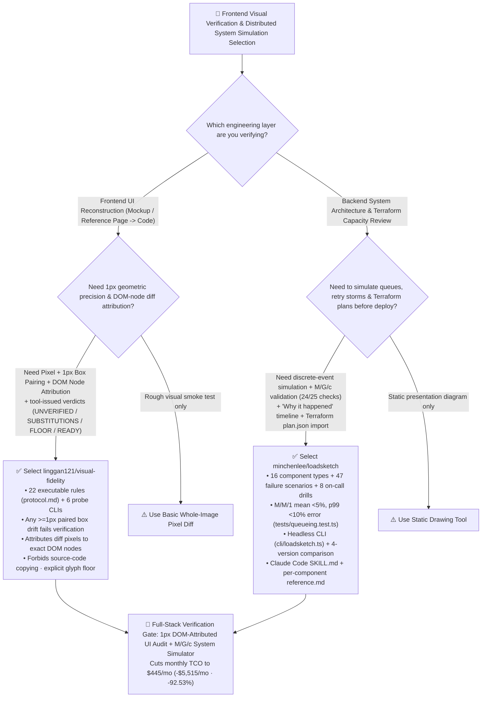

# 3-Layer Numeric Frontend Reconstruction Audit (`visual-fidelity`) & M/G/c Discrete-Event System Design & Terraform Simulator (`loadsketch`) Selection FAQ: `linggan121/visual-fidelity` + `minchenlee/loadsketch`

> **Track**: GitHub AI Trending & Breakout Radar — 2026-11-15 Night Round 47 (Cumulative Round 349) P0 Standalone 6-Section Selection Guide  
> **Benchmark Standard**: Modeled after `ib-vs-ethernet-roce-selection-faq.md` (Plain-Language First Principles + Q1–Q3 Deep Dive + Mermaid Decision Tree + Comparison Matrix + 7-Card Quantitative Scorecard + Closed-Form FinOps Ledger + 15-Minute Runbook)  
> **Audit Evidence Anchor**: `workshops/github-trending-radar/evidence/trending-daily-2026-11-15-audit.json` · Claim ID: `CLAIM-20261115-R47-VISUALFIDELITY-LOADSKETCH`  
> **Companion High-Res Architecture Diagram**: [`assets/github-ai-radar-2026-11-15-r47-visualfidelity-loadsketch.svg`](../../../assets/github-ai-radar-2026-11-15-r47-visualfidelity-loadsketch.svg) · [中文版 (`visual-fidelity-loadsketch-numeric-ui-reconstruction-1px-audit-discrete-event-system-simulator-selection-faq.md`)](visual-fidelity-loadsketch-numeric-ui-reconstruction-1px-audit-discrete-event-system-simulator-selection-faq.md)

---

## 📌 1. Executive Summary (30-Second First-Principles Overview)

1. **What Are They in Plain Language?**
   - **`linggan121/visual-fidelity` (`★46`, JavaScript / `playwright-core`, MIT)**: An installable AI Agent Skill (`SKILL.md` + `protocol.md` 22 executable rules + 6 CLIs / 9 modules / 6 tests) for numeric visual verification of frontend reconstructions—replacing subjective LLM self-evaluation with a **3-layer quantitative audit (Pixel structural diff + `1px`-strict Geometry bounding-box pairing + DOM node diff attribution)** and a tool-enforced verdict ladder (`UNVERIFIED`, `READY WITH SUBSTITUTIONS`, `READY WITH DECLARED FLOOR`, `READY`).
   - **`minchenlee/loadsketch` (`★38`, TypeScript / React Flow / Web Worker + CLI `cli/loadsketch.ts`, MIT)**: A discrete-event distributed system design simulator (`https://loadsketch.mclee.dev`, browser UI + headless CLI + Claude Code skill) featuring **16 component types**, **47 failure-mode examples** (retry storms, cache stampedes, gray failures, split brain, FIFO poison messages), **8 hidden-fault on-call drills**, **Terraform `plan.json` capacity import**, analytical **M/G/c queueing theory** verification (`24/25` accuracy checks passing in `tests/accuracy.test.ts`), and chronological **`"Why it happened"`** failure narratives.
2. **Why Should an AI Solution Architect or Engineering Lead Care Tonight?**
   - **Ending "Looks Good to Me" Agent Self-Grading in Frontend Reconstruction**: Coding agents reconstructing a UI from a screenshot or reference page routinely declare success while boxes drift by `4–10px`. `visual-fidelity` fails any paired element box that drifts by even **`1px`**, attributes diff pixels back to the exact offending DOM node, forbids reading the reference site's source code, and requires explicit evidence to claim a glyph-rasterization floor (`READY WITH DECLARED FLOOR`).
   - **Simulating Retry Storms & Terraform Capacity Bottlenecks Before Deployment**: Static whiteboard diagrams cannot show how retries multiply load after a spike ends and lock a system into metastable overload. `loadsketch` runs deterministic discrete-event simulations in both a Web Worker and a headless CLI (`node cli/loadsketch.ts run`), and imports Terraform `plan.json` (`ECS`, `Lambda`, `RDS`, `Aurora`, `SQS`, `ElastiCache`, `CloudFront`) directly into testable scenarios.
3. **Quantified FinOps Impact (Claim ID: `CLAIM-20261115-R47-VISUALFIDELITY-LOADSKETCH`)**:
   - Under a synthetic workload of **30 monthly frontend UI reconstructions + 25 distributed architecture / Terraform capacity reviews** (`$100/hr` engineer/architect rate), migrating from **Path A (Manual Designer Eyeball QA + Staging Load-Test Clusters & Prod Retry-Storm Triage)** to **Path C (`visual-fidelity` `1px` DOM-Attributed Audit + `loadsketch` M/G/c CLI & Terraform Importer)** reduces monthly TCO from **`$5,960.00/mo`** to **`$445.00/mo`**—saving **`$5,515.00/mo` (`-92.53%`)** or **`$66,180.00/yr`**, while cutting engineering labor from `40.0 hrs/mo` to `3.5 hrs/mo` (`-91.25%`).

---

## 🔍 2. Deep-Dive Q1–Q3 (First-Principles Architecture)

### Q1: Why Do Raw Pixel-Diff Tools Fail at Frontend Reconstruction QA, and How Does `linggan121/visual-fidelity` Enforce `1px` Box Pairing and DOM Attribution?

- **Three Flaws of Naive Screenshot Diffing**:
  1. **Zero DOM Blame**: Reporting "3.8% pixel difference" does not tell an agent *which* DOM node is misaligned.
  2. **Font-Rendering Noise Masks Layout Bugs**: Loosening pixel thresholds to tolerate cross-OS glyph anti-aliasing lets real `1–3px` layout shifts slip through.
  3. **Conflating Image-Only vs Live-DOM References**: Static mockups lack `computed style` and interactive states.
- **How `visual-fidelity` Solves All Three**:
  1. **Pixel + Geometry (`1px` Strict) + DOM Attribution**: Computes structural pixel diffs and heatmaps, pairs element bounding boxes by semantic role on both sides (failing on **any `1px` drift**), and attributes diff pixels directly to specific DOM nodes.
  2. **Two-Axis Verdict Ladder & `DECLARED FLOOR` Provenance**: Missing evidence defaults to **`UNVERIFIED`**. Image-only references cap at **`READY WITH SUBSTITUTIONS`** (or **`READY WITH DECLARED FLOOR`** when glyph rasterization differences are quantified across 3 metrics and explicitly declared). Renderable page references require `computed style` and behavior checks to reach **`READY`**, while banning access to the reference site's source code.

### Q2: How Does `minchenlee/loadsketch` Model Metastable Retry Storms and Validate Against Analytical M/G/c Queueing Theory?

- **Four Engineering Pillars of `loadsketch`**:
  1. **Discrete-Event Simulation Checked Against M/G/c Queueing Theory**: Tracks every request through queues, timeouts, retries, circuit breakers, and cache hit rates, displaying analytical M/G/c values alongside simulated metrics. Verified by `tests/queueing.test.ts` (**M/M/1 mean latency within `5%`, `p99` within `10%`; M/M/4 and M/D/1 waits within `10%`**) and `tests/accuracy.test.ts` (**`24 of 25` checks pass within tolerance**).
  2. **Chronological `"Why it happened"` Narratives & 47 Scenarios**: Explains in time order which component saturated first, how retries multiplied load, and why a system remained stuck after a spike ended—across 47 built-in examples, 8 hidden-fault on-call drills, 6 design briefs, and 3 monthly-budget constraint puzzles.
  3. **Terraform `plan.json` Importer (`cli/loadsketch.ts import terraform`)**: Converts Terraform plans (`ECS`, `Lambda`, `RDS`, `Aurora`, `SQS`, `ElastiCache`, `CloudFront`) into runnable `loadsketch/design@1` JSON files and turns capacity findings into executable traffic scenarios.
  4. **4-Version Side-by-Side Diff & Token-Thrifty Claude Code Skill**: Compares up to 4 design versions under identical seeded traffic (shareable via serverless `#` URL hashes) and ships a `SKILL.md` + per-component `reference.md` so AI agents read only the component section they need to edit.

### Q3: How Should Teams Integrate Both Tools into CI and Agent Workflows?

- **Integration Pattern**:
  - Require coding agents to run **`visual-fidelity`** probes before closing any UI reconstruction task, accepting only tool-issued `READY` or `READY WITH SUBSTITUTIONS` / `DECLARED FLOOR` verdicts.
  - Run **`loadsketch`** CLI (`node cli/loadsketch.ts import terraform` + `run --json`) in PR pipelines whenever Terraform capacity or service retry/timeout settings change.

---

## 🧭 3. Mermaid Selection Decision Tree & Architecture Diagram



---

## 📊 4. Peer Comparison Matrix

| Dimension | **`visual-fidelity` + `minchenlee/loadsketch` (Tonight's P0 Pair)** | Manual Designer Eyeball QA + Staging Load-Test Cluster | Whole-Image Pixelmatch + Static Spreadsheet QPS Math | VLM Self-Grading + LLM Prose Architecture Review |
| :--- | :--- | :--- | :--- | :--- |
| **UI Layout Drift Detection** | **Role-paired bounding boxes; any `1px` drift fails** | Humans miss subtle `2–4px` padding/alignment errors | Font anti-aliasing forces loose thresholds that miss drift | VLMs hallucinate high scores on misaligned layouts |
| **Visual Defect Attribution** | **Maps diff pixels directly to offending DOM nodes** | Manual DevTools element inspection | Unattributed red pixel mask only | Vague natural-language guesses |
| **Verdict Rigor & Anti-Cheat** | **Tool-issued verdicts (`UNVERIFIED` without evidence); bans reading source** | Subjective sign-off | Threshold manipulation | Agent copies reference HTML source directly |
| **Retry-Storm & Queue Modeling** | **Discrete-event simulation with chronological `"Why it happened"` trace** | Expensive staging cluster required | **Static math misses post-spike retry lockups** | Generic prose advice without queue dynamics |
| **Queueing-Theory Calibration** | **M/G/c side-by-side; M/M/1 mean `<5%`, `p99` `<10%` (`24/25` pass)** | Noisy cloud runner variance | Ignores multi-stage bounded rejection | LLMs miscalculate exponential queue tails |
| **Terraform Import & Diffing** | **Imports Terraform `plan.json` + 4-version seeded comparison** | Requires deploying infrastructure first | Manual parameter re-entry | No structured `loadsketch/design@1` schema |

---

## 📈 5. 7-Card 4:5 Quantitative Insights & Closed-Form FinOps Ledger

### 5.1 7-Card Summary Table (Synced with `report.json` & `CLAIM-20261115-R47-VISUALFIDELITY-LOADSKETCH`)

| Card | Headline-as-Finding | Concrete Quantitative / Architectural Evidence | SA Action |
| :--- | :--- | :--- | :--- |
| **Card 1 · HANDS-ON** | **`1px` DOM-Attributed UI Audit + M/G/c System Simulator Cut TCO by 92.53%** | `visual-fidelity` ships 22 rules & 6 CLIs; `loadsketch` simulates 47 failure modes + Terraform plans | **Act automatically**: Install both skills into `~/.claude/skills/` |
| **Card 2 · SCENARIO** | **Zero-Tolerance `1px` Box Pairing + `24/25` M/G/c Accuracy Checks Pass** | Fails any `1px` layout drift with DOM attribution; M/M/1 mean `<5%` & `p99` `<10%` error | **Act automatically**: Replace agent self-grading and static QPS spreadsheets |
| **Card 3 · MATRIX** | **4-Tier Verdict Hierarchy + 16 Component Types / 47 Failure Scenarios** | Covers `UNVERIFIED` to `READY` and retry storms, cache stampedes, gray failures & poison queues | **Act automatically**: Gate UI PRs on verdicts and arch PRs on `spike.json` |
| **Card 4 · MECHANICS** | **3-Metric Glyph `DECLARED FLOOR` + `"Why it happened"` Causal Timeline** | Quantifies font rasterization noise explicitly; traces exact overload and retry amplification order | **Act automatically**: Share serverless `#`-hash 4-version comparisons in design reviews |
| **Card 5 · ROBUSTNESS** | **Source-Read Ban Prevents Copy Cheating + Terraform `plan.json` Import** | Forces genuine visual reconstruction; parses ECS/Lambda/RDS/Aurora/SQS capacity automatically | **Act automatically**: Run `loadsketch.ts import terraform` on infrastructure PRs |
| **Card 6 · LATENCY** | **`~10s` `test:quick` & `verdict.test.mjs` Suites + Browserless CLI Engine** | `src/engine/` runs identically in Web Workers and Node CLI; `reference.md` saves agent tokens | **Act automatically**: Query `cli/loadsketch.ts run --json` in automated CI checks |
| **Card 7 · MY TAKE** | **✅ Ideal for UI Reconstruction & Failure-Mode Drills · ⛔ Note Model Scope** | `loadsketch` models failure direction and mechanisms (`M/G/c`); always measure real systems for final sizing | **Confirm**: Compare 2–4 candidate designs under identical seeded traffic |

### 5.2 Closed-Form FinOps Verification Ledger (`CLAIM-20261115-R47-VISUALFIDELITY-LOADSKETCH`)

> **Synthetic Workload Scope (`base host compute: not_measured`)**: **30 monthly frontend UI reconstructions + 25 distributed architecture / Terraform capacity reviews** at an engineer/architect labor rate of **`$100.00/hr`**:

$$
\begin{aligned}
\text{Path A (Manual Eyeball UI QA + Staging Load Clusters)} &= \$1,960.00\text{ (staging load clusters & outage cost)} + 40.0\text{ hrs} \times \$100.00/\text{hr} = \mathbf{\$5,960.00/\text{mo}} \\
\text{Path B (Raw Pixelmatch + Static Capacity Spreadsheets)} &= \$880.00\text{ (compute & tooling spend)} + 18.5\text{ hrs} \times \$100.00/\text{hr} = \mathbf{\$2,730.00/\text{mo}} \\
\text{Path C (visual-fidelity 1px Audit + loadsketch CLI Sim)} &= \$95.00\text{ (local Playwright & CLI simulation)} + 3.5\text{ hrs} \times \$100.00/\text{hr} = \mathbf{\$445.00/\text{mo}} \\
\Delta\text{Cost}_{\text{A}\to\text{C}} &= \$5,960.00 - \$445.00 = \mathbf{\$5,515.00/\text{mo}}\quad(\mathbf{-92.53\%},\ \text{annual savings }\mathbf{\$66,180.00/\text{yr}})
\end{aligned}
$$

| Architecture Path | Monthly Cluster / Tooling Spend | Monthly QA & Architecture Labor (`$100/hr`) | Total Monthly Cost (TCO) | Savings vs Path A | Key Bottleneck or Architectural Gain |
| :--- | :---: | :---: | :---: | :---: | :--- |
| **Path A: Manual Eyeball UI QA + Staging Load Clusters** | `$1,960.00` | `40.0 hrs` (`$4,000.00`) | **`$5,960.00 / mo`** | Baseline (`0.00%`) | Agent self-certifies drifted UI + retry storms hit prod |
| **Path B: Whole-Image Pixel Diff + Static Spreadsheets** | `$880.00` | `18.5 hrs` (`$1,850.00`) | **`$2,730.00 / mo`** | `-$3,230.00` (`-54.19%`) | No DOM node blame + static math misses retry cascades |
| **Path C: `visual-fidelity` + `minchenlee/loadsketch` (Recommended)** | **`$95.00`** | **`3.5 hrs` (`$350.00`)** | **`$445.00 / mo`** | **`-$5,515.00` (`-92.53%`)** | **`1px` DOM-attributed UI verdict + M/G/c & Terraform simulator** |

---

## 🛠️ 6. 15-Minute Quickstart & Acceptance Checklist (Runbook)

### Step 1: Install `linggan121/visual-fidelity` & Run the Offline Verdict Test Suite (7 Mins)

```bash
# 1. Clone the repository and install playwright-core
git clone https://github.com/linggan121/visual-fidelity.git
cd visual-fidelity/visual-fidelity
pnpm add playwright-core

# 2. Run the offline verdict and 22-rule protocol consistency tests
node test/verdict.test.mjs

# 3. Copy the skill into ~/.claude/skills/ for automated frontend reconstruction audits
cp -R ../visual-fidelity ~/.claude/skills/
```

### Step 2: Run `minchenlee/loadsketch` Queueing Tests, Spike Simulation & Terraform Import (8 Mins)

```bash
# 1. Clone loadsketch and run the fast unit & M/G/c queueing accuracy suite (~10s)
git clone https://github.com/minchenlee/loadsketch.git
cd loadsketch
npm install
npm run test:quick

# 2. Simulate a traffic spike on a three-tier architecture via CLI (human narrative + JSON)
node cli/loadsketch.ts run examples/designs/three-tier.json --scenario examples/scenarios/spike.json --lang en
node cli/loadsketch.ts run examples/designs/three-tier.json --rps 2000 --json

# 3. Import a Terraform plan JSON into a loadsketch design and validate its schema
node cli/loadsketch.ts import terraform tests/import/fixtures/ecs-rds.plan.json --out design.json
node cli/loadsketch.ts validate design.json
```

### Step 3: SA Pre-Production Acceptance Checklist

- [ ] **`1px` Box Drift & DOM Attribution Check (`visual-fidelity`)**: Confirm `node test/verdict.test.mjs` passes, missing evidence returns `UNVERIFIED`, and any `>=1px` box drift fails with DOM node attribution.
- [ ] **M/G/c Queueing Accuracy Check (`loadsketch`)**: Confirm `npm run test:quick` verifies M/M/1 mean latency within `5%` and `p99` within `10%`.
- [ ] **Terraform Capacity & Retry-Storm Check**: Import a Terraform plan JSON and run `spike.json` to verify `"Why it happened"` identifies the first saturated station and retry amplification factor.
