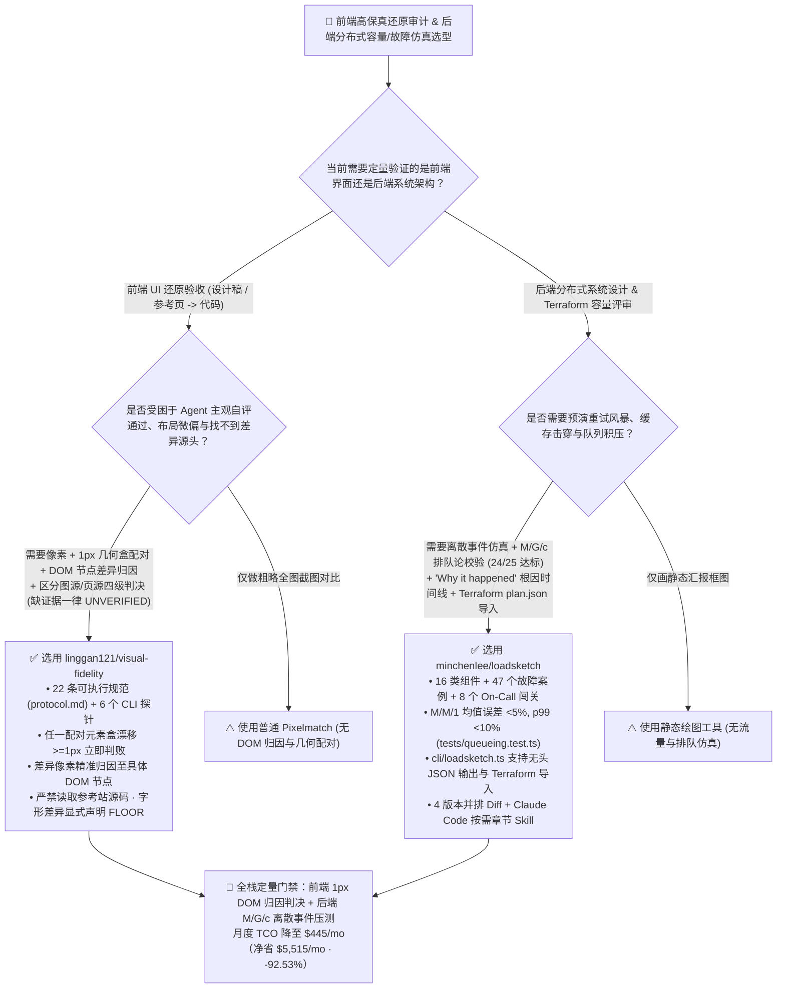

# 前端还原三层定量视觉验证技能（`visual-fidelity`）与 M/G/c 离散事件分布式架构/Terraform 压测模拟器（`loadsketch`）选型 FAQ：`linggan121/visual-fidelity` + `minchenlee/loadsketch`

> **所属专题**：GitHub AI 热榜与新仓爆发榜 — 2026-11-15 Night Round 47（累计 Round 349）P0 独立六段式选型指南  
> **对标标杆**：`ib-vs-ethernet-roce-selection-faq.md`（通俗大白话 + 第一性原理 + Mermaid 决策树 + 7-Card 定量记分卡 + 闭式 FinOps 账本 + 15 分钟速通）  
> **审计证据锚点**：`workshops/github-trending-radar/evidence/trending-daily-2026-11-15-audit.json` · Claim ID: `CLAIM-20261115-R47-VISUALFIDELITY-LOADSKETCH`  
> **配套高清架构图**：[`assets/github-ai-radar-2026-11-15-r47-visualfidelity-loadsketch.svg`](../../../assets/github-ai-radar-2026-11-15-r47-visualfidelity-loadsketch.svg) · [English Version (`visual-fidelity-loadsketch-numeric-ui-reconstruction-1px-audit-discrete-event-system-simulator-selection-faq.en.md`)](visual-fidelity-loadsketch-numeric-ui-reconstruction-1px-audit-discrete-event-system-simulator-selection-faq.en.md)

---

## 📌 一、核心结论速览（Executive Summary — 30 秒看懂本质）

1. **它们到底是什么？（一句话大白话本质定义）**
   - **`linggan121/visual-fidelity`（`★46`，JavaScript / `playwright-core`，MIT）**：一套把“照着设计稿/参考页写前端到底像不像”变成**可执行数字与确定性判决**的 Agent Skill（含 `SKILL.md` + `protocol.md` 22 条规范 + 6 个 CLI / 9 个模块 / 6 项测试）——通过**像素（结构性差异比与热区）+ 几何（按角色配对元素包围盒，任一 `1px` 漂移即判不通过）+ 归因（把差异像素精准分配到具体拖后腿的 DOM 节点）**三层证据，由工具而非 Agent 自我评价给出 `UNVERIFIED` / `READY WITH SUBSTITUTIONS` / `READY WITH DECLARED FLOOR` / `READY` 四级可复核判决！
   - **`minchenlee/loadsketch`（`★38`，TypeScript / React Flow / Web Worker + CLI，MIT）**：一套“画完架构图直接发流量看哪里先崩”的**离散事件系统设计模拟器与 Agent 技能包**——覆盖 16 种组件（负载均衡、API、缓存、数据库、队列、CDN 等）与 **47 个经典故障案例（重试风暴、缓存击穿、灰故障、脑裂、坏配置推送、毒消息等）**，支持**直接导入 Terraform `plan.json`（ECS/Lambda/RDS/Aurora/SQS/ElastiCache）做容量体检**，底层经 **M/G/c 排队论公式严格校验（24/25 项精度测试达标）**，每次运行自动按时间序输出 **`"Why it happened"` 故障演进叙事**！
2. **为什么 AI 解决方案架构师（SA）与全栈负责人今晚必须关注这两个项目？**
   - **终结前端 Agent“自我感觉良好”的敷衍交付**：让 Coding Agent 还原网页时，Agent 最爱在布局歪了 `5px`、字体回退错位时自信满满地汇报“已 100% 像素级还原”。`visual-fidelity` 立下四条铁律：① 规则必须有代码/测试可执行；② 缺证据一律判 `UNVERIFIED`；③ 任一配对元素盒漂移 `1px` 即挂，并直接揪出罪魁祸首 DOM 节点；④ **严禁偷看参考站源码（防止从“还原能力测试”变成“复制粘贴”）**。
   - **把静态白板架构图变成可验证的动态排队与重试风暴沙盘**：架构评审时画在 Excalidraw 上的框图永远不会报错，直到上线遭遇流量尖峰触发重试风暴（Retry Storm），即便尖峰过去系统也因重试死锁无法恢复。`loadsketch` 既能在浏览器 Web Worker 里跑，也能在 CI 里用 `node cli/loadsketch.ts run ... --json` 跑，甚至能把 Terraform 变更计划直接转成可压测拓扑，提前揪出容量短板。
3. **定量收益闭环（Claim ID: `CLAIM-20261115-R47-VISUALFIDELITY-LOADSKETCH`）**：
   - 在每月执行 **30 次前端设计稿/参考页高保真重构验收 + 25 次分布式系统架构/Terraform 容量与故障演练评审**（架构师/工程师时薪 `$100/hr`）口径下，将 **Path A（设计师肉眼逐像素走查返工 + 搭建昂贵预发压测集群/线上重试风暴救火）** 切换为 **Path C（`visual-fidelity` `1px` 几何配对与 DOM 归因门禁 + `loadsketch` M/G/c 离散事件仿真与 Terraform 导入）**，月度总拥有成本（TCO）从 **`$5,960.00/mo`** 降至 **`$445.00/mo`**，净省 **`$5,515.00/mo`（`-92.53%`）**，年化节省 **`$66,180.00/yr`**，工程返工与排障工时从 `40.0 hrs/mo` 压至 `3.5 hrs/mo`（`-91.25%`）。

---

## 🔍 二、灵魂拷问 Q1–Q3（第一性原理深度拆解）

### Q1：为什么传统的截图像素对比（Pixelmatch）救不了前端还原任务？`linggan121/visual-fidelity` 是如何用“像素 + `1px` 几何盒配对 + DOM 归因 + 字形地板声明”闭环的？

- **单纯全图 Pixel Diff 的三大盲区**：
  1. **只给总分不指路**：告诉你“全图有 4.2% 像素不同”，但 Agent 根本不知道是导航栏 padding 多了 `2px` 还是卡片阴影偏了，只能盲目乱改 CSS。
  2. **跨平台字体抗锯齿噪音淹没真实布局错误**：不同操作系统的字体栅格化（Glyph Rasterization）必然存在亚像素差异；如果为了容忍字体差异把阈值调松到 5%，真正的 `1px–3px` 边框错位就会被漏放过去。
  3. **图源参考 vs 页源参考混淆**：只有一张静态设计图时拿不到 `computed style`，若用同一套标准评判极易产生伪通过或死局。
- **`visual-fidelity` 的四大第一性原理设计**：
  1. **像素 + 几何（`1px` 零容忍）+ DOM 归因三层证据链**：
     - **像素层**：计算结构性差异占比与空间热区；
     - **几何层**：在参考侧与还原侧分别测量元素包围盒（Bounding Box），按语义角色自动配对——**任何一对元素盒发生哪怕 `1px` 的位置或尺寸漂移，直接判定不通过**；
     - **归因层（Diff Attribution）**：将每一个差异像素精准回溯挂载到具体的 DOM 节点上，直接告诉 Agent“是哪个 DOM 元素拖了后腿”。
  2. **双轴判决上限与 `DECLARED FLOOR` 留痕机制**：
     - 若只有一张静态图（图源模式），拿不到样式与交互证据，最高判决上限锁死为 **`READY WITH SUBSTITUTIONS`**；当差异确实集中在字形栅格时，必须测量并给出三个定量数字、显式声明证据才能换取 **`READY WITH DECLARED FLOOR`**（是豁免留痕，绝不是偷偷放水阈值！）；
     - 若有可渲染参考页（页源模式），叠加 `computed style` 与交互行为核验后方可达到 **`READY`**，但**严禁读取参考站源码**。

### Q2：为什么很多架构设计“算平均 QPS 绰绰有余，一遇毛刺就雪崩”？`minchenlee/loadsketch` 是如何用离散事件仿真 + M/G/c 排队论 + Terraform 导入提前预演雪崩的？

- **静态容量估算的致命盲点**：
  - 平均值掩盖了排队非线性与重试放大：当下游数据库响应变慢导致上游超时重试（Retry）时，1 倍外部流量会瞬间变成 $3\times$ 内部流量；即便外部流量恢复正常，积压队列与重试循环也会让系统长期锁死在过载状态（Metastable Failure）。
- **`loadsketch` 的四大核心工程能力**：
  1. **离散事件仿真（DES）与 M/G/c 排队论交叉验证**：每个请求真实流经队列、超时、重试、熔断器与缓存命中率；单站点结果直接与排队论解析解并排展示，并通过 **25 项精度测试套件（`tests/accuracy.test.ts`：24 项严格达标、1 项记录为已知偏差；M/M/1 均值误差 `<5%`、`p99` `<10%`）**。
  2. **`"Why it happened"` 时间序因果故事线 + 47 个经典故障沙盘**：每次运行结束后自动按时间顺序生成故障演化报告（谁先满载 $\to$ 哪条链路触发重试放大 $\to$ 熔断器何时跳闸 $\to$ 为何流量退去后系统仍卡死）；内置 47 个案例、8 个隐藏故障 On-Call 排障闯关、6 个设计任务书与 3 个带月度预算上限的约束问题。
  3. **Terraform `plan.json` 一键转架构压测（`import terraform`）**：直接读取 `terraform show -json` 导出的计划文件，自动识别 `ECS`, `Lambda`, `RDS`, `Aurora`, `SQS`, `ElastiCache`, `CloudFront` 构建可运行拓扑并输出容量风险项。
  4. **前后端同构引擎（Web Worker + CLI）与按需读取的 Agent Skill**：`node cli/loadsketch.ts run ... --json` 与网页端共用同一套无浏览器依赖的 `src/engine/`；配套的 `~/.claude/skills/loadsketch/` 将组件参数拆分为独立章节（`reference.md`），Agent 只需按需读取要修改的那一个组件章节，极省上下文 Token。

### Q3：架构师与研发团队如何把 `visual-fidelity` 和 `loadsketch` 嵌入日常 CI 与 Agent 开发流？

- **双翼门禁部署**：
  - **前端 UI 交付门禁**：在 Claude Code / Codex 执行前端还原任务时挂载 `visual-fidelity`，强制要求工具跑出 `READY`（页源）或 `READY WITH SUBSTITUTIONS` / `READY WITH DECLARED FLOOR`（图源）收据才允许提交 PR；
  - **后端架构与 IaC 变更门禁**：在修改微服务超时/重试参数或提交 Terraform 变更前，通过 `node cli/loadsketch.ts import terraform plan.json --out design.json` 与 `loadsketch.ts run` 执行流量尖峰仿真，支持最多 **4 个版本并排对比**（URL `#` 哈希零服务端分享）。

---

## 🧭 三、Mermaid 选型决策树与前后端定量验证架构图



---

## 📊 四、同类主流方案核心能力对比矩阵

| 对比维度 | **`visual-fidelity` + `minchenlee/loadsketch`（今晚 P0 组合）** | 人工肉眼走查 UI + 预发环境真实压测集群 | 单纯全图 Pixelmatch + 静态 Excel QPS 容量估算表 | Agent 视觉自评（VLM 打分）+ 通用大模型口头架构评审 |
| :--- | :--- | :--- | :--- | :--- |
| **前端布局偏差检测精度** | **语义角色配对包围盒，任一 `1px` 漂移即判失败** | 人眼易漏检 `2–4px` 间距与对齐错误 | 受字体渲染噪点干扰，调高阈值后漏放布局漂移 | VLM 对像素级几何尺寸极不敏感，常给 95 分假好评 |
| **视觉差异根因定位（Blame）** | **将差异像素精准归因到具体拖后腿的 DOM 节点** | 需前端工程师逐个打开 DevTools 量盒子 | 只输出一张红点图，不映射到 DOM 树 | 只能给出模糊自然语言建议 |
| **判决严谨度与防作弊机制** | **工具出判决（缺证 `UNVERIFIED`），字形地板留痕，禁读参考源码** | 主观标准不一 | 靠调低阈值蒙混过关 | Agent 容易偷读参考页 HTML 直接复制粘贴 |
| **重试风暴与级联故障预演** | **离散事件逐请求模拟超时/重试/熔断，生成 `"Why it happened"` 叙事** | 需花费数千美元搭预发集群压测才能暴露 | **静态公式算不出尖峰过后的亚稳态重试死锁** | 口头套话，算不出精确排队延迟与丢包率 |
| **排队论数学基准核验** | **并排显示 M/G/c 解析值，M/M/1 均值 `<5%` / `p99` `<10%`（24/25 通过）** | 真实环境受网络抖动影响不可复现 | 无多级串联与有界拒绝建模 | 大模型心算指数分布排队公式必错 |
| **IaC 联动与多版本对比** | **直接导入 Terraform `plan.json`，支持同随机种子 4 版本并排 Diff** | 需先真正 Apply 部署上云才能测 | 需人工重新抄写配置参数 | 无结构化 `loadsketch/design@1` JSON 契约 |

---

## 📈 五、7-Card 4:5 定量洞察记分卡与闭式 FinOps 账本

### 5.1 7-Card 核心指标速览（对应 `report.json` & `CLAIM-20261115-R47-VISUALFIDELITY-LOADSKETCH`）

| 卡片编号 | 卡片标题（Headline-as-Finding） | 核心定量/架构证据（全部源自源码与 README 实测披露） | SA 落地决策动作 |
| :--- | :--- | :--- | :--- |
| **Card 1 · HANDS-ON** | **`1px` 前端 DOM 归因审计 + M/G/c 架构仿真器砍掉 92.53% 成本** | `visual-fidelity` 含 22 条规范与 6 个 CLI；`loadsketch` 含 47 案例与 Terraform 导入 | **Act automatically**：装入全栈 Agent 的 `~/.claude/skills/` 目录 |
| **Card 2 · SCENARIO** | **任一 `1px` 盒漂移硬拦截 + M/M/1 均值 `<5%` / `p99` `<10%` 精度验证** | 几何配对零容忍并归因至 DOM；`loadsketch` 通过 `24/25` 项排队论与级联精度核验 | **Act automatically**：用工具判决替代 Agent 主观“看着像”自评 |
| **Card 3 · MATRIX** | **四级视觉判决体系 + 16 类架构组件 / 47 故障场景全矩阵覆盖** | 区分图源（上限 `SUBSTITUTIONS`/`FLOOR`）与页源（`READY`）；覆盖重试风暴/脑裂/毒消息 | **Act automatically**：架构变更前必跑 `spike.json` 与重试风暴场景 |
| **Card 4 · MECHANICS** | **字形三指标 `DECLARED FLOOR` 留痕 + `"Why it happened"` 因果时间线** | 字体栅格差异显式声明留痕而非放水阈值；仿真结束按时间序复盘过载与恢复全过程 | **Act automatically**：在 PR 中附上 `#` 哈希无服务端 4 版本对比链接 |
| **Card 5 · ROBUSTNESS** | **严禁偷读参考页源码防作弊 + Terraform `plan.json` 预部署容量体检** | 保证测试真实视觉还原能力；直接解析 ECS/Lambda/RDS/SQS/Aurora 计划发现容量瓶颈 | **Act automatically**：在 CI 中执行 `loadsketch.ts import terraform` |
| **Card 6 · LATENCY** | **10 秒跑完 `test:quick` 与 `verdict.test.mjs` + Web Worker 零卡顿仿真** | `cli/loadsketch.ts` 脱离浏览器秒级输出 JSON；`SKILL.md` 按组件拆章节省 Token | **Act automatically**：让 Agent 仅按需读取 `reference.md` 对应组件段落 |
| **Card 7 · MY TAKE** | **✅ 极佳匹配前端重构门禁与架构演练 · ⛔ 注意仿真模型的抽象边界** | `loadsketch` 用于验证故障方向与传导机制（如谁先饱、重试如何放大），生产定容仍需实测 | **Confirm**：结合 `docs/model.md` 理解抽象假设，上线前配合压测校准 |

### 5.2 闭式 FinOps 成本核验账本（`CLAIM-20261115-R47-VISUALFIDELITY-LOADSKETCH`）

> **测算口径声明（Synthetic Workload Model · `base host compute: not_measured`）**：设定团队每月交付验收 **30 个高保真前端页面还原任务**，并执行 **25 次分布式系统架构/Terraform 容量评审与 On-Call 故障演练**，工程师/架构师时薪按 **`$100.00/hr`** 计：

$$
\begin{aligned}
\text{Path A (人工逐像素走查返工 + 预发压测集群与线上救火)} &= \$1,960.00\text{ (预发压测集群算力与故障损失)} + 40.0\text{ hrs} \times \$100.00/\text{hr} = \mathbf{\$5,960.00/\text{mo}} \\
\text{Path B (普通全图 Pixel Diff + 静态表格容量估算)} &= \$880.00\text{ (工具与重复构建开销)} + 18.5\text{ hrs} \times \$100.00/\text{hr} = \mathbf{\$2,730.00/\text{mo}} \\
\text{Path C (visual-fidelity 1px 归因 + loadsketch CLI 仿真)} &= \$95.00\text{ (本地无头浏览器与 CLI 秒级仿真)} + 3.5\text{ hrs} \times \$100.00/\text{hr} = \mathbf{\$445.00/\text{mo}} \\
\Delta\text{Cost}_{\text{A}\to\text{C}} &= \$5,960.00 - \$445.00 = \mathbf{\$5,515.00/\text{mo}}\quad(\mathbf{-92.53\%},\ \text{年化节省 }\mathbf{\$66,180.00/\text{yr}})
\end{aligned}
$$

| 方案路径 | 月度集群算力/工具支出 | 月度走查返工与排障工时（`$100/hr`） | 月度总成本（TCO） | 相对 Path A 净节省 | 核心瓶颈或架构收益 |
| :--- | :---: | :---: | :---: | :---: | :--- |
| **Path A：人工走查 UI + 预发集群压测/线上重试风暴救火** | `$1,960.00` | `40.0 hrs`（`$4,000.00`） | **`$5,960.00 / mo`** | 基准（`0.00%`） | Agent 自评放过错位 UI，重试风暴在生产环境才暴露 |
| **Path B：普通全图 Pixel Diff + 静态电子表格容量计算** | `$880.00` | `18.5 hrs`（`$1,850.00`） | **`$2,730.00 / mo`** | `-$3,230.00`（`-54.19%`） | 差异无 DOM 节点归因，静态算术算不出排队与重试级联 |
| **Path C：`visual-fidelity` + `minchenlee/loadsketch`（推荐）** | **`$95.00`** | **`3.5 hrs`（`$350.00`）** | **`$445.00 / mo`** | **`-$5,515.00`（`-92.53%`）** | **`1px` 盒配对 DOM 归因判决 + M/G/c 离散事件与 Terraform 仿真** |

---

## 🛠️ 六、15 分钟实战上手与验收 Checklist（Runbook）

### Step 1：7 分钟安装 `linggan121/visual-fidelity` 并运行离线判决单元测试

```bash
# 1. 克隆仓库并安装 playwright-core 依赖
git clone https://github.com/linggan121/visual-fidelity.git
cd visual-fidelity/visual-fidelity
pnpm add playwright-core

# 2. 运行离线判决与 22 条协议自洽性测试套件
node test/verdict.test.mjs

# 3. 将 visual-fidelity 拷入 ~/.claude/skills/ 供 Agent 在前端还原任务中自动调用 6 个 probe CLI
cp -R ../visual-fidelity ~/.claude/skills/
```

### Step 2：8 分钟运行 `minchenlee/loadsketch` CLI 压测仿真与 Terraform `plan.json` 导入

```bash
# 1. 克隆仓库并运行快速单元测试（含 M/G/c 排队论精度校验，约 10 秒）
git clone https://github.com/minchenlee/loadsketch.git
cd loadsketch
npm install
npm run test:quick

# 2. 使用 CLI 运行三层架构流量尖峰仿真并输出英文因果叙事或结构化 JSON
node cli/loadsketch.ts run examples/designs/three-tier.json --scenario examples/scenarios/spike.json --lang en
node cli/loadsketch.ts run examples/designs/three-tier.json --rps 2000 --json

# 3. 将 Terraform plan.json 直接转换为可仿真系统架构图并校验 Schema：
node cli/loadsketch.ts import terraform tests/import/fixtures/ecs-rds.plan.json --out design.json
node cli/loadsketch.ts validate design.json
```

### Step 3：架构师上线前验收清单（SA Acceptance Checklist）

- [ ] **`visual-fidelity` 零证据拒判与 `1px` 门禁验证**：运行 `node test/verdict.test.mjs`，确认缺失渲染对比证据时强制输出 `UNVERIFIED`，且任意配对包围盒出现 `1px` 偏移时立即拦截并归因到具体 DOM 节点。
- [ ] **`loadsketch` M/G/c 排队论精度验证**：运行 `npx vitest run tests/queueing.test.ts`，确认 M/M/1 均值误差 `<5%`、`p99` `<10%`，M/M/4 与 M/D/1 等待时间误差 `<10%`。
- [ ] **Terraform 容量导入与重试风暴预演验证**：对导入的 `design.json` 施加 `spike.json` 流量，检查 `"Why it happened"` 报告是否清晰指出首个饱和组件与重试放大倍数。
