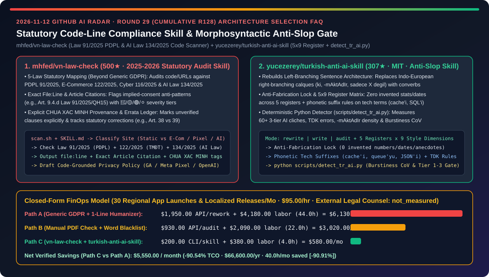
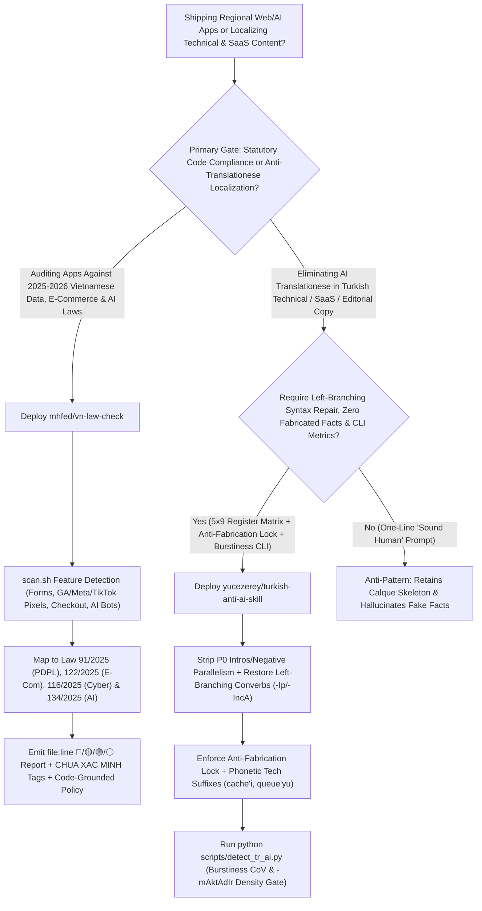
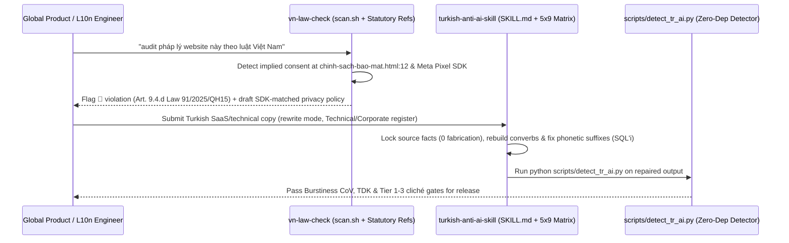

# Statutory Code-Line Compliance Scanner & Morphosyntactic Anti-Slop Skill Selection FAQ: `mhfed/vn-law-check` (2025–2026 Law `91/2025` PDPL & Law `134/2025` AI Code Audit) vs. `yucezerey/turkish-anti-ai-skill` (`5×9` Register Matrix, Anti-Fabrication Lock & `detect_tr_ai.py`)

> **Document Scope**: Written for AI Solution Architects (AI SAs), Global Expansion / Regulatory Compliance Leads, and Multilingual Localization (L10n) Engineering Teams. Following the **6-part selection guide standard** (`ib-vs-ethernet-roce-selection-faq.md`), this FAQ dissects two breakout repositories from the 2026-11-12 GitHub radar — **`mhfed/vn-law-check` (500★, a statutory code and URL compliance scanner covering Vietnam's 2025–2026 Personal Data Protection Law `91/2025/QH15`, E-Commerce Law `122/2025`, Cybersecurity Law `116/2025`, and AI Law `134/2025` with exact `file:line` citations, `CHƯA XÁC MINH` unverified tags, and a public errata ledger)** and **`yucezerey/turkish-anti-ai-skill` (307★, MIT, a 3-mode `rewrite / write / audit` morphosyntactic anti-translationese skill with a `5 Register × 9 Style Dimension` matrix, an Anti-Fabrication Lock, phonetic suffix rules for tech loanwords, and a zero-dependency Python detector `scripts/detect_tr_ai.py` measuring Burstiness CoV)** — answering: **"Why do generic GDPR prompts miss 2025–2026 regional digital laws while one-line 'humanizer' prompts leave English sentence skeletons intact and hallucinate fake statistics, and how does pairing statutory code scanning with morphosyntactic CLI gates cut monthly TCO by `90.54%`?"**



---

## 📌 1. Executive Summary

1. **Plain-Language First-Principles Definitions**:
   - **`mhfed/vn-law-check` (A Code- and URL-Scanning Compliance Toolkit Mapping 2025–2026 National Data, E-Commerce, Cybersecurity & AI Laws to Exact File Lines)**: Most open-source compliance skills only check GDPR or CCPA. `vn-law-check` targets Vietnam's sweeping 2025–2026 statutory overhaul (Personal Data Protection Law `91/2025` + Decree `356/2025` effective Jan 1, 2026; E-Commerce Law `122/2025` + Decree `248/2026`; Cybersecurity Law `116/2025` + Decree `333/2026`; Amended Advertising Law `75/2025`; and AI Law `134/2025` + Decree `142/2026`). Compatible with Claude Code, Cursor, Copilot, Windsurf, Cline, and Codex (`install.sh` + `scan.sh`), it classifies your site first (emitting a single-line pass for static blogs, or a full `🔴 / 🟡 / 🟢 / ⚪` report for sites with forms, GA/Meta/TikTok pixels, checkout buttons, or AI chatbots), cites exact `file:line` violations and statutory clauses (e.g., Article 9.4.d of Law `91/2025/QH15` prohibiting "continued use implies consent"), drafts code-grounded privacy policies, and honestly marks unverified edge clauses as **`CHƯA XÁC MINH`** with a transparent public errata history.
   - **`yucezerey/turkish-anti-ai-skill` (A Morphosyntactic Anti-Translationese Skill & Deterministic Python CLI Detector with an Anti-Fabrication Lock)**: Because LLMs are trained and RLHF-tuned primarily on English, their non-English output often suffers from *Translationese* — local vocabulary grafted onto an English right-branching sentence skeleton (`ki` clauses, `sadece X değil, aynı zamanda Y` negative parallelism, relentless `-DIr / -mAktAdIr` endings, and monotonous 18–22 word sentence lengths). `turkish-anti-ai-skill` operates across **`rewrite`, `write`, and `audit` modes**, calibrated by a **`5 Register × 9 Style Dimension` matrix** (*Blog/Essay, Technical/Engineering, Corporate/SaaS, Academic/Official, Literary*), a **60+ pattern 3-tier AI cliché lexicon**, **phonetic case-suffix attachment for English tech terms (`cache'i`, `queue'yu`, `SQL'i`, `JSON'ı`)**, a strict **Anti-Fabrication Lock** (forbidding invented numbers, dates, or anecdotes), and a zero-dependency Python CLI detector (`scripts/detect_tr_ai.py`) that measures `-mAktAdIr` density and sentence-length **Burstiness CoV**.
2. **Core Selection Guardrails**:
   - When shipping **websites, mobile apps, or AI chatbots subject to Vietnam's 2025–2026 digital laws (or designing regional statutory code scanners for any jurisdiction)**, never rely on generic GDPR prompts — adopt **`mhfed/vn-law-check`'s feature-classified code scan (`scan.sh`), exact article mapping, and explicit `CHƯA XÁC MINH` uncertainty tagging**.
   - When localizing or editing **Turkish (or other agglutinative/non-English) technical docs, SaaS copy, and articles**, never use one-line "make it sound human" prompts that hallucinate facts — enforce **`yucezerey/turkish-anti-ai-skill`'s left-branching morphosyntactic rules, Anti-Fabrication Lock, and `scripts/detect_tr_ai.py` Burstiness CoV gate**.
3. **Quantitative FinOps Takeaway**: Under our closed-form benchmark (`30` regional app launches & localized content releases/month, compliance/localization engineering rate `$95.00/hr`, external legal counsel retainers & human translation agency fees marked `not_measured`), migrating from **Path A (Generic GDPR Prompts + One-Line Humanizer Hallucinations)** (`$6,130.00/mo`) to **Path C (`vn-law-check` Statutory Scanner + `turkish-anti-ai-skill` `detect_tr_ai.py` Gate)** (`$580.00/mo`) saves **`$5,550.00/month` (`90.54%` reduction, `$66,600.00/year`)** and cuts pre-launch compliance and localization QA labor from `44.0 hrs/mo` to `4.0 hrs/mo` (`-90.91%`).

---

## ❓ 2. First-Principles Deep Dive (Q1–Q3)

### Q1: Why do generic LLM compliance checks miss critical 2025–2026 national laws while over-flagging static sites, and how does `mhfed/vn-law-check` ground statutory audits in actual repository code?

- **Root Cause**: Base LLM weights lag behind newly enacted 2025–2026 national statutes (such as Vietnam's PDPL `91/2025/QH15` and AI Law `134/2025`) and hallucinate article numbers when ungrounded.
- **How `mhfed/vn-law-check` Solves It**:
  1. **Code-Feature Site Classification & 4-Tier Triage (`🔴 / 🟡 / 🟢 / ⚪`)**: `scan.sh` inspects the codebase or live URL for concrete triggers (contact forms, Google Analytics / Meta Pixel / TikTok Pixel, login/cart/checkout flows, frontend AI chatbots). Static blogs with zero data collection receive a 1-line clean pass, while data-collecting apps receive `file:line` findings mapped to exact articles (e.g., flagging `chinh-sach-bao-mat.html:12` under Article 9.4.d of Law `91/2025/QH15` because silence or continued browsing cannot constitute consent).
  2. **Code-Derived Privacy Policy Drafting**: Generates privacy policy and consent-banner drafts directly from the third-party SDKs and data fields actually detected in the repository (Firebase, OpenAI, GA).
  3. **Epistemic Humility (`CHƯA XÁC MINH`) & Public Errata Ledger**: Explicitly labels any clause not yet cross-checked against full statutory text as `CHƯA XÁC MINH` (unverified), maintains a public correction log in `sources/legal-references.md` (e.g., documenting that the household-business exemption sits in Article 38 rather than Article 39), and pairs with a clear legal disclaimer (`DISCLAIMER.md`).

### Q2: Why do one-line "humanizer" prompts fail on agglutinative languages like Turkish and introduce fabricated claims, and how does `yucezerey/turkish-anti-ai-skill` solve both problems?

- **Root Cause**: Swapping surface synonyms leaves Indo-European right-branching syntax, passive voice calques, and flat 18–22 word sentence rhythms untouched, while instructing an LLM to "sound more human" frequently triggers fabricated statistics or personal anecdotes.
- **How `yucezerey/turkish-anti-ai-skill` Solves It**:
  1. **Left-Branching Morphosyntactic Repair & 60+ 3-Tier Cliché Removal**: Eliminates P0 throat-clearing intros (*"Günümüzün hızla değişen..."*), negative parallelisms (*"sadece X değil, aynı zamanda Y"*), Indo-European `ki` clauses, and `-mAktAdIr` inflation, rebuilding natural Turkish converbs (`-Ip, -IncA, -dIkçA`).
  2. **Anti-Fabrication Lock (Olgusal Sadakat Kilidi)**: Strictly forbids adding any number, date, name, causal claim, or personal anecdote not present in the source text during `rewrite` mode.
  3. **`5 Register × 9 Style Dimension` Calibration & Phonetic Tech Suffixes**: Prevents colloquial inversions in legal/KVKK texts while keeping technical loanwords (`endpoint`, `deploy`, `middleware`, `queue`) untranslated and attaching Turkish suffixes according to **phonetic pronunciation** rather than spelling (`cache'i`, `queue'yu`, `SQL'i`, `JSON'ı`).
  4. **Zero-Dependency Python CLI Detector (`scripts/detect_tr_ai.py`)**: Deterministically audits Tier 1–3 AI clichés, TDK spelling rules, `-mAktAdIr` density, and sentence-length **Burstiness CoV**.

### Q3: How should AI Solution Architects combine `vn-law-check` and `turkish-anti-ai-skill` in global product release pipelines?

- **Combined Global Release Gate**:
  - **Statutory Code-Scan Plane (`mhfed/vn-law-check`)**: Run `scan.sh` and statutory checklists in CI whenever forms, tracking pixels, checkout flows, or AI features change, resolving all `🔴` blockers before legal review.
  - **Morphosyntactic Localization Plane (`yucezerey/turkish-anti-ai-skill`)**: Run localized docs and UI copy through register-calibrated `rewrite/audit` with the Anti-Fabrication Lock enabled, gated in CI by `python scripts/detect_tr_ai.py`.

---

## 🧭 3. Mermaid Decision Tree & Architecture Sequence

### 3.1 Statutory Code Compliance & Morphosyntactic Anti-Slop Decision Tree



### 3.2 `vn-law-check` Code Audit & `turkish-anti-ai-skill` CLI Verification Sequence



---

## 📊 4. Head-to-Head Comparison Matrix

| Evaluation Dimension | Generic GDPR Prompts + 1-Line Humanizer (Path A) | Manual Legal PDF Review + Word Blacklists (Path B) | `mhfed/vn-law-check` + `yucezerey/turkish-anti-ai-skill` (Path C) |
| :--- | :--- | :--- | :--- |
| **2025–2026 Regional Law Coverage** | ❌ Misses Vietnam PDPL `91/2025` & AI Law `134/2025` | ⚠️ Days of manual statutory reading per release | ✅ **Maps code lines directly to `91/2025`, `122/2025`, `116/2025` & `134/2025`** |
| **False-Positive Control & Epistemic Honesty** | ❌ Hallucinates article numbers; over-flags static blogs | ⚠️ No tracked errata when statutes update | ✅ **1-line pass for static blogs + explicit `CHƯA XÁC MINH` tags & errata log** |
| **Morphosyntactic De-Slop Depth** | ❌ Replaces surface words; keeps English calque skeleton | ⚠️ Regex word lists break technical prose | ✅ **Rebuilds left-branching converbs + `5×9` register matrix + phonetic tech suffixes** |
| **Factual Integrity During Rewriting** | ❌ Invents fake stats and anecdotes to "sound human" | ⚠️ Manual line-by-line fact checking required | ✅ **Anti-Fabrication Lock forbids adding any ungrounded number, date, or claim** |
| **Deterministic Quantitative QA Gate** | ❌ Subjective self-grading by the same LLM | ⚠️ No burstiness or suffix density metrics | ✅ **Zero-dep `scripts/detect_tr_ai.py` measures Burstiness CoV & `-mAktAdIr` rate** |

---

## 🧮 5. 7-Card Quantitative Insights & Closed-Form FinOps Model

> **Provenance & Scope Disclosure**: Governed by `CLAIM-20261112-R29-VNLAWCHECK-TURKISHANTIAI` (`provenance: synthetic`, `independently_reproduced: false`). Models `N_rel = 30` monthly regional app compliance pre-checks and localized content releases at a compliance/L10n engineering rate of `$95.00/hr`. External licensed legal counsel retainers and human translation agency fees vary by jurisdiction and are explicitly labeled `not_measured`.

### 5.1 Closed-Form Monthly TCO Equation & Breakdown

$$\text{Monthly TCO} = C_{\text{audit\_and\_rewrite\_api}} + \left(H_{\text{compliance\_l10n\_eng}} \times \$95.00\right)$$

| Architecture Path | Compliance & Rewrite API Cost ($C_{\text{audit\_and\_rewrite\_api}}$) | Compliance & L10n QA Hours ($H_{\text{compliance\_l10n\_eng}}$) | Engineering Labor ($\times \$95/\text{hr}$) | Total Monthly TCO | Savings vs. Path A |
| :--- | :---: | :---: | :---: | :---: | :---: |
| **Path A: Generic GDPR Prompts + 1-Line Humanizer Rework** | `$1,950.00` | `44.0 hrs` | `$4,180.00` | **`$6,130.00`** | Baseline (`0.00%`) |
| **Path B: Manual Statutory PDFs + Word Blacklists** | `$930.00` | `22.0 hrs` | `$2,090.00` | **`$3,020.00`** | `-$3,110.00` (`-50.73%`) |
| **Path C: `vn-law-check` + `turkish-anti-ai-skill` CLI Gate** | `$200.00` | `4.0 hrs` | `$380.00` | **`$580.00`** | **`-$5,550.00` (`-90.54%`)** |

- **Key Quantitative Takeaway**: Path C saves **`$5,550.00/month` (`90.54%` reduction, `$66,600.00/year`)** while cutting pre-launch compliance and localization QA labor from `44.0 hrs/mo` to `4.0 hrs/mo` (`40.0 hrs/mo` saved, **`-90.91%`**).

---

## 🛠️ 6. Actionable AI SA Deployment Checklist

- [ ] **1. Install `mhfed/vn-law-check` & Run Pre-Launch Statutory Code Scans**:
  ```bash
  curl -fsSL https://raw.githubusercontent.com/mhfed/vn-law-check/main/install.sh | bash
  # Inside Claude Code / Cursor / Copilot:
  # audit pháp lý website này theo luật Việt Nam
  ```
- [ ] **2. Remediate `🔴` Violations & Escalate `CHƯA XÁC MINH` Clauses to Legal Counsel**: Fix implied-consent banners under Law `91/2025/QH15` Article 9.4.d and generate SDK-grounded privacy policy drafts.
- [ ] **3. Install `yucezerey/turkish-anti-ai-skill` & Gate Output with `detect_tr_ai.py`**:
  ```bash
  npx skills add yucezerey/turkish-anti-ai-skill
  python ~/.agents/skills/turkish-anti-ai-skill/scripts/detect_tr_ai.py output.md
  ```
- [ ] **4. Enforce the Anti-Fabrication Lock & Phonetic Loanword Suffixes**: Verify that zero ungrounded numbers or dates are introduced during `rewrite` passes and that technical terms (`cache'i`, `queue'yu`, `SQL'i`) follow phonetic suffix attachment.
