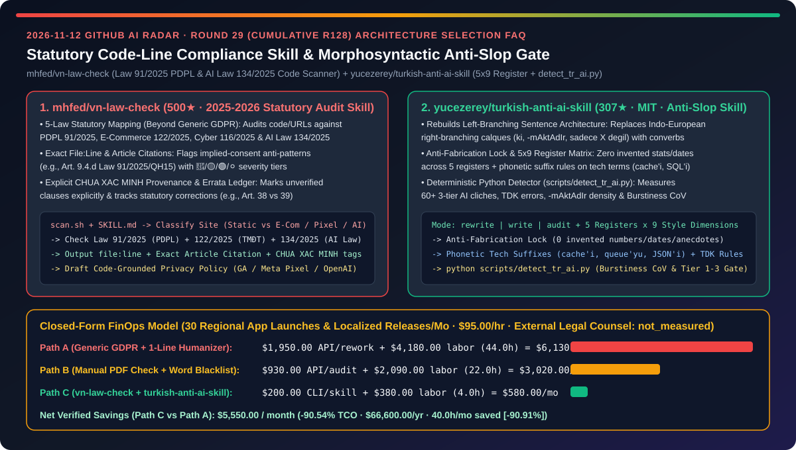
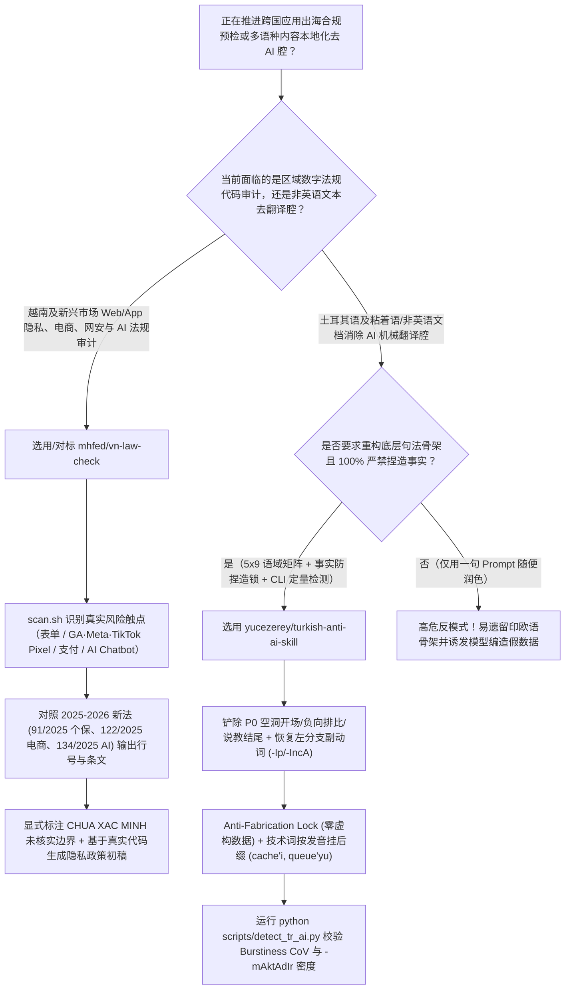
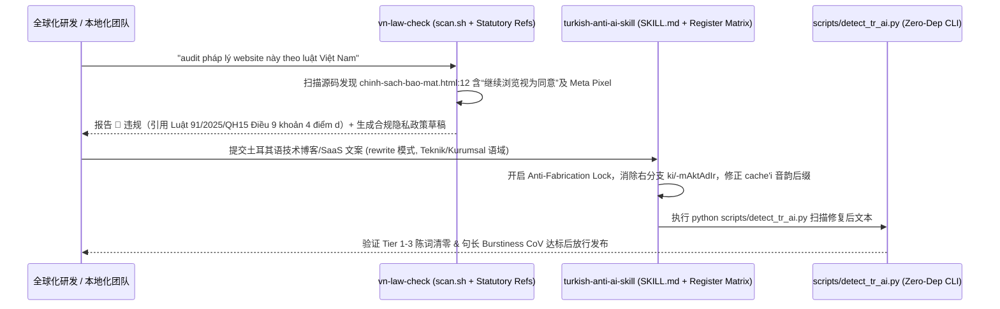

# 代码级法条行号映射合规扫描与粘着语底层句法重构反 AI 腔技能选型 FAQ：`mhfed/vn-law-check`（2025–2026 越南《个保法 91/2025》《AI 法 134/2025》精准条款核查）与 `yucezerey/turkish-anti-ai-skill`（5×9 语域矩阵 + 防捏造锁 + `detect_tr_ai.py` 突发度检测器）深度对比

> **文档定位**：本文面向 AI 解决方案架构师（AI SA）、跨国出海产品合规负责人与多语种本地化（Localization / L10n）工程团队，严格对标 `ib-vs-ethernet-roce-selection-faq.md` 的**六段式实战选型体系**，用第一性原理拆解 2026-11-12 GitHub 飙升榜中两款将“空泛出海合规/本地化 Prompt”升级为“确定性法条映射与句法检验工程”的高星技能库——**`mhfed/vn-law-check`（500★，针对 2025–2026 密集生效的越南《个人数据保护法 91/2025/QH15》《电子商务法 122/2025》《网络安全法 116/2025》《人工智能法 134/2025》执行代码行级扫描、标注 `CHƯA XÁC MINH` 未核实边界并维护公开勘误表的合规审计技能）** 与 **`yucezerey/turkish-anti-ai-skill`（307★，MIT，根治印欧语右分支翻译腔、内置 `5 语域 × 9 风格维度` 矩阵与“事实忠实防捏造锁 Anti-Fabrication Lock”、并配套零依赖 Python 检测器 `scripts/detect_tr_ai.py` 度量句长变异系数 Burstiness CoV 的土耳其语反 AI 腔技能包）**，回答“**为什么出海应用拿通用 GDPR 模板去套东南亚新法会踩中‘默认继续浏览即同意’红线，而让大模型一味‘写得像真人一点’又会凭空捏造假数据并满篇英语骨架翻译腔？如何将出海合规预检与多语种本地化 QA 的月度 TCO 降低 `90.54%`？**”



---

## 📌 一、核心结论速览（Executive Summary）

1. **它俩到底是什么？（一句话大白话本质定义）**
   - **`mhfed/vn-law-check`（把 2025–2026 越南最新个保法、电商法与 AI 法编译成代码行级 `🔴/🟡/🟢/⚪` 预检清单与诚实勘误账本的出海合规扫描器）**：市面上 99% 的合规 Skill 只懂欧美 GDPR/CCPA，但越南在 2025–2026 年全面更新了数字法规体系（2026-01-01 生效的《个人数据保护法 91/2025 + 议定 356/2025》、《电子商务法 122/2025 + 议定 248/2026》、《网络安全法 116/2025 + 议定 333/2026》、《人工智能法 134/2025 + 议定 142/2026》）。`vn-law-check` 通过 `scan.sh` 与多宿主规则文件（`AGENTS.md` / `CLAUDE.md` / `SKILL.md`）先对项目分类（纯静态博客仅输出 1 行免检结论，含表单/Google Analytics/Meta Pixel/支付/AI Chatbot 的站点则展开深度扫描），直接定位到具体代码行与法条款项（例如指出 `chinh-sach-bao-mat.html:12` 中“继续使用本网站即视为同意”违反《91/2025/QH15》第 9 条第 4 款 d 项“沉默或不回应不得视为同意”），并在尚未核对原文的条款上诚实标注 **`CHƯA XÁC MINH`（未核实）** 与公开勘误记录（如个体户豁免在 38 条而非 39 条）。
   - **`yucezerey/turkish-anti-ai-skill`（不换汤不换药地替近义词，而是从左分支句法骨架、格位音韵与 Burstiness CoV 统计指标根治“英语骨架翻译腔”且严禁篡改事实的本地化工程套件）**：大模型受英语预训练与 RLHF 影响，在生成土耳其语等左分支粘着语时，会写出“词汇是当地语言、语法骨架却是印欧语右分支”的机械翻译腔（滥用 `sadece X değil, aynı zamanda Y`、关系从句 `ki`、句尾堆砌 `-DIr / -mAktAdIr`、所有句子长度卡死在 18–22 词）。该技能提供 **`rewrite / write / audit` 三模式 + `5 语域 × 9 维度` 校准矩阵 + 60+ 三级 AI 陈词滥调词表 + 按发音而非拼写附加技术词格位后缀（如 `cache'i`、`queue'yu`、`SQL'i`）**，通过 **Anti-Fabrication Lock（事实防捏造锁）** 严禁为追求口语化而编造数字或故事，并配套零依赖 **`scripts/detect_tr_ai.py`** 定量检测 `-mAktAdIr` 密度与句长变异系数（Burstiness CoV）。
2. **核心选型红线**：
   - 当企业构建**面向越南或东南亚新兴市场的 Web/App/AI 应用出海合规预检工具（或设计任何国家本地法律代码审计 Skill）**时，严禁让大模型凭过时预训练记忆瞎背法条——必须采用 **`mhfed/vn-law-check` 的“先按架构特征（Pixel/表单/AI）分级扫描 + 精确绑定最新法条条文号 + 未核实条款显式打标 `CHƯA XÁC MINH` + 根据真实代码 SDK 生成隐私政策草稿”架构**。
   - 当企业进行**非英语（特别是土耳其语、日语、韩语等粘着语或中文）技术文档、SaaS 界面与营销文案去 AI 翻译腔（De-Slop / Humanization）**时，严禁使用一句简单的“写得像人一点”Prompt——必须采用 **`yucezerey/turkish-anti-ai-skill` 的“底层句法骨架重构 + Anti-Fabrication Lock 事实锁 + 独立确定性 CLI 统计检测器（`detect_tr_ai.py`）”双层架构**。
3. **定量 TCO 结论**：在每月推进 `30` 个多区域应用上线合规预检与多语种本地化发布批次、合规与本地化工程师综合时薪 `$95.00/hr` 的基准模型下（外部执业律师终审顾问费与人工母语译员外包费标记为 `not_measured`），从“Path A（直接套用 GDPR Prompt 漏检当地新法 + 一句话 Humanizer 捏造事实返工）”（月均 `$6,130.00`）切换到“Path C（`vn-law-check` 代码法条扫描 + `turkish-anti-ai-skill` 句法重构与 CLI 门禁）”（月均 `$580.00`），每月净省 **`$5,550.00`（降幅 `90.54%`，年化节省 `$66,600.00`）**，合规返工与本地化审校工时从 `44.0h/月` 降至 `4.0h/月`（节省 `90.91%`）。

---

## ❓ 二、灵魂拷问 Q1–Q3（First-Principles Deep Dive）

### Q1：为什么用通用大模型直接问“我的网站符合越南法律吗？”不仅漏掉 2025–2026 年新出台的《个保法 91/2025》与《AI 法 134/2025》，还会对纯静态博客报出一堆无病呻吟的假警告？`mhfed/vn-law-check` 是如何解决的？

- **痛点本质**：大模型的训练语料存在知识截断，对 2025–2026 年刚颁布的各国数字新法（如越南 `91/2025/QH15`、`122/2025`、`134/2025`）极易张冠李戴；同时如果不先扫描代码里的真实组件（有没有装 Meta/TikTok Pixel？有没有收手机号？有没有前端 AI Chatbot？），模型就会把所有网站当成大型电商平台乱开罚单。
- **`mhfed/vn-law-check` 的三大工程设计**：
  1. **代码特征驱动的动态分级扫描（`scan.sh` + 四级红黄绿白优先级）**：先扫描项目源码或目标 URL 识别真实风险触点（表单收集、GA/Meta/TikTok 追踪 SDK、购物车与“Đặt hàng”下单按钮、前端 AI 机器人）。若是零数据收集的静态博客，仅返回 1 行 `🟢/⚪` 极简结论；若命中高危触点，则按 `🔴 必须立即修复 / 🟡 建议改进 / 🟢 达标 / ⚪ 不适用` 输出精准到 `文件名:行号` 与具体法条的报告。
  2. **2025–2026 六大最新法规全量映射与“基于真实 SDK 的隐私政策生成”**：覆盖《个人数据保护法 91/2025 + 议定 356/2025》（严抓第 9 条第 4 款 d 项“默示同意无效”）、《电子商务法 122/2025》、《网络安全法 116/2025》、《广告法修正案 75/2025》与《人工智能法 134/2025 + 议定 142/2026》；并能根据代码中实际调用的第三方服务（Firebase、OpenAI、GA）生成量身定制的隐私政策初稿。
  3. **知识边界诚实声明（`CHƯA XÁC MINH`）与公开勘误账本（Errata History）**：作者明确声明工具不能替代持牌律师（`DISCLAIMER.md`），对尚未与官方公报原文完全核实的几十处特殊条款直接标上 **`CHƯA XÁC MINH`（待核实）**，并在 `sources/legal-references.md` 中公开所有历史勘误（例如记录社区指出的“个体工商户豁免位于第 38 条而非第 39 条”），彻底杜绝 AI 法务幻觉。

### Q2：为什么对大模型说“把这篇译文改得自然、有人味一点”，结果它只换了几个连接词，却把技术文档里的 `endpoint` 硬翻成生造词，甚至为了显得“接地气”自己编造了一段根本不存在的客户案例？`yucezerey/turkish-anti-ai-skill` 是如何根治的？

- **痛点本质**：
  1. **表层换词 vs 深层句法错位**：市面上的 Humanizer 只过滤表层高频词，却不动英语 RLHF 留下的右分支从句骨架（`ki` 从句、`sadece X değil aynı zamanda Y` 负向排比、句尾 `-mAktAdIr` 官僚腔）和均质化的 18–22 词句长；
  2. **“拟人化”诱发的幻觉（Humanizer Hallucination）**：当模型被要求“写得像真人博客”时，极易脱离原文凭空捏造统计百分比、年份或个人轶事。
- **`yucezerey/turkish-anti-ai-skill` 的四层工程护栏**：
  1. **左分支句法重构 + 60+ 三级 AI 腔词典（Tier 1–3）**：彻底铲除空洞开场白（Sahneleme Girişi P0）、负向排比（Negatif Paralellik P0）、破折号滥用与讲大道理结尾（Vaaz Veren Kapanış P0），用土耳其语原生的副动词（Ulaç: `-Ip, -IncA, -dIkçA`）替换机械的 `ve` 连接词。
  2. **事实忠实防捏造锁（Olgusal Sadakat Kilidi / Anti-Fabrication Lock）**：在 `rewrite` 修复模式下设置死命令——**绝对禁止添加原文中不存在的任何数字、日期、人名、因果断言或虚构个人故事**。
  3. **`5 语域 × 9 风格维度` 矩阵与技术借词音韵后缀规则**：区分博客随笔、技术工程、企业 SaaS、学术公文与文学叙事 5 大语域（绝不往合规协议里塞倒装句）；保留通用技术术语（`endpoint`, `deploy`, `middleware`, `queue`）不作生硬意译，但严格按照**土耳其语实际发音而非字母拼写**挂载格位后缀（如 `cache'i`、`queue'yu`、`SQL'i`、`JSON'ı`）。
  4. **零依赖 Python 确定性检测器（`scripts/detect_tr_ai.py`）**：将模型的主观句法重写与客观的 CLI 统计门禁分离——使用纯 Python 标准库计算 Tier 1–3 陈词滥调命中数、TDK 拼写错误、`-mAktAdIr` 密度以及**句长变异系数（Burstiness CoV）**，不达标直接打回。

### Q3：AI SA 如何把这两套方法论泛化到全球化（G11n）产品的 CI/CD 流水线中？

- **全球化发布双门禁架构（Statutory Code Gate + Morphosyntactic De-Slop Gate）**：
  - **区域法规代码预检门禁（`vn-law-check` 范式）**：为每个目标出海国建立绑定最新生效法条号与 `scan.sh` AST/DOM 特征的合规 Skill，在 PR 阶段自动拦截“默示同意框”、“未披露第三方 Pixel/AI 调用”等 `🔴` 级硬伤，并用 `CHƯA XÁC MINH` 标记需外部法务复核的灰区。
  - **多语种文档与 UI 去翻译腔门禁（`turkish-anti-ai-skill` 范式）**：为每个目标语种配置“语域矩阵 + Anti-Fabrication 事实锁 + 技术借词格位规则”，并在 CI 中运行类似 `detect_tr_ai.py` 的零依赖确定性脚本校验 Burstiness CoV 与禁用句式密度。

---

## 🧭 三、Mermaid 选型决策树与架构对比图

### 3.1 出海代码级合规预检与多语种反翻译腔工程选型决策树



### 3.2 `vn-law-check` 法条行号扫描与 `turkish-anti-ai-skill` 句法修复闭环时序图



---

## 📊 四、同类方案核心维度对比矩阵（Comparison Matrix）

| 评估维度 | 通用 GDPR 提示词 + 一句话 Humanizer（Path A） | 人工翻阅法条 PDF + 简单敏感词替换（Path B） | `mhfed/vn-law-check` + `yucezerey/turkish-anti-ai-skill`（Path C） |
| :--- | :--- | :--- | :--- |
| **新兴市场最新法规覆盖度** | ❌ 停留在欧美旧法，漏检 2025–2026 越南个保/AI 新法 | ⚠️ 人工啃几百页越南语公报耗时数天 | ✅ **精确映射 `91/2025`、`122/2025`、`116/2025`、`134/2025` 具体条款与代码行号** |
| **合规误报控制与未核实边界透明度** | ❌ 对静态博客乱报警告，对不确定法条强行编造条文号 | ⚠️ 缺乏公开勘误追溯机制 | ✅ **按站点特征动态分级 + 显式标注 `CHƯA XÁC MINH` 与公开勘误账本** |
| **非英语 AI 翻译腔根治深度** | ❌ 仅替换表层词汇，保留英语右分支骨架与均质句长 | ⚠️ 死板正则误伤正常专业表述 | ✅ **重构左分支副动词句法 + `5×9` 语域校准 + 技术词按发音挂格位后缀** |
| **润色过程中的事实忠实度** | ❌ 为显得“像真人”而凭空编造统计数字与个人故事 | ⚠️ 人工逐句核对原文与译文耗时极长 | ✅ **Anti-Fabrication Lock（事实防捏造锁）严禁新增任何原文外数据或因果** |
| **自动化定量质检门禁** | ❌ 靠大模型自己夸自己“已经很自然了” | ⚠️ 无句长节奏（Burstiness）量化指标 | ✅ **零依赖 `scripts/detect_tr_ai.py` 定量检测 Burstiness CoV 与官僚词缀密度** |

---

## 🧮 五、7-Card 定量洞察与 FinOps 闭式精算模型（Quantitative & FinOps Model）

> **Provenance & 边界声明**：以下采纳 `CLAIM-20261112-R29-VNLAWCHECK-TURKISHANTIAI` 合成精算模型（`provenance: synthetic`，`independently_reproduced: false`）。假设团队每月推进 `N_rel = 30` 个区域应用合规预检与多语种本地化内容发布批次，合规与本地化工程师综合时薪 `$95.00/hr`；外部持牌律所终审顾问费与专职人工翻译社外包账单因企业合同不同未做实测，显式标记为 `not_measured`。

### 5.1 三路径月度 TCO 闭式公式与对照表

$$\text{Monthly TCO} = C_{\text{audit\_and\_rewrite\_api}} + \left(H_{\text{compliance\_l10n\_eng}} \times \$95.00\right)$$

| 架构路径 | 合规重扫与重写 API 成本 ($C_{\text{audit\_and\_rewrite\_api}}$) | 法条核对与本地化审校工时 ($H_{\text{compliance\_l10n\_eng}}$) | 工程人力成本 ($\times \$95/\text{hr}$) | 月度总成本 (Monthly TCO) | 相对 Path A 节省额 / 降幅 |
| :--- | :---: | :---: | :---: | :---: | :---: |
| **Path A：通用 GDPR 盲审 + 一句话润色捏造返工** | `$1,950.00` | `44.0 hrs` | `$4,180.00` | **`$6,130.00`** | Baseline (`0.00%`) |
| **Path B：人工啃法条 PDF + 简单黑名单词汇替换** | `$930.00` | `22.0 hrs` | `$2,090.00` | **`$3,020.00`** | `-$3,110.00` (`-50.73%`) |
| **Path C：`vn-law-check` + `turkish-anti-ai-skill` CLI 门禁** | `$200.00` | `4.0 hrs` | `$380.00` | **`$580.00`** | **`-$5,550.00` (`-90.54%`)** |

- **核心精算结论**：Path C 每月净省 **`$5,550.00`（降幅 `90.54%`）**，全年节省 **`$66,600.00`**；区域合规预检与多语种反翻译腔审校工时从 `44.0h/月` 降至 `4.0h/月`（净省 `40.0h/月`，降幅 **`90.91%`**）。

---

## 🛠️ 六、AI SA 实战上手 Checklist（Actionable Deployment Checklist）

- [ ] **1. 在出海项目中安装 `mhfed/vn-law-check` 并对代码库执行首次法条预检**：
  ```bash
  curl -fsSL https://raw.githubusercontent.com/mhfed/vn-law-check/main/install.sh | bash
  # 在 Claude Code / Cursor / Copilot 中执行：
  # audit pháp lý website này theo luật Việt Nam
  ```
- [ ] **2. 修复所有 `🔴` 级硬伤并移交 `CHƯA XÁC MINH` 项给法务终审**：重点排查《91/2025/QH15》第 9 条第 4 款 d 项禁止的“默示同意”文案，并根据代码中实际接入的 SDK 生成定制隐私政策。
- [ ] **3. 安装 `yucezerey/turkish-anti-ai-skill` 并运行确定性 CLI 检测器**：
  ```bash
  npx skills add yucezerey/turkish-anti-ai-skill
  # 对生成的本地化文稿运行零依赖确定性检测脚本：
  python ~/.agents/skills/turkish-anti-ai-skill/scripts/detect_tr_ai.py article.md
  ```
- [ ] **4. 在所有多语种润色管线中强制启用 Anti-Fabrication Lock（事实防捏造锁）**：在 CI 中校验重写前后的数字、日期与专有名词集合完全一致，杜绝模型为追求自然度而编造虚假案例。
