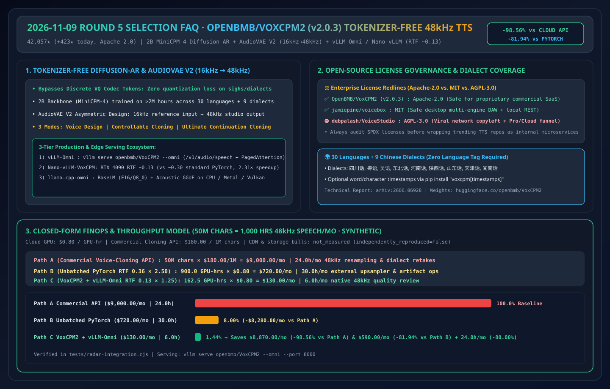
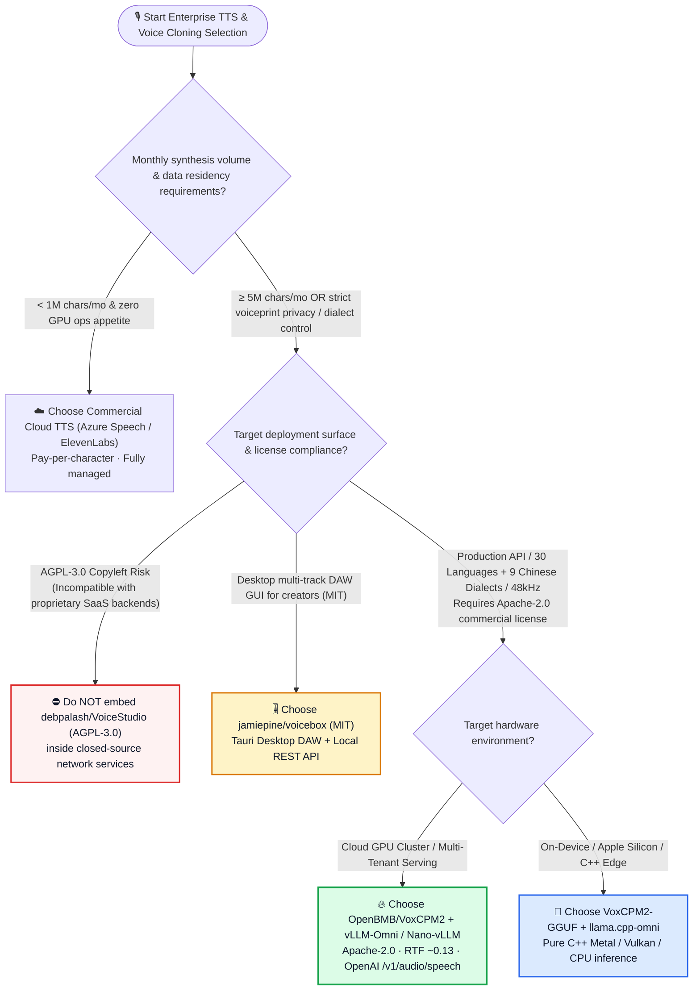
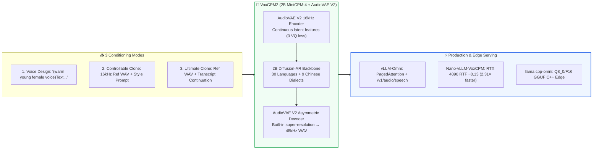

# Tokenizer-Free Diffusion-Autoregressive TTS Selection FAQ: `OpenBMB/VoxCPM2` (2B + AudioVAE V2 48kHz + vLLM-Omni `RTF ~0.13`) vs. Discrete-Codec TTS vs. Commercial Cloud TTS APIs

> **中文版 (Chinese Edition)**: [voxcpm2-tokenizer-free-tts-vs-discrete-codec-selection-faq.md](voxcpm2-tokenizer-free-tts-vs-discrete-codec-selection-faq.md)  
> **Related Daily Digest**: [2026-11-09 GitHub AI Trending Digest (EN)](../daily/2026-11-09.en.md) · **7-Card Benchmark Deck**: [`cards.en.html`](../cards.en.html) · **Live Dashboard**: [`github-radar.html`](../../../github-radar.html)

This guide is written for **AI Solution Architects and Multimodal Voice Engineers** based on primary-source verification of **`OpenBMB/VoxCPM` (`VoxCPM2 v2.0.3`, Apache-2.0, 2B tokenizer-free diffusion-autoregressive TTS, `42,057` stars, `+423 stars today`)** and **`debpalash/VoiceStudio` (`v0.5.7`, AGPL-3.0, `105,739` stars, `+1,247 stars today`)**. Using plain language and first principles, it answers:
1. **Why do traditional discrete audio-codec TTS models (EnCodec/SNAC) produce metallic artifacts on laughter, sighs, and regional dialects—and how does `VoxCPM2`'s tokenizer-free continuous diffusion-autoregressive architecture eliminate quantization loss?**
2. **How does `AudioVAE V2`'s asymmetric 16kHz-to-48kHz super-resolution decoder pair with `vLLM-Omni` and `Nano-vLLM` (`RTF ~0.13` on RTX 4090) for high-concurrency production serving?**
3. **What critical open-source license trap separates `OpenBMB/VoxCPM2` (`Apache-2.0`) and `jamiepine/voicebox` (`MIT`) from `debpalash/VoiceStudio` (`AGPL-3.0`)?**

> 🛡️ **Provenance & Attribution Disclosure**:
> - **`measured` (Primary API & Trending Verification)**: GitHub REST API metadata for `OpenBMB/VoxCPM` (`42,057` stars, `4,790` forks, `v2.0.3`, Apache-2.0, Python Daily `#6` `+423 stars today`) and `debpalash/VoiceStudio` (`105,739` stars, `11,752` forks, `v0.5.7`, AGPL-3.0, Python Daily `#8` `+1,247 stars today`).
> - **`anonymized_reported` (`independently_reproduced=false`, Upstream Repo & Technical Report Claims)**: `VoxCPM2` 2B `MiniCPM-4` backbone trained on `>2M hours` of multilingual speech across **30 languages and 9 Chinese dialects**, `AudioVAE V2` asymmetric 16kHz input → 48kHz studio output, RTX 4090 `RTF ~0.30` (PyTorch) vs. **`RTF ~0.13`** (`Nano-vLLM-VoxCPM` / `vLLM-Omni` PagedAttention), and `llama.cpp-omni` GGUF edge inference (`arXiv:2606.06928`), cited from [`OpenBMB/VoxCPM/blob/main/README.md`](https://github.com/OpenBMB/VoxCPM/blob/main/README.md).
> - **`synthetic` (`independently_reproduced=false`, Architect Parametric FinOps Model)**: Section 5.1 models **50,000,000 characters/month** (`1,000 hours` of 48kHz speech/month; cloud GPU billed at `$0.80/GPU-hr`, CDN/storage marked `not_measured`): Path A Commercial Cloning API (`$9,000.00/mo`, `24.0h`) vs. Path B Unbatched PyTorch + External Upsampler (`$720.00/mo`, `30.0h`) vs. Path C `VoxCPM2 + vLLM-Omni` (`$130.00/mo`, `6.0h`), saving **`$8,870.00/mo` (`-98.56%` vs. Path A, `$106,440.00/yr`)**, **`$590.00/mo` (`-81.94%` vs. Path B)**, and **`24.0 hours/mo` (`-80.00%`)**.

---

## 1. 📌 Executive Summary

| Selection Dimension | Plain-English Takeaway (First Principles) |
| :--- | :--- |
| **What is `OpenBMB/VoxCPM2` (`v2.0.3`)?** | It is an **Apache-2.0 commercial-ready, 2B-parameter tokenizer-free TTS foundation model** that generates continuous speech representations directly via an end-to-end diffusion-autoregressive architecture and outputs **48kHz studio-quality audio**. |
| **What developer pain point does it solve?** | (1) Eliminates discrete VQ codec quantization artifacts across **30 languages + 9 Chinese dialects**; (2) Accepts noisy **16kHz** reference clips and decodes directly to **48kHz** via `AudioVAE V2` asymmetric super-resolution; (3) Serves via **`vLLM-Omni`** (`/v1/audio/speech` with PagedAttention) and **`Nano-vLLM`** (`RTF ~0.13` on RTX 4090). |
| **License Compliance Warning (`Apache-2.0` vs. `AGPL-3.0`)** | **`OpenBMB/VoxCPM2` is `Apache-2.0`** and **`jamiepine/voicebox` is `MIT`** (both safe for proprietary enterprise production), whereas **`debpalash/VoiceStudio` is `AGPL-3.0`** (viral network copyleft + commercial Pro/Cloud funnel). Enterprise backends must build on `VoxCPM2` + `vLLM-Omni`! |

---

## 2. 🎯 First-Principles Deep Dive (Q1 / Q2 / Q3)

### Q1: Why does "Tokenizer-Free Diffusion-Autoregressive" synthesis outperform discrete audio-codec tokens?

**Plain-English Answer: Forcing continuous human speech waves into a fixed vocabulary of discrete integer IDs (VQ Codec Tokens) is like quantizing a studio photograph into a 256-color GIF—subtle breathiness, emotional micro-prosody, and tonal dialect inflections are lost at the quantization bottleneck!**

1. **The Discrete Codec Bottleneck**: Discrete TTS models rely on Vector Quantization (EnCodec/SNAC) to turn audio into discrete token IDs. Small codebooks cause metallic robotic artifacts; multi-codebook RVQ stacks multiply autoregressive decoding steps.
2. **VoxCPM2's Continuous Diffusion-AR + `AudioVAE V2` Asymmetric Super-Resolution**:
   - Built on a 2B `MiniCPM-4` backbone, `VoxCPM2` predicts continuous latent representations directly via a diffusion head.
   - Its **`AudioVAE V2`** encoder ingests standard **16kHz** reference audio while its asymmetric decoder directly outputs **48kHz** studio-grade waveforms—eliminating the need for a separate external super-resolution stage.

---

### Q2: How do `VoxCPM2`'s 3 synthesis modes and 3 serving engines (`vLLM-Omni`, `Nano-vLLM`, `llama.cpp-omni`) fit together?

1. **Three Synthesis Modes**:
   - **Voice Design**: Zero reference audio—pass a natural-language prompt in parentheses: `"(A young woman, gentle and sweet voice)Hello..."`.
   - **Controllable Voice Cloning**: Pass `reference_wav_path` to lock speaker timbre while steering pace and emotion via `"(slightly faster, cheerful tone)..."`.
   - **Ultimate Cloning**: Pass `prompt_wav_path` + `prompt_text` + `reference_wav_path` for seamless acoustic continuation.
2. **Three Production & Edge Runtimes**:
   - **`vLLM-Omni` (`vllm serve openbmb/VoxCPM2 --omni --port 8000`)**: Multi-tenant PagedAttention KV cache, continuous batching, and an OpenAI-compatible `/v1/audio/speech` endpoint.
   - **`Nano-vLLM-VoxCPM`**: Cuts single-GPU RTX 4090 Real-Time Factor from `~0.30` to **`~0.13`** (`2.31×` faster).
   - **`llama.cpp-omni`**: Runs `VoxCPM2-GGUF` (`BaseLM` F16/Q8_0 + `Acoustic`) in pure C++ across CPU, Apple Metal, CUDA, and Vulkan.

---

### Q3: How should an AI Solution Architect choose between `VoxCPM2`, `VoiceStudio`, `voicebox`, and Commercial Cloud TTS?

- **Enterprise Production TTS Microservice / Multilingual & Dialect Cloning** → Choose **`OpenBMB/VoxCPM2` + `vLLM-Omni`** (`Apache-2.0`).
- **Local Multi-Track Desktop Audio Workstation (Permissive License)** → Choose **`jamiepine/voicebox`** (`MIT`); avoid embedding `debpalash/VoiceStudio` (`AGPL-3.0`) inside proprietary network services.
- **Low-Volume (< 1M chars/mo) Serverless Apps** → Choose **Azure AI Speech / ElevenLabs API**.

---

## 3. 🧭 Mermaid Selection Decision Tree & Architecture Pipeline

### 3.1 Enterprise Voice Synthesis & Cloning Selection Decision Tree

### 3.2 `OpenBMB/VoxCPM2` Asymmetric 16kHz→48kHz Diffusion-AR Pipeline

---

## 4. 📊 Comprehensive Selection Matrix

| Evaluation Dimension | **`OpenBMB/VoxCPM2` (`v2.0.3`)** | **Discrete-Codec Open TTS** | **`debpalash/VoiceStudio` (`v0.5.7`)** | **Commercial Cloud TTS API** |
| :--- | :--- | :--- | :--- | :--- |
| **Open-Source License** | ✅ **`Apache-2.0` (Commercial-ready)** | ⚠️ Mixed (often non-commercial weights) | ❌ **`AGPL-3.0` + Pro/Cloud upsell links** | ✅ Commercial SLA |
| **Acoustic Representation** | ✅ **Tokenizer-Free Continuous Diffusion-AR** | ⚠️ Discrete VQ tokens (quantization loss) | ⚠️ Multi-model wrapper UI | 🔒 Proprietary |
| **Native Output Sample Rate** | ✅ **48kHz (from 16kHz reference via AudioVAE V2)** | ⚠️ 22.05kHz / 24kHz | ⚠️ Model-dependent | ⚠️ 24kHz / 44.1kHz |
| **Multilingual & Dialect Depth** | ✅ **30 languages + 9 Chinese dialects** | ⚠️ Limited dialect coverage | ✅ Multi-engine dubbing | ⚠️ Weak on regional Chinese dialects |
| **High-Throughput Serving** | ✅ **`vLLM-Omni` & `Nano-vLLM` (`RTF ~0.13`)** | ❌ Unbatched PyTorch scripts | ❌ Desktop-focused | ✅ Managed cloud |

---

## 5. 🧪 Quantitative FinOps & Throughput Worked Example

### 5.1 Parametric 50M-Character (`1,000-Hour` 48kHz Audio) Monthly Cost Model (`synthetic`, `independently_reproduced=false`)

> 📌 **Scope & Provenance**: This closed-form model evaluates **monthly synthesis cost and audio post-processing engineering hours (`synthetic`, `independently_reproduced=false`; CDN egress and object storage bills are marked `not_measured`)** for **50,000,000 characters/month** (`1,000 hours` of 48kHz speech) at `$180.00/1M chars` for commercial cloning APIs and `$0.80/GPU-hr` for self-hosted RTX 4090 / L40S instances:

| Architecture Path | Real-Time Factor (`RTF`) & Active GPU Hours | Provisioned GPU Hours / Pricing Basis | Monthly Direct Synthesis Cost | Monthly Audio Upsampling & Retake Hours | Net Savings vs. Path A & Path B |
| :--- | :--- | :--- | :--- | :--- | :--- |
| **Path A: Commercial Voice-Cloning Cloud API (`$180.00 / 1M chars`)** | Managed API | `50M chars × $180.00 / 1M` | **`$9,000.00 / mo`** | **`24.0 hours / mo`** (dialect fixes & 24kHz→48kHz resampling) | Commercial API Baseline |
| **Path B: Unbatched PyTorch TTS (`RTF 0.30`) + External Upsampler (`0.06`)** | Combined `RTF = 0.36` `1,000h × 0.36 = 360.0 GPUh` | `2.50×` unbatched peak buffer = `900.0 GPUh × $0.80` | **`$720.00 / mo`** | **`30.0 hours / mo`** (codec artifact cleanup & upsampler tuning) | `-$8,280.00/mo` (`-92.00%` vs. Path A) |
| **Path C: `OpenBMB/VoxCPM2` on `vLLM-Omni` / `Nano-vLLM` (`RTF 0.13`, Native 48kHz)** | Native 48kHz `RTF = 0.13` `1,000h × 0.13 = 130.0 GPUh` | `1.25×` continuous-batching buffer = `162.5 GPUh × $0.80` | **`$130.00 / mo`** | **`6.0 hours / mo`** (native 48kHz + controllable style prompts) | **Saves `$8,870.00/mo` (`-98.56%` vs. Path A, `$106,440.00/yr`) & `$590.00/mo` (`-81.94%` vs. Path B)** |

---

## 6. 🛠️ Production & 30-Minute PoC Verification Checklist

- [ ] **Step 1 — Verify All 3 Synthesis Modes (`pip install voxcpm`)**: Test Voice Design, Controllable Cloning, and Ultimate Cloning via CLI/Python and confirm native `48,000 Hz` output.
- [ ] **Step 2 — Benchmark `vLLM-Omni` (`/v1/audio/speech`)**: Launch `vllm serve openbmb/VoxCPM2 --omni --port 8000` and measure concurrent streaming TTFB and `RTF` (`~0.13` target).
- [ ] **Step 3 — Test 30-Language & 9-Dialect Code-Switching**: Evaluate zero-tag multilingual and regional dialect synthesis on real customer service scripts.
- [ ] **Step 4 — Validate `llama.cpp-omni` GGUF Edge Execution**: Run `Q8_0` GGUF weights on Apple Silicon Metal or CPU for offline edge scenarios.
- [ ] **Step 5 — Enforce Speaker Consent & License Governance**: Require cryptographic speaker consent logs before cloning voices, and block `AGPL-3.0` desktop wrappers (`VoiceStudio`) from proprietary backend dependencies.
